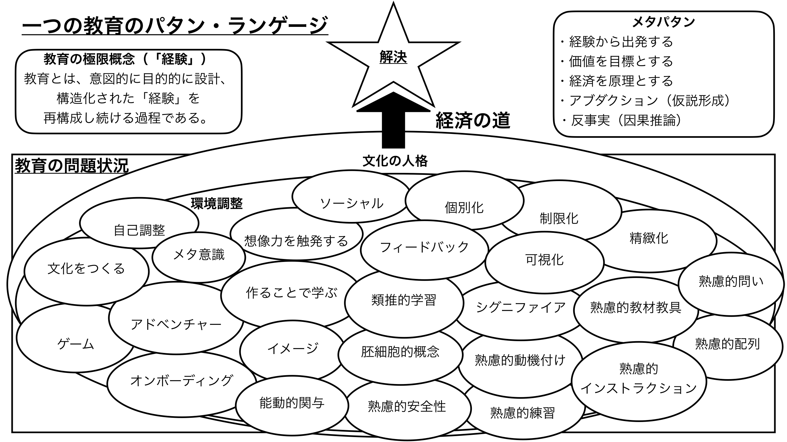

# 教育パタン・ランゲージ Wiki

<svg viewBox="0 0 2400 1350" preserveAspectRatio="none" style="position:absolute;top:0;left:0;width:100%;height:100%" role="group" aria-label="図解のパタンへのリンク">
<a data-no-popover="true" data-router-ignore href="./パタン/ソーシャル" aria-label="ソーシャル"><title>ソーシャル</title><ellipse cx="1070" cy="600" rx="180" ry="80"/></a>
<a data-no-popover="true" data-router-ignore href="./パタン/個別化" aria-label="個別化"><title>個別化</title><ellipse cx="1416" cy="614" rx="180" ry="90"/></a>
<a data-no-popover="true" data-router-ignore href="./パタン/制限化限定化" aria-label="制限化"><title>制限化</title><ellipse cx="1710" cy="648" rx="186" ry="96"/></a>
<a data-no-popover="true" data-router-ignore href="./パタン/精緻化" aria-label="精緻化"><title>精緻化</title><ellipse cx="1980" cy="732" rx="204" ry="96"/></a>
<a data-no-popover="true" data-router-ignore href="./パタン/自己調整" aria-label="自己調整"><title>自己調整</title><ellipse cx="424" cy="682" rx="180" ry="78"/></a>
<a data-no-popover="true" data-router-ignore href="./パタン/想像力（感情）を触発する" aria-label="想像力を触発する"><title>想像力を触発する</title><ellipse cx="902" cy="720" rx="202" ry="84"/></a>
<a data-no-popover="true" data-router-ignore href="./パタン/メタ意識" aria-label="メタ意識"><title>メタ意識</title><ellipse cx="606" cy="778" rx="142" ry="72"/></a>
<a data-no-popover="true" data-router-ignore href="./パタン/文化をつくる" aria-label="文化をつくる"><title>文化をつくる</title><ellipse cx="264" cy="828" rx="190" ry="102"/></a>
<a data-no-popover="true" data-router-ignore href="./パタン/フィードバック" aria-label="フィードバック"><title>フィードバック</title><ellipse cx="1294" cy="754" rx="194" ry="84"/></a>
<a data-no-popover="true" data-router-ignore href="./パタン/可視化" aria-label="可視化"><title>可視化</title><ellipse cx="1660" cy="790" rx="180" ry="96"/></a>
<a data-no-popover="true" data-router-ignore href="./パタン/作ることで学ぶ" aria-label="作ることで学ぶ"><title>作ることで学ぶ</title><ellipse cx="888" cy="894" rx="214" ry="96"/></a>
<a data-no-popover="true" data-router-ignore href="./パタン/シグニファイア" aria-label="シグニファイア"><title>シグニファイア</title><ellipse cx="1588" cy="938" rx="202" ry="96"/></a>
<a data-no-popover="true" data-router-ignore href="./パタン/熟慮的教材教具" aria-label="熟慮的教材教具"><title>熟慮的教材教具</title><ellipse cx="1938" cy="942" rx="186" ry="96"/></a>
<a data-no-popover="true" data-router-ignore href="./パタン/アドベンチャー" aria-label="アドベンチャー"><title>アドベンチャー</title><ellipse cx="535" cy="971" rx="204" ry="109"/></a>
<a data-no-popover="true" data-router-ignore href="./パタン/ゲーム" aria-label="ゲーム"><title>ゲーム</title><ellipse cx="228" cy="1033" rx="180" ry="107"/></a>
<a data-no-popover="true" data-router-ignore href="./パタン/類推的学習①" aria-label="類推的学習"><title>類推的学習</title><ellipse cx="1232" cy="922" rx="180" ry="102"/></a>
<a data-no-popover="true" data-router-ignore href="./パタン/イメージ" aria-label="イメージ"><title>イメージ</title><ellipse cx="892" cy="1062" rx="162" ry="84"/></a>
<a data-no-popover="true" data-router-ignore href="./パタン/キーコンセプト（胚細胞的概念）" aria-label="胚細胞的概念"><title>胚細胞的概念</title><ellipse cx="1220" cy="1072" rx="190" ry="84"/></a>
<a data-no-popover="true" data-router-ignore href="./パタン/熟慮的動機づけ" aria-label="熟慮的動機付け"><title>熟慮的動機付け</title><ellipse cx="1586" cy="1098" rx="190" ry="96"/></a>
<a data-no-popover="true" data-router-ignore href="./パタン/熟慮的配列" aria-label="熟慮的配列"><title>熟慮的配列</title><ellipse cx="2218" cy="1056" rx="168" ry="102"/></a>
<a data-no-popover="true" data-router-ignore href="./パタン/熟慮的問い" aria-label="熟慮的問い"><title>熟慮的問い</title><ellipse cx="2227" cy="860" rx="162" ry="90"/></a>
<a data-no-popover="true" data-router-ignore href="./パタン/オンボーディング" aria-label="オンボーディング"><title>オンボーディング</title><ellipse cx="554" cy="1162" rx="228" ry="90"/></a>
<a data-no-popover="true" data-router-ignore href="./パタン/能動的関与" aria-label="能動的関与"><title>能動的関与</title><ellipse cx="890" cy="1230" rx="170" ry="84"/></a>
<a data-no-popover="true" data-router-ignore href="./パタン/熟慮的安全性" aria-label="熟慮的安全性"><title>熟慮的安全性</title><ellipse cx="1242" cy="1242" rx="194" ry="90"/></a>
<a data-no-popover="true" data-router-ignore href="./パタン/熟慮的練習" aria-label="熟慮的練習"><title>熟慮的練習</title><ellipse cx="1594" cy="1258" rx="186" ry="84"/></a>
<a data-no-popover="true" data-router-ignore href="./パタン/熟慮的インストラクション" aria-label="熟慮的インストラクション"><title>熟慮的インストラクション</title><ellipse cx="1946" cy="1158" rx="204" ry="114"/></a>
<a data-no-popover="true" data-router-ignore href="./パタン/文化の人格" aria-label="文化の人格"><title>文化の人格</title><rect x="1098" y="466" width="216" height="54" rx="20"/></a>
<a data-no-popover="true" data-router-ignore href="./パタン/環境調整" aria-label="環境調整"><title>環境調整</title><rect x="576" y="596" width="174" height="54" rx="20"/></a>
<a data-no-popover="true" data-router-ignore href="./メタパタン/経済を原理とする" aria-label="解決（経済の道）"><title>解決（経済の道）</title><rect x="996" y="6" width="564" height="390" rx="20"/></a>
<a data-no-popover="true" data-router-ignore href="./メタパタン/極限概念と極限クライテリア" aria-label="教育の極限概念（経験）"><title>教育の極限概念（経験）</title><rect x="48" y="150" width="690" height="258" rx="20"/></a>
<a data-no-popover="true" data-router-ignore href="./メタパタン/経験から出発する" aria-label="経験から出発する"><title>経験から出発する</title><rect x="1704" y="102" width="384" height="54" rx="20"/></a>
<a data-no-popover="true" data-router-ignore href="./メタパタン/価値を目標とする" aria-label="価値を目標とする"><title>価値を目標とする</title><rect x="1704" y="162" width="384" height="54" rx="20"/></a>
<a data-no-popover="true" data-router-ignore href="./メタパタン/経済を原理とする" aria-label="経済を原理とする"><title>経済を原理とする</title><rect x="1704" y="222" width="384" height="54" rx="20"/></a>
<a data-no-popover="true" data-router-ignore href="./メタパタン/アブダクション（仮説形成）" aria-label="アブダクション（仮説形成）"><title>アブダクション（仮説形成）</title><rect x="1704" y="282" width="576" height="54" rx="20"/></a>
<a data-no-popover="true" data-router-ignore href="./メタパタン/反事実（因果推論）" aria-label="反事実（因果推論）"><title>反事実（因果推論）</title><rect x="1704" y="342" width="408" height="54" rx="20"/></a>
</svg>

*図解の楕円や枠を押すと、そのパタンのページが開きます。*

教育設計・授業実践・学習理論に関するパタン・ランゲージのアーカイブ。

> よい教育は、そこに働くパタンの圧縮として観察できる。

## 図解にある親パタン

上の図解に描かれているものを、図解と同じ名前で一つずつ並べる。楕円の26パタンは、使う場面ごとに四つに分けた。名前から探すときは [[パタン名インデックス|主要パタン名インデックス]] を使う。

### 図解の枠（教育の向き）

| 図解の要素 | 核心 |
| --- | --- |
| [[メタパタン/極限概念と極限クライテリア\|教育の極限概念（「経験」）]] | 教育とは、意図的に目的的に設計、構造化された「経験」を再構成し続ける過程である |
| [[メタパタン/経済を原理とする\|解決・経済の道]] | よいパタンは、最小の手段で最大の価値を生む |
| [[パタン/文化の人格]] | 自然の個性を文化的な人格へ育てる、教育の目的と軌道 |
| [[パタン/環境調整]] | 物的・社会的環境を意図的に設計する |
| [メタパタン（5つ）](#メタパタン) | 経験から出発する・価値を目標とする・経済を原理とする・アブダクション・反事実 |

### 文化・環境をつくる

| パタン | 核心 |
| --- | --- |
| [[パタン/ソーシャル]] | 社会的相互作用を学びの資源にする |
| [[パタン/個別化]] | 一人ひとりの状態に合わせて学習経験を調整する |
| [[パタン/文化をつくる]] | コミュニティと文化を意図的に育てる |
| [[パタン/心理的安全性（コンフォートゾーン）]] | 認められる経験が積み重なることで、ここは安全だという確信になる |

### 学習者の内側を育てる

| パタン | 核心 |
| --- | --- |
| [[パタン/自己調整]] | 学習者が自分の学びを見取り、調整する |
| [[パタン/メタ意識]] | 自分の学びや思考を一段高い視点から見る |
| [[パタン/想像力（感情）を触発する\|想像力を触発する]] | 感情と想像力に働きかけ、深い動機と理解を生む |
| [[パタン/イメージ]] | 具体的な像が学びの方向を支える |
| [[パタン/能動的関与]] | 学習者が自分から関わる状態をつくる |
| [[パタン/熟慮的動機づけ\|熟慮的動機付け]] | 学習者のやる気を意図的に設計する |

### 教材・活動を設計する

| パタン | 核心 |
| --- | --- |
| [[パタン/制限化限定化\|制限化]] | 制約を設けて、集中と創造性を生む |
| [[パタン/精緻化]] | 知識をつなぎ、使える理解へ深める |
| [[パタン/作ることで学ぶ]] | 制作・表現を通じて理解を深める |
| [[パタン/類推的学習①\|類推的学習]] | 既知の構造を使って未知の概念を理解する |
| [[パタン/シグニファイア]] | 行動や理解を導く知覚可能な手がかりを置く |
| [[パタン/熟慮的教材教具]] | 教材・教具を吟味して設計する |
| [[パタン/アドベンチャー]] | 冒険・挑戦・遊びを学習に組み込む |
| [[パタン/キーコンセプト（胚細胞的概念）\|胚細胞的概念]] | 背後の原理を小さな核として捉える |
| [[パタン/ゲーム]] | ルール・挑戦・フィードバックを学習に生かす——9ブロックフレームワーク（深田, 2012） |
| [[パタン/オンボーディング]] | 学習者を活動の土台に乗せる——最初の5分で価値を体験させる |

### 問い・指示・練習・フィードバックを設計する

| パタン | 核心 |
| --- | --- |
| [[パタン/熟慮的問い]] | 問いを目的・相手・方法・文脈から設計する |
| [[パタン/フィードバック]] | 学習の進み具合を伝え合う |
| [[パタン/可視化]] | 見えないものを見える形にする |
| [[パタン/熟慮的配列]] | 学習経験をどの順序で並べるかを設計する |
| [[パタン/熟慮的練習]] | 目標設定と内省を伴う練習を設計する |
| [[パタン/熟慮的インストラクション]] | 指示・説明をシステムとして設計する |

### 図解の親パタンに近いパタン

図解には描いていないが、図解の楕円のすぐ近くで働くパタン。「近い楕円」は、そのパタンが属する図解の親パタン。

| パタン | 近い楕円 | 核心 |
| --- | --- | --- |
| [[パタン/心理的安全性（コンフォートゾーン）]] | [[パタン/心理的安全性（コンフォートゾーン）]] | 安心して試し、間違えられる場をつくる |
| [[パタン/読み書きの文化]] | [[パタン/文化をつくる]] | 読み書きを民主主義を担う人を育てる基礎として文化にする |
| [[パタン/聴き合う文化]] | [[パタン/文化をつくる]] | 聴くことは話すことと同じくらい能動的な行為である |
| [[パタン/考える文化]] | [[パタン/文化をつくる]] | 全員の思考が毎日のあたりまえの経験として尊重・可視化される場をつくる |
| [[パタン/話し合う文化]] | [[パタン/文化をつくる]] | 話し合いを民主主義の基礎として学級文化の中心に置く |
| [[パタン/コミュニティをつくる]] | [[パタン/文化をつくる]] | 共感的・同僚的・同志的な三つの人間的交渉で学びの共同体を育てる |
| [[パタン/世界観]] | [[パタン/文化をつくる]] | 一貫したストーリー・価値観・雰囲気が「ここにいたい」という所属感を生む |
| [[パタン/チーム学習（Team Learning）]] | [[パタン/ソーシャル]] | 一緒に考える能力そのものを育てることが学習する学校の基盤になる |
| [[パタン/おもてなし]] | [[パタン/個別化]] | 学習者のゴール（深い動機）を先読みして準備し即応するマインドセット |
| [[パタン/1対1の面談]] | [[パタン/個別化]] | 一人ひとりへの言葉だけが、その人の核心に届く |
| [[パタン/内発的動機づけ]] | [[パタン/熟慮的動機づけ\|熟慮的動機付け]] | 「やらされる」でなく「やりたい」——内側から湧く動機づけ |
| [[パタン/自己選択自己決定]] | [[パタン/熟慮的動機づけ\|熟慮的動機付け]] | 「自分で決めた」という感覚が、やってみようという気持ちの根っこになる |
| [[パタン/形成的評価]] | [[パタン/フィードバック]] | 評価は学習を終わらせるためではなく学習を育てるためにある |
| [[パタン/再提出を許す（リトライ・サイクル）]] | [[パタン/フィードバック]] | フィードバックは「使う機会」があって初めて学習になる——評価を一回完結から循環に変える（Sadler, 1989; Wormeli, 2011） |
| [[パタン/待ち時間（問いのあとの3秒）]] | [[パタン/熟慮的問い]] | 問いのあと3秒待つ——沈黙が思考の質と参加の幅を変える（Rowe, 1974） |
| [[パタン/IRE型応答の脱却（Talk Move）]] | [[パタン/熟慮的問い]] | 対話を殺すのは悪い発問ではなく教師の第3ターンの「評価」——評価のかわりに思考を教室に返すTalk Moveへ組み替える（Chapin, O'Connor & Anderson, 2009） |
| [[パタン/幸福（教育目的としての幸福）]] | [[パタン/文化の人格]] | 父母が子に望むことを率直に言わせれば「幸福な生活」以外の何物でもない |
| [[パタン/問題の系列が足場を担う（一変数変化の連鎖）]] | [[パタン/熟慮的配列]] | 問題を「一度に一箇所だけ変わる系列」として設計する——前の問題が次の問題の足場になり、外部足場なしに難度が上がれる（戸田城外, 1930; 桝田尚之, 2006） |
| [[パタン/変化オペレータの系列設計（喜びのグレードアップ）]] | [[パタン/熟慮的配列]] | 変化の「種別（オペレータ）」を意図して設計する——同・逆・＋α・質的変化・複合の5種を順序立てて配列すると「同じなのに違う」感覚が育ち、考える喜びがグレードアップする（戸田城外, 1930; 桝田尚之, 2006） |
| [[パタン/型から自由創作へ（閉じた練習の開口部）]] | [[パタン/熟慮的配列]] | 系列の末尾に「同じ型を使って自分の問題・作品を作る」段階を組み込む——型練習（守）→制約付き作問→自由創作の3段階で「閉じた練習」を「開いた創作」につなぐ（戸田城外, 1930; Sawyer, 2006） |
| [[パタン/同等点と差異点の均衡設計（学習の駆動エンジン）]] | [[パタン/類推的学習①\|類推的学習]] | 1つの事例に「既知との同等点（安心）」と「新しい差異点（発見）」を意図的に同居させる——同等点が安心感を、差異点が探究動機を担い、どちらが欠けても学習は駆動しない（戸田城外, 1930; 桝田尚之, 2006） |
| [[パタン/解説を先に渡さない（自得の設計）]] | [[パタン/熟慮的問い]] | ヒントは「解き方」でなく「どの先行問題と比べるか」の指さしに留め、必要に応じて3層フェードインで開示する——自得の経路を残すヒント設計（戸田城外, 1930; 桝田尚之, 2006） |
| [[パタン/つまずきを構造で記録する（診断の粒度設計）]] | [[パタン/フィードバック]] | 正答率ではなく「どの変化種別で詰まったか」を記録する——「逆が弱い」「質的変化で迷う」という構造的な見取りが補充設計に直結する（戸田城外, 1930; 岩井輝久, 2026） |
| [[パタン/補充機構の常設化（匡救設計）]] | [[パタン/フィードバック]] | 補充は思いやりでなく設計として存在させる——つまずきの発見・補充系列提案・教師の判断の3ステップを常設し、誰が担当しても最低限の補充が機能する底支えをつくる（戸田城外「匡救」, 1930; 岩井輝久, 2026） |

## まず読むなら

初めてきた人は、目的に近い道筋を上から順にたどる。

**理論から深める**  
[パタン・ランゲージ概論](./概念/パタン・ランゲージ概論) → [メタパタン](./メタパタン/) → [概念](./概念/)

**教育を設計する**  
[図解にある親パタン](#図解にある親パタン) → [熟慮的配列](./パタン/熟慮的配列) → [類推的学習](./パタン/類推的学習①) → [オンボーディングなど](./パタン/オンボーディング)

**今日の教育に使う**  
[実践から探す](./実践/) → [教材から探す](./教材/) → [困りごとから探す](./困りごとから探す) → [目標から探す](./目標から探す)

## Wikiの地図

| 入口                        | こんな時に使う                                       |
| --------------------------- | ---------------------------------------------------- |
| [パタン](./パタン/)         | 授業設計・指導・学級づくりの具体的な型を探す         |
| [概念](./概念/)             | パタンの背景にある理論・哲学・教育思想を確認する     |
| [実践](./実践/)             | 具体的な授業・指導の記録から考える                   |
| [特別支援](./特別支援/)     | 特別支援教育の実践と理論をつなげて見る               |
| [教科](./教科/)             | 算数・国語など教科別のアイデアを見る                 |
| [算数](./教科/算数)         | ナンバートーク、数学ワークショップ、算数教材から探す |
| [教材](./教材/)             | 授業で使う道具・ワークシート・ゲーム教材を探す       |
| [文献](./文献)              | 参考文献・動画記録・研究メモをたどる                 |
| [メタパタン](./メタパタン/) | パタンを発見・検証・使い続ける原理を確認する         |

## 初めての人へ

- [[初めての人へ]] — このWikiの読み方と、目的別の最短ルート
- [[まず覚える30パタン]] — 授業設計で最初に思い出す第一軍のパタン
- [[パタン組み合わせ例]] — 複数パタンを授業レシピとして重ねる
- [[授業設計テンプレート]] — パタンを授業案へ変換する作業台
- [[授業設計テンプレート記入例：カエルの算数]] — 算数の記入例
- [[授業設計テンプレート記入例：文学討論グループ]] — 国語・読書会の記入例
- [[授業後リフレクションテンプレート]] — 授業後に働いたパタンを記録する
- [[近いパタンの違い]] — 似ているパタンを見分ける入口
- [[自分のパタンを作る]] — 自分の経験から教育のパタン・ランゲージを育てる入口
- [[パタンの親子関係]] — 大パタンから小パタンへたどる体系地図
- [[Obsidian同期の運用方針]] — ObsidianとQuartzの同期ルール
- [[検索のための別名・表記ゆれ]] — 英語名・別表記・旧名から探す入口
- [[このWikiについて]] — このWikiの位置づけと編集方針

## 実践・教材から探す

授業準備中にすぐ使うなら、実践と教材の棚から入る。

| 入口                                                                | 何を探せるか                                                             |
| ------------------------------------------------------------------- | ------------------------------------------------------------------------ |
| [実践](./実践/)                                                     | 国語・算数・特別支援など、具体的な授業実践を教科・領域別に探す           |
| [教材](./教材/)                                                     | 授業で使う道具・ワークシート・ゲーム教材を用途別に探す                   |
| [読書の道具棚](./教材/読書の道具棚)                                 | 付箋、読書目標、読書記録、振り返りなどを探す                             |
| [読書会の道具棚](./教材/読書会の道具棚)                             | ブッククラブや読書会で使う質問・付箋・書き出しの道具を探す               |
| [書くことの道具棚](./教材/書くことの道具棚)                         | 詩・俳句・物語などを書く活動の足場を探す                                 |
| [算数の道具棚](./教材/算数の道具棚)                                 | 算数ゲーム、良問・課題、語彙辞典、数学ジャーナル、学習チームの道具を探す |
| [算数シンキング・タスク集索引](./教材/算数シンキング・タスク集索引) | 136問の算数タスクを、学年・領域・目的から先に選ぶ                        |

## メタパタン

パタンを発見・検証・使い続けるための根本原理。

| メタパタン                                | 核心                                                   |
| ----------------------------------------- | ------------------------------------------------------ |
| [[メタパタン/経験から出発する]]           | 私たちのあらゆる認識は経験とともに始まる               |
| [[メタパタン/価値を目標とする]]           | パタンの目的は価値の実現にある                         |
| [[メタパタン/経済を原理とする]]           | よいパタンは、最小の手段で最大の価値を生む             |
| [[メタパタン/アブダクション（仮説形成）]] | 驚くべき事実から、最もよい説明仮説を立てる             |
| [[メタパタン/反事実（因果推論）]]         | 「もしなかったら」と問うことで、パタンの因果を確かめる |
| [[メタパタン/極限概念と極限クライテリア]] | 経験・価値・経済の三極限概念の相互依存と圏論的定式化（draft） |

## 文献・実践から統合したパタン

文献や実践を読んで統合したパタンを、出典ごとにまとめる。図解の親パタンを使うときに、裏づけや下位のパタンをたどる場所。

### 読みに困難のある小学生への支援（Neitzel ほか 2022 より統合）

**Neitzel ほか（2022）より：** 読みに困難のある幼稚園〜5年生の65研究（厳しい条件）。一対一 +0.41 が少人数 +0.24 より大きい（算数とは逆）。教師・支援員・報酬のあるボランティアは同じくらい、報酬のないボランティアは小さい。協同学習と音の読みの学級全体の指導 +0.31。コンピュータ +0.09。

| 文献 | 核心 |
| --- | --- |
| [[文献/読みに困難のある小学生への支援の効き方を確かめる（Neitzelほか2022）]] | 読みは一対一が大きい。指導者は教師でも支援員でもよい。続く仕組みのないボランティアは小さい |

### 中高生への毎日の個別指導（Guryan ほか 2023 より統合）

**Guryan ほか（2023）より：** シカゴの9・10年生の二つの大規模な無作為化比較。毎日1時限、指導者一人に生徒二人の数学の個別指導で、数学のテストが 0.16〜0.37 SD 伸び、11年生でも残った。指導者は教員免許のない大学新卒者など。効いたのは数学の指導の中身で、大人との親しさなどは変わらなかった。

| 文献 | 核心 |
| --- | --- |
| [[文献/中高生でも遅くないことを、毎日の二人一組の数学の個別指導で確かめる（Guryanほか2023）]] | 中高生でも遅くない。毎日・二人・決まった流れ・頻繁な確かめ。1人あたり年約3,800ドル |

### 小学校の算数で効いたプログラム（Pellegrini ほか 2021 より統合）

**Pellegrini ほか（2021）より：** 幼稚園〜5年生の算数の87研究（厳しい条件）。個別指導 +0.20（少人数 +0.30）と、学級の組織と経営の研修 +0.19 が効き、内容の研修 +0.03・教材の入れ替え +0.05・到達度テスト 0.00 はほぼ効かない。デジタル教材はゼロに近い。

| 文献 | 核心 |
| --- | --- |
| [[文献/小学校の算数で効いたプログラムの種類を確かめる（Pellegriniほか2021）]] | 少人数の個別指導 +0.30・一対一 +0.19。チームで助け合う仕組み +0.19。内容の研修 +0.03 |

### 自分についての信念と学力（Valentine ほか 2004 より統合）

**Valentine ほか（2004）より：** 縦断研究60集団のメタ分析。前の学力をそろえても、自分についての信念はのちの学力を小さく予測した（0.08）。学業についての信念（0.13）が、全般的な信念（0.07）より大きい。教科を合わせると大きくなる。

| 文献 | 核心 |
| --- | --- |
| [[文献/自分についての信念が、のちの学力を予測するかを、縦断研究から確かめる（Valentineほか2004）]] | 効くのは「勉強ができる」という自己像で、効果は小さい |

### 自己概念と学力の論争（Núñez-Regueiro ほか 2025 より統合）

**Núñez-Regueiro ほか（2025）より：** 「教科の自己概念が次の年の学力を高める」という矢印への統計の批判に対し、唱えてきた側が元のデータで再分析した。別のモデルでも効果は残った。観察データの論争で、批判そのものは未読。

| 文献 | 核心 |
| --- | --- |
| [[文献/自己概念が学力を伸ばすという矢印は、統計の批判に耐えるかを確かめる（Núñez-Regueiroほか2025）]] | 自己概念→学力の矢印は、批判を受けつつ保たれている |

### 熟達化の逆転（Kalyuga 2018 より統合）

**Kalyuga（2018）より：** 知識の少ない学習者に効く手厚い支えが、知識の多い学習者には効かなくなり、ときに妨げになる。学習者の今の知識を見取り、支えを調整する仕組みが要る。

| 文献 | 核心 |
| --- | --- |
| [[文献/初学者に効く手立てが、知っている学習者には効かなくなる「熟達化の逆転」を確かめる（Kalyuga2018）]] | 同じ手立てを、全員にずっと続けない |

### 待ち時間の原典（Rowe 1972 より統合）

**Rowe（1972）より：** 小学校の理科の授業で、教師は問いのあと平均1秒、答えのあと平均0.9秒しか待っていなかった。3秒以上待てるようになると、答えが長くなり、推論や子どもの問いが増えた。学会発表の原稿で、比べる組はない。

| 文献 | 核心 |
| --- | --- |
| [[文献/問いのあと、答えのあとに教師が3秒以上待つと、子どもの答えと考え方は変わるかを、小学校の理科の授業の録音から確かめる（Rowe1972）]] | 問いのあとと答えのあとに3秒待つ。「いいね」やくり返しで引き取らない。練習の2〜3週めの迷いを越える |

### 教師と子どもの対話の特徴（Howe ほか 2019 より統合）

**Howe ほか（2019）より：** 多くの子が互いの考えを受けて話す学級でだけ、前の発言を広げるやりとりと問い返すやりとりが、学年末の学力と結びついた。理由を言い求めるやりとりは結びつかなかった。小学6年生72学級の観察研究。

| 文献 | 核心 |
| --- | --- |
| [[文献/教師と子どものやりとりで、考えを広げることと問い返すことが、多くの子どもが参加する中で起きると、学力は高いかを、72学級の授業で確かめる（Howeほか2019）]] | 前の子の考えに重ねる・問い返すことを、多くの子の参加の中で行う。教師はすぐに評価しない |

### 直すための自己評価（Andrade 2019 より統合）

**Andrade（2019）より：** 自己評価は、直すための手がかりを自分でつくること。直す機会があり、規準とやり方の練習で支えるときに役立つ。成績のための自己評価は外の評価と合いにくい。76の研究の見直し。

| 文献 | 核心 |
| --- | --- |
| [[文献/自己評価を、点をつけることではなく、直すための手がかりを自分でつくることとして使うと効くかを、76の研究から見直す（Andrade2019）]] | 自己評価のあとに直す時間をとる。規準を具体的にし、作品の中の証拠を指し示す。自己評価を成績に入れない |

### 反駁文で誤解を正す（Danielson ほか 2025 より統合）

**Danielson ほか（2025）より：** よくある誤解を書き、誤りだと言い、正しい考えを説明する文章は、ふつうの文章より誤解を正す（76の研究のメタ分析、g = 0.37）。主に大学生で、小学生の研究は少ない。著者らは、文章だけでなく話し合いの出発点として使うよう勧める。

| 文献 | 核心 |
| --- | --- |
| [[文献/よくある誤解を書いて打ち消し、正しい説明を添える文章は、ふつうの説明文より誤解を正すかを、76の研究から確かめる（Danielsonほか2025）]] | 誤解を一度はっきり示し、打ち消し、正しい考えを理由とともに示す。読んで終わりにせず話し合う |

### 一度に頭に置いておける量の限界（Cowan 2010 より統合）

**Cowan（2010）より：** 頭の中に一度に置いておけるのは、若い大人で3〜5個のまとまりまで。単純な材料で、7歳は約1.5個と大人の半分ほどだった。実験室の研究の総説。

| 文献 | 核心 |
| --- | --- |
| [[文献/頭の中に一度に置いておけるのは3〜5個のまとまりまでで、幼い子どもはもっと少ないことを、記憶の実験から整理する（Cowan2010）]] | 一度に示す新しいことを少なくする。合わせて考える情報は頭の外（板書・ノート）に置く |

### 近い小さな目標（Bandura と Schunk 1981 より統合）

**Bandura と Schunk（1981）より：** 引き算がとても苦手な小学生が、「毎回6ページ」というその日に届く目標で自習を進めると、遠い目標や目標なしより、できるという見通し・力・興味がそろって伸びた。小学生40人の無作為化比較。

| 文献 | 核心 |
| --- | --- |
| [[文献/苦手な引き算を、その日に届く小さな目標で進めると、できる見通しと力と興味がそろって育つかを確かめる（BanduraとSchunk1981）]] | 最初の一歩を、その日のうちに届く大きさにする。目標は提案として出し、決めるのは子どもにする |

### 透明な課題設計（Winkelmes ほか 2016 より統合）

**Winkelmes ほか（2016）より：** 課題の目的・やること・評価の規準を、取りかかる前に学生と話す。米国の少数派の学生が多い7大学の1年生で、自信と所属感の自己評定が上がり、家族で初めて大学に進んだ学生で伸びが大きかった。大学協会の機関誌の報告。

| 文献 | 核心 |
| --- | --- |
| [[文献/課題の目的・やること・評価の規準をはっきり示すと、大学1年生、とくに家族で初めて大学に進んだ学生の自信と所属感は伸びるかを確かめる（Winkelmesほか2016）]] | 課題を出す前に、目的・やること・規準の3つを話す。説明つきの作品例を見せる |

### 理科の大きな考え（Harlen 編 2015 より統合）

**Harlen 編（2015）より：** 理科の目標を14の「大きな考え」に絞り、選ぶ4つの基準と、小学校から高校までの育ち方を示す。大きな考えは直接教えず、小さな考えをつなげて育てる。専門家の合意による提案。

| 文献 | 核心 |
| --- | --- |
| [[文献/理科で学ぶ「大きな考え」を14に絞り、選ぶ基準と、小学校から高校までの育ち方を示す（Harlen編2015）]] | 単元の核を4つの基準で点検する。各段階では大きな考えに向かって少し進めばよい。見せかけの探究に気をつける |

### 閾値概念と立ち往生（Meyer と Land 2005 より統合）

**Meyer と Land（2005）より：** 教科には、通ると見え方が一変し、忘れにくく、つながりを見せる「閾値概念」がある。その手前では、どっちつかずの時期に分かったふりや立ち往生が起きやすい。大学の科目の例による理論の提案。

| 文献 | 核心 |
| --- | --- |
| [[文献/通ると見え方が一変する「閾値概念」と、その手前で学ぶ人が立ち往生するところを、教える人のための枠組みに整理する（MeyerとLand2005）]] | 単元の閾値を見つける。日常のことばの意味が教科の意味をじゃましていないかを見る。単純な最初の版で止まらないようにする |

### 共感的な生徒指導の考え方（Okonofua ほか 2016 より統合）

**Okonofua ほか（2016）より：** 罰でなく、生徒の気持ちを理解し関係を保つ指導の考え方を、短いオンライン教材で教師に伝えると、受け持ちの生徒の1年間の停学率が約半分になった。教師31人の無作為の比較。

| 文献 | 核心 |
| --- | --- |
| [[文献/罰ではなく、生徒の気持ちを理解し関係を保つ生徒指導の考え方を教師に伝えると、停学は減るかを確かめる（Okonofuaほか2016）]] | 指導はするが、関係は切らない。問題行動の前に理由を尋ねる。教師を「直される人」でなく専門家として扱う研修 |

### 解き方の例と手引きを減らす順序（Sweller ほか 2019 より統合）

**Sweller ほか（2019）より：** 新しく複雑な内容では、初学者は解き方の例から学ぶほうがよいが、知識が増えると例は逆効果にもなる。例 → 一部を空けた問題 → ふつうの問題と、手引きを減らす。理論の提唱者による20年の見直し。

| 文献 | 核心 |
| --- | --- |
| [[文献/頭の中で一度に扱える量の限界から教え方を組み立てる認知負荷理論の20年を、理論をつくった3人が整理する（Swellerほか2019）]] | 手引きの量を、内容の複雑さと学習者の熟達で変える。図と説明を離さない。同じことを二重に示さない |

### 学びの段階に合わせた学び方の方略（Hattie と Donoghue 2016 より統合）

**Hattie と Donoghue（2016）より：** 228のメタ分析を、表層・深層・転移の段階に振り分けると、同じ学び方でも、どの段階で使うかで効き方が変わった。メタ統合と、推測として出されたモデル。

| 文献 | 核心 |
| --- | --- |
| [[文献/学び方の方略は、学びのどの段階で使うかで効き方が変わるかを、228のメタ分析から整理する（HattieとDonoghue2016）]] | まず考えを持ち、それから関係づける。達成規準を先に示す。応用の前に、前の問題との似たところと違うところを見る |

### 感情と学び・記憶（Tyng ほか 2017 より統合）

**Tyng ほか（2017）より：** 感情をともなう内容は注意をとらえ、覚えられやすい。ただし効果は一方向ではなく、強く長いストレスは学びを妨げる。大人の実験室の研究が中心の、脳の研究の見直し。

| 文献 | 核心 |
| --- | --- |
| [[文献/感情は、学ぶことと覚えることにどう効くのかを、脳の研究から整理する（Tyngほか2017）]] | 驚きと好奇心で注意を学ぶ中身に向ける。緊張は軽く短く。教科の学習で確かめた研究は少ない |

### 能動的な授業と学んだ実感のずれ（Deslauriers ほか 2019 より統合）

**Deslauriers ほか（2019）より：** 同じ教材で、解答の前に小グループで解いてみる授業と講義を、大学生を無作為に分けて比べると、能動的な授業のほうが多く学んでいたのに、学んだ実感は小さかった。授業直後の測定だけの研究。

| 文献 | 核心 |
| --- | --- |
| [[文献/能動的な授業では、学生は多く学んでいるのに、学んだ実感は小さくなるかを、同じ教材で無作為に分けて確かめる（Deslauriersほか2019）]] | 「分かった気がする」と「分かった」は逆を向くことがある。考える苦労の価値を前もって伝え、早めに実際の学びを見えるようにする |

### 数を一直線に並べたすごろく（Ramani ほか 2012 より統合）

**Ramani ほか（2012）より：** 1〜10の数を一直線に並べたすごろくを、数を声に出しながら小グループで遊ぶと、低所得の家庭の幼児の数直線の見積もりと数字の読みが伸びた。1時間の研修だけの補助の先生が遊んでも伸びた。遊んだ直後の測定だけの研究。

| 文献 | 核心 |
| --- | --- |
| [[文献/数を一直線に並べたすごろくを、教室の小グループで補助の先生と遊ぶと、幼児の数の力は伸びるかを確かめる（Ramaniほか2012）]] | 一直線の盤で、数を言いながら進む。手助けは子どもの力に合わせて強さを変え、だんだん減らす |

### 算数の具体物を効かせる四つの原則（Laski ほか 2015 より統合）

**Laski ほか（2015）より：** 具体物は、同じ物を長く使い、具体から抽象へ薄め、飾りのない物を選び、物と概念の関係を言葉と身ぶりで説明するときに効く、という認知科学からの四つの原則。モンテッソーリの教具を例に示す。原則の提案で、組み合わせた効果は確かめられていない。

| 文献 | 核心 |
| --- | --- |
| [[文献/算数の具体物は、どう使えば効くのかを、認知科学の四つの原則とモンテッソーリ教育の教具から考える（Laskiほか2015）]] | 具体物は概念そのものではなく、概念を表す物。何を表すかを読み取るには導きが要る |

### メタ認知を教科の中で教える（Perry ほか 2019 より統合）

**Perry ほか（2019）より：** 学校でメタ認知を教える研究51本の見直し。教科の中に組み込み、ねらいを説明し、長く続けることを条件に挙げる。幸福感への効果は、教室での研究がほとんどない。

| 文献 | 核心 |
| --- | --- |
| [[文献/学校でメタ認知を教えると、学力と幸福感はどう変わるかを、51の研究の見直しから考える（Perryほか2019）]] | メタ認知は特別な時間ではなく、教科の中で、ねらいを伝えて、長く |

### 一つの活動の長さと授業の形態（Godwin ほか 2016 より統合）

**Godwin ほか（2016）より：** 米国の幼稚園〜4年生の52学級の観察で、一つの活動が長いほど子どもが課題に向かう割合が下がり、学級全体の活動では教室の掲示に気が散りやすかった。観察研究で、学びの成果は測っていない。

| 文献 | 核心 |
| --- | --- |
| [[文献/小学生が授業から離れるのは、どんな形態の授業で、どのくらいの長さの活動のときかを、52の学級で観察して確かめる（Godwinほか2016）]] | 活動は10分ほどのまとまりで。学級全体の活動のときは、教室の前面をすっきりと |

### 学ぶ内容をゲームの中心に組み込む（Habgood と Ainsworth 2011 より統合）

**Habgood と Ainsworth（2011）より：** 割り算をゲームの中心の動きに組み込むと、ゲームの合間にクイズを出す版より、子どもは2週間後によく覚えていて、自由に選べるときは7倍以上長く遊んだ。一つの学校の少人数の研究。

| 文献 | 核心 |
| --- | --- |
| [[文献/学ぶ内容をゲームの中心の動きに組み込むと、子どもはよく学び、長く遊ぶかを、割り算のゲームで確かめる（HabgoodとAinsworth2011）]] | 勉強のごほうびにゲームを使わず、学ぶ内容を遊びの中心に置く |

### 理科で子どもが自分で描く（Ainsworth ほか 2011 より統合）

**Ainsworth ほか（2011）より：** 理科の授業では、子どもは他人の図を読み取るばかりで、自分で描いて考えることは少ない。描くことを読む・書く・話すと並ぶ学び方にすべき五つの理由を示した論説。効果を新しく確かめたものではない。

| 文献 | 核心 |
| --- | --- |
| [[文献/子どもが自分で描くことを、読む・書く・話すと並ぶ理科の学び方にすべき五つの理由を示す（Ainsworthほか2011）]] | 何を描き、何を描かないかを選ぶことが、考えることになる |

### 人格と社会性を育てる学校全体の取り組み（Berkowitz ほか 2016 より統合）

**Berkowitz ほか（2016）より：** 人格を育てる研究を集めた八つのレビューから、42の手立てを六つの原則（優先・関係・内からの動機・手本・力を渡す・発達に沿った教え方）にまとめた。もっとも多く挙がったのは学校全体の文化。効果の大きさは比べられない。

| 文献 | 核心 |
| --- | --- |
| [[文献/学校で人格と社会性を育てる実践を、八つのレビューから六つの原則と42の手立てにまとめる（Berkowitzほか2016）]] | 行動をかたちづくるより、人を育てる。手立ては束で働く |

### 胚細胞のモデルで教科をつなぐ授業（Hedegaard 2020 より統合）

**Hedegaard（2020）より：** デンマークの3〜5年生の学級で、胚細胞のモデルを手がかりに生物・地理・歴史を3年かけてつなぎ、子どもの「ふしぎ」と教科の概念のあいだを行き来して教えた設計実験の報告。結果のデータはこの論文にはない。

| 文献 | 核心 |
| --- | --- |
| [[文献/胚細胞のモデルで小学校の生物・地理・歴史をつなぎ、子どもの関心と教科の概念のあいだを行き来して教える（Hedegaard2020）]] | 子どものふしぎ → 胚細胞に導かれた分析 → 子どもの理解に戻る（二重の動き） |

### ルーブリックとお手本のフィードバック（Peltzer ほか 2024 より統合）

**Peltzer ほか（2024）より：** 意見文の下書きに、要素ごとのルーブリックと短いお手本を返すと、書き込みのコメントの約半分の手間で、書く力とジャンルの知識が大きく伸びた。両方を重ねても、伸びは大きくならなかった。ただし組どうしの差の多くは有意に届いていない。

| 文献 | 核心 |
| --- | --- |
| [[文献/意見文へのフィードバックを、書き込みのコメントにするか、ルーブリックとお手本にするかで、書く力の伸びは変わるかを、無作為に分けて確かめる（Peltzerほか2024）]] | 要素ごとの表とお手本を返す。フィードバックは足しすぎない |

### チームの心理的安全性（Edmondson 1999 より統合）

**Edmondson（1999）より：** 職場の51のチームで、失敗しても責められないとメンバーが共有して思えるチームほど、質問・助けを求める・失敗を話すといった学ぶ行動が多く、学ぶ行動を通して成果の評価と結びついた。一時点の調査で、因果は示せない。

| 文献 | 核心 |
| --- | --- |
| [[文献/失敗しても責められないとチームで思えることは、質問や失敗の話し合いなどの学ぶ行動と結びつくかを、51の職場のチームで確かめる（Edmondson1999）]] | 心理的安全性は、甘さではなく、発言しても恥をかかない・拒まれない・罰せられないという共有の確信 |

### 能力で分けない数学の学級（Boaler と Staples 2008 より統合）

**Boaler と Staples（2008）より：** 米国の都市部の高校の数学科が、能力で分けない学級と複雑指導を数年続けると、2年目に比べた二校を上回り、民族の間の差もほとんど消えた。ただし三校を目的に沿って選んだ比較で、どの実践が効いたかは分けられず、公の批判もある。

| 文献 | 核心 |
| --- | --- |
| [[文献/能力で分けない数学の学級で、学科全体が一つの教え方を続けると、生徒の学びと格差はどう変わるかを、三つの高校を追って確かめる（BoalerとStaples2008）]] | 成功する道が多ければ、成功する生徒も多くなる。カリキュラムは仕組みの一部分にすぎない |

### プロジェクト型の学習（Saavedra ほか 2021 より統合）

**Saavedra ほか（2021）より：** 高校の AP の授業を、研修つきでプロジェクト型に変えると、1年目の AP の試験で合格の点をとる生徒が約4ポイント多くなった。ただし学校の脱落が多く、効果ははじめの違いの補正に左右される。生徒は「プロジェクト疲れ」も感じていた。

| 文献 | 核心 |
| --- | --- |
| [[文献/高校のAPの授業をプロジェクト型に変えると、試験の成績は上がるかを、学校を無作為に分けて確かめる（Saavedraほか2021）]] | はじめにプロジェクトで関わり、そのあとで読む・聞く。教師一人で始めない |

### ルーブリック（Panadero ほか 2023 より統合）

**Panadero ほか（2023）より：** 評価の観点と質の段階を示すルーブリックを学習者が使うと、成績は中くらい伸びた（g = 0.57、補正して 0.45）。自己調整と自己効力感への効果は小さく、研究も少ない。観点や段階の数は効果と関係がなかった。

| 文献 | 核心 |
| --- | --- |
| [[文献/ルーブリックを使うと、成績・自己調整・自己効力感はどのくらい変わるかを、23の研究から確かめる（Panaderoほか2023）]] | 効くかどうかより、どんな条件で効くか。課題の前に渡し、自己評価で使う |

### 学んだことを自分で作り変える八つの方法（Fiorella と Mayer 2016 より統合）

**Fiorella と Mayer（2016）より：** 要約・図に組む・絵をかく・想像・自分でテスト・自己説明・教える・動作で表す、の八つは、効果の中央値がどれも d = 0.40 以上だった。ただし、だれに効くか、どんな手引きが要るかは方法ごとに違う。効果の示された方法を選んだ総説である。

| 文献 | 核心 |
| --- | --- |
| [[文献/学んだことを自分で作り変える八つの学び方は、だれに・どんな条件で効くかを整理する（FiorellaとMayer2016）]] | 一つの方法をいちばんとせず、内容の形と前の知識で方法を選ぶ |

### 類推に添える支え（Richland ほか 2007 より統合）

**Richland ほか（2007）より：** 米国・香港・日本の中学2年生の数学の授業ビデオでは、どの国も類推をたくさん使っていたが、よく知っている「もと」・見える形・位置や身ぶりで対応を示す、といった支えは、米国がすべて少なかった。教師の行動の観察で、子どもの学びは測っていない。

| 文献 | 核心 |
| --- | --- |
| [[文献/数学の授業で類推を使うとき、教師がどんな支えを添えているかを、米国・香港・日本の授業ビデオで比べる（Richlandほか2007）]] | 類推は「もと」を板書に残し、対応を位置と身ぶりで示す |

### 10の学習方法の有用性（Dunlosky ほか 2013 を全部読み直して更新）

**Dunlosky ほか（2013）より：** 学習者が自分で使える10の方法のうち、練習のテストと分散学習は有用性「高」、精緻化の質問・自己説明・交互練習は「中」、要約・ハイライト・キーワード記憶法・頭に絵を描くこと・読み返しは「低」。「中」の方法は、前の知識・時間・教材・並べ方の条件つきで効く。

| 文献 | 核心 |
| --- | --- |
| [[文献/学習方法の効果と適用条件（Dunloskyほか2013）]] | 「なぜ」を問うのは前の知識があるところから。新しい種類はまずそれだけで練習し、あとでまぜる |

### 二つの事例を比べる（Gentner ほか 2003 より統合）

**Gentner ほか（2003）より：** 同じ原理の二つの事例を、一つずつ読むのでなく比べると、見かけの違う新しい場面で原理を使える人が倍以上になった。ただし学習者は、並べられても自分からは比べない。大学生の交渉の学習の実験である。

| 文献 | 核心 |
| --- | --- |
| [[文献/二つの事例を一つずつ読むのではなく比べると、共通の原理がつかめて新しい場面で使えるかを、三つの実験で確かめる（Gentnerほか2003）]] | 二つの事例を並べ、似ているところをはっきり問う |

### 注意の向け先を示す手がかり（Xie ほか 2017 より統合）

**Xie ほか（2017）より：** 文と絵を使う教材に、矢印・色分けなどの手がかりを足した32の実験をまとめると、覚えることと使うことが小〜中くらい伸び、頭の負担の感じ方はわずかに減った。多くは大学生の研究である。

| 文献 | 核心 |
| --- | --- |
| [[文献/図や文に注意の向け先を示す手がかりが、負担を減らし、覚えることと使うことを助けるかを、32の研究から確かめる（Xieほか2017）]] | いま説明している部分を指し示すと、覚えることと使うことを助ける |

### 選択肢の数（Scheibehenne ほか 2010 より統合）

**Scheibehenne ほか（2010）より：** 選択肢の数を実験で変えた50の実験をまとめると、選択肢が多いと選ぶ気持ちや満足が下がるという効果は、平均するとほぼゼロだった。詳しい人は多いほうがよかった。起きうる条件は一つの研究ずつでしか示されていない。

| 文献 | 核心 |
| --- | --- |
| [[文献/選択肢が多すぎると選べなくなるのかを、50の実験から確かめる（Scheibehenneほか2010）]] | 絞れば必ずよくなるわけではない。並べ方と選ぶ人の詳しさを見る |

### 子どものころの自制心（Moffitt ほか 2011 より統合）

**Moffitt ほか（2011）より：** ニュージーランドの一つの都市で生まれた子ども全員を32歳まで追うと、子どものころの自制心が低いほど、大人の健康・経済状況・犯罪の問題が多く、その関係は全体にわたるなだらかな勾配だった。観察の研究で、取り組みの効果ではない。

| 文献 | 核心 |
| --- | --- |
| [[文献/子どものころの自制心が、32歳の健康・経済状況・犯罪を予測するかを、生まれた子ども全員の追跡から確かめる（Moffittほか2011）]] | 自制心は、一部の子どもでなく全員の課題である（観察） |

### 抽象を形づくる対話（Ozmantar と Monaghan 2007 より統合）

**Ozmantar と Monaghan（2007）より：** 二人の高校生が絶対値のグラフに取り組んだ記録では、新しい抽象は、例の共通点ではなく、すでに抽象化していた知識をつなぎ直すことから生まれた。聞き手は、不確かさを減らし、注意を導き、小さな目標を立てた。一組の質的な事例である。

| 文献 | 核心 |
| --- | --- |
| [[文献/共通点を集めるのではなく、既に知っていることをつなぎ直して抽象をつくる過程を、二人の生徒の対話から描く（OzmantarとMonaghan2007）]] | 抽象は、既習の構造をつなぎ直す具体への上向として生まれる（質的研究） |

### 胚細胞と逆向き設計（Engeström 2020、McTighe と Seif より統合）

**Engeström（2020）と McTighe・Seif より：** 胚細胞は、もっとも小さな単位で、内に矛盾をはらみ、ありふれていて、多くに広がり、行為として先にある。核となる概念を先に決める逆向き設計については、作者自身が「直接の因果の証拠はまだない」と書いている。

| 文献 | 核心 |
| --- | --- |
| [[文献/胚細胞から具体へ上向する学びを、学校の外の三つの研究から描く（Engeström2020）]] | 胚細胞の5つの性質は、単元の核を選ぶ基準の候補になる（理論） |
| [[文献/逆向き設計が学力を伸ばすという根拠を、作者自身のまとめから確かめる（McTigheとSeif・McTighe2025）]] | 逆向き設計そのものの効果は、独立した研究ではまだ確かめられていない |

### 学級経営の方略とプログラム（Korpershoek ほか 2016 より統合）

**Korpershoek ほか（2016）より：** 小学校で学級全体に行う学級経営の54の取り組みをまとめると、行動・社会性と情動・学力を小さく確かに高めた（全体 0.22）。子どもの社会性と情動の発達に焦点を当てたものがよく効いた。

| 文献 | 核心 |
| --- | --- |
| [[文献/学級経営の方略とプログラムは、学力・行動・情緒・意欲をどのくらい変えるかを54の取り組みから確かめる（Korpershoekほか2016）]] | 学級経営は効くが、単純な解決はない。社会性と情動の学習と一組にする |

### 学び方を教えた効果の長さ（de Boer ほか 2018 より統合）

**de Boer ほか（2018）より：** メタ認知の方略を教えた1〜8年生の48の取り組みをまとめると、学力への効果は直後 0.50、平均21.6週後に 0.63 で、教え終えたあとも残った。くり返し覚える方略だけでは残りにくかった。

| 文献 | 核心 |
| --- | --- |
| [[文献/学び方の方略を教えた効果は、教え終えたあとも残るかを48の取り組みから確かめる（deBoerほか2018）]] | 学び方を教えた効果は、教え終えたあとも残る |

### ゲームの要素を学習に入れる（Sailer と Homner 2020 より統合）

**Sailer と Homner（2020）より：** ゲーミフィケーションの40実験をまとめると、知識 0.49・意欲 0.36・行動 0.25 の効果があったが、方法のしっかりした研究で残ったのは知識だけだった。競争だけより、協力しながら競う形がよかった。

| 文献 | 核心 |
| --- | --- |
| [[文献/学習にゲームの要素を入れると、知識・意欲・行動はどのくらい変わるかを確かめる（SailerとHomner2020）]] | ゲーム化は知識に効く。競うなら協力と組み合わせる |

### 物語の形と記憶・理解（Mar ほか 2021 より統合）

**Mar ほか（2021）より：** 物語文と説明文を比べた37の実験研究をまとめると、物語のほうが覚えやすく分かりやすかった（g = 0.55）。中身をそろえた研究は少なく、物語の形が効くのか、なじみのある中身が効くのかはまだ分けられていない。

| 文献 | 核心 |
| --- | --- |
| [[文献/物語の形で読むと、説明の形より覚えやすく分かりやすいかを、37の研究から確かめる（Marほか2021）]] | 物語は覚えやすいが、すべてを物語にしてよいわけではない |

### 例題の段階に目的の見出しを添える（Margulieux ほか 2020 より統合）

**Margulieux ほか（2020）より：** 大学の初級プログラミングで、例題の各段階に「何のための段階か」の見出しを添えると、習いたての小テストがよくでき、やめる学生と不合格の学生がほぼ半分になった。試験の平均には差がなかった。準実験で、子どもではない。

| 文献 | 核心 |
| --- | --- |
| [[文献/例題の各段階に「何のための段階か」を書き添えると、つまずきやすい学生がやめずに続けられるかを確かめる（Margulieuxほか2020）]] | 段階の名前は、つまずきやすい学習者を途中で離さない足場になる |

### 社会性と情動の学習の新しい証拠（Cipriano ほか 2023 より統合）

**Cipriano ほか（2023）より：** 幼稚園から12年生までの424の実験研究をまとめると、学校で全員に行う SEL は、学校の雰囲気・技能・友だちとの関係を小さく確かに改善し、問題行動と情緒の苦しさを減らした。感情の技能を先に教える順序で効果が大きかった。出版前の原稿で読んだ。

| 文献 | 核心 |
| --- | --- |
| [[文献/学校で全員に行う社会性と情動の学習は、何をどのくらい伸ばすかを424の研究から確かめる（Ciprianoほか2023）]] | 効果は小さいが広い。いちばん変わるのは学校の雰囲気 |

### 自分から学ぶ意欲の筋道（Bureau ほか 2022 より統合）

**Bureau ほか（2022）より：** 小学生から大学生までの144標本のメタ分析で、教師の自律性への支援は、自律・有能・関係の欲求が満たされることを通して、自分から学ぶ意欲と結びついていた。意欲をいちばん強く予測したのは有能感。相関の研究で因果は言えない。

| 文献 | 核心 |
| --- | --- |
| [[文献/自分から学ぶ意欲は、教師の自律性への支援と、三つの欲求の満たされ方から生まれるかを、144の標本から確かめる（Bureauほか2022）]] | 他律から自律へは、教師の支援と「できる」という手ごたえから |

### 制約と創造性（Acar ほか 2019 より統合）

**Acar ほか（2019）より：** 組織の創造性の研究145本を整理すると、制約（時間・材料・手順・作るものの指定）は少なすぎても多すぎてもよくないという逆U字の枠組みが描けた。制約が「管理」と受けとられると早く逆効果になる。組織の研究で、子どもは対象外。

| 文献 | 核心 |
| --- | --- |
| [[文献/制約は創造性を妨げるのか、引き出すのかを、分野をまたいで整理する（Acarほか2019）]] | 鍵は制約をなくすことではなく、ちょうどよい量にすること |

### 学校への所属感（Korpershoek ほか 2020 より統合）

**Korpershoek ほか（2020）より：** 中学・高校段階の82の相関研究をまとめると、学校への所属感は、関与・自己効力感・習熟を目指す目標と中程度に、学力と小さく正に、欠席・中退と負に結びついていた。因果は言えない。

| 文献 | 核心 |
| --- | --- |
| [[文献/学校への所属感が、意欲・自己像・行動・学力とどのくらい結びつくかを82の研究から確かめる（Korpershoekほか2020）]] | 所属感は、学校生活の多くの面と結びつく。いちばん小さいのは学力 |

### 間違いを受けとめる学級の雰囲気（Dresel ほか 2024 より統合）

**Dresel ほか（2024）より：** ドイツの算数・数学の69学級を5〜6年生の2年間追うと、間違いから学ぶ反応は平均して下がり、子どもが「間違いを受けとめる雰囲気」とみる学級ほど下がり方が小さかった。観察研究で、因果は言えない。

| 文献 | 核心 |
| --- | --- |
| [[文献/間違いを受けとめる学級の雰囲気と、間違いから学ぶ力の2年間の変化を確かめる（Dreselほか2024）]] | 間違いを受けとめる雰囲気は、間違いから学ぶ力が下がるのを和らげうる |

### 何を変え、何を変えないか（Kullberg ほか 2017 より統合）

**Kullberg ほか（2017）より：** 変化の理論では、気づかせたい面を変わらない背景の上で変えると気づきやすく、対比→一般化→融合の順で意味が育つ。1人の教師の授業の例の分析で、子どもの学びは測っていない。

| 文献 | 核心 |
| --- | --- |
| [[文献/何を変え、何を変えずに見せるかで、学べることが変わるかを確かめる（Kullbergほか2017）]] | 同じ単元でも、何を変え何を変えないかで学べることが変わる |

### 好奇心と記憶（Gruber ほか 2014 より統合）

**Gruber ほか（2014）より：** 大人の実験で、知りたいと思った雑学の問いの答えは、1日後にもよく思い出された。答えを待つあいだに見た関係のない顔の記憶も少し上がった。子どもや教室では確かめていない。

| 文献 | 核心 |
| --- | --- |
| [[文献/知りたい気持ちが高まっているとき、答えもそのとき見たものも覚えやすいかを確かめる（Gruberほか2014）]] | 知りたい状態は、答えとそのとき出会ったものの記憶を助ける |

### 子どもが問題を作る（Rosli ほか 2014 より統合）

**Rosli ほか（2014）より：** 作問の効果を13の研究からまとめたメタ分析。学力・問題を解く力・作る問題の水準・態度のすべてで大きな効果が報告されたが、研究は少なく、3〜12年生の学力では 0.81 だった。

| 文献 | 核心 |
| --- | --- |
| [[文献/子どもが算数の問題を自分で作ると、何が伸びるかを13の研究から確かめる（Rosliほか2014）]] | 作問は益がありうる。ただし効果の大きさは不確か |

### 見える思考の原則と教室の例（Ritchhart と Perkins 2008 より統合）

**Ritchhart と Perkins（2008）より：** プロジェクト・ゼロの「見える思考」の六つの原則と、「どうしてそう言えるの？」と返して答えを記録する1年生の教室の例。教師向けの雑誌の解説で、効果の数値は載っていない。

| 文献 | 核心 |
| --- | --- |
| [[文献/思考ルーチンと記録で、考えを見える形にする（RitchhartとPerkins2008）]] | 外に出して記録すると、思考をふり返り、よくできる（実践の解説） |

### 大学の講義と思考ルーチン（Ramos-Vallecillo ほか 2024 より統合）

**Ramos-Vallecillo ほか（2024）より：** 教員養成課程の大学2年生237人の講義で思考ルーチンを使うと、自発的な参加が増え、よく参加した学生は実習と課題の点が高かった。理論の試験には差がなく、比べたのは参加した学生としなかった学生である。

| 文献 | 核心 |
| --- | --- |
| [[文献/大学の講義に思考ルーチンを入れると、学生の参加と成績はどう変わるかを確かめる（Ramos-Vallecilloほか2024）]] | 参加の入口は増える。試験の成績までは言えない |

### 思考を見える形にする学級（Ritchhart ほか 2009 より統合）

**Ritchhart ほか（2009）より：** プロジェクト・ゼロ自身の研究。思考を見える形にする学級で1年過ごした3〜11年生239人は、「考えるとき頭の中で何が起きているか」を方略として書く割合が増えた。比べる群はなく、著者は測り方の開発が目的だとする。

| 文献 | 核心 |
| --- | --- |
| [[文献/思考を見える形にする学級で1年過ごすと、子どもの「考えること」のとらえ方が変わるかを確かめる（Ritchhartほか2009）]] | 考えることのとらえ方は育つ。ただし比べる群のない前後比較 |

### 身振りと学びの保持（Cook ほか 2008 より統合）

**Cook ほか（2008）より：** 3・4年生84人の実験で、身振りをしながら学んだ子は、4週間後も直後の伸びの85%を保ち、言葉だけの子は33%だった。授業の直後には差がなかった。

| 文献 | 核心 |
| --- | --- |
| [[文献/身振りをしながら学ぶと、学んだことが4週間後も残るかを確かめる（Cookほか2008）]] | 直後には同じでも、手で表した学びは残る |

### 本物らしい具体物の得と損（McNeil ほか 2009 より統合）

**McNeil ほか（2009）より：** 4〜6年生がお金の文章題を本物そっくりのお金で解くと、正答が減った。簡素なお金では減らなかった。ただし本物そっくりのほうが、問題の意味を取り違える間違いは少なかった。

| 文献 | 核心 |
| --- | --- |
| [[文献/本物そっくりのお金を使うと、算数の文章題の成績はどう変わるかを確かめる（McNeilほか2009）]] | 意味の場面では本物らしく、手続きの場面では簡素に |

### 描いて覚える（Wammes ほか 2016 より統合）

**Wammes ほか（2016）より：** 大学生の7つの実験で、単語を絵に描くと、書き写すより2倍以上思い出された。思い浮かべる、絵を見る、特徴を書き出すより有利で、1語4秒でも残った。

| 文献 | 核心 |
| --- | --- |
| [[文献/書き写すより絵に描くと、あとで思い出しやすいかを、7つの実験で確かめる（Wammesほか2016）]] | 描くと、意味・見た目・手の動きが一つの記憶になる |

### 子どもが描く図（Tolsberg ほか 2022 より統合）

**Tolsberg ほか（2022）より：** 2年生・4年生に、物の絵と関係を表す図の違いを教え、いろいろな教科で練習すると、算数の文章題で関係を表す図を描く子が増えた。ただし、図を描くだけで解けるようになるとは限らない。

| 文献 | 核心 |
| --- | --- |
| [[文献/小学生に、算数の文章題で関係を表す図を描く方法を教えると、何が変わるかを確かめる（Tolsbergほか2022）]] | 関係を表す図は、教えれば低学年でも描ける |

### 自然の中での学び（Mann ほか 2022 より統合）

**Mann ほか（2022）より：** 自然の中での学びの147研究の系統的レビュー。近くの自然の中で行う教科の授業は、学力の伸びは教室と同じで、意欲と関わりを高めた研究があった。冒険教育の研究は学力をほとんど測っていない。

| 文献 | 核心 |
| --- | --- |
| [[文献/自然の中で学ぶと、子どもの学力と育ちに何が起きるかを、147の研究から確かめる（Mannほか2022）]] | 自然の中の授業は、学力を下げずに関わりを高めうる |

### 感情に働きかけるデザイン（Brom ほか 2018 より統合）

**Brom ほか（2018）より：** 図の中の物に顔をつける、心地よい色を使うといった、情報を増やさない工夫は、学び（0.32〜0.39）と内発的な意欲（0.26）を上げた。関係のない飾りを足す誘惑的な細部とは別物。

| 文献 | 核心 |
| --- | --- |
| [[文献/教材の絵に顔をつけ、心地よい色を使うと、学びと意欲は上がるかを確かめる（Bromほか2018）]] | 飾るなら、学ぶ対象そのものを心地よく |

### 誘惑的な細部のメタ分析（Sundararajan 2018 より統合）

**Sundararajan（2018）より：** 54研究のメタ分析。関係のない面白い情報を足すと、直後の学びが下がった（g = −0.43、偏りの大きい研究を除くと −0.28）。文と絵など二つの形で見せると悪影響が約2倍。

| 文献 | 核心 |
| --- | --- |
| [[文献/面白いが関係のない絵や話が学びを下げる効果を、54の研究から確かめる（Sundararajan2018）]] | 飾りは最小限に。入れるなら一つの形で、本文から離す |

### 誘惑的な細部（Kienitz ほか 2023 より統合）

**Kienitz ほか（2023）より：** 学ぶ内容と関係のない面白い写真や話を教材に足すと、学んだことの再生が下がった。「試験に関係ない」と伝えると差は消えた。学習者が飾りを大事なものと思い込むことが原因とする。

| 文献 | 核心 |
| --- | --- |
| [[文献/面白いが関係のない絵や話が学びを下げるのはなぜか、どうすれば防げるかを確かめる（Kienitzほか2023）]] | 飾りは、関係のあるものに絞るか、関係ないと伝える |

### 実物から記号へ（Fyfe・Nathan 2019 より統合）

**Fyfe・Nathan（2019）より：** 実物→絵や図→記号と、同じ概念を少しずつ抽象に移す「具体性の漸減」を、六つの仮説に整理した総説。抽象に向かう順が逆の順より効くことは暫定的な原則、三段階と二段階の比較などは未検証。

| 文献 | 核心 |
| --- | --- |
| [[文献/実物から図、図から記号へと薄めていく教え方を、確かめるべき仮説に整理する（FyfeとNathan2019）]] | 順序が効く。ただし多くはまだ仮説 |

### 先行オーガナイザー（Luiten ほか 1979 より統合）

**Luiten ほか（1979）より：** 135研究のメタ分析。先行オーガナイザーの直後の効果は 0.21 と小さめ。数学で小さく（0.10）、社会科学で大きい（0.34）。力の高い学習者のほうが効き、口頭で示す型が文章より大きい。

| 文献 | 核心 |
| --- | --- |
| [[文献/先行オーガナイザーの効果を、135の研究から確かめる（Luitenほか1979）]] | 先に枠組みを示す効果は小さめで、教科と示し方で変わる |

### 身振りと学び（Goldin-Meadow ほか 2009・Novack・Goldin-Meadow 2015 より統合）

**Goldin-Meadow ほか（2009）・Novack・Goldin-Meadow（2015）より：** 算数の解き方を表す身振りを子ども自身がすると、身振りの中の解き方を授業後に言葉にし、よく解けた（3・4年生128人の実験）。教師は言葉と同時に身振りを示すとよい。

| 文献 | 核心 |
| --- | --- |
| [[文献/子どもが手で身振りをすると、算数の新しい考えが生まれるかを確かめる（Goldin-Meadowほか2009・NovackとGoldin-Meadow2015）]] | 手は、言葉より先に考えを表し、考えを生む |

### 自己概念と学力（Baumeister ほか 2003・Marsh ほか 2018 より統合）

**Baumeister ほか（2003）・Marsh ほか（2018）より：** 全般的な自尊感情は成績をほとんど予測せず、高める手立ても成績を上げなかった。一方、教科の自己概念と学力は、互いに小さく影響し合う（数学の自己概念→次の年の成績 0.07）。学力の高い集団に入ると自己概念は下がる。

| 文献 | 核心 |
| --- | --- |
| [[文献/自尊感情を高めると成績は上がるのかを確かめる（Baumeisterほか2003）]] | 自尊感情は成績の原因というより結果 |
| [[文献/算数の自己概念と学力が、6年間で互いにどう影響し合うかを確かめる（Marshほか2018）]] | 教科の自己概念と学力は互いに小さく影響し合う |

### 冒険教育のメタ分析（Hattie ほか 1997 より統合）

**Hattie ほか（1997）より：** 96研究のメタ分析。直後の効果 0.34、追跡でさらに 0.17。参加の前後の差で、参加者の75%は大人、学校の野外教育は除外。直接の学力への効果は、学力をねらったプログラムから来ている。

| 文献 | 核心 |
| --- | --- |
| [[文献/冒険教育とアウトワード・バウンドの効果を、96の研究から確かめる（Hattieほか1997）]] | 効くのは一部のプログラムの、一部の成果だけ |

### 屋外での定期的な授業（Becker ほか 2017 より統合）

**Becker ほか（2017）より：** 学校の授業を定期的に屋外で行う取り組みの13研究の系統的レビュー。多くは事例研究で、学力テストで比べる群と比べた研究は1つ（読み・書きが高く、算数は報告なし）。

| 文献 | 核心 |
| --- | --- |
| [[文献/学校の授業を定期的に屋外で行うと、学びや人間関係に何が起きるかを確かめる（Beckerほか2017）]] | 屋外の授業の学力への効果は、まだ傾向の段階 |

### 冒険の学びの実験（Willis・Reaney-Wood 2026 より統合）

**Willis・Reaney-Wood（2026）より：** 英国97校で合宿型と校内型の冒険の学びを偶然で割り当てた。自己調整は直後に伸びたが8か月後には消え、行動の困難は減った。活動のあとにつなぐ計画がどの学校でも乏しかった。

| 文献 | 核心 |
| --- | --- |
| [[文献/合宿型と校内型の冒険の学びを、偶然で割り当てて比べる（英国の実験、WillisとReaney-Wood2026）]] | 冒険の学びは出発点で、つなぐ計画が要る |

### 年度はじめの学級経営（Emmer ほか 1979・Evertson 1988 より統合）

**Emmer ほか（1979）・Evertson（1988）より：** 1年の運営がうまくいった教師は、最初の3週間に手順を必要な分だけ、例・理由・練習をそえて教えていた（観察研究）。始業前の研修を偶然で割り当てた実験では、研修を受けた学級で課題から離れる子が少なかった（約3%対約12%）。

| 文献 | 核心 |
| --- | --- |
| [[文献/年度はじめの3週間に手順を教えることが、1年の学級を左右するかを確かめる（Emmerほか1979・Evertson1988）]] | 手順は伝えるのでなく教える。最初の3週間が1年を見通す |

### 図と文の対応を示す手がかり（Richter 2016 より統合）

**Richter（2016）より：** 図と文の対応を色分けや指し示しで示す手がかりは、前の知識の少ない学習者に効き（r = 0.19）、前の知識の多い学習者では効かないか、かえって妨げになった（メタ分析45比較＋8年生127人の学校での実験）。

| 文献 | 核心 |
| --- | --- |
| [[文献/図と文の対応を示す手がかりが、だれに効き、だれの邪魔になるかを確かめる（Richter2016）]] | 印は初学者を助け、知っている子には回り道 |

### 教室の物理的な環境と伸び（Barrett ほか 2015 より統合）

**Barrett ほか（2015）より：** 英国の小学校153学級で、光・温度・空気・自分たちの教室の工夫・柔軟さ・視覚的な複雑さ・色が子どもの伸びと関わった。掲示や配置の刺激は中くらいのときだけよい。学校ごとより教室ごとの違いが大きい。観察研究。

| 文献 | 核心 |
| --- | --- |
| [[文献/教室の光・空気・掲示・色が、子どもの伸びとどう関わるかを確かめる（Barrettほか2015）]] | 見せるほどよいのではなく、ほどよい刺激 |

### 日本の冒険教育の効果（張本・向後 2023 より統合）

**張本・向後（2023）より：** 日本の冒険教育の113研究をメタ分析。参加前後の変化は 0.55（ばらつき大）、外れ値を除くと 0.36。日数・プログラム・年齢による差は認められず、1泊2日と日帰りでは有意な変化なし。多くは比べる群のない前後比較。

| 文献 | 核心 |
| --- | --- |
| [[文献/日本の冒険教育の効果を、113の研究から確かめる（張本・向後2023）]] | 前後の変化は確かにあるが、比べる群のない研究が多い |

### デジタルゲームの設計と効き方（Clark ほか 2016 より統合）

**Clark ほか（2016）より：** ゲームはふだんの授業より 0.33 学びを伸ばしたが、効き方は設計で変わった。何回かに分けて遊ぶ、一人で競わない、教師が手助けする形が効き、凝った見た目や物語は効果を小さくした。

| 文献 | 核心 |
| --- | --- |
| [[文献/デジタルゲームの学びの効果が、ゲームの設計でどう変わるかを確かめる（Clarkほか2016）]] | 媒体と同じくらい、設計が効く |

### 概念地図の効き方（Nesbit と Adesope 2006・Schroeder ほか 2018 より統合）

**二つのメタ分析より：** 概念地図は、作ると 0.72、見て学ぶと 0.43。ただし講義と比べると大きく、要約や文章を書く活動と比べると小さい。教師の作った地図は言葉の力の低い学習者に効く。2006年の期間・学年の結果は、研究を増やすと再現されなかった。

| 文献 | 核心 |
| --- | --- |
| [[文献/概念地図を作る・見ることの効き方を、比べた相手と学習者で確かめる（NesbitとAdesope2006）]] | 効き方は比べた相手と言葉の力で変わる |
| [[文献/概念地図のメタ分析を研究を増やして確かめ直す（Schroederほか2018）]] | 作る・見るとも効くが、前の調整要因の結果の一部は再現されず |

### 効くはずの手立てを学校で効かせる（英国 EEF の実装の手引き 2024 より統合）

**英国 EEF の実装の手引き（2024）より：** 厳密な評価のほとんどは、いつものやり方と比べて効果をほとんど示さない。研究の場と自分の場の似かたを問い、核になる要素を変えずに試す。学校全体の取り組みには少なくとも2年かかり、取り組みは減らして丁寧に。

| 文献 | 核心 |
| --- | --- |
| [[文献/効くはずの手立てを学校で効かせる実装の手順を確かめる（英国EEF2024）]] | 何を選ぶかと、どう実行するかの両方。良いのにばらついているなら、まずそろえる |

### 保護者と協力する手立て（英国 EEF 2018 より統合）

**英国 EEF の保護者の指針（2018）より：** 保護者の関わりは子どもの成果と結びつくが、学校がそれを変えて学びを伸ばした根拠はまだ少ない。効くのは、その子に合わせた具体的で前向きな連絡、本に支えを添えた家庭での読み聞かせ、宿題の習慣づくりの支え。対象のしぼり方を誤ると、手厚いプログラムも効かない。

| 文献 | 核心 |
| --- | --- |
| [[文献/保護者と協力する手立てが、どの家庭・どの条件で効いたかを確かめる（英国EEF2018）]] | 一般的なお知らせより、その子の具体的な数を、責めない言葉で |

### よい行動ゲームはなぜ英国で効かなかったか（Humphrey ほか 2018 より統合）

**Humphrey ほか（2018）より：** 英国の小学校77校の無作為化比較で、読みにも行動にも効果がなかった。比べる側の教師も日頃から決まり・見守り・ご褒美を使っており、違いが小さかった。手順どおりに行ったかは成果と結びつかず、子どもの反応だけが結びついた。行動上の問題の危うさがあった男子には効く傾向があった。

| 文献 | 核心 |
| --- | --- |
| [[文献/よい行動ゲームが英国の学級で効かなかった理由を確かめる（Humphreyほか2018）]] | 新しい手立ての効果は、いつものやり方との違いの大きさで決まる |

### 学校での行動の手立て（英国 EEF 2019 より統合）

**英国 EEF の行動の指針（2019）より：** 子どもを知る、学び方の行動を教える、学級経営、簡単な日課、個に応じた手立て、一貫性の六つの勧め。学級経営の研修は荒れの多い学級でとくに効く。ほめる仕組みだけのプログラムは EEF の試行で再現されなかった。どの手立てを選ぶかより、一貫して実行することが大事。

| 文献 | 核心 |
| --- | --- |
| [[文献/学校での行動の手立てが、どの学級・どの子に効いたかを確かめる（英国EEF2019）]] | 同じ対応が子によって逆に働く。手立ての選択より一貫した実行 |

### 特別な支援の要る子への手立ての根拠の強さ（SEND のエビデンス・レビュー 2020 より統合）

**Cullen ほか（2020）より：** 通常の学校で SEND のある子を支える12の問いごとに、体系的レビューから根拠の強さを判断。教室の中の手立て（質の高い授業・行動への対応・介入の選び方・支援員の配置）は「高」、見取りの段階的なやり方・保護者との協力・管理職の役割は「低」。インクルーシブな方針が SEND のある子の学力に与える効果は空白。

| 文献 | 核心 |
| --- | --- |
| [[文献/特別な支援の要る子への手立ての根拠の強さを、問いごとに確かめる（SENDのエビデンス・レビュー2020）]] | 根拠が強いのは教室の中。介入は自分の場に合うかを確かめて選ぶ |

### 支援員の配置を変えても学力は伸びなかった（MITA の評価 2021 より統合）

**Dimova ほか（2021）より：** 支援員の指針の考え方を学校全体で実行するプログラムを128校で無作為化比較。支援員の配置と子どもの授業への参加は変わったが、読みの学力は伸びず（効果量 0.00）、SEND のある子にも追加の効果はなかった。教師が支援の要る子と過ごす時間は増えていなかった。

| 文献 | 核心 |
| --- | --- |
| [[文献/支援員の配置を学校全体で変えても学力は伸びなかったことを確かめる（MITAの評価2021）]] | 支援員を離すだけでは、教師から教わる時間は増えない |

### 5〜7歳の読み書きの指導（英国 EEF 2020 より統合）

**英国 EEF の5〜7歳の読み書きの指針（2020）より：** 話す・聞く力、文字の読み解きと理解のつり合い、体系的なフォニックス、読解と書くことの方略、書字と綴り、見取り、構造化された介入の八つの勧め。取り出す指導が学級の授業より効かなければ、差はかえって広がる。英語の綴りは不規則なので、かなにはそのまま当てはめない。

| 文献 | 核心 |
| --- | --- |
| [[文献/5〜7歳の読み書きの指導を研究から整える（英国EEF2020）]] | 読み解きと理解はどちらも要り、どちらか一方では足りない。かろうじて届いた子も見る |

### 支援員の配置で効き方が逆になる（英国 EEF 2018 より統合）

**英国 EEF の支援員の指針（2018）より：** 日常の支援員の手厚い支えを受けた子ほど伸びが小さく、学級の授業・教師・仲間から切り離されていた。研修を受けた支援員が決まった手順の短い介入を行うと効果量 0.2〜0.3。効果を分けるのは支援員ではなく、校長と教師の配置の判断。

| 文献 | 核心 |
| --- | --- |
| [[文献/支援員の手厚い支えが、かえって子どもを授業から切り離すことを確かめる（英国EEF2018）]] | 支援員は教師の代わりではなく、教師の授業を補う。まず最も少ない助けから |

### 通常の学級で特別な支援の要る子を支える（英国 EEF 2020 より統合）

**英国 EEF（2020）より：** SEND のある子への質の高い授業は、柔軟な集団編成・認知とメタ認知の方略・明示的な指導・テクノロジー・足場かけという、多くの教師がすでに持つ手立てでできる。取り出しの介入は慎重に選び、学級の授業とつなぐ。支援員の手厚い支えは、かえって学級の授業や仲間から子どもを切り離すことがある。

| 文献 | 核心 |
| --- | --- |
| [[文献/通常の学級で特別な支援の要る子を支える五つの勧め（英国EEF2020）]] | 診断名より「この子に何が要るか」。取り出しと支援員は、学級の授業を補うときに効く |

### 音素の意識とフォニックスの指導（全米読書委員会 2000 第2章より統合）

**全米読書委員会（2000）の第2章より：** 音素の意識の指導は読みに 0.53、フォニックスの指導は 0.44。文字を使い、操作を絞り、少人数で行う音素の意識の指導が大きく効いた。フォニックスは幼稚園・1年生で効果が大きく、2年生以上の読解には効きにくかった。どちらも手段であって読みの指導の全体ではない。英語の研究なので、日本語のかなにそのまま当てはめない。

| 文献 | 核心 |
| --- | --- |
| [[文献/音素の意識とフォニックスの指導が、だれにどんな条件で効いたかを確かめる（全米読書委員会2000）]] | 文字を使い、絞って、早く。ただし手段であって目的ではない |

### くり返し音読と自由に読む時間（全米読書委員会 2000 第3章より統合）

**全米読書委員会（2000）の第3章より：** 導きやフィードバックを受けながら同じ文章をくり返し声に出して読む手立ては、16研究で効果量 0.41（語の読み 0.55、流暢さ 0.44、読解 0.35）。自由に読む時間を促す手立ては、研究が少なく作りも弱く、効果はまだ示されていないとされた。読むだけでなく面談や話し合いと組み合わせると少し伸びた研究がある。

| 文献 | 核心 |
| --- | --- |
| [[文献/くり返し音読と、自由に読む時間を促すことの効き方を確かめる（全米読書委員会2000流暢さ）]] | 導かれたくり返し音読は効く。自由に読む時間は「効かない」でなく「まだ示されていない」 |

### 子ども同士で教え合う読みの学習が効かなかった子（McMaster ほか 2007 より統合）

**McMaster ほか（2007）より：** 上位と下位の二人組で役割を交代して読む PALS は、成績の高低や障害の有無を問わず効いたとされる一方、成績の低い子の約20%、障害のある子の半分以上には効かなかった。伸びない子に PALS を続けても手直ししても多くは変わらず、一対一の指導でも半分は伸びなかった。

| 文献 | 核心 |
| --- | --- |
| [[文献/子ども同士で教え合う読みの学習（PALS）が、だれに効かなかったかを確かめる（McMasterほか2007）]] | 教え合いは多くの子に効くが全員ではない。伸びない子を早く見つけて別の手を |

### 教室の話し合いを変える研修で学力は伸びるか（EEF の対話的な授業の評価 2017 より統合）

**EEF の評価（2017）より：** Alexander の対話的な授業を、イングランドの小学校76校の無作為化比較で確かめた。録画・録音と指導役との振り返りで教師の話し方を変え、英語と理科で小さな効果、給食費の補助を受ける子の算数で効果が出た。教師の多くは2学期では定着しきらないと感じていた。

| 文献 | 核心 |
| --- | --- |
| [[文献/教室の話し合いを変える研修で、子どもの学力が伸びるかを確かめる（EEFの対話的な授業の評価2017）]] | 話し方は録って聞き返すと変わる。学力への効果は小さく、時間がかかる |

### 授業観察による評価で、教師はその後も伸びるか（Taylor と Tyler 2012 より統合）

**Taylor と Tyler（2012）より：** シンシナティの中堅の教師が、同僚の評価者によるルーブリックでの授業観察を1年受けた。評価の後の年に受け持った子の算数の点は 0.11 SD 高く、評価の点が低かった教師ほど伸びた。読みには効果がなかった。評価は、教師の技能への投資として働きうる。

| 文献 | 核心 |
| --- | --- |
| [[文献/授業観察による1年間の評価を受けた中堅の教師は、その後も伸びるかを確かめる（TaylorとTyler2012）]] | 段階を言葉にした物差しで何度も見て返すと、評価の後も伸びる |

### 黒人の教師に一人でも教わると、卒業と進学は（Gershenson ほか 2022 より統合）

**Gershenson ほか（2022）より：** STAR 実験で、低学年に黒人の教師に一人でも無作為に当たった黒人の子は、大学への進学が6ポイント高かった（主に2年制）。白人の子には効果がなかった。ノースカロライナ州でも同じ向きで、恵まれない黒人の男子で大きく、性別まで重なると強まった。短い期間の点の効果からは予想できない形があった。

| 文献 | 核心 |
| --- | --- |
| [[文献/低学年で黒人の教師に一人でも教わると、黒人の子の卒業と進学が変わるかを確かめる（Gershensonほか2022）]] | 長い期間の効果は、短い期間の点からは予想できない |

### 点を上げる教師と、行動をよくする教師（Jackson 2018 より統合）

**Jackson（2018）より：** ノースカロライナ州の高校の9年生の教師について、点への効果と、欠席・停学・成績・進級への効果を推定した。二つの相関は弱く、行動への効果は点への効果とは別に高校の卒業を予測した。著者は、点以外の指標は操作できるので、そのまま教師の評価に使うのは賢明でないとする。

| 文献 | 核心 |
| --- | --- |
| [[文献/点を上げる教師と、欠席・停学・成績・進級をよくする教師は同じかを確かめる（Jackson2018）]] | 点だけで教師を測ると、卒業に効く力を見落とす |

### 幼稚園の学級は大人になってからに表れるか（Chetty ほか 2011 より統合）

**Chetty ほか（2011）より：** STAR 実験の子どもを税の記録で27歳まで追った。小さな学級の子は大学に通う割合が高く、よい学級に当たった子は収入が高かった。学級の良さの点への効果は4年生までに消えたが、進学と収入にまた表れた。その間をつなぐものとして、教師が評価した努力・自発性などの非認知的な力が挙げられている。

| 文献 | 核心 |
| --- | --- |
| [[文献/幼稚園の学級が、大人になってからの進学と収入に表れるかを確かめる（Chettyほか2011）]] | 点では消えても、大人になってまた表れる |

### 自分と同じ人種の教師に教わると（Dee 2004 より統合）

**Dee（2004）より：** テネシー州の学級の人数の実験では、教師も無作為に割り付けられていた。同じ人種の教師に1年教わると、黒人の子も白人の子も算数と読みが百分位で3〜4ポイント高く、年数とともに積み上がった。効果はふつうの人数の学級と経験の浅い教師のもとに集まった。なぜ効くのかは分けられず、著者は人種で分ける方向に読むことを戒めている。

| 文献 | 核心 |
| --- | --- |
| [[文献/自分と同じ人種の教師に教わると点が上がるかを、無作為の割り付けで確かめる（Dee2004）]] | 子どもと教師の関係は学力に表れうる。理由はまだわからない |

### 学級の人数を減らすと、だれがいつ伸びるか（Krueger 1999 より統合）

**Krueger（1999）より：** テネシー州の学級の人数の無作為化比較（幼稚園〜3年生、80校）を読み直した。小さな学級（13〜17人）の子は 0.19〜0.28 SD 高く、効果の大部分は最初の年に現れた。黒人の子と都市の中心部の学校の子で効果が大きかった。学校ごとの効果は大きくばらつき、3分の1の学校では負だった。

| 文献 | 核心 |
| --- | --- |
| [[文献/学級の人数を減らすと、だれがいつ伸びるかを無作為化比較で確かめる（Krueger1999）]] | 少人数の効果は最初の年に大きく、成績の低い子と一部の学校で大きい |

### 苦手な生徒の代数を1日2コマにすると（Cortes ほか 2015 より統合）

**Cortes ほか（2015）より：** シカゴの公立高校で、8年生の算数が中央値より下の9年生の代数を1日2コマにした制度を、回帰不連続で調べた。代数の合格・卒業・大学への進学が増え、単位と卒業の効果は読みの苦手な生徒に集まった。学級は力で分けられた形になったが、それでも伸びた。テストの点の伸びは小さく、卒業と進学の効果はずっと大きかった。

| 文献 | 核心 |
| --- | --- |
| [[文献/代数の授業を1日2コマにすると、だれの卒業と進学が伸びるかを確かめる（Cortesほか2015）]] | 時間を足すなら中身を決める。点より長い期間の結果に効果が出た |

### 教科書を配るとだれの点が上がるか（Glewwe ほか 2009 より統合）

**Glewwe ほか（2009）より：** ケニアの農村の公立小学校で政府の公式の教科書を無作為に配った。平均の点は上がらず、事前の点の上の二つの層だけが上がった。教科書は多くの子の3つめの言語である英語で書かれ、3・4年生の中位の子の多くは読めなかった。

| 文献 | 核心 |
| --- | --- |
| [[文献/教科書を配ると、だれの点が上がるかを確かめる（Glewweほか2009）]] | 学年の水準の教材を足しても、読めない子には届かない |

### 宿題への即時の返しと、教師への誤答の一覧（Roschelle ほか 2016 より統合）

**Roschelle ほか（2016）より：** 米国メイン州の43校の7年生で、算数の宿題に答えるとすぐに正誤と手がかりが返り、教師に問題ごとの誤答の一覧が届く道具を、研修とあわせて学校単位で無作為に割り付けた。学年末のテストで 0.18 SD 高く、事前の点の低い生徒ほど効果が大きかった（0.29 と 0.12 SD）。

| 文献 | 核心 |
| --- | --- |
| [[文献/宿題にその場で正誤と手がかりを返し、誤答の集計を教師に渡すと、だれが伸びるかを確かめる（Roschelleほか2016）]] | 子どもに即時に返し、教師は誤答の一覧で次の授業を決める。点の低い生徒に効く |

### 段階に合わせて教えるやり方を公立学校に広げる条件（Banerjee ほか 2016 より統合）

**Banerjee ほか（2016）より：** 子どもを今の段階で組み分けて教えるやり方を、インドの四つの州の公立学校に広げた一連の無作為化比較。教材や担任の研修だけ、学校の中にボランティアを入れるだけでは効かず、教室は組み分けられなかった。毎日決まった1時間に担任が組み分けて教え、指導主事が授業を見に来る形と、ボランティアが40日間学校を預かるキャンプが効いた。

| 文献 | 核心 |
| --- | --- |
| [[文献/段階に合わせて教えるやり方を公立学校に広げると、どんな条件で効いたかを確かめる（Banerjeeほか2016）]] | 時間を区切り、支える人が見に行かないと、いつものやり方に呑み込まれる |

### 成績で学級を分けるとだれが伸びたか（Duflo ほか 2011 より統合）

**Duflo ほか（2011）より：** ケニアの公立小学校121校で、1年生を事前の成績で二つの学級に分ける学校と無作為に分ける学校を無作為に割り付けた。成績で分けた学校では上の子も下の子も伸び（18か月後 0.14 SD）、1年後も残った。ただし下の学級でも正規の教師に教わった子は伸びなかった。脱トラッキングのパタンとは逆向きの結果で、両立させる読み方をページに書いた。

| 文献 | 核心 |
| --- | --- |
| [[文献/1年生を事前の成績で二つの学級に分けると、だれが伸びるかを確かめる（Dufloほか2011）]] | 分けるか混ぜるかより、だれの段階に向けて、だれが教えるか |

### 入学前の短い介入はだれに効いたか（Yeager ほか 2016 より統合）

**Yeager ほか（2016）より：** 大学入学前に「つまずきはよくあり、乗り越えられる」と伝える1回のオンライン教材を、三つの学校の入学生の9割以上に無作為に割り付けた。不利な立場の学生の在籍と成績が上がり、差は31〜40%縮んだ。有利な立場の学生には効かなかった。成長マインドセットの教材は場によって効いたり効かなかったりした。

| 文献 | 核心 |
| --- | --- |
| [[文献/入学前に「つまずきはよくあり、乗り越えられる」と伝える短い介入が、だれに効いたかを確かめる（Yeagerほか2016）]] | つまずく前に読み方を渡す。魔法の弾丸ではなく、効く条件がある |

### 段階に合わせるソフトは中学生に効いたか（Muralidharan ほか 2019 より統合）

**Muralidharan ほか（2019）より：** インドの公立中学生の無作為化比較。同じ学年の生徒は5〜6学年分の幅に散らばっていた。一人ひとりの段階に合わせるソフトで、4.5か月に算数 0.36 SD、ヒンディー語 0.22 SD 伸び、効果は事前の点の高低で変わらなかった。学年の内容を復習する放課後の集団指導は効かなかった。

| 文献 | 核心 |
| --- | --- |
| [[文献/一人ひとりの段階に合わせるソフトで、学年から大きく遅れた中学生が伸びるかを確かめる（Muralidharanほか2019）]] | 足りないのは時間ではなく、段階に合った内容。技術と教師は補い合う |

### 遅れている子への補習はだれに効いたか（Banerjee ほか 2007 より統合）

**Banerjee ほか（2007）より：** インドの公立小学校で、遅れている子を取り出してまだ持っていない基礎から教える補習は、受けた子を 0.6〜1 SD 伸ばし、効果は下位の子に集中した。残った子は人数が半分になっても伸びなかった。段階に合わせるコンピューターの算数は、どの層にもほぼ同じように効いた。

| 文献 | 核心 |
| --- | --- |
| [[文献/遅れている子を取り出して地域の若い女性が教える補習の効き方を確かめる（Banerjeeほか2007）]] | 教師の数ではなく、どこに置き何をするか。資源は子どもの必要に向ける |

### 能動的な学びは差を縮めるか（Theobald ほか 2020 より統合）

**Theobald ほか（2020）より：** 大学の理系の授業41研究の学生一人ひとりのデータを集め直したメタ分析。能動的な学びは、少数派と低所得の学生との差を試験で33%、合格率で45%縮めた。差を縮めたのは、学生が活動する時間の割合が高い授業だけ。差を広げた研究もあった。

| 文献 | 核心 |
| --- | --- |
| [[文献/能動的な学びが、少数派と低所得の学生との差を縮めるかを確かめる（Theobaldほか2020）]] | 強度の高い能動的な学びでだけ差が縮む。熟慮的練習と包摂の文化の「頭と心の仮説」 |

### 有用性価値の課題はだれに効いたか（Harackiewicz ほか 2016 より統合）

**Harackiewicz ほか（2016）より：** 学んだ内容の役立ちを自分で書く課題。全員の平均はわずか（d = 0.06）だが、人種的少数派で親が大卒でない学生では d = 0.55、差を61%縮めた。前の成績が低い学生、家族や地域の役に立ちたい学生ほど効いた。自己肯定化の作文は効かなかった。

| 文献 | 核心 |
| --- | --- |
| [[文献/学ぶ内容の役立ちを自分で書く課題が、だれに効いたかを確かめる（Harackiewiczほか2016）]] | 役立ちは告げるより自分で見つける。強み（貢献したい動機）とつなぐ |

### 効果量を比べて読む物差し（Hill ほか 2008 より統合）

**Hill ほか（2008）より：** Cohen の目安の代わりに、①介入がなくても1年で伸びる量（読みは1→2年生 0.97、11→12年生 0.06）、②縮めたい集団の差、③似た介入の過去の効果と比べて読む。一つの経験則はすべてに当てはまらない。

| 文献 | 核心 |
| --- | --- |
| [[文献/効果量を、1年の伸び・集団の差・似た研究と比べて読む（Hillほか2008）]] | 同じ 0.10 でも、学年・比べる差・測ったもので重さが変わる |

### 研究の作りと効果量（Cheung と Slavin 2016 より統合）

**Cheung と Slavin（2016）より：** 教育プログラムの評価645研究。公刊・小さな研究・研究者が作ったテストは、それぞれの反対のおよそ2倍の効果量になる。小さな準実験 0.33、大きな無作為化比較 0.12。現実に近いのは大きな研究・独立したテストの小さいほう。

| 文献 | 核心 |
| --- | --- |
| [[文献/研究の作りが効果量をどれだけ大きく見せるかを確かめる（CheungとSlavin2016）]] | 効果量を見たら、研究の大きさ・作り・テスト・公刊かを先に確かめる |

### 学級全体での読解方略の指導（Okkinga ほか 2018 より統合）

**Okkinga ほか（2018）より：** 3〜12年生の学級全体での読解方略の指導52研究。標準テスト 0.19、研究者のテスト 0.43、方略を使う力 0.79。研究者が教えた研究ほど大きく、多層分析では小さい。「読む目的を決める」と教師の手本が効きやすい（少数の研究）。

| 文献 | 核心 |
| --- | --- |
| [[文献/読解方略を学級全体で教えたときの効き方を確かめる（Okkingaほか2018）]] | 少人数の実験の効果は学級全体では小さくなる。目的づけと手本を厚く |

### 教員研修の効き目を分ける仕組み（Sims ほか 2021 より統合）

**Sims ほか（2021）より：** 教員研修の無作為化比較104研究。平均 0.05。研修に含まれる学びと行動を変える仕組み（目標・手本・フィードバック・練習・計画など14）が多いほど効く（0個でほぼ0、14個でほぼ 0.17）。授業研究・コーチングなどの形による差はない。事前登録した研究ではほぼゼロ。

| 文献 | 核心 |
| --- | --- |
| [[文献/教員研修の効き目を、研修に含まれる学びの仕組みの数で確かめる（Simsほか2021）]] | 形より仕組み。理解・目標・技術・定着をそろえる。長い研修ほどよいとは限らない |

### 短い社会心理学的介入の追試（Hanselman ほか 2017 より統合）

**Hanselman ほか（2017）より：** 大切な価値を書く短い作文（自己肯定化）を、同じ学区・同じ手順で2年続けて無作為化比較した。1年目は効果が残り、翌年は効果がなかった。理論の挙げる条件では説明できない。「少数の手では効くが、多くの手に渡ると効き目を失う」。

| 文献 | 核心 |
| --- | --- |
| [[文献/価値を書く短い作文の効果が、同じ学区の翌年に消えたことを確かめる（Hanselmanほか2017）]] | 1年目 d = 0.15、翌年 d = −0.07。効く条件が予測できない |

### 196の無作為化実験の総説（Fryer 2017 より統合）

**Fryer（2017）より：** 先進国の196の無作為化実験。乳幼児期は効き、家庭の環境を変える支援は学力にほぼ効かない。学校では高い量の個別指導と手順の決まった教員研修が大きく、一般の研修・金銭の報酬は小さい。平均で打ち消し合う下位群の差がある。

| 文献 | 核心 |
| --- | --- |
| [[文献/196の無作為化実験から、どの種類の支援が学力を伸ばしたかを確かめる（Fryer2017）]] | 高い量の個別指導 0.31・0.23、低い量 0.02。手順の決まった研修は読み 0.40。報酬は付かない教科を下げることがある |

### 学習に困難のある小学生への支援（Dietrichson ほか 2021 より統合）

**Dietrichson ほか（2021）より：** 幼稚園〜6年生の学習に困難のある子への支援205研究。直後 0.30、追跡 0.27。大人の少人数指導（0.38）と子ども同士の教え合い（0.39）が大きく安定。コンピュータは小さい（0.13）。困難の最も大きい子には教え合いは効きにくい可能性。平均に隠れた効く介入があるかもしれない。

| 文献 | 核心 |
| --- | --- |
| [[文献/学習に困難のある小学生への支援の効き方を確かめる（Dietrichsonほか2021）]] | 少人数指導 0.38・教え合い 0.39・コンピュータ 0.13。一対一と少人数の差ははっきりしない |

### 個別指導の効く条件（Nickow ほか 2020 より統合）

**Nickow ほか（2020）より：** 就学前〜高校の個別指導の無作為化比較96研究。全体 0.37 SD。教師・教員以外の専門の指導者が、授業時間中に、週3回以上行うと大きい。読みは低学年ほど、算数は2〜5年生で大きい。週1回では効きにくい。

| 文献 | 核心 |
| --- | --- |
| [[文献/だれが・いつ・どれだけ個別指導すると効くかを確かめる（Nickowほか2020）]] | 教師 0.50・専門 0.40・ボランティア 0.21。授業中 0.40・放課後 0.21 |

### 熟慮的練習の原典をめぐる追試と反論（2019 より統合）

**Macnamara と Maitra（2019）・Ericsson と Harwell（2019）より：** 熟慮的練習の語の出どころの研究は、二重盲検の追試で「いちばんうまい群ほど練習が多い」が再現されなかった（説明できる差26%）。原典の側は、熟慮的練習は教師が設計しすぐにフィードバックが得られる練習で、定義を絞れば29%（補正後61%）と反論する。7〜9歳の一人練習は誤りに気づけず上達しにくい（引用）。

| 文献 | 核心 |
| --- | --- |
| [[文献/熟慮的練習の名研究を追試で確かめる（MacnamaraとMaitra2019）]] | 追試で差は出ず。練習量で説明できる差は26%（原典の統計から計算した値は48%） |
| [[文献/熟慮的練習の定義をそろえて練習と熟達の関係を読み直す（EricssonとHarwell2019）]] | 定義をそろえれば29%（補正61%）。量より練習の質 |
| [[文献/熟慮的練習の語が生まれた音楽家の練習の研究を読む（Ericssonほか1993）]] | 語の原典。教師が設計する練習・集中の限度・休息。上の二群の差は累積時間にだけ出た |

### 研究の中の堪能者を読む（牧口の帰納の源泉（B）を研究論文に）

量的研究の平均の陰にある「とくによく効いた相手と条件」を、根拠の強さ（強・中・仮説・再現されず）で分けて集める。

| パタン | 核心 |
| --- | --- |
| [[パタン/研究の中の堪能者を読む（だれに・どんな条件で効いたか）]] | 平均の効果量は、効く相手と効かない相手を混ぜた数である。だれに・どんな条件で効いたかを拾い、次の実践の仮説にする |

### 圏論的教育記述（刊行書籍・2026より統合）

このWikiの比喩を形式理論へ持ち上げた書籍群。**理論の正は書籍側にあり、Wikiは入口と実践への還流を担う**（定義・記号・証明はここに置かない）。第2巻は評価の続き——返した評価がその子の中で何になったか、いつ「できるようになった」「文化がある」と言ってよいか——を扱うので、上の形成的評価・妥当性の各節と地続きに読める。

| パタン / 文献 | 核心 |
| --- | --- |
| [[文献/圏論的教育記述の公理化ノート 第1巻（岩井）]] | 混同されやすいものへ異なる形式的住所を与え、非含意を保存する第一の基礎体系（P0〜P7） |
| [[文献/圏論的教育記述の公理化ノート 第2巻（岩井）]] | 第1巻が閉じなかった「返却のあと」の環から始まる続篇。返却の数日・単元の数週間・学級の一年という三つの時間の幅（P7〜P9） |
| [[文献/圏論的教育記述の公理化ノート 第3巻（岩井）]] | シリーズを閉じる最終巻。その記録を**誰が書き、誰が読み、誰が訂正を申し立てられるか**（P10）。薄いのは、書かないと決めてあることを書かなかったから——**薄さは抑制の跡である** |
| [[パタン/誰が書けるかを明文と実効で読む]] | 「このノートを書けるのは係だけだよね」を、決まり（明文）と行使の記録（実効）の二列で読む。**一件は、証人一件である**。記述であって、門番ではない |
| [[パタン/声を聞く仕組みを四段で確かめる（欄・行使・考慮・反映）]] | 意見箱が置いてあることと、投書が入ったことと、それが読まれたことと、ルールが変わったことは、**別の出来事である** |
| [[パタン/沈黙に値をつけているのは誰か]] | **沈黙は、音を立てない**。記録に現れるのは沈黙に与えられた値である。「見たうえで無かった」と「見ていないから分からない」——**値の分かれ目を作ったのは、子どもではなく、窓の開け方** |
| [[文献/教育の見方が変わる十一の問い（岩井）]] | 第1巻と同じ内容を数式ゼロで。十一の検査質問——「外から貼ったまとめか、満ちた結果か」ほか |
| [[文献/続・教育の見方が変わる十一の問い（岩井）]] | 第2巻と同じ内容を数式ゼロで。前作が一時間の**中**を見たのに対し、その一時間の**あと**を見る十一の検査質問 |
| [[パタン/検査質問を一つだけ持って教室に入る]] | 二冊あわせて22本になった検査質問を、場面から引ける形に。**一度に一つだけ持つ**——チェックリストにしない |
| [[概念/証拠不足と不成立の区別]] | 評価の三値（言える・言えない・まだ分からない）——証拠不足を低評価へ変換しない |
| [[パタン/返したことと届いたことを分ける（返却の五段）]] | 返した ≠ 届いた ≠ 受け取った ≠ 応えた ≠ **使った**。サドラーの「宙ぶらりんのデータ」を点検できる粒度に割ったもの |
| [[パタン/一回できたことと続いていることを分ける（記録の列）]] | **主語は列である**——記録の形をそのまま子どもの形として読まない。集約は証拠を作らない。観察の空白を学びの空白と読まない |
| [[パタン/学級の文化と書く前に三つを揃える]] | 定義の名指し・記録の裏づけ・飛躍の自覚。**「文化がある」と言えるかは、いちばん見取りの薄かった子をどれだけ厚く見たかに懸かっている** |

### 熟慮的動機付け・ARCSモデル（動機設計）

ケラー（Keller）のARCSモデルによる動機付け設計のパタン群。ARCS→4要素→各サブパターンの階層を持つ。ボトルネックとなる要素を診断して的を絞った介入ができる。

| パタン | 核心 |
| --- | --- |
| [[パタン/ARCS]] | 注意・関連性・自信・満足の4観点から学習意欲を総合的に設計する |
| [[パタン/注意を生み出し維持する（Attention）]] | 新奇性・驚き・問いかけ・変化で注意を引きつけ持続させる |
| [[パタン/A1.興味の獲得（知覚的喚起）]] | 驚き・新奇性・視覚的刺激で「なんだろう？」を呼び起こす |
| [[パタン/A2.探究心の刺激（喚起）]] | 問いかけ・謎・仮説で「解きたい」「知りたい」状態を作る |
| [[パタン/A3.注意の持続（変化性）]] | 活動・形式・ペースに変化を設けて注意を持続させる |
| [[パタン/関連性を確立し支援する（Relevance）]] | 「これは自分に関係がある」と感じることが学ぼうとする意志を生む |
| [[パタン/自信を構築する（Confidence）]] | 「自分にはできる」という感覚が挑戦を続ける原動力になる |
| [[パタン/C1.成功への期待感（学習要求）]] | 成功への見通しがあってこそ、学習者は動き出す |
| [[パタン/C2.成功の機会]] | 「できた」という実体験が次の挑戦への自信になる |
| [[パタン/C3.個人の責任（個人的なコントロール）]] | 「自分でやった」という感覚が自信の核心をつくる |
| [[パタン/満足感をもたらす（Satisfaction）]] | やり遂げた喜び・認められる経験・公平な扱いが学習を続けたい気持ちにつなげる |
| [[パタン/S1.内発的満足感（内発的な強化）]] | 「できた！」「面白い！」という内側からの喜びが外からの報酬なしに学びを続けさせる |

### 教師の役割・教師論（牧口常三郎より統合）

| パタン                              | 核心                                                                                                               |
| ----------------------------------- | ------------------------------------------------------------------------------------------------------------------ |
| [[パタン/産婆役としての教師]]       | 「知識は伝達し得べからず」——教師は知識の供給者ではなく、学習者が知識を産むのを助ける産婆役（牧口常三郎, 1931）     |
| [[パタン/学習と勤労の並行]]         | 学習は生活の準備でなく生活と並行する——半日学校制度の原理（牧口常三郎, 1931）                                       |
| [[パタン/教師の三方面修養]]         | 教材学修・教授法修練・師範人格修養を並行して進める——師範人格が最も本質的（牧口常三郎, 1931）                       |
| [[パタン/非可視の教師]]             | 教師が消えるとき学習者が主役になる——教師の役割を「教える者」から「環境をつくる者」へ                               |
| [[パタン/認識と評価の区別]]         | 評価（価値判断）が認識（事実把握）に先行することの弊害——評価を保留して認識を先に行う科学的態度（牧口常三郎, 1930） |
| [[パタン/学習指導の三方面]]         | 認識作用・評価作用・創価作用の三方面を並行して指導する——知識習得だけに偏らない完全な学習（牧口常三郎, 1930）       |
| [[パタン/意識的計画的生活への指導]] | 学習者が目的と計画を意識して生活を調整できるよう導く——教師の技術的到達点（牧口常三郎, 1930）                       |

### 形成的評価と評価的専門性（Sadler 1989 より統合）

**Sadler, D. R.（1989）より：** 妥当なフィードバックを返しても学習者が伸びないのはなぜか——改善には、学習者自身が目指す水準の概念を持ち、現在地と比べ、ギャップを埋める行動をとる3条件が同時に要る。

| パタン / 概念 / 文献 | 核心 |
| --- | --- |
| [[文献/Formative Assessment and the Design of Instructional Systems（Sadler）]] | 形成的評価の3条件・ギルド知識・範例と記述文・フィードバックから自己モニタリングへの移行を論じた原典（Sadler, 1989） |
| [[パタン/評価的専門性を渡す（ギルド知識のダウンロード）]] | 教師の専門性は「作品を評価できること」より「評価する力を学習者へ渡せること」にある——質の概念が渡らなければ、正確なフィードバックも改善を生まない（Sadler, 1989） |
| [[パタン/潜在規準と顕在規準（規準の浮き沈み）]] | 規準表の硬直性への解——今この場で見る顕在規準と、背景で待機する潜在規準を出し入れし、身についたら再び沈める（Sadler, 1983/1989; Marshall, 1958） |
| [[パタン/制作しながら質を判断する（産出中のモニタリング）]] | 「すぐれた詩人はみな批評家を内に含む」——作り終えた後ではなく、作っているまさにその最中に自分の作品の質を見る（Sadler, 1989; Polanyi, 1962） |
| [[パタン/最適なギャップ（願望水準の交渉）]] | 距離が大きすぎれば諦め、小さすぎれば動かない——期待の上昇が改善を追い越すとギャップは自己強化的に広がる（Sadler, 1989; Locke et al., 1981） |
| [[概念/質的判断（曖昧な規準とメタ規準）]] | 公式に還元できない判断の構造——複数規準の噛み合い・曖昧な規準・メタ規準・数値は判断の後に来る（Sadler, 1987/1989） |

### 形成的評価の証拠と条件（Black & Wiliam 1998 より統合）

**Black, P. & Wiliam, D.（1998）より：** 76誌を全走査した系統的レビュー。形成的評価は効く——効果量は Fuchs & Fuchs で0.70、マスタリー・ラーニングで0.82。利益は低達成の子どもに最も大きい。ただし「周辺的な追加」としては成立せず、教室実践の中心的な変化を要求する。サドラー（1989）が理論を与え、この論文が証拠を与えた。

| パタン / 概念 / 文献 | 核心 |
| --- | --- |
| [[文献/Assessment and Classroom Learning（Black & Wiliam）]] | 形成的評価の定義（情報が使われて教授と学習が変わること）・二つの行為の連鎖・効果の証拠・実践の現状・政策への含意を扱った原典（Black & Wiliam, 1998） |
| [[パタン/評点なしで返す（コメントだけの一巡）]] | 丁寧なコメントも、同じ紙に点数があれば消える——「評点＋コメント」は「評点のみ」と同じ結果になり、害は低達成の子に集中する（Butler, 1987/1988） |
| [[パタン/見取ったあとの手を決めておく（データ利用のルール化）]] | 見取る前に「何が起きたら何をするか」を書いておく——データ利用のルールがある研究は効果量0.92、教師の判断に委ねた研究は0.42（Fuchs & Fuchs, 1986） |
| [[パタン/進歩の傾きを見る（水準ではなく変化率）]] | 点ではなく角度を見る——学習成功の勾配を鍵となる指標にし、目標は達成に応じて上方修正する（CBM; Fuchs, 1993） |
| [[パタン/理解のしるしを読む（fit と match）]] | 正答は理解の証拠にならない——子どもの理解は教師のそれと一致（match）せず、たまたま適合（fit）しているだけかもしれない（von Glasersfeld, 1987; Reynolds et al., 1995 の理解の7指標） |
| [[パタン/聴き方を変える（評価的・解釈的・解釈学的）]] | 期待との一致を聴く段から、情報を聴く段、そして教師自身の見方が子どもと共に変わる段へ——変容には2年を要した（Davis, 1997） |
| [[概念/自我関与と課題関与（フィードバックが向ける先）]] | フィードバックの効果を分けるのは量ではなく宛先——自己に向けば負に働く。5件に2件は逆効果（Butler; Kluger & DeNisi, 1996; Deci & Ryan; Dweck） |
| [[概念/教授学的契約（やり過ごしの均衡）]] | 子どもは最大限学ぼうとしているのではなく「なんとかやり過ごそう」としている——形成的評価はこの均衡の移動を前提とする（Brousseau, 1984; Perrenoud, 1991） |

### 形成的評価の理論（Black & Wiliam 2009 より統合）

**Black, P. & Wiliam, D.（2009）より：** 1998年レビューの11年後の理論篇。定義が「程度（to the extent that）」と「決定（decisions）」で書き直された——形成的か否かは二値ではなく、証拠が次の一歩の決定を「よりよく、またはより良く根拠づけられた」ものにする程度である。中心概念は**偶発の瞬間（moments of contingency）**。焦点は狭いが影響は広い。そして中心的判定——認知加速もダイナミック・アセスメントも自己調整学習も**形成的評価の代替ではなく、そのすべてが形成的評価を含んでいる**。日本の「発問→自力解決→練り上げ」が signature pedagogy として名指されているのも本稿である。

| パタン / 概念 / 文献 | 核心 |
| --- | --- |
| [[文献/Developing the Theory of Formative Assessment（Black & Wiliam, 2009）]] | 新しい定義・5つの戦略・偶発の瞬間・自己調整学習モデル・認知加速とダイナミック・アセスメント・hatsumon と neriage・教師の二重の責任を扱った原典（Black & Wiliam, 2009） |
| [[概念/形成的評価の5つの戦略（3×3の枠組み）]] | 三つの問い×三人の主体＝5つの鍵となる戦略。「活動のリスト」のままにしておくと表面的採用の危険がある——自分の活動がどの戦略の実装かを言えるかが診断になる（Wiliam & Thompson, 2007） |
| [[パタン/偶発の瞬間を活かす（コンティンジェンシー）]] | 証拠によって進路が分かれる一点を、授業のどこに、いくつ作るか。同期（授業中）だけでなく非同期（出口パス・翌年の設計）も含む |
| [[パタン/練り上げ（比較検討の全体交流）]] | 日本の教室の当たり前が、世界からは signature pedagogy と呼ばれている。集める→要約する→違いを問う→教師の判断は最後に。熟達者は「集合的な生徒」に応答する（Takahashi, 2008; Bromme & Steinbring, 1994） |
| [[パタン/答えの出どころを推し量る（誤答の解釈）]] | 「ばかなことを言わないの、ビリー」——見当外れに見えた答えは無限の入れ子の発見だった。不出来な出力が示しうる7つのこと（Fisher, 1995; Lighthall, 1988; von Glasersfeld, 1987） |
| [[パタン/予想される反応を先に書く（応答の幅を絞る）]] | 日本の指導案の「予想される児童の反応」に理論的な名を与える——計画を制限することが、その場での応答の自由を生む（Threlfall, 2005） |
| [[パタン/教科に対しても責任を負う（教えすぎと放任のあいだ）]] | 学習者の代わりに学ぼうとすることも、司会に徹することも斥ける。教師は生徒に対してと、生徒が参入していく教科に対しての、二重の責任を負う |
| [[概念/自己調整学習の内側（成長の道とウェルビーイングの道）]] | フィードバックを受け取る側の内部構造。自己評価は始めさせるものではなく表に出すもの。メタ認知と意志（volition）は別物（Winne & Hadwin, 1998; Boekaerts & Corno, 2005） |
| [[概念/認知加速とダイナミック・アセスメント（学習する力そのものを狙う）]] | ZPD は「支援があればできること」ではなく「成熟しつつある心理的機能」の記述である——ヴィゴツキーの学習と発達の区別（Shayer & Adey; Feuerstein; Chaiklin, 2003） |

### 鑑識眼としての形成的アセスメント（サドラー後期・石田 2021 より統合）

**石田智敬（2021）より：** 形成的アセスメント論のルーツとされたサドラー本人が、2000年代以降その潮流をラディカルに批判し始めた——フィードバックもフィードフォワードも本質的には「**伝えること（as telling）**」であり、情報伝達モデルへの依存である。目的は質を**伝えること（disclosure）**から、質の根拠を**見えるようにすること（visibility）**へ移されるべきだ。彼が代わりに置くのは、熟達者の導きの下での真正な評価経験を通して、学習者の**鑑識眼**を錬磨するというアプローチである。上の三つの節（Sadler 1989 / Black & Wiliam 1998 / 2009）を読んだ後に読むと、同じ運動の内側にある断層が見える。

| パタン / 概念 / 文献 | 核心 |
| --- | --- |
| [[文献/ロイス・サドラーによる形成的アセスメント論の検討（石田智敬, 2021）]] | サドラーの所論の背景・受容史（Black & Wiliam が1989年論文を「10年の眠り」から起こした）・後期の批判の論理と、石田が指摘するその限界（石田, 2021） |
| [[パタン/質の根拠を見えるようにする（伝えることからの脱却）]] | 問題はフィードバックの質ではなく、「伝えること」が複雑な学習の改善に最も適した方法だという仮定そのものにある（Sadler, 2010/2013） |
| [[パタン/四つの問いで作品を判断する]] | 課題適合性→全体の質→根拠のクライテリア→大幅な改善策。規準を先に配らず、判断を先に下させてから根拠を言語化させる順序（Sadler, 2010/2013） |
| [[パタン/質の幅ぜんぶに出会わせる（作品の束）]] | 良い例だけでなく、あらゆる質の幅を持つ本物の作品に触れさせる。学級の作品では幅が足りないので、教師が匿名の作品を束に混ぜる（Sadler, 2010/2013） |
| [[概念/鑑識眼（コノサーシップ）]] | 質的判断の能力が高度に発達したもの。ただし「好み」への収斂ではなく、実践共同体によって堅牢に間主観化されたもの（Sadler, 2009; Polanyi, 1962） |
| [[概念/評価エキスパティーズ（課題適合性・質・クライテリア）]] | 1989年の3条件が2010年に語り直された形。3側面＋暗黙知。これが育つとフィードバックへの依存は究極的になくなる（Sadler, 1989/2010） |

### 妥当性——評価そのものを評価する（Messick 1994 より統合）

**Messick, S.（1994）より：** ここまでの4節が「どう評価すれば学習が進むか」を扱ってきたのに対し、この節は**その評価自体が信用に足るのか**を問う。メシックの一撃はこうである——**妥当なのはテストではない。妥当性はテストの性質ではなく、スコアの意味の性質である**。だから「この単元テストは妥当ですか」という問いは、そのままでは答えられない。問えるのは「このスコアをこう解釈し、それに基づいてこう手を打つことは妥当か」だけである。しかも「スコア」には所見も見取りのメモも含まれる。前節までのサドラー（判断の正しさは独立に確かめられず、上告先はまた別の質的判断である）と、正面から緊張する。

| パタン / 概念 / 文献 | 核心 |
| --- | --- |
| [[文献/Validity of Psychological Assessment（Messick, 1994）]] | 統一的妥当性概念・6側面・進行行列・二大脅威・帰結を妥当性証拠として扱う論理を述べた原典（Messick, 1994） |
| [[概念/妥当性（スコアの意味についての評価判断）]] | 妥当性は進化する性質、妥当化は継続する過程。妥当化とは評価論証であり、証拠と論証の両方を要する（Cronbach, 1988） |
| [[パタン/余計な難しさを外す（構成概念に無関係な分散）]] | 算数のテストが読解力を測ってしまう——ルビ・読み上げ・時間延長は甘やかしではなく**妥当性の回復**。ただし何を測るか決めない限りどの配慮が正しいかも決まらない |
| [[パタン/測れていないものを疑う（構成概念の過少代表）]] | 評価が測っていない側面は、子どもの中に無いことにされる。関連しているだけでなく領域を**代表**しているか |
| [[パタン/採点の形を中身の形に合わせる（構造的忠実性）]] | 観点を合計する運用は「互いに埋め合わせられる」という構造仮定を暗黙に置いている。採点の形はその教科の力の構造についての主張である |
| [[パタン/その過程が本当に働いたかを確かめる]] | 内容をカバーしたことと、意図した過程が実際に働いたことは別。配る前に数人に声に出して解いてもらう |
| [[概念/帰結的妥当性（評価がもたらす結果まで問う）]] | 「帰結的妥当性」という別種の妥当性は無い。有害な帰結が**評価の無効性に由来してはならない**というのが正確な要請 |

### 妥当化の順序——どの証拠から集めるか（Kane 1990 より統合）

**Kane, M. T.（1990）より：** 前節のメシックは「何を証拠として数えるか」を六側面として整理した。ケインが立てるのは、その手前の問いである——**目の前のこのテストのこの使い方について、どの証拠から集めればよいのか。どこまでやれば「ひとまず足りた」と言えるのか**。妥当性の文献は証拠の集め方は詳しく教えるが、どの証拠を集めるかはほとんど教えない。だから証拠は**都合のよさ**で選ばれる。ケインの解決は、スコアから結論・決定へ至る推論の鎖（**解釈的論証**）を先に書き出させ、証拠を集める仕事をそのリストに従わせることである。そして原則は一つ——**論証は、その最も弱い環より強くならない。すでにもっともらしい仮定を補強しても、何も強くならない。** 六側面が「抜けの検出」なら、こちらは「順序の決定」であり、両者は置き換え合わない。

| パタン / 概念 / 文献 | 核心 |
| --- | --- |
| [[文献/An Argument-Based Approach to Validation（Kane, 1990）]] | 解釈的論証と妥当性論証の区別、推論の五種、形成的／総括的の二段階、六段階の反復過程を述べた原典（Kane, 1990） |
| [[概念/解釈的論証と妥当性論証（何を確かめればよいかを決める）]] | 解釈は**作られたものであって見つかったものではない**。論証には構造があり非対称。妥当性が証明されることは決してないが「今のところ十分」とは決められる |
| [[パタン/読みの筋道を書き出す（スコアから結論までの階段）]] | 「60点だった」→「割合が分かっていない」→「取り出しで指導する」のあいだに何段あるか。書き出されていない推論は点検できない |
| [[パタン/一番弱いところから確かめる（問題含みの仮定を先に叩く）]] | 出席・提出率・小テストの平均は集まりやすいが、たいてい一番あやしい仮定を叩いていない。**強いところを補強しない** |
| [[パタン/隠れた前提を掘り出す（測る前に、測らない道を並べる）]] | 取り出し・通級・習熟度別の判断は、**「授業のほうを全員が入れるように作り直す道」が一度も比較されていない**という仮定の上に立っている |

### フィードバックの原典（Hattie & Timperley 2007 より統合）

**Hattie & Timperley（2007）より：** wiki のフィードバックのパタン群が立っている「三つの問い×四つのレベル」の原典を、原文で読んで照合した。フィードバックは強力だが正にも負にも効き、**自己（人そのもの）に向けたほめ言葉がもっとも効かない**。フィードバックは**二番目に起きる**もので、理解がまったくない子には教え直しのほうが効く。平均効果量0.79は、同じハッティが入ったやり直しのメタ分析（2020）で0.48になったが、「情報の多いフィードバックほど効く」は支持された。

| パタン / 文献 | 核心 |
| --- | --- |
| [[文献/The Power of Feedback（Hattie & Timperley, 2007）]] | 三つの問い（feed up / feed back / feed forward）と四つのレベル（課題・過程・自己調整・自己）。wiki 内の記述10か所との照合表つき（Hattie & Timperley, 2007; Wisniewski et al., 2020） |
| [[パタン/フィードバックか、教え直しかを見分ける（フィードバックは二番目に起きる）]] | 同じ「×」でも、誤った解釈にはフィードバックが効き、理解の欠如には教え直しが効く。**自信のある誤りにもっとも効く** |

### 類推の原典（Gentner 1983 より統合）

**Gentner（1983）より：** wiki の類推・比較のパタン群と、岩井の『読み書き教育における類推的学習』が理論的根拠に置く構造写像理論の原典を、原文で読んで照合した。類推で写るのは見た目（属性）ではなく関係であり、**関係のうちどれが写るかは、ほかの関係とつながった体系に属しているかで決まる**（体系性の原理）。第二版の「3原則」の②（構造的一貫性）は1983年の論文にはなく、のちの理論の段階の規則だった（誤りではなく版の違い）。

| パタン / 文献 | 核心 |
| --- | --- |
| [[文献/Structure-Mapping（Gentner, 1983）]] | 属性を捨て、関係を保ち、体系を選ぶ。比べ方は類似・類推・抽象化・見かけに分かれる。wiki 内の記述8か所との照合表つき（Gentner, 1983） |
| [[パタン/つながった関係ほど写る（体系性で類推を選ぶ）]] | 「太陽は惑星より重い」は原子に写るのに、「より熱い」は写らない。**写したい関係を逆にしたら、ほかに何が変わるか**で類推を選ぶ |

### 指導の量をめぐる反対の声（Kirschner, Sweller & Clark 2006 より統合）

**Kirschner, Sweller & Clark（2006）より：** このWikiは発見・探究・自得の側のパタンが厚いが、**発見型の授業に正面から反論する側の文献**がなかった。認知負荷理論の側から、新しい内容を学ぶ初学者が手がかりなしに探索する「最小限の指導」は効かず、作業例のような強い指導が効くこと、ただし熟達が進むとその利点は逆転することを論じた論争の書。反論も出ているので、どちらか一方を教室の唯一の原理にしない。

| パタン / 文献 | 核心 |
| --- | --- |
| [[文献/Why Minimal Guidance During Instruction Does Not Work（Kirschner, Sweller & Clark, 2006）]] | 作業記憶と長期記憶、作業例の効果、熟達化反転効果、構成主義の記述と処方の区別。wiki のパタンとの関係を整理した表つき（Kirschner et al., 2006） |
| [[パタン/専門家のやり方と初学者の学び方を分ける（研究の方法は学びの方法ではない）]] | 専門家のやり方を学ぶことと、専門家のやり方で学ぶことは違う。**新しい内容は示してから、探究は使える知識がついてから** |

### 動機づけの原典（Ryan & Deci 2000 より統合）

**Ryan & Deci（2000）より：** wiki の動機づけのパタン20ページ以上が引く自己決定理論の原典を、原文で読んで照合した。三つの基本的欲求（有能さ・自律性・関係性）。**wiki の一部は自己決定理論を「外発的 vs 内発的」の二項対立として書いていたが、原文は逆で、外発的動機づけにも自律の度合いの連続体があるとする**。学校の面白くない課題では、面白さの演出より内在化を支える。

| パタン / 文献 | 核心 |
| --- | --- |
| [[文献/Self-Determination Theory（Ryan & Deci, 2000）]] | 三つの欲求、認知的評価理論、外発的動機づけの連続体（外的・取り入れ・同一化・統合）、自律性は独立ではない。wiki 内の記述7か所との照合表つき（Ryan & Deci, 2000） |
| [[パタン/面白くない課題を自分のものにする道をつくる（内在化を支える）]] | 内発的動機づけの原理は、もともと面白い活動にしか当てはまらない。**意味のある理由を、気持ちを認め選ぶ余地を残して伝える** |

### 成長マインドセットの効果（Yeager et al. 2019 より統合）

**Yeager et al.（2019）より：** wiki で52ページに出てくる「マインドセット」の、効果の大きさを確かめた研究論文がなかった。全米を代表する9年生12,490人の無作為化実験では、短いオンラインの介入で、成績の振るわない生徒の成績が4段階で+0.10（効果量0.11）上がった。**考え方はどこでも同じように変わったが、成績への効果は、仲間が難しい問題を選ぶ雰囲気のある学校で続いた**（種と土）。

| 文献 | 核心 |
| --- | --- |
| [[文献/A National Experiment Reveals Where a Growth Mindset Improves Achievement（Yeager et al., 2019）]] | 効果は控えめで、効く相手（成績の振るわない生徒）と場所（挑戦を支える仲間の雰囲気）がある。事前登録・独立したデータ収集・盲検のベイズ分析（Yeager et al., 2019） |

### 望ましい困難の原典（Bjork & Bjork 2011 より統合）

**Bjork & Bjork（2011）より：** wiki で29ページに出てくる「望ましい困難」の、提唱者自身の章を読んだ。**その場のでき（パフォーマンス）と、長く残る学習は別物**であり、できを早く上げる条件は長期の保持と転移を支えないことが多い。望ましい困難は四つで、wiki の整理には「練習の条件を変える」が抜けていた。応える知識がなければ困難は望ましくなくなる。

| パタン / 文献 | 核心 |
| --- | --- |
| [[文献/Making Things Hard on Yourself, But in a Good Way（Bjork & Bjork, 2011）]] | 条件を変える・交互に混ぜる・間隔をあける・テストする。貯蔵の強さと検索の強さ。忘れることが学ぶ機会をつくる（Bjork & Bjork, 2011） |
| [[パタン/練習の条件を変える（いつも同じ形で練習しない）]] | テストと同じ距離だけで投げる練習より、近い距離と遠い距離で練習したほうが、テストの距離でうまく投げた。**同じ中身の練習の条件を一つずつ変える** |

### 学習科学の勧めと根拠の強さ（Pashler et al. 2007 より統合）

**Pashler et al.（2007）より：** wiki の学習科学のパタンは一般向けの本を経由していて、それぞれの知見がどれくらい確かめられているかが書かれていなかった。米国教育省の実践ガイドは勧め7つに根拠の強さを付ける。**strong は「答えを思い出す小テスト」と「深い問いで説明を組み立てる」の二つ**。また、**具体物だけで教えると最初の理解は早いが別の場面に使えない**という、具体から抽象への移り方の注意を含む。

| パタン / 文献 | 核心 |
| --- | --- |
| [[文献/Organizing Instruction and Study to Improve Student Learning（Pashler et al., 2007）]] | 間隔をあける・例と問題を交互に・図と言葉・抽象と具体をつなぐ・小テスト・学習の自己判断・深い問い。勧めごとの根拠の強さ（Pashler et al., 2007） |
| [[パタン/時間をおいてから、答えを見ずに「わかったか」を確かめる（遅延した学習判断）]] | 学んだ直後の「わかった」は高すぎる。**数日後に、答えを隠して「明日解けそう？」を判断し、自信のないところを学び直す**（根拠は low） |

### 小学生の作文の指導と根拠の強さ（Graham et al. 2012 より統合）

**Graham et al.（2012）より：** wiki のライティング・ワークショップのパタン群に、研究の裏づけの強さを足した。米国教育省の実践ガイドで根拠が **strong** なのは「方略を明示的に教え、だんだん任せながら、目的に応じて書く過程を教える」で、その手順の中に**よい文章をまねる**（語・文・文章のレベル）が含まれる。書き手の共同体（作家の椅子・出版など）と毎日書く時間は minimal。

| 文献 | 核心 |
| --- | --- |
| [[文献/Teaching Elementary School Students to Be Effective Writers（Graham et al., 2012）]] | 毎日1時間書く・書く過程と方略（SRSD・目標設定）・書字やつづりの流暢さ・書き手の共同体。勧めごとの根拠の強さ（Graham et al., 2012） |

### 学習方法を原典で確かめる（2026年10月追加）

個別化・能動的関与・自己調整・想起練習を、研究の対象と適用条件から読む。まず上から順にたどり、大学生の実験と小学生の実験を区別する。

| 順番 | 文献 | 確かめたいこと |
|---|---|---|
| 1 | [[文献/学習スタイルの概念と証拠（Pashlerほか2008）]] | 好み・個人差と、学習スタイルへの適合仮説を分ける |
| 2 | [[文献/認知的関与を捉えるICAP（ChiとWylie2014）]] | 活動量と、生成・共同生成による関与を分ける |
| 3 | [[文献/自己調整学習の六モデル（Panadero2017）]] | 六モデルから認知・動機・感情・援助・協働を見る |
| 4 | [[文献/想起テストによる長期保持（RoedigerとKarpicke2006）]] | 即時のできと1週間後の保持を分ける |
| 5 | [[文献/小学生の想起練習を支える手がかり（Karpickeほか2014）]] | 手がかりで想起を支える。直後の成績と長期保持は別に確かめる |

### 日独米の数学の授業の台本（Stiglerほか 1999 より統合）

**Stiglerほか（1999）より：** 中学2年生の数学の授業を日独米231学級でビデオに撮った TIMSS ビデオ研究。日本の授業は**問題が先**（問題→生徒が取り組む→生徒が考えを発表→教師がまとめる→練習）、ドイツとアメリカは**解き方が先**（例題で示す→練習）。生徒が発表する別解は日本の授業の42％、教師が前の授業へはっきりつなぐのは日本30授業中26、板書の82.9％が授業の終わりまで残る。一方で、具体物やグループを取り入れても授業の台本は変わらなかった（アメリカ）。探索的な報告で、学力との因果は調べていない。

| 文献 | 核心 |
| --- | --- |
| [[文献/日独米の数学の授業をビデオで比べる（Stiglerほか1999）]] | 「問題が先」と「解き方が先」の二つの台本。別解の発表・つなぐ言葉・残す板書の頻度。表面の特徴と台本の区別 |

### 算数の問題解決と根拠の強さ（Woodwardほか 2012 より統合）

**Woodwardほか（2012）より：** 米国教育科学研究所の4〜8年生向け実践ガイド。根拠が **strong** なのは「解く過程を点検し、ふり返るのを助ける（問いかけの一覧・教師の手本）」と「図の使い方を教える（少数の図を一貫して）」。**moderate** は「複数の解き方に触れる（同じページに並べて比べる。前提の知識がない子には逆効果もある）」と「概念と記号を言葉にする」。**minimal** は「問題を準備する」。照合で、Rittle-Johnson & Star（2007）の効果の書き方を直した（概念理解には差がなかった）。

| 文献 | 核心 |
| --- | --- |
| [[文献/算数の問題解決を4〜8年生で育てる（Woodwardほか2012）]] | 五つの勧めと根拠の強さ。複数の解き方は柔軟性を伸ばすが、正答と概念への効果は一貫しない。同値な分数の「正しいが完全でない説明」 |

### 低学年の読解指導と根拠の強さ（Shanahanほか 2010 より統合）

**Shanahanほか（2010）より：** 米国教育科学研究所の幼稚園〜3年生向け実践ガイド。根拠が **strong** なのは「読解方略を教える」だけ（既有知識・予測、問い、思い描く、点検と修正、推論、要約・再話）。ただし「問い」と「点検」は単独で試されていない。**moderate** は「文章の構造を教える」「読む意欲がわく文脈（目的・成功・選択・協同）」。**minimal** は「話し合い」「文章の選び方」——低学年で試されてこなかったためで、効果がないと分かったわけではない。だんだん任せることの効果そのものは比較されていない。

| 文献 | 核心 |
| --- | --- |
| [[文献/幼稚園〜3年生の読解指導を研究から組み立てる（Shanahanほか2010）]] | 五つの勧めと根拠の強さ。方略はワークシートではなく頭の中の行動。五つは手袋の指のように一体 |

### 教室での行動上の問題と根拠の強さ（Epsteinほか 2008 より統合）

**Epsteinほか（2008）より：** 米国教育科学研究所の小学校向け実践ガイド。根拠が **strong** なのは「教室の環境を変える（きまり・時間割・切り替え・課題の難しさ・選択）」と「代わりになる行動を教えて強める」。**moderate** は「きっかけと結果を観察して特定する」「同僚・専門家・家庭との連携」「学校全体の取り組み」。罰を強めても望ましい行動は増えない。根拠の多くは単一事例研究と特別支援の対象の子の研究。報酬については、ガイドの要約と Deci ほか（1999）で結論が違う。

| 文献 | 核心 |
| --- | --- |
| [[文献/小学校の教室での行動上の問題を減らす（Epsteinほか2008）]] | 行動は学ばれる。きっかけと結果の観察・環境の調整・代わりの行動を教える。4:1 の比率の出典は未確認 |

### 人の学び方の科学（How People Learn 2000 より統合）

**全米研究評議会（2000）より：** 研究の基盤が固い三つの知見——①子どもは先入観を持って教室に来る。触れなければ新しい概念はつかまれないか、教室の外で元に戻る ②力をつけるには事実の深い土台・概念の枠組み・取り出しやすいまとまりが要る ③メタ認知の指導は教科ごとに組み込む。転移は、最初の学習の十分さ・分かって学ぶこと・複数の文脈・具体と原理の釣り合いで決まる。「どこでもいちばんよい教え方はない」。第4〜7章からは、学習環境の四つの観点（学習者・知識・評価・共同体を中心に置く）と、教科ごとの実践例（Lampert・Ball・Keith の算数、歴史の作文へのコメント、理科の橋渡しと演示）。日本の誤りを分析する授業は、学級の文化があって働く。第8〜11章からは、研修の多くは学習の研究と逆を行っている（1回きり・文脈なし）、うまくいく研修は続き、子どもの作品を囲んで一緒に決める。全11章を統合済み。

| 文献 | 核心 |
| --- | --- |
| [[文献/人の学び方の研究を授業の設計につなぐ（全米研究評議会2000）]] | 三つの中心的な知見・熟達者の六つの原理・転移の条件。章の順に並んだ練習では使う場面を学びにくい |

### 低学年の読みの基礎技能と根拠の強さ（Foormanほか 2016 より統合）

**Foormanほか（2016）より：** 米国教育科学研究所の幼稚園〜3年生向け実践ガイド（Shanahan ほか 2010 の姉妹編）。根拠が **strong** なのは「話しことばの音の単位に気づき文字と結ぶ」と「語を読み解き・語の部分を分け・書く」。**moderate** は「毎日まとまった文章を読む（音読中の支え・『意味が通る？』の点検・フィードバックつきの音読）」。**minimal** は「学ぶためのことば（推論・語り・学習語彙）」——聞く理解への効果は4研究とも見いだせなかった。当て推量で読むことは勧めない。英語のアルファベットのガイドで、仮名・漢字にそのまま移さない。

| 文献 | 核心 |
| --- | --- |
| [[文献/低学年の読みの基礎技能を研究から組み立てる（Foormanほか2016）]] | 四つの勧めと根拠の強さ。難しすぎる文章をフィードバックなしで読まない。勧めを組み合わせる効果は直接は検証されていない |

### 練習問題のまぜ方（Rohrerほか 2015 より統合）

**Rohrerほか（2015）より：** 中学1年生126人の教室で3か月。同じ問題を、習った日にまとめる（ブロック）か、後の宿題に散らしてまぜるかだけを変えた。予告なしのテストで、1日後 80% 対 64%、30日後 74% 対 42%。ブロック練習では問題を読む前に方略が分かり、「どの方略を使うか」を選ぶ練習にならない。習った直後に少しまとめるのはよい。まぜる効果と間隔の効果は分けていない。

| 文献 | 核心 |
| --- | --- |
| [[文献/練習問題をまぜると算数の学びが残る（Rohrerほか2015）]] | 並べ方だけを変えて30日後に大差。方略を「選ぶ」練習の機会 |

### 算数の土台と教え方の論争（全米数学諮問委員会 2008 より統合）

**全米数学諮問委員会（2008）より：** 小学校の算数は整数・分数・一部の図形と測定に絞り、身につくまで扱う。概念・手順の流暢さ・基本の計算の想起は互いに支え合い、どれかを選ぶ論争は誤り。分数は計算できても大きさを分かっているとは限らず、数直線が鍵。授業を「子ども中心」か「教師主導」かのどちらかに決める勧めには研究の裏づけがない。毎年戻って区切りをつけないやり方は避ける（他国との比較に基づく）。

| 文献 | 核心 |
| --- | --- |
| [[文献/算数の土台を研究から絞り込む（全米数学諮問委員会2008）]] | 代数の欠かせない土台（整数・分数・図形と測定）。二択の論争を退ける。多くの問いで研究不足と明記 |

### 講義だけの授業と能動的な学び（Freemanほか 2014 より統合）

**Freemanほか（2014）より：** 大学の理系の授業225研究のメタ分析。授業中に活動や話し合いを入れると、講義だけの授業より試験の成績が標準偏差 0.47 高く、不合格は 21.8% 対 33.8%。分野・規模を問わず効果があり、50人以下で最大。教員は自ら手を挙げた人たちで、活動の種類や量と効果の関係は調べられていない。

| 文献 | 核心 |
| --- | --- |
| [[文献/講義だけの授業と能動的な学びを比べる（Freemanほか2014）]] | 能動的な学びの効果の代表的なメタ分析。対象は大学で、活動の種類は比べていない |

### 算数に困難のある子への介入（Fuchsほか 2021 より統合）

**Fuchsほか（2021）より：** 米国教育科学研究所の小学生向け実践ガイド。体系的な指導・算数のことば・具体物と図・数直線・文章題の型・時間を計った練習の六つすべてが **strong**。ただし根拠の44研究はすべて複数要素の介入で、要素ごとの効果は分けられない。キーワードで演算を決めない、分数の比較にたすき掛けを使わない、具体物は正確になってから外す。委員長らは根拠の介入の開発者（開示あり）。

| 文献 | 核心 |
| --- | --- |
| [[文献/算数に困難のある子への介入を研究から組み立てる（Fuchsほか2021）]] | 六つの勧めと根拠。異分母の分数は二本の数直線で。要素ごとの効果は不明 |

### 十分な手引きの主張（Clark・Kirschner・Sweller 2012 より統合）

**Clarkほか（2012）より：** Kirschnerほか2006を教師向けにまとめ直した記事。新しい内容を学ぶ初学者には、解き方と理由をはっきり示し、練習とフィードバックを与えるほうが効果的。グループの問題は発見ではなく練習の手段。構成主義は学びの理論で教え方の処方ではない。作業例の効果と熟達化反転効果。一つの立場からの主張で、支えのある発見を有利としたAlfieriほか2011とは分かれる。

| 文献 | 核心 |
| --- | --- |
| [[文献/十分な手引きのある教え方を主張する（ClarkKirschnerSweller2012）]] | 十分な手引き・作業例・熟達化反転。問題解決型の授業の流れを「一部の手引き」の例とする |

### 成長マインドセットの介入の効果（Macnamara & Burgoyne 2023 より統合）

**Macnamara & Burgoyne（2023）より：** 63研究のメタ分析。全研究で d = 0.05、出版の偏りの補正後は有意でない。考え方が変わった研究・質の高い研究に絞っても有意でない。介入の多くが努力の励ましや方略を含み、何が効いたか分からない。懐疑的な立場からの結論。

| 文献 | 核心 |
| --- | --- |
| [[文献/成長マインドセットの介入の効果を研究の質で絞って確かめる（MacnamaraとBurgoyne2023）]] | d = 0.05 → 0.04 → 0.02（質で絞るほど小さく、有意でない） |

### 成長マインドセットのメタ分析への反論（Tipton ほか 2023 より統合）

**Tipton ほか（2023）より：** 効く相手と効かない相手を平均すると効果は小さく見える。メタ分析は平均の有無より効果のばらつきとその説明を問うべき。Macnamara & Burgoyne のデータの再分析で平均 0.09、困難のある群で 0.15（探索的）。成長マインドセットの研究者による論評。

| 文献 | 核心 |
| --- | --- |
| [[文献/成長マインドセットのメタ分析を効果のばらつきから読み直す（Tiptonほか2023）]] | 平均の有無ではなく、だれに・どんな条件で効くかを問う |

### 効果量の読み方（Kraft 2020 より統合）

**Lortie-Forgues & Inglis（2019）より：** EEF と NCEE の大規模な無作為化比較141件の効果量は平均 0.06、信頼区間の幅は平均 0.30。40%は結論を出せない。「有意差なし」は「効かない」とは限らない。

**Kraft（2020）より：** Cohen の「0.2小・0.5中・0.8大」は学校の介入には大きすぎる。標準化された学力テストの無作為化比較では 0.05未満が小、0.05〜0.20が中、0.20以上が大。何を・いつ・どう測ったか、費用、規模を広げられるかも合わせて読む。

| 文献 | 核心 |
| --- | --- |
| [[文献/教育の介入の効果量を読む物差しを作り直す（Kraft2020）]] | 747の無作為化比較の中央値は 0.10。五つの指針と新しい目安 |
| [[文献/大規模な無作為化比較の多くが結論を出せないことを確かめる（LortieForguesとInglis2019）]] | 平均 0.06、検定力の平均23%、40%が結論を出せない |

### 英国のフィードバックの指針（EEF 2021 より統合）

**EEF（2021）より：** 教師のフィードバックの六つの勧め。方法（書くか話すか）より三つの原則——土台（良い授業と形成的評価）、時機と焦点（課題・教科・自己調整）、受け取りと使用。人柄へのフィードバックは効きにくい。時機の根拠はあいまいで、学校の方針で頻度や方法を決めすぎない。

| 文献 | 核心 |
| --- | --- |
| [[文献/学びを前に進める教師のフィードバックを整える（英国EEF2021）]] | 三つの原則と方法・実施の三つの勧め。根拠は限られていると明記 |

### 英国のメタ認知の指針（EEF 2018 より統合）

**EEF（2018）より：** メタ認知と自己調整学習の七つの勧め。計画・点検・評価を教科の中で明示的に教える七段階の型、教師の考え聞かせ、ちょうどよい難しさ、目的のある対話。「認知なくしてメタ認知なし」。「学び方を学ぶ」別時間の効果は乏しい。初学者のふり返りは課題の後に。

| 文献 | 核心 |
| --- | --- |
| [[文献/メタ認知と自己調整を教科の中で育てる（英国EEF2018）]] | 七つの勧めと四つの誤解。例は強い根拠に直接は支えられないと明記 |

### 英国の算数の指針（EEF 2017 より統合）

**EEF（2017）より：** 7〜14歳の算数の八つの勧め。評価で既有の理解をつかむ・具体物と図は道具で使い方が大事・問題解決の方略・知識の網・メタ認知と意欲・課題と教材・構造化された介入・小中の移行。誤概念は部分的な真実として取り上げる。具体物は理解に応じて外す。習熟度別の学級編成は差を広げやすい。電卓の扱いは米国の委員会報告と強調が分かれる。

| 文献 | 核心 |
| --- | --- |
| [[文献/7〜14歳の算数の指導を研究から整える（英国EEF2017）]] | 八つの勧め。1/2 + 1/8 = 2/10 を数直線で確かめる授業例。根拠の等級はない |

### 何を比べるか（Rittle-Johnson & Star 2009 より統合）

**Star & Rittle-Johnson（2009）より：** 小学5・6年生の見積もり。同じ問題の二つの方法を並べて比べると、方法が増え楽な方法を選べた。正しく見積もる力は同じ。概念の理解は少しなじんだ子でだけ2週間後に残った。

**Rittle-Johnson & Star（2009）より：** 方程式の解き方の例を、同じ型の問題どうし・違う型の問題どうし・同じ問題の違う解き方で比べた実験。概念の理解と柔軟性は同じ問題の違う解き方の比較が最もよく、正しく解く力は三群同じ。ささいな違いの比較は効かない。

| 文献 | 核心 |
| --- | --- |
| [[文献/何と何を比べると学びが伸びるかを確かめる（RittleJohnsonとStar2009）]] | 何を比べるかで効果が違う。比較を支える五つの特徴 |
| [[文献/見積もりの方法を比べると柔軟になる（StarとRittleJohnson2009）]] | 小学5・6年生。比べると柔軟に。概念は少しなじんだ子でだけ |

### 先に問題か、先に説明か（Sinha & Kapur 2021 より統合）

**Sinha & Kapur（2021）より：** 先に問題に取り組みあとで教える授業と、先に教える授業を比べた53研究・166比較のメタ分析。概念の理解と転移で g = 0.36、手続きは差なし。子どもの解き方をもとに対話で教えるほど効く。2〜5年生と汎用の技能では先に教えるほうがわずかによい。Clark らの主張と練り上げの対立に答える。

| 文献 | 核心 |
| --- | --- |
| [[文献/先に問題に取り組み、あとで教える授業を比べる（SinhaとKapur2021）]] | g = 0.36（概念・転移）、−0.03（手続き）。生産的失敗の七つの要素。2〜5年生は −0.09 |

### 授業研究（Takahashi & McDougal 2016 より統合）

**Schoen ほか（2023）より：** Lewis & Perry の追試。授業研究＋手引き・授業研究だけ・手引きだけ・比較群の四つに分けると、授業の質を上げたのは手引きのほうで、子どもの分数の成績はどの群も比較群を上回らなかった。

**Lewis & Perry（2014）より：** 分数の教材研究の手引きを添えた授業研究の無作為化比較。教師の分数の知識が四つの面のうち三つで伸びた。子どもへの効果は別論文。手引きだけの効果とは区別できない。

**Takahashi & McDougal（2016）より：** 日本の授業研究が海外で効いたり効かなかったりするのは、支える仕組みが抜けるから。研究主題・教材研究・学習指導案・研究授業と協議会・講師・成果の共有の六つを「協働的な授業研究」と定義し、米国の学校全体での試行を報告する。目的は指導案を磨くことではなく新しい知識を得ること。効果の検証ではなく事例報告。

| 文献 | 核心 |
| --- | --- |
| [[文献/授業研究の効き目を支える仕組みを取り出す（TakahashiとMcDougal2016）]] | 六つの要素。日本の1サイクルは5週間以上。学校全体に広がる四つの条件 |
| [[文献/教材の手引きを添えた授業研究で教師の分数の知識が伸びる（LewisとPerry2014）]] | 教師の分数の知識。日米の指導書の子どもの考えの記述は28%と1% |
| [[文献/授業研究と分数の手引きの効果を追試で分けて確かめる（Schoenほか2023）]] | 追試。授業の質は手引きで上がる（0.82、0.73）。子どもの成績は再現されず |

### 英国の読み書きの指針（EEF 2021 第2版より統合）

**EEF（2021）より：** 7〜11歳の読み書きの七つの勧め。ことばの力・流暢に読む力・読解方略・作文の方略・書く／綴る／文をつくる力・評価による指導の調整・構造化された介入。語彙の三層。順番読みでなく手本のあとの繰り返し読み。流暢さは理解を保証しない。

| 文献 | 核心 |
| --- | --- |
| [[文献/7〜11歳の読み書きの指導を研究から整える（英国EEF2021）]] | 七つの勧め。相互読みは小グループの介入で効き、学級全体では差なし |

### 語彙指導（Words, Words, Words より統合）

| パタン                    | 核心                                                                                                               |
| ------------------------- | ------------------------------------------------------------------------------------------------------------------ |
| [[パタン/語彙指導]]       | 語彙は「定義の暗記」でなく意味のある文脈での反復的な出会いから育つ——3段階知識・3条件・10の問い（Allen, 1999）      |
| [[パタン/ワードウォール]] | 学習した語彙を教室の壁に常時貼り出す——書く・話す活動の「外付けの記憶」（Allen, 1999）                              |
| [[パタン/語彙の評価]]     | 「使える語彙」を測る——Concept Circles・Opposites Hunt・統合の問いで指導と評価のミスマッチを解消する（Allen, 1999） |

### 国語・読書指導（リーディングワークショップより統合）

| パタン / 実践                                           | 核心                                                                                                                                                                                                                 |
| ------------------------------------------------------- | -------------------------------------------------------------------------------------------------------------------------------------------------------------------------------------------------------------------- |
| [[パタン/リーディング・ワークショップ]]                 | ミニレッスン・独立読書・カンファリングの3部構造で読書力を育てる                                                                                                                                                      |
| [[パタン/リテラシー・ワークステーション]]               | 小グループ指導中に全員が「目的のある本物の練習」をする——I Can リスト・パートナー・教えた内容だけの原則（Diller, 2005）                                                                                               |
| [[実践/リテラシー・ワークステーションの起動]]           | 独立読書から始めて3〜4週間でワークステーション体制を段階的に育てる起動ガイド                                                                                                                                         |
| [[パタン/デイリー5]]                                    | 5択（自分で読む・誰かに読む・聴く・書く・言葉の仕事）を毎回自由選択——独立性とスタミナを育て、教師が小グループ指導に集中できる時間を作る（Boushey & Moser, 2014）                                                     |
| [[パタン/スタミナを育てる]]                             | 「1分から始めて毎日少しずつ延ばす」——I-チャート・スタミナチャート・10ステップで独立学習の持続力を育てる                                                                                                              |
| [[パタン/段階的手放し]]                                 | I Do → We Do → You Do の3段階——足場は学習者の力が育ったとき初めて外す（Pearson & Gallagher, 1983 / Diller, 2005）                                                                                                    |
| [[パタン/よい本の選び方（IPICK）]]                      | 目的・興味・理解・語彙の4軸で「今の自分に合う本」を自分で選ぶ力を教える——IPICK と5本指ルール                                                                                                                         |
| [[実践/デイリー5の起動]]                                | 独立性を教える10ステップと4〜6週間の段階的起動プラン——Read to Self から始めて5択へ                                                                                                                                   |
| [[パタン/リーダーズ・ノート]]                           | 読者の思考を可視化する道具——読書ログでも感想日記でもない、思考の記録と読書アイデンティティの場                                                                                                                       |
| [[パタン/作家のように読む]]                             | 著者の技法を観察・記録してライターズ・ノートで試す——読書と作文をつなぐ橋                                                                                                                                             |
| [[実践/リーダーズ・ノートの起動]]                       | 年度初め2週間で読者の自分史から始める起動実践                                                                                                                                                                        |
| [[パタン/ライティング・ワークショップ]]                 | 書く時間・選択・作家の椅子・カンファリングで書き手を育てる                                                                                                                                                           |
| [[パタン/ライターズ・ノート]]                           | アイデアを集める貯蔵庫——低リスク・高頻度の書き実践でワークショップの素材を育てる                                                                                                                                     |
| [[実践/ライターズ・ノートの起動]]                       | 年度初め2週間で8種類のエントリーを体験しノート文化をつくる                                                                                                                                                           |
| [[パタン/作家のクラフト]]                               | 書き出し・見せる描写・視点・声・語選択で「正確な文」を「読みたい文」に変える技芸                                                                                                                                     |
| [[パタン/話す・描く・書く]]                             | 話すことをリハーサルに、描くことを作曲として、書く前の足場をつくる                                                                                                                                                   |
| [[パタン/ストーリーテリング（語りの時間）]]             | 一人の語り手が椅子に座りクラス全体に自分の経験を語る——文字も絵の技術も不要で全員が参加できる入口                                                                                                                     |
| [[パタン/ミニレッスン・サイクル]]                       | 3〜6時間を傘テーマで束ねるサイクル計画で読者を育てる                                                                                                                                                                 |
| [[パタン/BDAフレームワーク]]                            | 読む前・読む間・読んだ後の3段階で読解授業を設計するメタフレームワーク——あらゆる読解方略の「いつ使うか」が決まる（Buehl, 2017）                                                                                       |
| [[パタン/読解の7プロセス]]                              | 熟達した読者が使う7つの思考プロセス（既有知識とのつながり・問いの生成・視覚化・推論・重要性の判断・統合・モニタリング）——7プロセスを授業の共通言語として読解指導を設計する（Keene & Zimmermann, 2007 / Buehl, 2014） |
| [[パタン/規律的リテラシー]]                             | 教科固有の読み方を教える——リテラシーの塔（Towers of Literacy）・3つの失敗パターン（Sink or Swim/Hedging Your Bets/Throwing in the Towel）・10の教科別質問分類表で教科横断的な読解指導を設計する（Buehl, 2014）       |
| [[パタン/テキスト・フレーム]]                           | 6つの文章構造（原因と結果・問題と解決・比較対比等）を読みの枠組みとして使う——国語・理科・社会・算数に横断して機能する                                                                                                |
| [[パタン/アンティシペーション・ガイド]]                 | 先入観を記述文で明示化し認知的葛藤を作る——読む前の「問いと予測」が理解を深くする                                                                                                                                     |
| [[実践/BDA読解授業の設計]]                              | Before・During・After の方略メニューと教科別授業例——読解授業をゼロから設計する実践ガイド                                                                                                                             |
| [[パタン/ブッククラブ]]                                 | 一冊の本をグループで読み語り合う——読む・聴く・考える・問い返すが圧縮された複数パタンの実践                                                                                                                          |
| [[パタン/リテラチャー・サークル]]                       | 役割シートで足場かけし、段階的に消して生徒主導の読書対話へ——補助輪は外すためにある（Daniels, 2002）                                                                                                                  |
| [[パタン/リーディング・ゾーン]]                         | 本の世界に完全に入り込み時間の感覚を忘れる没入状態——ゾーン体験の繰り返しが読書を義務でなく喜びとして内面化する（Atwell, 2007/2016）                                                                                  |
| [[パタン/読書センター]]                                 | 4〜6人が選んだジャンル・著者・テーマを中心に集まり、私読みとは別に「追求する読書」を育てる場（Collins, 2004）                                                                                                        |
| [[パタン/読書ラウンジ]]                                 | 読書を特別な体験として物理的に位置づける——「読書がそれほど重要なら、学校は場所を見つけるだろう」（Layne, 2009）                                                                                                      |
| [[パタン/表現して学ぶ]]                                 | 書く・描く・演じる・動くを「評価のため」でなく「考えるツール」として使う——クイックライト・クイックドローが思考を外在化する                                                                                           |
| [[実践/リテラチャー・サークルの起動]]                   | 役割シートから始めて役割を消す6週間の起動プラン——Week別の具体的ステップと観察ノート                                                                                                                                  |
| [[パタン/深い理解（表層と深層）]]                      | 表層（文字どおり）と深層（本文を越えて考え、書き手の意図と自分の見方を統合する）の二つの水準と4種の知識で読解を捉える——Dorn & Soffos の3つの問いが既存の指導を批評的に問い直す                                                                                   |
| [[パタン/共有読書（Shared Reading）]]                   | 易しいテキストの再読→新テキストへのオリエンテーション→共に読む5ステップで「疲れ知らず」の読書リズムを作る——スケール・オブ・ヘルプで足場を動的に調整する（Dorn & Soffos, 2005）                                       |
| [[パタン/文学討論グループ]]                             | 7コンポーネント（導入→黙読→個別カンファリング→グループ討論→ピア討論→テキストマップ→拡張）で徒弟制的な文学討論を設計——リテラル言語・ジャンル研究・著者研究への展開（Dorn & Soffos, 2005）                             |
| [[パタン/テキスト・セット]]                             | 同じテーマ・著者・問いで3〜5冊を束ねて順に読む——読み進めるほど背景知識が積み上がり、深層へ向かう比較・評価が自然に起動する                                                                                              |
| [[実践/文学討論グループの設計]]                         | 深層の理解を目指す問いを教師が設計し、小グループの討論→個人の書くで深める                                                                                                                                 |
| [[パタン/シンクアラウド]]                               | 教師が思考を声に出すモデリングで読解ストラテジーを可視化する                                                                                                                                                         |
| [[パタン/アンカーチャート]]                             | 子どもの言葉で作る年間通しの思考の地図                                                                                                                                                                               |
| [[パタン/背景知識]]                                     | 読解力の最も強力な変数——ストラテジーより知識の蓄積が長期的な読解力を決める（Willingham, 2015）                                                                                                                       |
| [[パタン/読み聞かせ]]                                   | 自分の読書レベルを超えた語彙・概念・背景知識に触れられる全年齢向けの経路——パフォーマンスとしての声・表情・クリフハンガー技法（Layne, 2009追補）                                                                      |
| [[パタン/対話的読み聞かせ（PEER法）]]                   | 読み聞かせの中に「問いかけ→受け止め→広げる→繰り返し」の対話を設計する——子どもを受動的な聴衆から能動的な語り手に変える就学前〜K-2向け語彙強化技法（Arnold & Whitehurst, 1994）                                        |
| [[パタン/心の状態言語の意図的使用（メンタル・ステート・トーク）]] | 「彼女は何が入っていると**思っている**かな？」——心の状態動詞を教師が意図的に教室言語に織り込むことで心の理論（ToM）発達を支える。特にSES低い環境の子への補完的介入（Brandt, 2026） |
| [[パタン/読書アイデンティティ]]                         | 「自分は読む人間だ」という自己像——SKILL（技術）× WILL（意志）の両立が完全な読み手を育てる（Willingham/Atwell/Buckner/Layne統合）                                                                                     |
| [[パタン/アリテラシー（読む意志）]]                     | 読む技術はあるが読もうとしない「アリテラシー」を名付け、SKILL vs. WILL の区別で読書指導の目標を再設計する（Layne, 2009）                                                                                             |
| [[パタン/ブック・チャット]]                             | 教師がクラス全体の前で、読んだ本を6〜8分ほど熱をこめて紹介する。準備用紙のバインダー、ルーブリックで教える生徒の発表まで（Layne, 2009）                                                                                                    |
| [[パタン/一冊を手渡す（本のマッチング）]] | 「この本、あなたに合いそう」——年度はじめの興味調べをもとに、一人の子に合う本を手渡す。評価なし・感想の報告なし（Layne, 2009 の "I thought of you."） |
| [[実践/読書への情熱を育てる実践集]]                     | 興味調査・読書ラウンジ・Book Celebration・著者研究・四半期計画で読む情熱を年間を通じて設計する                                                                                                                       |
| [[パタン/チェックイン（Checking In）]]                  | 「カンファランス」でなく「チェックイン」——毎日2〜3分・全員に・7カテゴリの問いで、ゾーンから取り残される子を一人も出さない（Atwell, 2016）                                                                            |
| [[パタン/レターエッセイ（Letter-Essay）]]               | 読んでいる本について3週ごとに1通・先生か友人宛の手紙を書く——感想文ではなく対話の往復が読むことと書くことをつなぐ（Atwell, 2016）                                                                                     |
| [[パタン/Books-We-Love（本の展示コーナー）]]            | クラスで愛された本（評価9以上）を表紙が見える形で展示——生徒の選書の3回に1回はここから始まる（Atwell, 2016）                                                                                                          |
| [[パタン/Someday List（読みたい本リスト）]]             | 読みたい本リストを常に育てる——「次が決まっている読者」を作り、ブック・トークや Books-We-Love の出会いを「いつか読む」意図に変換する（Atwell, 2016）                                                                  |
| [[パタン/不思議を育てる]]                               | 問いを持つことを読書の目的として位置づける                                                                                                                                                                           |
| [[パタン/RIPモデル]]                                    | 読書会議をReview・Instruction・Planの3段階構造で設計する                                                                                                                                                             |
| [[パタン/推論する（インファリング）]]                   | テキストに書かれていないことを既知の知識と手がかりから考える                                                                                                                                                         |
| [[パタン/読みとつながる]]                               | 自分の経験・他の本・世界とつなぐことで読解を深める                                                                                                                                                                   |
| [[パタン/会話から問いを引き上げる（Lifting a Prompt）]] | クラスの対話から有機的に生まれた問いをノートエントリーへ移す——事前設計でなく子どもの声が問いになる（Buckner, 2009）                                                                                                  |
| [[パタン/問いをもつ（クエスチョニング）]]               | Thin/Thick Questions・Wonder Wall・I Wonder→I Think で問いを能動的関与の核にする（Harvey & Goudvis, 2007）                                                                                                           |
| [[パタン/重要性の見極め]]                               | 「面白い」vs「重要」の区別・ノンフィクション特徴の活用・教室の80%問題（Harvey & Goudvis, 2007）                                                                                                                      |
| [[パタン/統合する（シンセサイジング）]]                 | Summary≠Synthesis・Reading changes thinking・CPC フォームで思考の進化を記録する（Harvey & Goudvis, 2007）                                                                                                            |
| [[実践/カンファリング（読書会議）]]                     | 1対1の読書会議で読者としての成長を支援する                                                                                                                                                                           |
| [[実践/思考の記録サイクル]]                             | 年度初めの「読みながら考えを記録する」4時間サイクルの具体的実践                                                                                                                                                      |
| [[実践/ライティング・ワークショップ年度初め]]           | 白紙の冊子・作家の椅子・話す→描く→書くで書く文化を作る最初の2週間                                                                                                                                                    |
| [[実践/書き出しのクラフト]]                             | 書き出しの5パターンを3〜4時間サイクルで指導する技芸ミニレッスン                                                                                                                                                      |
| [[パタン/ガイデッド・リーディング（小グループの読み指導）]] | 読み聞かせ→共有読書→ガイデッド→ひとり読みの連続体の第3段階——少し背伸びの本を小グループで、教師の見守りのもと各自が読む（Fountas & Pinnell, 1996） |
| [[パタン/編集（Editing）]] | 内容が決まってから表記の規約を読者のために整える最終段階——推敲と時間的に分離し、編集の主体を教師の赤ペンから子ども自身へ移す（Fletcher & Portalupi, 2001） |

### 心の理論・言語発達（Theory of Mind and Language Development より統合）

**Brandt, S.（2026）より：**

| パタン / 文献 | 核心 |
| --- | --- |
| [[文献/Theory of Mind and Language Development（Brandt）]] | 言語がToM（心の理論）を支える三経路（談話・意味論・補文節統語）の実証的整理——心の状態言語の教室使用がSES格差を補完する介入になりうる（Brandt, 2026） |
| [[パタン/心の状態言語の意図的使用（メンタル・ステート・トーク）]] | 「彼女は何が入っていると**思っている**かな？」——心の状態動詞を教師が意図的に教室言語に織り込むことで心の理論（ToM）発達を支え、友人関係・読解力・科学的推論に波及する（Brandt, 2026） |

### 言語・権力・社会正義（Language Weaponization より統合）

**Pentón Herrera, L. J.（2026）より：**

| パタン / 文献 | 核心 |
| --- | --- |
| [[文献/Language Weaponization（Pentón Herrera）]] | ことばの武器化の3段階（スティグマ化→非人間化→ハーム）と（再）人間化のための語りの実践——言語は武器にも治癒の道具にもなりうる（Pentón Herrera, 2026） |
| [[パタン/ことばの武器化の三段階（スティグマ化・非人間化・ハーム）]] | 差別的ラベルが繰り返されることで、スティグマ化から非人間化へ、そしてハームへと緩やかに進行する——第1段階での介入が最も効果的（Pentón Herrera, 2026） |
| [[パタン/語りによる（再）人間化]] | 排除された人が自分の声で語るとき、語り手と聴き手の両方が（再び）人間になる——「語る権利」を意図的に設計し、周縁化された声が教室に存在できる場をつくる（Pentón Herrera, 2026） |

### 生得性・文化的学習・部族心理（Innateness in Mind より統合）

**Carruthers, P.（2026）より：**

| パタン / 文献 | 核心 |
| --- | --- |
| [[文献/Innateness in Mind（Carruthers）]] | 人間本性は「文化可能な本性」——コア知識システム・ナチュラル・ペダゴジー・評価的学習・部族的思考・部族的感情の実証的整理（Carruthers, 2026） |
| [[パタン/ナチュラル・ペダゴジー（自然的教授法）]] | 「よく見ていてね」——意図的なアイコンタクト・名前の呼びかけ・CDSトーンが生得的な「文化的模倣モード」を起動し、子どもは全手順をオーバーイミテーションで受け取る（Csibra & Gergely, 2011; Carruthers, 2026） |

### 心の理論と言語発達（Theory of Mind and Language Development より統合）

**Brandt, S.（2026）より：**

| パタン / 文献 / 概念 | 核心 |
| --- | --- |
| [[文献/Theory of Mind and Language Development（Brandt）]] | 言語はToM発達を談話・意味論・統語の三経路で支える。使う言語によって優位な経路が異なり、英語は補文節構文、中国語は非事実動詞、トルコ語は証拠性標識が機能する（Brandt, 2026） |
| [[パタン/心の状態言語の意図的使用（メンタル・ステート・トーク）]] | 「彼女は何が入っていると**思っている**かな？」——心の状態動詞を教師が意図的に教室言語に織り込むことで心の理論（ToM）発達を支える。特にSES低い環境の子への補完的介入（Brandt, 2026） |
| [[概念/心の理論（Theory of Mind）]] | 他者が自分とは異なる信念・知識・欲求を持ちうることを理解する能力。偽信念理解（4歳）が発達的マイルストーン。ToM は友人関係・読解力・科学的推論の基盤 |
| [[概念/証拠性標識（エビデンシャリティ）]] | 「見て知った」か「聞いた話では」か——情報源を言語化する仕組み。日本語の「らしい/はずだ/かもしれない」体系と「どうやって知ったの？」という教室の問いがToMとソース・モニタリングを同時に支える |

### 読書格差・夏季読書（Summer Reading より統合）

**Allington, R. L., & McGill-Franzen, A.（Eds.）(2013) より：**

| パタン / 文献 | 核心 |
| --- | --- |
| [[文献/Summer Reading（Allington & McGill-Franzen）]] | 夏休みの読書量の差が貧富間の読書達成格差の80%を説明——蛇口理論・年50ドルでサマースクール同等効果・選択で効果量2倍のエビデンス集 |
| [[パタン/夏の読書（格差を閉じる）]] | **新規**：本が手元にある子が成長し、ない子が後退する——夏前ブックフェア・kids' culture本・3ステップ選書指導・中間交換イベントで格差を閉じる（Allington & McGill-Franzen, 2013） |

### 国語・詩歌教育（近藤真・白谷明美より統合）

| パタン                            | 核心                                                                                                                      |
| --------------------------------- | ------------------------------------------------------------------------------------------------------------------------- |
| [[パタン/なりきる詩]]             | 物・生き物になりきって詩を書く——「いいなあ変身」「特長図」で内側の複数の側面を詩のことばで引き出す                        |
| [[パタン/いいえ詩]]               | 見慣れた事実に「いいえ」で否定すると新しいイメージが生まれる——3ステップ（否定→見直し→つながりの発見）で詩の驚きを体験する |
| [[パタン/詩を書きかえる]]         | 詩の「別の声」から書く——視点転換・本歌取りで読むことと書くことを不可分にする                                              |
| [[パタン/わからなさを噛みしめる]] | 「意味がわからない」を価値として扱う——感情の共感帯に触れることが詩との本物の出会いになる                                  |
| [[パタン/連句の座]]               | クラスを「座」・生徒を「連衆」として連句を制作——前の句を受けてつなぐことが他者との出会いになる                            |
| [[パタン/ことばに立ち止まる]]     | 詩の一語を音・意味・感情・選択の4次元で探究——「なぜこの語でなければならなかったか」の問いが詩の読みを深める               |
| [[パタン/虚構の表現]]             | ペンネーム・変身・他者の声で表現の入口を作る——虚構を通ることで本音が出やすくなる逆説                                      |
| [[パタン/未来のプロフィール詩]]   | 短所を「でも、本当は……」で逆転させ隠れた願いを発見する——「願いのある大うそ」という枠組みが心理的安全を生む自己探求        |
| [[パタン/他者の目から自分を見る]] | 「すずめから見ると——空をとべない大きな人」——多視点から自己を描くことで知らなかった自分に出会う                            |
| [[パタン/もう一人のわたし]]       | 「なまけ忍者」に名前をつけて詩に書く——内なる葛藤を別人格として外在化することで自己受容が生まれる                          |

### 個別最適な学び・自己調整（みるみる / 文科省より統合）

| パタン / 概念                         | 核心                                                                                       |
| ------------------------------------- | ------------------------------------------------------------------------------------------ |
| [[概念/個別最適な学びと協働的な学び]] | 指導の個別化と学習の個性化——子供自身が学習を自己調整することを含む令和答申の核心概念       |
| [[パタン/複線型授業]]                 | 学習課題・過程・形態の3つを子供が選べる授業設計——山吹YST・天童フリースタイルへの段階的深化 |
| [[パタン/パフォーマンス課題]]         | 単元終末の魅力的な課題が「なぜ学ぶか」の見通しを与え個別学習の動機になる                   |

### 学習科学・認知心理学（Weinstein & Sumeracki・一流の記憶法より統合）

| パタン / 実践                   | 核心                                                                                                   |
| ------------------------------- | ------------------------------------------------------------------------------------------------------ |
| [[パタン/間隔学習]]             | 詰め込みより分散した学習が長期記憶を作る——忘れかけた頃に想起する                                       |
| [[パタン/インターリービング]]   | 種類を混ぜた練習が「どれを使うか」の判断力を育てる                                                     |
| [[パタン/テストを繰り返す]]     | 思い出す行為そのものが記憶を強化する（検索練習効果）                                                   |
| [[パタン/精緻化]]               | 「なぜ？」を問うことで新旧知識がつながり使える理解になる                                               |
| [[パタン/具体例]]               | 多様な文脈からの具体例が抽象概念の輪郭を形づくる                                                       |
| [[パタン/マルチモダール]]       | 言語＋視覚の二重符号化で記憶の経路が増える                                                             |
| [[パタン/望ましい困難]]         | 「難しく感じる」は効いているサイン——学習中の困難感が長期記憶を強化する                                 |
| [[パタン/記憶術]]               | 韻・頭字語・物語・場所法などで覚えにくい情報を「意味ある連想」に変える——6技法の使い分け基準            |
| [[パタン/場所法（記憶の宮殿）]] | よく知っている場所のポイントに情報を配置して想起する——世界記憶力選手権のプロが全員使う2000年以上の技術 |
| [[パタン/手がかりと記憶対象]]   | 記憶は「手がかり→記憶対象」の連合——「何を使って思い出すか」を授業設計の中心に置く                      |
| [[概念/認知負荷理論]]           | ワーキングメモリの容量限界から授業設計を考える——外在的負荷を減らし学習的負荷を増やす                   |
| [[実践/学習科学の6方略]]        | 6方略を授業の各場面に組み込む実装ガイド                                                                |

### AIを活かした教育・AIリテラシー（AI-Powered Language Teaching より統合）

**Son, J.-B., & Philpott, A.（2026）より：**

| パタン / 概念 / 文献 | 核心 |
| --- | --- |
| [[文献/AI-Powered Language Teaching（Son & Philpott）]] | AIを活かした言語教育の概念・利点・限界、教師の役割とコンピテンシー——中核はAIリテラシー5観点（Son & Philpott, 2026） |
| [[概念/AIリテラシー（創造的・批判的・効果的・効率的・倫理的）]] | AIを創造的・批判的・効果的・効率的・倫理的に使う能力——AIを使う授業を点検する5つの構え（Son, 2024b） |
| [[パタン/AI生成物を吟味する（批判的リテラシー）]] | 流暢さは正しさではない——ハルシネーション・バイアスを実例で検証する「生成→検証→修正」の型（Son & Philpott, 2026） |
| [[パタン/AIフィードバックと教師の二重ループ]] | 低次の表記はAI・高次の意味と人格的応答は教師——AIと教師がそれぞれの得意で二重にループを回す（Son & Philpott, 2026） |

### 特別支援・インクルーシブ教育

| パタン / 実践                                       | 核心                                                                                                                                                                     |
| --------------------------------------------------- | ------------------------------------------------------------------------------------------------------------------------------------------------------------------------ |
| [[パタン/環境調整]]                                 | 物的・社会的環境を意図的に設計する超特大パタン                                                                                                                           |
| [[パタン/発達特性と環境調整]]                       | 人的・物的・空間的の3次元から発達障害の困難を環境側で解消する（いるかどり, 2023）                                                                                        |
| [[パタン/援助要求スキル]]                           | 「問題行動」の多くは援助要求スキルの未獲得から——声に出せない「助けてのサイン」を受け取れる人的環境の設計（いるかどり, 2023）                                             |
| [[実践/発達特性別の環境調整]]                       | A〜Rの全18ケース（言語理解・感覚過敏・食・感情・援助要求・初対面・読み書き・計算・絵・体操作・縄跳び・忘れ物・集団参加・位置把握・片づけ・落ち着き・行事）別の調整ガイド |
| [[特別支援/TEACCHとシグニファイア]]                 | TEACCHの環境構造化とシグニファイアの接続                                                                                                                                 |
| [[パタン/授業のユニバーサルデザイン]]               | 表現・表出・参加の3原則ではじめから全員のために設計する——配慮→適応→修正の3段階（Hammeken, 2007 / CAST）                                                                  |
| [[実践/インクルーシブ授業の設計]]                   | 教科別配慮カタログ・行動支援の予防的設計・評価の調整・ウェイトタイム・Pass or Play（Hammeken, 2007）                                                                     |
| [[パタン/合図システム]]                             | 指1本＝助けが必要、指2本＝動きたい——双方向の目立たない合図が子どもの自己主張と教師のリマインドを守る                                                                     |
| [[パタン/行動契約]]                                 | 目標と報酬を子どもが選ぶ——「自分で決めた」契約が動機を生む行動支援の設計                                                                                                 |
| [[パタン/段階的クールダウン]]                       | 教室内コーナー→別室→管理職→保護者の4段階——危機になる前に「落ち着く場所」が設計されているクラス                                                                           |
| [[パタン/コーティーチング]]                         | チーム・サポート・補完・並行の4形態——一般担任×特別支援教員の役割を授業ごとに設計する                                                                                     |
| [[パタン/チェックイン・チェックアウト（行動支援）]] | 朝の目標確認と放課後の振り返りを特別支援教員・支援員と行う日常的な行動支援ルーティン                                                                                     |
| [[パタン/指示の段階化]]                             | 注意確保→簡潔化→視覚化→1〜2ステップずつ→理解確認——複雑な指示を届けるための5ステップ                                                                                      |

### 算数・数学の指導（数学ワークショップより統合）

| パタン / 教材                     | 核心                                                                                 |
| --------------------------------- | ------------------------------------------------------------------------------------ |
| [[パタン/数学ワークショップ]]     | ウォームアップ・ミニレッスン・問題解決・ジャーナルで「数学者として考える」場をつくる |
| [[パタン/ナンバートーク]]         | 1問の計算を暗算で解き、複数の解法を共有する5分のウォームアップ                       |
| [[パタン/算数シンキング・タスク]] | 低い床・高い天井・新しさの3条件を満たすタスクをLaunch→探究→Consolidationで使う       |
| [[教材/算数シンキング・タスク集]] | 日本語版シンキング・タスク136問（K-6対応、Liljedahl & Giroux, 2024をもとに再構成）   |
| [[パタン/誤概念の組み替え（素朴概念を資源にする）]] | 誤概念は撲滅でなく「どこまでは正しいか」の適用範囲の再交渉として組み替える（Posner et al., 1982; Smith et al., 1993） |
| [[パタン/比較で概念をつくる（事例ペアの設計）]] | 概念は定義でなく、よく設計された「比べるペア」から生まれる——何を揃え何だけを変えるか（Gentner, 2010; Rittle-Johnson & Star, 2007） |

### 分数の指導（Siegler et al. 2010 より統合）

**Siegler et al.（2010）より：** 分数を「全体の部分」としてだけ教えると、分数が大きさを持った一つの数だという見方が育たず、分子どうし・分母どうしを足す誤りの多くはそこから来る。米国教育省の実践ガイドは勧め5つに根拠の強さを付け、strong は一つもないことを正直に書いている。

| パタン / 文献 | 核心 |
| --- | --- |
| [[文献/Developing Effective Fractions Instruction（Siegler et al., 2010）]] | 数直線を中心の表し方に・手続きがなぜ意味をなすかを分かるように・比例はたすき掛けの前に自分の解き方から（Siegler et al., 2010） |
| [[パタン/表し方の形を計算の形に合わせる（表現が誤りを強めることがある）]] | 図や具体物は使えば分かるとは限らない。ドット用紙で分子どうしを足す誤りが増えた。**表し方の形を、教えたい計算の形に合わせる** |
| [[パタン/先に見積もってから計算する（答えのあたりをつける）]] | 1/2 + 1/5 = 2/7 と書いた子は、2/7 が 1/2 より小さいことに気づかない。**見積もりは近道ではなく、自分の答えを自分で疑うための前段** |

### 学習する組織・システム思考（Schools That Learn より統合）

| パタン / 実践                 | 核心                                                                       |
| ----------------------------- | -------------------------------------------------------------------------- |
| [[パタン/学習する学校]]       | 5つのディシプリンで学校を学習組織として設計する（Senge et al., 2000/2012） |
| [[パタン/推論のはしご]]       | 無意識の前提・仮定を7段階で可視化し、固定した見方を解くツール              |
| [[パタン/ダイアログ]]         | 議論と区別された「仮定を宙吊りにして集合的に考える」対話の形式             |
| [[実践/学習する学校をつくる]] | 個人・チーム・学校の三層で5つのディシプリンを実装する実践ガイド            |

### 哲学対話・探究の共同体（土屋陽介「僕らの世界を作りかえる哲学の授業」より統合）

**僕らの世界を作りかえる哲学の授業（2019）より：**

| パタン / 文献 | 核心 |
| --- | --- |
| [[パタン/哲学対話（P4C）]] | 答えのない問いを「議論が導くところについていく」——探究の共同体が教室を知的に安全な場に変える（土屋陽介, 2019） |
| [[文献/僕らの世界を作りかえる哲学の授業（土屋）]] | P4Cの実践論・5つの心得・5ステップ・探究の共同体・概念の洗練/無知の気づき——リップマン（1969）からアリストテレスへ |

### 政治哲学・市民教育（三酔人経綸問答より統合）

**三酔人経綸問答（中江兆民, 1887）より：**

| パタン / 文献 | 核心 |
| --- | --- |
| [[文献/三酔人経綸問答（中江兆民）]] | 洋学紳士・豪傑・南海先生の対話劇——思想種子論・恩賜/回復の民権・対話の7意義・眉批の多層構造（中江兆民, 1887） |
| [[パタン/思想の種まき（長期変革論）]] | **新規**：思想は種子であり、頭脳は畑だ——「今日の到達度」より「将来の芽吹きのための問いの種」を授業に組み込む長期的視座（中江兆民, 1887） |
| [[パタン/民主的教育]] | 「指示待ちではモノの役に立たない」——恩賜の民権を回復した民権へ育てる段階的市民教育論・思想種子論（中江兆民補強） |
| [[パタン/ダイアログ]] | 対話の7つの意義（J.S.ミル）・眉批の「仮定を宙吊りにする」構造——「真理は衆説相抵激するの間より発す」（中江兆民補強） |
| [[パタン/哲学対話（P4C）]] | 三酔人が1887年に実践していた「問いで終わる開かれた対話劇」——P4Cの先例（中江兆民補強） |
| [[パタン/漸進主義（時と地の読み）]] | **新規**：今この時と地でできる次の一歩を選ぶ——急激な変革より漸進的改良が確実に遠くへ到達する。フロネーシス・タクトとの補完関係（中江兆民補強） |

### 能動的学習・教授戦術（Pedagogical Patterns より統合）

Bergin et al.（2012）_Pedagogical Patterns: Advice For Educators_ より。\*\* = Alexander基準の真の不変項。

| パタン                        | 核心                                                                                                  |
| ----------------------------- | ----------------------------------------------------------------------------------------------------- |
| [[パタン/グループ学習]]       | 大小・短期・長期のグループを授業の基本構造にする—— \*\*                                               |
| [[パタン/非可視の教師]]       | 問題が起きたらピアへ向かわせる——教師が唯一の情報源でなくなることで全員が学ぶ \*\*                     |
| [[パタン/問いを大切にする]]   | 愚かな質問はない——問いを正解より高く評価する文化が深い学びを生む \*\*                                 |
| [[パタン/省察]]               | 学習者自身の経験と知性を信頼する環境——教師が「答えを与える者」でなくなる \*\*                         |
| [[パタン/ゴールドスター]]     | 良い仕事を公開で称える——何を価値あるとするかをクラス全体に示す \*\*                                   |
| [[パタン/早期警告]]           | 落ちこぼれる前に声をかける——指摘より「成功への道筋」を示す個別の介入 \*\*                             |
| [[パタン/修正を受け入れる]]   | 成果物を改善できる機会を与える——一度の提出で終わらない「実社会の標準」を教室に \*\*                   |
| [[パタン/チャレンジ理解]]     | 理解を問う活動で隠れた誤解を表面化させる——「分かっている」と「使える」の距離を埋める \*\*             |
| [[パタン/一貫したメタファー]] | 複雑な概念に首尾一貫したアナロジーを与える——メタファーから正しい推論ができるものが良いメタファー \*\* |
| [[パタン/自分で探求する]]     | 自分で調べて発表させる——探索の不確実性を乗り越えるほど自律学習者に育つ \*\*                           |
| [[パタン/自分の言葉で]]       | キーアイデアを自分の言葉で説明させる——定義の暗唱ではなく本物の理解を診断する \*\*                     |
| [[パタン/主要概念で評価する]] | 最重要概念を最高配点にする——難しいことと重要なことは別である \*\*                                     |
| [[パタン/誰も完璧ではない]]   | 知らないことを率直に認め、一緒に探求する姿勢が問いを歓迎する文化をつくる \*\*                         |
| [[パタン/まずやってみる]]     | 説明の途中で止まり、その場で短い演習を——即時フィードバックが理解の誤りを今この瞬間に発見する \*\*     |
| [[パタン/リスクを減らす]]     | 評価構造を「試験対策」でなく「能動的な学習者」を支える設計に変える——失敗が学びになる土台 \*\*         |
| [[パタン/自己テスト]]         | 成績に影響しない、学習者が自分で採点する確認テスト——スパイラルの節目に自分の理解の地図をつくる \*\*   |
| [[パタン/ラウンドロビン]]     | 順番に発言させ全員の声を書き留める——声の大きい人が場を占拠する問題を構造で解く \*\*                   |
| [[パタン/場を設定する]]       | 新トピック導入前の5点チェックリスト——名前・前提・目標・文脈・見通しで認知的準備を整える \*\*          |

### 教育哲学・古代ギリシア哲学（プラトン統合）

**メノン——徳について（前387年頃）より：**

| パタン / 文献                                                 | 核心                                                                                                                   |
| ------------------------------------------------------------- | ---------------------------------------------------------------------------------------------------------------------- |
| [[パタン/アポリアの設計]]                                     | 「知っているつもり」から「わからない」への転落——少年の幾何学問答・エレンコス5段階（プラトン, 前387年）                  |
| [[パタン/エピステーメーとドクサ（知識と正しい考え）]]         | ダイダロスの彫像：正しい考えは魂から逃げ出す——原因推論で縛って安定した知識に高める（プラトン, 前387年）                |
| [[文献/メノン（プラトン）]]                                   | アポリア・想起説・エピステーメーvsドクサの原典——「徳は教えられるか」の根本問題                                         |

**プロタゴラス——あるソフィストとの対話（前387年頃）より：**

| パタン / 文献                                                 | 核心                                                                                                                   |
| ------------------------------------------------------------- | ---------------------------------------------------------------------------------------------------------------------- |
| [[パタン/計量術（メトレーティケー）]]                         | 近い快楽は大きく見える——時間的バイアスを補正する測定の技術が正しい選択を可能にする（プラトン, 前387年）                  |
| [[文献/プロタゴラス（プラトン）]]                             | プロメテウス神話・教育5段階論・罰の目的論・計量術——「全員が徳の先生」という社会的教育論                                 |

**テアイテトス（前369年頃）より：**

| パタン / 文献                                                 | 核心                                                                                                                   |
| ------------------------------------------------------------- | ---------------------------------------------------------------------------------------------------------------------- |
| [[パタン/タウマゼイン（驚きから始まる探究）]]                 | 驚きは哲学の「始まりのひとつ」ではなく「唯一の始まり」——探究の起点を設計する（プラトン, 前369年）                       |
| [[文献/テアイテトス（プラトン）]]                             | 産婆術・タウマゼイン・ワックスの塊・鳩小屋・アポリアの結末——「知識とは何か」を問い、問いで終わる認識論的対話篇          |

**ゴルギアス（前380年頃）より：**

| パタン / 文献                                                 | 核心                                                                                                                   |
| ------------------------------------------------------------- | ---------------------------------------------------------------------------------------------------------------------- |
| [[パタン/コラケイア（おべっか）]]                             | 弁論術批判から生まれた「偽の教育技術」vs「真の教育技術」の区別——4つの真の技術vs4つのコラケイア（プラトン, 前380年）     |
| [[文献/ゴルギアス（プラトン）]]                               | 弁論術・コラケイア・節度・自然の正義・魂の治療・哲学者は真の政治家——「よく生きるとは何か」を問う倫理・政治哲学的対話篇 |

**饗宴（前380年頃）より：**

| パタン / 文献                                                 | 核心                                                                                                                   |
| ------------------------------------------------------------- | ---------------------------------------------------------------------------------------------------------------------- |
| [[パタン/美の梯子（エロスの道）]]                             | 一つの美しいものへの没入→類への抽象化→心の美→知識の美→美のイデア——段階的上昇は対話と言語産出を通じて起こる（プラトン, 前380年）|
| [[文献/饗宴（プラトン）]]                                     | エロス・ダイモン・心の妊娠・美の梯子・アルキビアデスの証言——「なぜ人間は学び成長しようとするのか」を問うエロス論の集大成 |

**パイドン（前380年頃）より：**

| パタン / 文献 | 核心 |
| --- | --- |
| [[パタン/アナムネーシス（想起としての学び）]] | 欠如（エンデイン）が想起を起動する——学びは感覚物が「イデアに欠ける」と気づくことで内なる知識が目覚めるプロセス（パイドン72e-77a） |
| [[パタン/ミソロゴス（言論嫌い）]] | アポリアの連続が言論一般への不信に変わる——責任は言論でなく判断者自身の技術にある（パイドン88c-91c） |
| [[文献/パイドン（プラトン）]] | 哲学は死の練習・アナムネーシス・ミソロゴス・第二の航海・大地のミュートス——「魂の配慮」を究極目標とするソクラテスの最後の日 |

**ソクラテスの弁明（前390年代）より：**

| パタン / 文献 | 核心 |
| --- | --- |
| [[パタン/パレーシア（真実を語る勇気）]] | 語り手の徳は真実を語ること——美辞麗句でなく真実の力で伝える勇気（弁明17a–18a, フーコー） |
| [[文献/ソクラテスの弁明（プラトン）]] | 「無知の知」の発見物語・アテネの虻・魂への配慮・「吟味されない生は人間として生きるに値しない」（38a） |

**ソクラテスの思い出（前370年代頃）より——クセノフォン：**

| パタン / 文献 | 核心 |
| --- | --- |
| [[パタン/ヘラクレスの岐路]] | 二つの人生の道を物語として提示し「どちらを選ぶか」を問う——徳への憧れを呼び起こすナラティブ技法（クセノフォン 第一巻一章） |
| [[パタン/エンクラテイア（自制の鍛錬）]] | 食欲→飲欲→睡眠→性欲と段階的に欲望の自制を鍛錬する——自己統治の基礎（クセノフォン 第一巻五章） |
| [[文献/ソクラテスの思い出（クセノフォン）]] | 日常的・実践的なソクラテス——アゴラ・体育場・職人の工房で実践された連鎖的問い返しと徳への憧れの教育論 |

**詩学（前335年頃）より——アリストテレス：**

| パタン / 文献 | 核心 |
| --- | --- |
| [[パタン/ミメーシス（模倣による学び）]] | 「これが○○のパターンだ」と推論しわかること——模倣の快は認識の喜び（アリストテレス, 前335年） |
| [[文献/詩学（アリストテレス）]] | ミメーシス・わかることの快・カタルシス・縺れ-解き・ペリペテイア・アナグノーリシス——プラトンの詩人追放論への応答 |

**政治学（前335年頃）より——アリストテレス：**

| パタン / 文献 | 核心 |
| --- | --- |
| [[パタン/ゾーン・ポリティコン（言葉による共同体形成）]] | 人間は言葉（ロゴス）によって善悪・正義を共有し共同体を形成する——話し合いは人間の本性の実現（アリストテレス, 前335年） |
| [[パタン/フィリア（共同体の友愛）]] | 共同体は友愛によって成立する——立法者にとって正義よりフィリアが重要（アリストテレス, 前335年） |
| [[文献/政治学（上）（アリストテレス）]] | エウ・ゼーン・ゾーン・ポリティコン・六政体分類・メソン・フィリア・エソス——「教育の力によって共同体が統一される」（第2巻） |

**ニコマコス倫理学（前335年頃）より——アリストテレス：**

| パタン / 文献 | 核心 |
| --- | --- |
| [[パタン/エソスと習慣形成]] | 徳は行為の反復によってのみ形成される——「年少の頃からの習慣こそがすべて」（アリストテレス, 前335年） |
| [[パタン/メソン（中庸）]] | 中庸は妥協でなく卓越の頂点——フロネーシスが「ちょうどしかるべき」を見極める（アリストテレス, 前335年） |
| [[パタン/フロネーシス（実践的知恵）]] | 行為を支える知的な徳——実践と省察の積み重ねで育つ実践的判断力（アリストテレス, 前335年） |
| [[文献/ニコマコス倫理学（上）（アリストテレス）]] | エウダイモニア・アレテー・エソス・メソン・フロネーシス——「正しい教育とは喜ぶべきものを喜び苦痛を感ずべきものに苦痛を感じるよう導くこと」 |

**法の精神（1748年）より——モンテスキュー：**

| パタン / 文献 | 核心 |
| --- | --- |
| [[パタン/政体の原理と教育目標]] | 教育の法はいやでも政体の原理と関係する——徳・名誉・恐怖の三原理とデジタル時代の第四の政体（モンテスキュー, 1748） |
| [[パタン/複数の教育源]] | 父・教師・世界（デジタル含む）の三教育源は相反する——矛盾を対話の素材にする（モンテスキュー, 1748） |
| [[文献/法の精神（モンテスキュー）]] | 事物の本性から生じる必然的関係としての「法」——パタン・ランゲージの哲学的根拠・三政体と教育論・エレクトロニクス時代への接続 |

### 教育哲学・経験主義（Dewey統合）

**Democracy and Education（1916）より：**

| パタン                          | 核心                                                                                                     |
| ------------------------------- | -------------------------------------------------------------------------------------------------------- |
| [[パタン/教育＝成長]]           | 未熟性は積極的な力（可塑性）——教育に外部目標はなく、成長すること自体が目的（Dewey, 1916）                |
| [[パタン/反省的思考の5段階]]    | 困惑→問題化→仮説→推論→検証の5段階——「正しい答え」でなく「思考の質」が教育の尺度（Dewey, 1916）           |
| [[メタパタン/経験から出発する]] | 経験＝doing（やること）＋undergoing（被ること）の結合——知識の3段階（やり方→情報→科学）（Dewey補強）      |
| [[パタン/認知的コンフリクト]]   | 困惑（perplexity）こそが反省的思考の起点——訓練された心は「知的な宙吊り」を保てる（Dewey補強）            |
| [[パタン/能動的関与]]           | 「すること（doing）の産物でない本物の知識はない」——身体活動の排除が能動的関与を破壊する根拠（Dewey補強） |
| [[パタン/アドベンチャー]]       | 遊びの態度を保った仕事＝芸術——play（遊び）とwork（仕事）は時間スパンの違いにすぎない（Dewey補強）        |
| [[パタン/学習する学校]]         | 学校＝縮小された民主的コミュニティ——Sengeの5仮定×Deweyの批判対応表（Dewey補強）                          |
| [[パタン/熟慮的動機づけ]]       | 関心の3意味・真の関心vs偽の関心（糖衣）・目的形成3段階——多方興味との接続（Dewey補強）                    |
| [[パタン/民主的教育]]           | 「民主主義＝共同生活の様式」2条件・社会的統制ゲームルールモデル——民主的教育の哲学的根拠（Dewey補強）     |
| [[パタン/多方興味]]             | Deweyの関心論（3意味・本物か糖衣か）とヘルバルト→牧口の系譜を統合（Dewey補強）                           |
| [[パタン/作業活動の時間]]       | 作業的活動（occupations）→知識3段階——Miller実践のDewey的理論根拠（Dewey補強）                            |
| [[パタン/教育目的]]             | 良い目的の3条件（現在から育つ・柔軟・活動を解放する）——牧口（価値論）×Dewey（目的論）の補完（Dewey補強） |

**Experience and Education（1938）より：**

| パタン                        | 核心                                                                                            |
| ----------------------------- | ----------------------------------------------------------------------------------------------- |
| [[パタン/副次的学習]]         | 授業で形成される態度は内容より重要——「学び続けたい」という態度が教育の最大の資産（Dewey, 1938） |
| [[パタン/経験の質を問う]]     | 連続性・相互作用・感情的質の3次元——非教育的経験4類型（Dewey補強）                               |
| [[パタン/環境調整]]           | 教育は客観的条件と内的条件の相互作用——教師の仕事は客観的条件（環境）の調整（Dewey補強）         |
| [[パタン/成長マインドセット]] | 「学び続けたい」という副次的態度の形成——Dweck理論の哲学的根拠（Dewey補強）                      |

### 教育哲学・存在論（細谷恒夫「教育の哲学 人間形成の基礎理論」より統合）

**教育の哲学 人間形成の基礎理論（1957）より：**

| パタン                          | 核心                                                                                          |
| ------------------------------- | --------------------------------------------------------------------------------------------- |
| [[パタン/人間形成の様式]]       | しつけ・訓練・教え・覚醒——四つの形成様式と必要な条件（細谷, 1957）                            |
| [[パタン/環境調整]]             | 教育的環境の四層（風土→文化→人間的交渉→教育的交渉）・文化の二面性（制約と更新）（細谷補強）   |
| [[パタン/コミュニティをつくる]] | 三つの人間的交渉（共感的・同僚的・同志的）・学校は同志的交渉の固有の場（細谷補強）            |
| [[パタン/教育＝成長]]           | 人間形成（Menschenbildung）は教育より広い——四段階の行為様式が成長の多層構造を示す（細谷補強） |
| [[パタン/民主的教育]]           | 同志的交渉（思想・理想を紐帯とする交渉）が民主的文化の基盤——退落の二形態（細谷補強）          |
| [[パタン/話し合う文化]]         | 三種の対話（研究的・政治的・教育的）の区別——始源は被教育者の側にある（細谷補強）              |
| [[パタン/教育目的]]             | 教育的世界観の三類型（自由主義・社会主義・文化主義）と教育的英知（細谷補強）                  |
| [[メタパタン/経験から出発する]] | 隠された人間形成的意味を取り出す方法論（細谷終章）＋GEA・本質観取（井庭補強）                 |

### パターン・ランゲージの方法論（井庭崇「質的研究法としてのパターン・ランゲージ」より統合）

**質的研究法としてのパターン・ランゲージ（2025）より：**

| 文献・パタン                                              | 核心                                                                            |
| --------------------------------------------------------- | ------------------------------------------------------------------------------- |
| [[文献/質的研究法としてのパターン・ランゲージ（井庭崇）]] | 実践学・GEA・本質観取——パターン・ランゲージが実践に根差した本質学である根拠     |
| [[メタパタン/経験から出発する]]                           | GEAの本質観取（想像による自由変更）が「経験から本質を取り出す」プロセスを具体化 |

### 実践省察の考察（そら子の問い, 2026-06-06）——経験の出発点はどの瞬間か

> ✏️ *AI支援で整理した考察（そら子）：*
> 「経験から出発する」とき、その経験はどの場面から始まるのでしょうか。授業後3分のメモより、授業直後に自然に浮かぶ感覚の方が出発点かもしれません。教師が「あの子のあの顔」「あの瞬間に何かが変わった感じ」と心に残る一場面——それは言語化される前から、すでに出発している。「経験を全部に名前をつけなくていい」という許可があれば、一場面から出発すれば十分。フロネーシス（実践的知恵）は、終わった後に静かに残る感覚の中にある。

この問いは、既存の「経験から出発する」という原則に**前言語的層**という新しい次元を加える。

- **既存パタンとの関連**：細谷（1957）は「生活現実に隠された意味は日常には隠されており、取り出すには複数の方法が必要」と論じたが、そもそも「取り出す前」に何があるか——教師の身体に刻まれた感覚——はこれまで問われていなかった。この問いはその手前の層を照らす。
- **補強された点**：「経験から出発する」の「経験」は言語化されたメモより前に始まっている。Deweyの「doing + undergoing」の「undergoing（被ること・感受すること）」のうち、言語に変換される前の感覚的残余がまさに出発点である。
- **フロネーシスとの接続**：アリストテレスの*phronēsis*（実践的知恵）は「状況の中で正しく判断する能力」であり、理論知（*epistēmē*）とも技術知（*technē*）とも区別される。フロネーシスはルールから演繹されるのではなく、実践後に静かに堆積する感覚の中にある——これは細谷が「存在論的方法」として参照したアリストテレス系統の知識観と整合する。
- **「名前をつけなくていい」という許可**：省察の心理的ハードルは「すべてを言語化しなければならない」という義務感から生まれることが多い。一場面・一感覚から出発してよいという許可は、省察の入口を広げ、経験から出発することをより多くの教師が実際に実行できる条件を作る。
- **修正・拡張された点**：「経験から出発する」の時間軸を遡及的に拡張する——出発点はメモや振り返りの時ではなく、授業が終わった直後の余韻の中に既にある。
- **他のパタンへの波及**：[[パタン/省察的評価]]（省察「以前」の感覚層という新次元）・[[パタン/前へ進む力（不完全さを推進力に）]]（「言語化できない感覚」も推進力になる）・[[メタパタン/アブダクション（仮説形成）]]（前言語的感覚が仮説の種子になる）

### 問いかけの技術（安斎勇樹「問いかけの作法」より統合）

| パタン                          | 核心                                                                                                                           |
| ------------------------------- | ------------------------------------------------------------------------------------------------------------------------------ |
| [[パタン/問いかけの見立て]]     | 問いかける前に三角形モデルで「必要な変化」を逆算する——場の目的×見たい光景×現在の様子（安斎勇樹, 2021）                         |
| [[パタン/問いかけを入れる]]     | フカボリ（こだわりを深掘り）とユサブリ（とらわれを揺さぶり）の2モード6技法体系——失敗パターン5種・足場かけ6種（安斎勇樹, 2021） |
| [[パタン/素人質問]]             | AKY（あえて・空気・読まない）でフカボリする——カーナビ事例・吃音A君エピソード                                                   |
| [[パタン/ルーツ発掘]]           | こだわりの発現6ポイント（基準の高さ・過剰な投資・怒りのツボ・偏愛対象・違和感）でフカボリする                                  |
| [[パタン/パラフレイズ（問い）]] | たとえる・数値化・動詞化・禁止・定義の5バリエーションでユサブリする                                                            |
| [[パタン/仮定法（視点変更）]]   | 立場の転換・制約の撤廃・架空の物語の3バリエーションでユサブリする                                                              |
| [[パタン/バイアス破壊]]         | 除去・代替・付加の4フォーミュラでユサブリする                                                                                  |

### 学級経営・社会科授業（小倉勝登「仕掛け学」より統合）

| パタン                                | 核心                                                                                             |
| ------------------------------------- | ------------------------------------------------------------------------------------------------ |
| [[パタン/35プラス1]]                  | 学級は35人＋1人の担任の36人チーム——学期はじめの6つの約束が学級の憲法になる                       |
| [[パタン/三行日記]]                   | 毎日たった3行の往復が教師と子どものルートをつくる——二つの日記・SOS機能・学級通信増幅             |
| [[パタン/一人の発言をみんなに広げる]] | 1×1の対話を1×35の思考材料に変える——対角線立ち位置・問い返し4パターン・わからないフリ技           |
| [[パタン/提案する文化]]               | 「作戦会議を開きたい」と子どもが言い始める学級——提案を受け取る教師の姿勢が文化をつくる           |
| [[パタン/問題解決的教材研究]]         | 教師自身の「驚き・行き詰まり・解決」が授業の骨格になる——アンテナを張り、シンプルな問いと解に絞る |
| [[パタン/授業の縦糸と横糸]]           | 縦糸＝問いの連鎖、横糸＝三つの場面——仕掛け8割・本番2割、追い込み漁への批判                       |

### 数学・構造の哲学（Category Theory for Programmers より統合）

**Category Theory for Programmers（Milewski, 2023）より：**

| パタン / 文献 | 核心 |
| --- | --- |
| [[パタン/合成による問題解決]] | 問題を射の連鎖として分解し再合成する——7±2チャンクの認知限界が合成を必然とする（Milewski, 2023 Ch.1） |
| [[文献/Category Theory for Programmers（Milewski）]] | 合成・関手・自然変換・宣言的アプローチ・米田の補題——「対象の内部を見るな、射（関係）を見よ」の教育哲学的展開 |

### フランス哲学・認識論（ベルクソン哲学より統合）

**思考と動き（Bergson, 1934／2013）より：**

| パタン / 文献 | 核心 |
| --- | --- |
| [[文献/思考と動き（ベルクソン）]] | 直観と分析の非対称性・製作人（Homo Faber）・ラヴェッソン「生命的なものから始める」——「直観から分析へは移行できるが、分析から直観へは移行できない」の教育設計原理 |
| [[パタン/作ることで学ぶ]] | Homo Faber：子どもは探究者・発明家——「言語人」養成からの転換、製作と発明を中心に置く授業設計（ベルクソン接続） |
| [[パタン/全体から局所スキルへ]] | ラヴェッソン：生命的なものから始める——「完全なものから始めれば要素は後からついてくるが、要素から始めても完全なものにはならない」（ベルクソン接続） |
| [[パタン/身体的理解]] | 朗読術・直観が分析に先行する——「知的理解の前に構造と運動への知覚がある」（ベルクソン接続） |

**精神のエネルギー（Bergson, 1919／2012）より：**

| パタン / 文献 | 核心 |
| --- | --- |
| [[文献/精神のエネルギー（ベルクソン）]] | 歓び（Joy）= 創造の証、脳はパントマイムの器官、動的図式（図式→イメージ）、物質は障得・道具・刺激——「歓びのあるところにはどこにも創造がある」 |
| [[パタン/内発的動機づけ]] | 歓び（Joy）vs 快楽（Pleasure）——内発的動機の質的指標として「創造の証」を使う（ベルクソン接続） |
| [[パタン/作ることで学ぶ]] | 物質は障得・道具・刺激——作ることで学ぶの存在論的根拠・歓びと創造の授業設計（ベルクソン接続） |
| [[パタン/全体から局所スキルへ]] | 動的図式（機能の記憶）——チェスの達人・ダンス習得の例が示す「全体図式→局所スキル」の認識論的構造（ベルクソン接続） |
| [[パタン/身体的理解]] | 脳はパントマイムの器官——身体的演技が思考の形式そのものである、音読・朗読は理解の最初の形式（ベルクソン接続） |

### 精神分析・教育心理（フロイト「無意識について語る」より統合）

**フロイト, S.（中山元訳）(2021) より（原著 1911–1921）：**

| パタン / 文献 | 核心 |
| --- | --- |
| [[文献/フロイト、無意識について語る（中山元訳）]] | 6論文（1911–1921）の集成——快感原則と現実原則・無意識の三義区別・転移・反復強迫・徹底操作・言語表象と事物表象・集団心理のリビドー的構造 |
| [[概念/無意識と教育]] | **新規**：行動の深層を照射する6つの概念——転移・反復強迫・徹底操作・事物表象/言語表象・集団心理・快感/現実原則の教育的含意 |
| [[パタン/行為化を読む（転移と反復強迫）]] | **新規**：子どもが繰り返す問題行動は「語れない記憶の行為化」——転移を読む・行為をメッセージとして読む・徹底操作による繰り返しの関与 |
| [[パタン/内発的動機づけ]] | 快感原則→現実原則の発達的転換が内発的動機の基盤——「愛の条件性」と動機設計・「分かっても変わらない」の構造（フロイト接続） |
| [[パタン/省察的評価]] | 徹底操作（Durcharbeiten）——理解しただけでは変化しない、繰り返しの向き合いが省察的評価の核心・言語化が事物表象を意識に引き上げる（フロイト接続） |

**フロイト, S.（中山元訳）「人はなぜ戦争をするのか　エロスとタナトス」より（原著 1915–1933）：**

| パタン / 文献 | 核心 |
| --- | --- |
| [[文献/人はなぜ戦争をするのか（フロイト、中山元訳）]] | 4論文（1915–1933）の集成——エロス（生の欲動）とタナトス（死の欲動）・悲嘆と憂鬱・超自我の形成・文化的超自我・アインシュタインへの書簡 |
| [[概念/エロスとタナトス]] | **新規**：攻撃性の起源（タナトスの外向化）・エロスとしての学級設計・超自我の形成プロセス・昇華——タナトスのエロス化 |
| [[パタン/悲嘆と喪の作業]] | **新規**：失ったものを悼む時間を保証する——「早く元気に」は喪の作業を阻害する・悲嘆と憂鬱の見分け方・喪の作業を支える三つの姿勢 |
| [[パタン/行為化を読む（転移と反復強迫）]] | タナトスとしての攻撃的行為化——「怒る・罰する」ではなく「昇華の場を設計する」（エロスで受け取る）（フロイト接続） |
| [[パタン/民主的教育]] | エロスとしての民主的共同体——「なぜ民主的教育か」の欲動論的根拠・タナトスの昇華としての対話・文化的超自我と禁止依存からの脱却（フロイト接続） |

### 詩歌・言語技芸（考える短歌〔俵万智〕より統合）

**考える短歌——作る手ほどき、読む技術（Tawara Machi, 2004）より：**

| パタン / 文献 | 核心 |
| --- | --- |
| [[文献/考える短歌（俵万智）]] | 全8講にわたる「削ること」の技芸論——「も」「副詞」「主観的形容詞」を削ることで言葉が輝く・「初句のつかみ」・数字と固有名詞の情報量 |
| [[パタン/作家のクラフト]] | 8講のクラフト要素が書き出し・見せる描写・語選択・比喩・感覚的イメージに対応——「削ることで輝く」という逆方向のアプローチ（俵万智接続） |
| [[パタン/推敲（Revision）]] | 添削プロセスの可視化——原歌→添削後の並置が推敲の「前後を見せる」モデル・削る観点（主観的形容詞・焦点の曖昧な助詞）の実例集（俵万智接続） |
| [[パタン/引き算＞足し算（教材）]] | 言語表現の引き算——助詞・副詞・主観的形容詞を削ることで残った語が輝くという「削ることで輝く」原理（俵万智接続） |
| [[パタン/具体例]] | 数字の具体性・固有名詞の情報量——副詞を数値に置き換える操作と、固有名詞が読者の想像力を方向づける機能（俵万智接続） |

### 俳句・道楽（生き抜くための俳句塾〔北大路翼〕より統合）

**生き抜くための俳句塾（Kitaoji Tsubasa, 2019）より：**

| パタン / 文献 | 核心 |
| --- | --- |
| [[文献/生き抜くための俳句塾（北大路翼）]] | 道楽・遊びによる俳句入門。「道楽でたいていのことは学べる」「感じることが表現の勉強」「すべての発想の起点はモノ」「俳句は作者そのもの」 |
| [[パタン/タウマゼイン（驚きから始まる探究）]] | 怒り・余差（不満）＝タウマゼインの感情的・生活的形態——「不満がなければ表現なんてやる必要はない」「詩は世の中が捨てた中にある」（北大路翼接続） |
| [[パタン/内発的動機づけ]] | 「道楽でたいていのことは学べる」——道楽が内発的動機の実践語・「遊びまくった経験が財産」・「俳句は作者そのもの、要は遊べばいい」（北大路翼接続） |
| [[パタン/作家のクラフト]] | 二物衝撃（モンタージュ）・切れ字・取り合わせ・五感からモノで発想・音量>音数——俳句の技芸論（北大路翼接続） |
| [[パタン/身体的理解]] | 手でちぎる短冊（句モードのスイッチ）・耳で俳句を聞く（書くことを捨てる）・「俳句は音楽だ」——身体的作法が思考モードを変える（北大路翼接続） |
| [[パタン/引き算＞足し算（教材）]] | 17文字の極限引き算・多作多捨・「うごけば、寒い」（橋本夢道）の6文字・「音数よりも音量」（北大路翼接続） |
| [[パタン/一流から学ぶ]] | 「学ぶとは盗むこと。感じることが表現の勉強」・「句の立ち姿がいい句が名句」・なんとなく覚えてしまう句との出会い（北大路翼接続） |
| [[パタン/二物衝撃]] | **新規**：関係のない二物を並置して「間」に意味を生む取り合わせ技法。類推的学習の俳句実装——複数の句を読み比べ共通するものを発見し自作へ |
| [[パタン/多作多捨]] | **新規**：量を作り大部分を捨てる。「反省するな、開き直れ」——捨てること自体が選別眼の訓練。5句持参・1句選出の句会制度 |

### 言語習得・認知科学（言語の本質より統合）

**言語の本質 ことばはどう生まれ、進化したか（今井むつみ・秋田喜美, 2023）より：**

| パタン / 文献 | 核心 |
| --- | --- |
| [[文献/言語の本質（今井むつみ・秋田喜美）]] | 記号接地・オノマトペのアイコン性・ガヴァガーイ問題・ブートストラッピング・アブダクション——言語が身体経験とともに育つ認知科学的根拠 |
| [[パタン/記号接地（Symbol Grounding）]] | **新規**：記号（語・数式）は身体経験に根を下ろすことで生きた理解になる——接地なき記号は「浮いた記号」にとどまり使えない（今井むつみ・秋田喜美, 2023） |
| [[メタパタン/アブダクション（仮説形成）]] | アブダクション推論が「インファリング」「語彙推論」「科学的思考」の認知科学的正体——誤りを犯すリスクがある推論こそが新知識を生む（今井むつみ・秋田喜美, 2023補強） |
| [[パタン/具体から抽象へ]] | オノマトペのアイコン性：言語習得は「アイコン→恣意性」の道筋をたどる——絵本でのオノマトペ密度が語彙密度と逆転する発達段階論（今井むつみ・秋田喜美, 2023補強） |
| [[パタン/推論する（インファリング）]] | アブダクションが読解推論の正体——三種の推論と読書過程の対応表（帰納的読み・演繹的読み・アブダクション的読み）（今井むつみ・秋田喜美, 2023補強） |
| [[パタン/語彙指導]] | 記号接地と語彙習得——オノマトペは「第一の足場」、動詞習得実験（コネケ vs ノスノス）が指す語彙指導の方向（今井むつみ・秋田喜美, 2023補強） |

### ドゥルーズ哲学（記号と事件より統合）

**記号と事件: 1972-1990年の対話（ドゥルーズ, 宮林寛訳, 1992）より：**

| パタン / 文献 | 核心 |
| --- | --- |
| [[文献/記号と事件（ドゥルーズ）]] | 授業≠情報・概念の創造・仲介者（médiateur）・管理社会vs規律社会・芸術は抵抗——ドゥルーズの対話集が示す教育の本質 |
| [[パタン/授業と情報の区別]] | **新規**：授業とは誰も事前には知らなかったことを探索することだ——情報は驚きを殺し、授業は驚きを起動する（ドゥルーズ, 1990） |
| [[パタン/仲介者（メディエーター）]] | **新規**：思考は孤独に起きない——教師・クラスメート・テキスト・物・問い・芸術作品が仲介者として思考を解放する（ドゥルーズ, 1990） |
| [[概念/ドゥルーズと出来事の哲学]] | 管理社会（変調による常時モニタリング）vs規律社会・生成変化（devenir）と模倣の対比・芸術は抵抗——記号と事件からの大幅補強 |
| [[パタン/タウマゼイン（驚きから始まる探究）]] | 真問題（vrai problème）vs仮問題・「思考するとは危険を冒すこと——何かが変わってしまう」——ドゥルーズ補強 |
| [[パタン/ミメーシス（模倣による学び）]] | 生成変化（devenir）と模倣の区別——「女性を模倣することと女性-になることは異なる」模倣は生成変化への足場（ドゥルーズ補強） |
| [[パタン/概念の創造（哲学）]] | **新規**：概念は定義として渡すものではない——問いへの応答として共に創るもの。「概念を教える前に問題を立てる」ことが本質的な順序（ドゥルーズ, 1990） |
| [[概念/管理社会と教育]] | **新規**：規律社会（型を鋳込む）vs管理社会（終わりなき変調）——「個別最適な学び」「生涯学習」が管理社会的変調として機能しうることへの批判的視座（ドゥルーズ, 1990） |

### 読解と指導を支える研究原典

| 文献 | 接続する観点 |
| --- | --- |
| [[文献/対話で読解を育てる相互教授法（PalincsarとBrown1984）]] | 対話中の上達が、別の文章を一人で読むときにも現れるか。 |
| [[文献/学習者に合わせる足場かけ（Woodほか1976）]] | 同じ課題でも、支援の種類を変えると子どもの次の一手はどう変わるか。 |
| [[文献/学習方法の効果と適用条件（Dunloskyほか2013）]] | 理解修復のための再読と、覚えるための反復再読をどう使い分けるか。 |
| [[文献/授業を支える指導原則（Rosenshine2012）]] | 短いミニレッスンでも、全員の理解を確かめて支援を変える余地をどう確保するか。 |

### 読み・書き・学習環境を結ぶ基本文献

| 文献 | 位置づけ |
| --- | --- |
| [[文献/読解を読み手・文章・活動から捉える（RAND2002）]] | 読解を、書かれた言語との相互作用を通して意味を取り出し、同時に構築する過程と定義する（p. 11）。 |
| [[文献/方略指導と実際の読書を結ぶ（DukeとPearson2002）]] | 熟達した読み手は目的を持ち、理解を点検しながら意味を構築・修正する（pp. 205–206）。 |
| [[文献/思考過程を見せて支える認知的徒弟制（Collinsほか1987）]] | 認知的・メタ認知的な方略を、実際の課題を解く文脈で観察・実行できるようにする（本文p. 16）。 |
| [[文献/書く活動で読む力を支える（GrahamとHebert2010）]] | 研究を集約し、読む力を支える書く活動を三つの勧告に整理した報告書である。 |
| [[文献/知識・動機・文化を結ぶ学習科学（全米アカデミーズ2018）]] | 知識は個々の経験を蓄積するだけでなく、異なる経験の関係をつくり、統合することによって発展する（pp. 85–89）。 |

### 探究・協同学習・社会性と情動の学習

| 文献 | 実践で確かめること |
| --- | --- |
| [[文献/足場かけのある探究学習を捉える（HmeloSilverほか2007）]] | 支援を増減したとき、活動の完了だけでなく、根拠を使った説明や次の課題での判断がどう変わるか。 |
| [[文献/協同学習を成立させる五つの条件（JohnsonとJohnson2009）]] | 集団の成果がよくても個人の理解が見えないとき、どの確認方法なら負担を増やさず援助につなげられるか。 |
| [[文献/社会性と情動の学習を設計し確かめる（Durlakほか2011）]] | 技能練習の場と日常場面の両方を見たとき、子どもの変化と、教師が整えた環境の変化をどう区別して記録できるか。 |

### 探究・発見・読書の対話を検討するメタ分析

| 文献 | 授業で確かめること |
| --- | --- |
| [[文献/探究を支える指導の効果を確かめる（LazonderとHarmsen2016）]] | 支援を減らす判断に、作品の完成以外のどんな証拠を使えるか。 |
| [[文献/発見学習の支援条件を見分ける（Alfieriほか2011）]] | 自分で気づく余白を残しながら、誤った理解を放置しない支援をどこに置くか。 |
| [[文献/読書の対話と個人の理解を分けて確かめる（Murphyほか2009）]] | よく話せた読書会で、静かだった子の理解も確かめるには、どんな記録が役立つか。 |

### 読む意欲・自己調整・作文指導をつなぐ文献

| 文献 | 授業で確かめること |
| --- | --- |
| [[文献/読む意欲と方略指導を結ぶ（Guthrieほか2004）]] | 読みたくなる支援と、読めるようになる支援が、同じ時間の中で結びついているか。 |
| [[文献/小学生の自己調整学習を支える（Dignathほか2008）]] | 「方法を知っている」と「必要な場面で使って確かめられる」をどう分けて見取るか。 |
| [[文献/作文指導の有効な要素を組み合わせる（Writing Next2007）]] | 書く時間の確保に加えて、今日はどの指導要素を用意し、どの変化を確かめるか。 |

### 概念理解・自己説明・事例比較と読みの発達

| 文献 | 授業で確かめること |
| --- | --- |
| [[文献/概念理解と手続きを往復して育てる（RittleJohnsonほか2001）]] | 練習の前後で、正答だけでなく数の捉え方がどう変わったかを確かめられるか。 |
| [[文献/自己説明で知識のつながりをつくる（Chiほか1994）]] | 説明の量ではなく、本文と既有知識のつながりや修正をどう確かめるか。 |
| [[文献/事例比較の効果と条件を確かめる（Alfieriほか2013）]] | 比較で見つけた関係を、別の事例でも使えるかをどう確かめるか。 |
| [[文献/文字の読みと内容理解をつないで育てる（Castlesほか2018）]] | 読書時間と選書の支援に、文字・語の読みや言語理解への必要な指導をどう組み込むか。 |

### 教師との関係・報酬と動機づけ・次の学びへの転移

| 文献 | 授業で確かめること |
| --- | --- |
| [[文献/教師との関係と学習への参加を分けて捉える（Roordaほか2017）]] | 教師との関係、学習への参加、内容の理解を、混同せずに見取るには何を記録するか。 |
| [[文献/報酬の条件と内発的動機づけを見分ける（Deciほか1999）]] | 報酬中の取り組みと、報酬のない場面での自発的な選択を分けて確かめられるか。 |
| [[文献/次の学びへの準備として転移を捉える（BransfordとSchwartz1999）]] | 今できることに加え、新しい資料や説明から学べるようになったことをどう確かめるか。 |

### 興味の発達・教師の知識・認知負荷

| 文献 | 授業で確かめること |
| --- | --- |
| [[文献/興味を喚起から継続へ育てる（HidiとRenninger2006）]] | その場の「面白い」を、知識・価値・再び関わる機会へどうつなぐか。 |
| [[文献/教科内容を教えるための知識に変える（Shulman1986）]] | 内容の理解を、伝わる表現・つまずきの予想・教材の選択にどう変えるか。 |
| [[文献/問題解決とスキーマ獲得を分けて捉える（Sweller1988）]] | 答えに到達したことと、問題の構造を学んだことをどう別々に確かめるか。 |

### 誤りからの学び・学級の動機づけ・教師への支援

| 文献 | 授業で確かめること |
| --- | --- |
| [[文献/誤りを訂正につないで学ぶ（Metcalfe2017）]] | 誤りを受け止めた後、正しい理解への修正を何で確かめるか。 |
| [[文献/学級の構造から学習への動機づけを支える（Ames1992）]] | 課題・評価・選択の機会は、同じ学習の目的を子どもに伝えているか。 |
| [[文献/教師へのコーチングの効果と条件を確かめる（Kraftほか2018）]] | 教師への助言が授業の変化につながり、子どもの学びにも届いたかをどう確かめるか。 |

### フィードバックの条件・学習の持続・複数表現

| 文献 | 授業で確かめること |
| --- | --- |
| [[文献/フィードバックの効果を注意の向きから捉える（KlugerとDeNisi1996）]] | 返した情報は、本人の次の作業のどこに使われたか。 |
| [[文献/その場のできと長く残る学習を分ける（SoderstromとBjork2015）]] | 当日の正答と、後日の保持・転移を別々に確かめているか。 |
| [[文献/複数の表現を学びにつなぐ（Ainsworth2006）]] | その表現を加える役割と、子どもが理解する必要のある対応関係は何か。 |

### 足場かけ・学習への関与・自己効力感

| 文献 | 授業で確かめること |
| --- | --- |
| [[文献/足場かけの調整と手放しを確かめる（van de Polほか2010）]] | どの応答を見て支援を変え、その後どの判断を学習者が引き受けたかを、授業中の短い記録で確かめられるか。 |
| [[文献/学習への関与を行動と感情と思考から捉える（Fredricksほか2004）]] | 取り組む姿・本人の関心・理解への工夫を分けて見ると、同じ授業で必要な支援はどう変わるか。 |
| [[文献/できるという見通しを経験から育てる（Bandura1977）]] | 「できそうだ」という見通しと実際の遂行を分けて確かめると、次の課題や支援をどう選べるか。 |

### 自律性・対話・包摂

| 文献 | 授業で確かめること |
| --- | --- |
| [[文献/自律性と明確な支援を両立する（Jangほか2010）]] | 選べる余地と、次の一手が分かる支援の両方があるか。 |
| [[文献/理由を出し合う対話を育てる（Mercerほか2004）]] | 話す量だけでなく、理由を受けて考えが変わっているか。 |
| [[文献/全員の学び方を広げる包摂的な授業（FlorianとBlackHawkins2011）]] | 一部の子だけを分けずに、全員が使える学び方を広げられるか。 |

### 生活の知識・間隔学習・相互評価

| 文献 | 授業で確かめること |
| --- | --- |
| [[文献/家庭と地域の知識を授業につなぐ（Mollほか1992）]] | 生活で使われている知識を、紹介で終わらせず教科の問いに変えるには何が必要か。 |
| [[文献/復習間隔と保持期間を合わせて考える（Cepedaほか2006）]] | いつまで使えるようにしたい知識かを決めると、復習と確認の日程はどう変わるか。 |
| [[文献/相互評価の設計と実施条件を確かめる（Topping1998）]] | 相互評価のコメントを、受け手の修正と評価した側の学びの両方へつなげられているか。 |

### 算数の熟達・メタ認知・状況的認知

| 文献 | 授業で確かめること |
| --- | --- |
| [[文献/数学的熟達を五つの側面から育てる（全米研究評議会2001）]] | 一つの算数課題で、答えの正確さと概念のつながり、理由づけ、次も学べる見通しをどう一緒に見取れるか。 |
| [[文献/理解の点検を次の行動につなぐ（Flavell1979）]] | 理解を点検したことが、次の読み方・問い方・援助の求め方を変えたかを、どう確かめるか。 |
| [[文献/活動と文化の中で使える知識を育てる（Brownほか1989）]] | 活動で使えた知識を言語化し、別の場面で使い直すために、どの支援と比較が必要か。 |

### 数学的思考・数学の規範・教師の知識

| 文献 | 授業で確かめること |
| --- | --- |
| [[文献/数学の問題解決で方略を選び直す（Schoenfeld1992）]] | 知っている方略を、問題の途中で続けるか変えるか判断できるように、どんな支援を置くか。 |
| [[文献/数学的によい説明の基準を教室で育てる（YackelとCobb1996）]] | 別の解法やよい説明の基準が、教師だけでなく子どもの判断にも使われているか。 |
| [[文献/算数を教えるための専門的な知識を見分ける（Ballほか2008）]] | 解けることから一歩進み、子どもの解法を理解して次の説明を選ぶには、何を準備するか。 |

### 数学の議論と子どもの考え方の見取り

| 文献 | 授業で確かめること |
| --- | --- |
| [[文献/予想と根拠の検討を通して数学を学ぶ（Lampert1990）]] | 子どもが考えを変えた理由は、根拠の検討だったか、それとも教師や得意な子への同調だったか。 |
| [[文献/子どもの算数の考え方を指導判断に生かす（Carpenterほか1988公開稿）]] | 正誤だけの記録では選べなかった次の一問を、子どもの解き方の記録から選べるか。 |

### 読解指導・理解の点検・読書経験を結ぶ

| 文献 | 授業で確かめること |
| --- | --- |
| [[文献/読解指導を知識と方略と読書経験で支える（Dukeほか2021）]] | 語彙・知識・方略のどこに支援を足すと、子どもの説明が具体的になるか。 |
| [[文献/推論と理解の点検から読解を捉える（Cainほか2004）]] | 子どもは、文を読めないのか、情報を結べないのか、つながらなさに気づいていないのか。 |
| [[文献/読書経験と読む力の関連を確かめる（MolとBus2011）]] | 読む機会を増やす支援は、実際の読書・楽しさ・内容理解のそれぞれにどう表れるか。 |

### 対話・読解・作文の支援を確かめる

| 文献 | 授業で確かめること |
| --- | --- |
| [[文献/話し合いの約束と個人の推論を確かめる（Mercerほか1999）]] | 理由を言う回数の増加は、各自の説明の変化にもつながっているか。 |
| [[文献/読解方略を文章の意味づくりにつなぐ（McKeownほか2009）]] | 読み方の名前を言えたことと、内容をつなげて説明できたことを区別できているか。 |
| [[文献/読みの困難に応じて言語と読解を支える（SnowlingとHulme2011）]] | 語が読めないことと、意味がつながらないことを分けて、次の支援を選べているか。 |
| [[文献/小学生の作文指導を要素ごとに確かめる（Grahamほか2012）]] | 書く量だけでなく、目標・支援・推敲によって文章のどこが変わったかを残せているか。 |

### 背景知識と書く方略を確かめる

| 文献 | 授業で確かめること |
| --- | --- |
| [[文献/背景知識と文章の記憶を確かめる（RechtとLeslie1988）]] | 内容が説明できないとき、語の読み・話題の知識・重要情報の選択をどう分けて確かめるか。 |
| [[文献/書く方略と自己調整を低学年で支える（Harrisほか2006）]] | 教えた方略を、支援を減らした場面や別の作品でも使えているか。 |

### 算数支援・協同学習・評価を原典から確かめる

| 文献 | 授業で確かめること |
| --- | --- |
| [[文献/算数の困難に応じて指導を組み合わせる（Gerstenほか2009）]] | 手順・図・例題を示した後、本人はどこまで自分で解法を選び説明できるか。 |
| [[文献/協同学習の対話を教師が支える（Gillies2016）]] | 班を作った後、理由を聞き合う対話と一人ひとりの理解をどう確かめるか。 |
| [[文献/評点とコメントが向ける注意を確かめる（Butler1988）]] | 返したコメントは、点数の記憶に埋もれず次の行動に使われているか。 |

### 実行機能と語彙・読解指導を原典から確かめる

| 文献 | 授業で確かめること |
| --- | --- |
| [[文献/実行機能の負担と支援を見分ける（Diamond2013）]] | 課題のどの要求を軽くすると、本人が自分で次の行動へ進めるか。 |
| [[文献/語彙と読解の指導を研究から組み立てる（全米読書委員会2000）]] | 教えた語や読解方略が、その文章の理解に使われたことをどう確かめるか。 |

### 統合文献

文献の一覧と、文献から生まれたパタン・実践・教材への導線は [[文献/index|文献]] にまとめる。トップページでは、まず実践・教材・親パタンへの入口を優先する。

## 困りごとから探す

パタン名を知らなくても、今日の教室で起きていることから探せる入口。

[現場の「困りごと」から探す](./困りごとから探す)

## 目標から探す

「どんな子に育てたいか」と「何ができるようになってほしいか」から探せる入口。

[目指す学習者の姿とパフォーマンスから探す](./目標から探す)

## パタンを名前から探す

探すための入口。よく使うパタンから探すなら主要パタン名インデックス、全体を確認するなら全パタン一覧。

[主要パタン名インデックスを見る](./パタン名インデックス)  
[全パタン一覧を見る](./全パタン一覧)

## このWikiの使い方

外部から見る人、引用する人、編集・保守する人のための入口。

| 入口                           | 何を見るか                             |
| ------------------------------ | -------------------------------------- | ---------------------------- |
| [[このWikiについて]]           | このWikiの考え方、ページ種別、編集方針 |
| [[引用・利用について]]         | 引用、授業での利用、公開教材の扱い     |
| [[更新履歴]]                   | 最近の大きな更新と詳細ログへの入口     |
| [[検索のための別名・表記ゆれ]] | 英語名・旧名・略称から探す入口         |
| [[メンテナンス/index           | メンテナンス]]                         | 改名・候補整理・保守用ページ |

## フィードバック

感想・コメントをお気軽にどうぞ。

<iframe src="https://docs.google.com/forms/d/e/1FAIpQLSc9yJU3O2oWrO4yhRzJuqs0r-T42FYQf71Rv1sxj6vGVj7nYQ/viewform?embedded=true" width="100%" height="600" frameborder="0" marginheight="0" marginwidth="0">読み込んでいます…</iframe>
