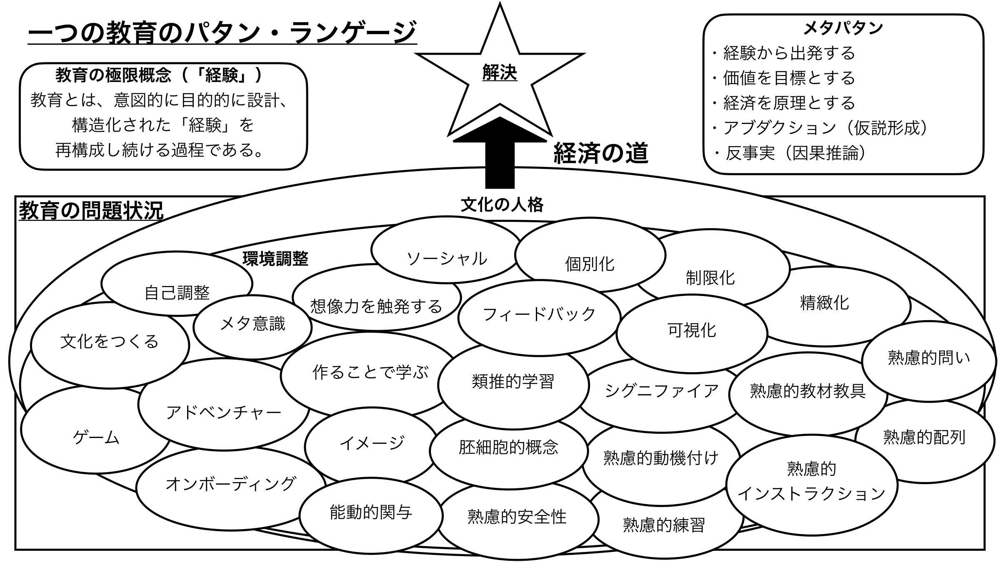

# 教育パタン・ランゲージ Wiki

教育設計・授業実践・学習理論に関するパタン・ランゲージのアーカイブ。

> よい教育は、そこに働くパタンの圧縮として観察できる。

## まず読むなら

初めてきた人は、目的に近い道筋を上から順にたどる。

**理論から深める**  
[パタン・ランゲージ概論](./概念/パタン・ランゲージ概論) → [メタパタン](./メタパタン/) → [概念](./概念/)

**教育を設計する**  
[図解にある親パタン](#図解にある親パタン) → [熟慮的配列](./パタン/熟慮的配列) → [類推的学習](./パタン/類推的学習①) → [オンボーディングなど](./パタン/オンボーディング)

**今日の教育に使う**  
[実践から探す](./実践/) → [教材から探す](./教材/) → [困りごとから探す](./困りごとから探す) → [目標から探す](./目標から探す)

## Wikiの地図

| 入口                        | こんな時に使う                                       |
| --------------------------- | ---------------------------------------------------- |
| [パタン](./パタン/)         | 授業設計・指導・学級づくりの具体的な型を探す         |
| [概念](./概念/)             | パタンの背景にある理論・哲学・教育思想を確認する     |
| [実践](./実践/)             | 具体的な授業・指導の記録から考える                   |
| [特別支援](./特別支援/)     | 特別支援教育の実践と理論をつなげて見る               |
| [教科](./教科/)             | 算数・国語など教科別のアイデアを見る                 |
| [算数](./教科/算数)         | ナンバートーク、数学ワークショップ、算数教材から探す |
| [教材](./教材/)             | 授業で使う道具・ワークシート・ゲーム教材を探す       |
| [文献](./文献)              | 参考文献・動画記録・研究メモをたどる                 |
| [メタパタン](./メタパタン/) | パタンを発見・検証・使い続ける原理を確認する         |

## 初めての人へ

- [[初めての人へ]] — このWikiの読み方と、目的別の最短ルート
- [[まず覚える30パタン]] — 授業設計で最初に思い出す第一軍のパタン
- [[パタン組み合わせ例]] — 複数パタンを授業レシピとして重ねる
- [[授業設計テンプレート]] — パタンを授業案へ変換する作業台
- [[授業設計テンプレート記入例：カエルの算数]] — 算数の記入例
- [[授業設計テンプレート記入例：文学討論グループ]] — 国語・読書会の記入例
- [[授業後リフレクションテンプレート]] — 授業後に働いたパタンを記録する
- [[近いパタンの違い]] — 似ているパタンを見分ける入口
- [[自分のパタンを作る]] — 自分の経験から教育のパタン・ランゲージを育てる入口
- [[パタンの親子関係]] — 大パタンから小パタンへたどる体系地図
- [[Obsidian同期の運用方針]] — ObsidianとQuartzの同期ルール
- [[検索のための別名・表記ゆれ]] — 英語名・別表記・旧名から探す入口
- [[このWikiについて]] — このWikiの位置づけと編集方針

## 実践・教材から探す

授業準備中にすぐ使うなら、実践と教材の棚から入る。

| 入口                                                                | 何を探せるか                                                             |
| ------------------------------------------------------------------- | ------------------------------------------------------------------------ |
| [実践](./実践/)                                                     | 国語・算数・特別支援など、具体的な授業実践を教科・領域別に探す           |
| [教材](./教材/)                                                     | 授業で使う道具・ワークシート・ゲーム教材を用途別に探す                   |
| [読書の道具棚](./教材/読書の道具棚)                                 | 付箋、読書目標、読書記録、振り返りなどを探す                             |
| [読書会の道具棚](./教材/読書会の道具棚)                             | ブッククラブや読書会で使う質問・付箋・書き出しの道具を探す               |
| [書くことの道具棚](./教材/書くことの道具棚)                         | 詩・俳句・物語などを書く活動の足場を探す                                 |
| [算数の道具棚](./教材/算数の道具棚)                                 | 算数ゲーム、良問・課題、語彙辞典、数学ジャーナル、学習チームの道具を探す |
| [算数シンキング・タスク集索引](./教材/算数シンキング・タスク集索引) | 136問の算数タスクを、学年・領域・目的から先に選ぶ                        |

## メタパタン

パタンを発見・検証・使い続けるための根本原理。

| メタパタン                                | 核心                                                   |
| ----------------------------------------- | ------------------------------------------------------ |
| [[メタパタン/経験から出発する]]           | 私たちのあらゆる認識は経験とともに始まる               |
| [[メタパタン/価値を目標とする]]           | パタンの目的は価値の実現にある                         |
| [[メタパタン/経済を原理とする]]           | よいパタンは、最小の手段で最大の価値を生む             |
| [[メタパタン/アブダクション（仮説形成）]] | 驚くべき事実から、最もよい説明仮説を立てる             |
| [[メタパタン/反事実（因果推論）]]         | 「もしなかったら」と問うことで、パタンの因果を確かめる |
| [[メタパタン/極限概念と極限クライテリア]] | 経験・価値・経済の三極限概念の相互依存と圏論的定式化（draft） |

### 圏論的教育記述（刊行書籍・2026より統合）

このWikiの比喩を形式理論へ持ち上げた書籍群。**理論の正は書籍側にあり、Wikiは入口と実践への還流を担う**（定義・記号・証明はここに置かない）。第2巻は評価の続き——返した評価がその子の中で何になったか、いつ「できるようになった」「文化がある」と言ってよいか——を扱うので、上の形成的評価・妥当性の各節と地続きに読める。

| パタン / 文献 | 核心 |
| --- | --- |
| [[文献/圏論的教育記述の公理化ノート 第1巻（岩井）]] | 混同されやすいものへ異なる形式的住所を与え、非含意を保存する第一の基礎体系（P0〜P7） |
| [[文献/圏論的教育記述の公理化ノート 第2巻（岩井）]] | 第1巻が閉じなかった「返却のあと」の環から始まる続篇。返却の数日・単元の数週間・学級の一年という三つの時間の幅（P7〜P9） |
| [[文献/圏論的教育記述の公理化ノート 第3巻（岩井）]] | シリーズを閉じる最終巻。その記録を**誰が書き、誰が読み、誰が訂正を申し立てられるか**（P10）。薄いのは、書かないと決めてあることを書かなかったから——**薄さは抑制の跡である** |
| [[パタン/誰が書けるかを明文と実効で読む]] | 「このノートを書けるのは係だけだよね」を、決まり（明文）と行使の記録（実効）の二列で読む。**一件は、証人一件である**。記述であって、門番ではない |
| [[パタン/声を聞く仕組みを四段で確かめる（欄・行使・考慮・反映）]] | 意見箱が置いてあることと、投書が入ったことと、それが読まれたことと、ルールが変わったことは、**別の出来事である** |
| [[パタン/沈黙に値をつけているのは誰か]] | **沈黙は、音を立てない**。記録に現れるのは沈黙に与えられた値である。「見たうえで無かった」と「見ていないから分からない」——**値の分かれ目を作ったのは、子どもではなく、窓の開け方** |
| [[文献/教育の見方が変わる十一の問い（岩井）]] | 第1巻と同じ内容を数式ゼロで。十一の検査質問——「外から貼ったまとめか、満ちた結果か」ほか |
| [[文献/続・教育の見方が変わる十一の問い（岩井）]] | 第2巻と同じ内容を数式ゼロで。前作が一時間の**中**を見たのに対し、その一時間の**あと**を見る十一の検査質問 |
| [[パタン/検査質問を一つだけ持って教室に入る]] | 二冊あわせて22本になった検査質問を、場面から引ける形に。**一度に一つだけ持つ**——チェックリストにしない |
| [[概念/証拠不足と不成立の区別]] | 評価の三値（言える・言えない・まだ分からない）——証拠不足を低評価へ変換しない |
| [[パタン/返したことと届いたことを分ける（返却の五段）]] | 返した ≠ 届いた ≠ 受け取った ≠ 応えた ≠ **使った**。サドラーの「宙ぶらりんのデータ」を点検できる粒度に割ったもの |
| [[パタン/一回できたことと続いていることを分ける（記録の列）]] | **主語は列である**——記録の形をそのまま子どもの形として読まない。集約は証拠を作らない。観察の空白を学びの空白と読まない |
| [[パタン/学級の文化と書く前に三つを揃える]] | 定義の名指し・記録の裏づけ・飛躍の自覚。**「文化がある」と言えるかは、いちばん見取りの薄かった子をどれだけ厚く見たかに懸かっている** |

## 図解にある親パタン

図解の楕円に置かれている主要パタンを、使う場面ごとに並べた全体像。名前から探すときは [[パタン名インデックス|主要パタン名インデックス]] を使う。

### 文化・環境をつくる

| パタン                                        | 核心                                               |
| --------------------------------------------- | -------------------------------------------------- |
| [[パタン/文化の人格]]                         | 自然の個性を文化的な人格へ育てる、教育の目的と軌道 |
| [[パタン/環境調整]]                           | 物的・社会的環境を意図的に設計する                 |
| [[パタン/ソーシャル]]                         | 社会的相互作用を学びの資源にする                   |
| [[パタン/個別化]]                             | 一人ひとりの状態に合わせて学習経験を調整する       |
| [[パタン/文化をつくる]]                       | コミュニティと文化を意図的に育てる                 |
| [[パタン/心理的安全性（コンフォートゾーン）]] | 安心して試し、間違えられる場をつくる               |
| [[パタン/読み書きの文化]]                     | 読み書きを民主主義を担う人を育てる基礎として文化にする |
| [[パタン/聴き合う文化]]                       | 聴くことは話すことと同じくらい能動的な行為である     |
| [[パタン/考える文化]]                         | 全員の思考が毎日のあたりまえの経験として尊重・可視化される場をつくる |
| [[パタン/話し合う文化]]                       | 話し合いを民主主義の基礎として学級文化の中心に置く   |
| [[パタン/コミュニティをつくる]]               | 共感的・同僚的・同志的な三つの人間的交渉で学びの共同体を育てる |
| [[パタン/チーム学習（Team Learning）]]        | 一緒に考える能力そのものを育てることが学習する学校の基盤になる |

### 学習者の内側を育てる

| パタン                              | 核心                                         |
| ----------------------------------- | -------------------------------------------- |
| [[パタン/自己調整]]                 | 学習者が自分の学びを見取り、調整する         |
| [[パタン/メタ意識]]                 | 自分の学びや思考を一段高い視点から見る       |
| [[パタン/想像力（感情）を触発する]] | 感情と想像力に働きかけ、深い動機と理解を生む |
| [[パタン/イメージ]]                 | 具体的な像が学びの方向を支える               |
| [[パタン/能動的関与]]               | 学習者が自分から関わる状態をつくる           |
| [[パタン/熟慮的動機づけ]]           | 学習者のやる気を意図的に設計する             |
| [[パタン/内発的動機づけ]]           | 「やらされる」でなく「やりたい」——内側から湧く動機づけ |
| [[パタン/自己選択自己決定]]         | 「自分で決めた」という感覚が、やってみようという気持ちの根っこになる |
| [[パタン/幸福（教育目的としての幸福）]] | 父母が子に望むことを率直に言わせれば「幸福な生活」以外の何物でもない |

### 熟慮的動機付け・ARCSモデル（動機設計）

ケラー（Keller）のARCSモデルによる動機付け設計のパタン群。ARCS→4要素→各サブパターンの階層を持つ。ボトルネックとなる要素を診断して的を絞った介入ができる。

| パタン | 核心 |
| --- | --- |
| [[パタン/ARCS]] | 注意・関連性・自信・満足の4観点から学習意欲を総合的に設計する |
| [[パタン/注意を生み出し維持する（Attention）]] | 新奇性・驚き・問いかけ・変化で注意を引きつけ持続させる |
| [[パタン/A1.興味の獲得（知覚的喚起）]] | 驚き・新奇性・視覚的刺激で「なんだろう？」を呼び起こす |
| [[パタン/A2.探究心の刺激（喚起）]] | 問いかけ・謎・仮説で「解きたい」「知りたい」状態を作る |
| [[パタン/A3.注意の持続（変化性）]] | 活動・形式・ペースに変化を設けて注意を持続させる |
| [[パタン/関連性を確立し支援する（Relevance）]] | 「これは自分に関係がある」と感じることが学ぼうとする意志を生む |
| [[パタン/自信を構築する（Confidence）]] | 「自分にはできる」という感覚が挑戦を続ける原動力になる |
| [[パタン/C1.成功への期待感（学習要求）]] | 成功への見通しがあってこそ、学習者は動き出す |
| [[パタン/C2.成功の機会]] | 「できた」という実体験が次の挑戦への自信になる |
| [[パタン/C3.個人の責任（個人的なコントロール）]] | 「自分でやった」という感覚が自信の核心をつくる |
| [[パタン/満足感をもたらす（Satisfaction）]] | やり遂げた喜び・認められる経験・公平な扱いが学習を続けたい気持ちにつなげる |
| [[パタン/S1.内発的満足感（内発的な強化）]] | 「できた！」「面白い！」という内側からの喜びが外からの報酬なしに学びを続けさせる |

### 教師の役割・教師論（牧口常三郎より統合）

| パタン                              | 核心                                                                                                               |
| ----------------------------------- | ------------------------------------------------------------------------------------------------------------------ |
| [[パタン/産婆役としての教師]]       | 「知識は伝達し得べからず」——教師は知識の供給者ではなく、学習者が知識を産むのを助ける産婆役（牧口常三郎, 1931）     |
| [[パタン/学習と勤労の並行]]         | 学習は生活の準備でなく生活と並行する——半日学校制度の原理（牧口常三郎, 1931）                                       |
| [[パタン/教師の三方面修養]]         | 教材学修・教授法修練・師範人格修養を並行して進める——師範人格が最も本質的（牧口常三郎, 1931）                       |
| [[パタン/非可視の教師]]             | 教師が消えるとき学習者が主役になる——教師の役割を「教える者」から「環境をつくる者」へ                               |
| [[パタン/認識と評価の区別]]         | 評価（価値判断）が認識（事実把握）に先行することの弊害——評価を保留して認識を先に行う科学的態度（牧口常三郎, 1930） |
| [[パタン/学習指導の三方面]]         | 認識作用・評価作用・創価作用の三方面を並行して指導する——知識習得だけに偏らない完全な学習（牧口常三郎, 1930）       |
| [[パタン/意識的計画的生活への指導]] | 学習者が目的と計画を意識して生活を調整できるよう導く——教師の技術的到達点（牧口常三郎, 1930）                       |

### 教材・活動を設計する

| パタン                                    | 核心                                                                              |
| ----------------------------------------- | --------------------------------------------------------------------------------- |
| [[パタン/制限化限定化]]                   | 制約を設けて、集中と創造性を生む                                                  |
| [[パタン/精緻化]]                         | 知識をつなぎ、使える理解へ深める                                                  |
| [[パタン/作ることで学ぶ]]                 | 制作・表現を通じて理解を深める                                                    |
| [[パタン/類推的学習①]]                    | 既知の構造を使って未知の概念を理解する                                            |
| [[パタン/シグニファイア]]                 | 行動や理解を導く知覚可能な手がかりを置く                                          |
| [[パタン/熟慮的教材教具]]                 | 教材・教具を吟味して設計する                                                      |
| [[パタン/アドベンチャー]]                 | 冒険・挑戦・遊びを学習に組み込む                                                  |
| [[パタン/キーコンセプト（胚細胞的概念）]] | 背後の原理を小さな核として捉える                                                  |
| [[パタン/ゲーム]]                         | ルール・挑戦・フィードバックを学習に生かす——9ブロックフレームワーク（深田, 2012） |
| [[パタン/オンボーディング]]               | 学習者を活動の土台に乗せる——最初の5分で価値を体験させる                           |
| [[パタン/世界観]]                         | 一貫したストーリー・価値観・雰囲気が「ここにいたい」という所属感を生む            |
| [[パタン/おもてなし]]                     | 学習者のゴール（深い動機）を先読みして準備し即応するマインドセット                |

### 問い・指示・練習・フィードバックを設計する

| パタン                              | 核心                                     |
| ----------------------------------- | ---------------------------------------- |
| [[パタン/熟慮的問い]]               | 問いを目的・相手・方法・文脈から設計する |
| [[パタン/フィードバック]]           | 学習の進み具合を伝え合う                 |
| [[パタン/可視化]]                   | 見えないものを見える形にする             |
| [[パタン/熟慮的配列]]               | 学習経験をどの順序で並べるかを設計する   |
| [[パタン/熟慮的練習]]               | 目標設定と内省を伴う練習を設計する       |
| [[パタン/熟慮的インストラクション]] | 指示・説明をシステムとして設計する       |
| [[パタン/形成的評価]]               | 評価は学習を終わらせるためではなく学習を育てるためにある |
| [[パタン/1対1の面談]]               | 一人ひとりへの言葉だけが、その人の核心に届く |
| [[パタン/待ち時間（問いのあとの3秒）]] | 問いのあと3秒待つ——沈黙が思考の質と参加の幅を変える（Rowe, 1974） |
| [[パタン/再提出を許す（リトライ・サイクル）]] | フィードバックは「使う機会」があって初めて学習になる——評価を一回完結から循環に変える（Sadler, 1989; Wormeli, 2011） |
| [[パタン/IRE型応答の脱却（Talk Move）]] | 対話を殺すのは悪い発問ではなく教師の第3ターンの「評価」——評価のかわりに思考を教室に返すTalk Moveへ組み替える（Chapin, O'Connor & Anderson, 2009） |
| [[パタン/解説を先に渡さない（自得の設計）]] | ヒントは「解き方」でなく「どの先行問題と比べるか」の指さしに留め、必要に応じて3層フェードインで開示する——自得の経路を残すヒント設計（戸田城外, 1930; 桝田尚之, 2006） |
| [[パタン/問題の系列が足場を担う（一変数変化の連鎖）]] | 問題を「一度に一箇所だけ変わる系列」として設計する——前の問題が次の問題の足場になり、外部足場なしに難度が上がれる（戸田城外, 1930; 桝田尚之, 2006） |
| [[パタン/変化オペレータの系列設計（喜びのグレードアップ）]] | 変化の「種別（オペレータ）」を意図して設計する——同・逆・＋α・質的変化・複合の5種を順序立てて配列すると「同じなのに違う」感覚が育ち、考える喜びがグレードアップする（戸田城外, 1930; 桝田尚之, 2006） |
| [[パタン/同等点と差異点の均衡設計（学習の駆動エンジン）]] | 1つの事例に「既知との同等点（安心）」と「新しい差異点（発見）」を意図的に同居させる——同等点が安心感を、差異点が探究動機を担い、どちらが欠けても学習は駆動しない（戸田城外, 1930; 桝田尚之, 2006） |
| [[パタン/つまずきを構造で記録する（診断の粒度設計）]] | 正答率ではなく「どの変化種別で詰まったか」を記録する——「逆が弱い」「質的変化で迷う」という構造的な見取りが補充設計に直結する（戸田城外, 1930; 岩井輝久, 2026） |
| [[パタン/補充機構の常設化（匡救設計）]] | 補充は思いやりでなく設計として存在させる——つまずきの発見・補充系列提案・教師の判断の3ステップを常設し、誰が担当しても最低限の補充が機能する底支えをつくる（戸田城外「匡救」, 1930; 岩井輝久, 2026） |
| [[パタン/型から自由創作へ（閉じた練習の開口部）]] | 系列の末尾に「同じ型を使って自分の問題・作品を作る」段階を組み込む——型練習（守）→制約付き作問→自由創作の3段階で「閉じた練習」を「開いた創作」につなぐ（戸田城外, 1930; Sawyer, 2006） |

### 形成的評価と評価的専門性（Sadler 1989 より統合）

**Sadler, D. R.（1989）より：** 妥当なフィードバックを返しても学習者が伸びないのはなぜか——改善には、学習者自身が目指す水準の概念を持ち、現在地と比べ、ギャップを埋める行動をとる3条件が同時に要る。

| パタン / 概念 / 文献 | 核心 |
| --- | --- |
| [[文献/Formative Assessment and the Design of Instructional Systems（Sadler）]] | 形成的評価の3条件・ギルド知識・範例と記述文・フィードバックから自己モニタリングへの移行を論じた原典（Sadler, 1989） |
| [[パタン/評価的専門性を渡す（ギルド知識のダウンロード）]] | 教師の専門性は「作品を評価できること」より「評価する力を学習者へ渡せること」にある——質の概念が渡らなければ、正確なフィードバックも改善を生まない（Sadler, 1989） |
| [[パタン/潜在規準と顕在規準（規準の浮き沈み）]] | 規準表の硬直性への解——今この場で見る顕在規準と、背景で待機する潜在規準を出し入れし、身についたら再び沈める（Sadler, 1983/1989; Marshall, 1958） |
| [[パタン/制作しながら質を判断する（産出中のモニタリング）]] | 「すぐれた詩人はみな批評家を内に含む」——作り終えた後ではなく、作っているまさにその最中に自分の作品の質を見る（Sadler, 1989; Polanyi, 1962） |
| [[パタン/最適なギャップ（願望水準の交渉）]] | 距離が大きすぎれば諦め、小さすぎれば動かない——期待の上昇が改善を追い越すとギャップは自己強化的に広がる（Sadler, 1989; Locke et al., 1981） |
| [[概念/質的判断（曖昧な規準とメタ規準）]] | 公式に還元できない判断の構造——複数規準の噛み合い・曖昧な規準・メタ規準・数値は判断の後に来る（Sadler, 1987/1989） |

### 形成的評価の証拠と条件（Black & Wiliam 1998 より統合）

**Black, P. & Wiliam, D.（1998）より：** 76誌を全走査した系統的レビュー。形成的評価は効く——効果量は Fuchs & Fuchs で0.70、マスタリー・ラーニングで0.82。利益は低達成の子どもに最も大きい。ただし「周辺的な追加」としては成立せず、教室実践の中心的な変化を要求する。サドラー（1989）が理論を与え、この論文が証拠を与えた。

| パタン / 概念 / 文献 | 核心 |
| --- | --- |
| [[文献/Assessment and Classroom Learning（Black & Wiliam）]] | 形成的評価の定義（情報が使われて教授と学習が変わること）・二つの行為の連鎖・効果の証拠・実践の現状・政策への含意を扱った原典（Black & Wiliam, 1998） |
| [[パタン/評点なしで返す（コメントだけの一巡）]] | 丁寧なコメントも、同じ紙に点数があれば消える——「評点＋コメント」は「評点のみ」と同じ結果になり、害は低達成の子に集中する（Butler, 1987/1988） |
| [[パタン/見取ったあとの手を決めておく（データ利用のルール化）]] | 見取る前に「何が起きたら何をするか」を書いておく——データ利用のルールがある研究は効果量0.92、教師の判断に委ねた研究は0.42（Fuchs & Fuchs, 1986） |
| [[パタン/進歩の傾きを見る（水準ではなく変化率）]] | 点ではなく角度を見る——学習成功の勾配を鍵となる指標にし、目標は達成に応じて上方修正する（CBM; Fuchs, 1993） |
| [[パタン/理解のしるしを読む（fit と match）]] | 正答は理解の証拠にならない——子どもの理解は教師のそれと一致（match）せず、たまたま適合（fit）しているだけかもしれない（von Glasersfeld, 1987; Reynolds et al., 1995 の理解の7指標） |
| [[パタン/聴き方を変える（評価的・解釈的・解釈学的）]] | 期待との一致を聴く段から、情報を聴く段、そして教師自身の見方が子どもと共に変わる段へ——変容には2年を要した（Davis, 1997） |
| [[概念/自我関与と課題関与（フィードバックが向ける先）]] | フィードバックの効果を分けるのは量ではなく宛先——自己に向けば負に働く。5件に2件は逆効果（Butler; Kluger & DeNisi, 1996; Deci & Ryan; Dweck） |
| [[概念/教授学的契約（やり過ごしの均衡）]] | 子どもは最大限学ぼうとしているのではなく「なんとかやり過ごそう」としている——形成的評価はこの均衡の移動を前提とする（Brousseau, 1984; Perrenoud, 1991） |

### 形成的評価の理論（Black & Wiliam 2009 より統合）

**Black, P. & Wiliam, D.（2009）より：** 1998年レビューの11年後の理論篇。定義が「程度（to the extent that）」と「決定（decisions）」で書き直された——形成的か否かは二値ではなく、証拠が次の一歩の決定を「よりよく、またはより良く根拠づけられた」ものにする程度である。中心概念は**偶発の瞬間（moments of contingency）**。焦点は狭いが影響は広い。そして中心的判定——認知加速もダイナミック・アセスメントも自己調整学習も**形成的評価の代替ではなく、そのすべてが形成的評価を含んでいる**。日本の「発問→自力解決→練り上げ」が signature pedagogy として名指されているのも本稿である。

| パタン / 概念 / 文献 | 核心 |
| --- | --- |
| [[文献/Developing the Theory of Formative Assessment（Black & Wiliam, 2009）]] | 新しい定義・5つの戦略・偶発の瞬間・自己調整学習モデル・認知加速とダイナミック・アセスメント・hatsumon と neriage・教師の二重の責任を扱った原典（Black & Wiliam, 2009） |
| [[概念/形成的評価の5つの戦略（3×3の枠組み）]] | 三つの問い×三人の主体＝5つの鍵となる戦略。「活動のリスト」のままにしておくと表面的採用の危険がある——自分の活動がどの戦略の実装かを言えるかが診断になる（Wiliam & Thompson, 2007） |
| [[パタン/偶発の瞬間を活かす（コンティンジェンシー）]] | 証拠によって進路が分かれる一点を、授業のどこに、いくつ作るか。同期（授業中）だけでなく非同期（出口パス・翌年の設計）も含む |
| [[パタン/練り上げ（比較検討の全体交流）]] | 日本の教室の当たり前が、世界からは signature pedagogy と呼ばれている。集める→要約する→違いを問う→教師の判断は最後に。熟達者は「集合的な生徒」に応答する（Takahashi, 2008; Bromme & Steinbring, 1994） |
| [[パタン/答えの出どころを推し量る（誤答の解釈）]] | 「ばかなことを言わないの、ビリー」——見当外れに見えた答えは無限の入れ子の発見だった。不出来な出力が示しうる7つのこと（Fisher, 1995; Lighthall, 1988; von Glasersfeld, 1987） |
| [[パタン/予想される反応を先に書く（応答の幅を絞る）]] | 日本の指導案の「予想される児童の反応」に理論的な名を与える——計画を制限することが、その場での応答の自由を生む（Threlfall, 2005） |
| [[パタン/教科に対しても責任を負う（教えすぎと放任のあいだ）]] | 学習者の代わりに学ぼうとすることも、司会に徹することも斥ける。教師は生徒に対してと、生徒が参入していく教科に対しての、二重の責任を負う |
| [[概念/自己調整学習の内側（成長の道とウェルビーイングの道）]] | フィードバックを受け取る側の内部構造。自己評価は始めさせるものではなく表に出すもの。メタ認知と意志（volition）は別物（Winne & Hadwin, 1998; Boekaerts & Corno, 2005） |
| [[概念/認知加速とダイナミック・アセスメント（学習する力そのものを狙う）]] | ZPD は「支援があればできること」ではなく「成熟しつつある心理的機能」の記述である——ヴィゴツキーの学習と発達の区別（Shayer & Adey; Feuerstein; Chaiklin, 2003） |

### 鑑識眼としての形成的アセスメント（サドラー後期・石田 2021 より統合）

**石田智敬（2021）より：** 形成的アセスメント論のルーツとされたサドラー本人が、2000年代以降その潮流をラディカルに批判し始めた——フィードバックもフィードフォワードも本質的には「**伝えること（as telling）**」であり、情報伝達モデルへの依存である。目的は質を**伝えること（disclosure）**から、質の根拠を**見えるようにすること（visibility）**へ移されるべきだ。彼が代わりに置くのは、熟達者の導きの下での真正な評価経験を通して、学習者の**鑑識眼**を錬磨するというアプローチである。上の三つの節（Sadler 1989 / Black & Wiliam 1998 / 2009）を読んだ後に読むと、同じ運動の内側にある断層が見える。

| パタン / 概念 / 文献 | 核心 |
| --- | --- |
| [[文献/ロイス・サドラーによる形成的アセスメント論の検討（石田智敬, 2021）]] | サドラーの所論の背景・受容史（Black & Wiliam が1989年論文を「10年の眠り」から起こした）・後期の批判の論理と、石田が指摘するその限界（石田, 2021） |
| [[パタン/質の根拠を見えるようにする（伝えることからの脱却）]] | 問題はフィードバックの質ではなく、「伝えること」が複雑な学習の改善に最も適した方法だという仮定そのものにある（Sadler, 2010/2013） |
| [[パタン/四つの問いで作品を判断する]] | 課題適合性→全体の質→根拠のクライテリア→大幅な改善策。規準を先に配らず、判断を先に下させてから根拠を言語化させる順序（Sadler, 2010/2013） |
| [[パタン/質の幅ぜんぶに出会わせる（作品の束）]] | 良い例だけでなく、あらゆる質の幅を持つ本物の作品に触れさせる。学級の作品では幅が足りないので、教師が匿名の作品を束に混ぜる（Sadler, 2010/2013） |
| [[概念/鑑識眼（コノサーシップ）]] | 質的判断の能力が高度に発達したもの。ただし「好み」への収斂ではなく、実践共同体によって堅牢に間主観化されたもの（Sadler, 2009; Polanyi, 1962） |
| [[概念/評価エキスパティーズ（課題適合性・質・クライテリア）]] | 1989年の3条件が2010年に語り直された形。3側面＋暗黙知。これが育つとフィードバックへの依存は究極的になくなる（Sadler, 1989/2010） |

### 妥当性——評価そのものを評価する（Messick 1994 より統合）

**Messick, S.（1994）より：** ここまでの4節が「どう評価すれば学習が進むか」を扱ってきたのに対し、この節は**その評価自体が信用に足るのか**を問う。メシックの一撃はこうである——**妥当なのはテストではない。妥当性はテストの性質ではなく、スコアの意味の性質である**。だから「この単元テストは妥当ですか」という問いは、そのままでは答えられない。問えるのは「このスコアをこう解釈し、それに基づいてこう手を打つことは妥当か」だけである。しかも「スコア」には所見も見取りのメモも含まれる。前節までのサドラー（判断の正しさは独立に確かめられず、上告先はまた別の質的判断である）と、正面から緊張する。

| パタン / 概念 / 文献 | 核心 |
| --- | --- |
| [[文献/Validity of Psychological Assessment（Messick, 1994）]] | 統一的妥当性概念・6側面・進行行列・二大脅威・帰結を妥当性証拠として扱う論理を述べた原典（Messick, 1994） |
| [[概念/妥当性（スコアの意味についての評価判断）]] | 妥当性は進化する性質、妥当化は継続する過程。妥当化とは評価論証であり、証拠と論証の両方を要する（Cronbach, 1988） |
| [[パタン/余計な難しさを外す（構成概念に無関係な分散）]] | 算数のテストが読解力を測ってしまう——ルビ・読み上げ・時間延長は甘やかしではなく**妥当性の回復**。ただし何を測るか決めない限りどの配慮が正しいかも決まらない |
| [[パタン/測れていないものを疑う（構成概念の過少代表）]] | 評価が測っていない側面は、子どもの中に無いことにされる。関連しているだけでなく領域を**代表**しているか |
| [[パタン/採点の形を中身の形に合わせる（構造的忠実性）]] | 観点を合計する運用は「互いに埋め合わせられる」という構造仮定を暗黙に置いている。採点の形はその教科の力の構造についての主張である |
| [[パタン/その過程が本当に働いたかを確かめる]] | 内容をカバーしたことと、意図した過程が実際に働いたことは別。配る前に数人に声に出して解いてもらう |
| [[概念/帰結的妥当性（評価がもたらす結果まで問う）]] | 「帰結的妥当性」という別種の妥当性は無い。有害な帰結が**評価の無効性に由来してはならない**というのが正確な要請 |

### 妥当化の順序——どの証拠から集めるか（Kane 1990 より統合）

**Kane, M. T.（1990）より：** 前節のメシックは「何を証拠として数えるか」を六側面として整理した。ケインが立てるのは、その手前の問いである——**目の前のこのテストのこの使い方について、どの証拠から集めればよいのか。どこまでやれば「ひとまず足りた」と言えるのか**。妥当性の文献は証拠の集め方は詳しく教えるが、どの証拠を集めるかはほとんど教えない。だから証拠は**都合のよさ**で選ばれる。ケインの解決は、スコアから結論・決定へ至る推論の鎖（**解釈的論証**）を先に書き出させ、証拠を集める仕事をそのリストに従わせることである。そして原則は一つ——**論証は、その最も弱い環より強くならない。すでにもっともらしい仮定を補強しても、何も強くならない。** 六側面が「抜けの検出」なら、こちらは「順序の決定」であり、両者は置き換え合わない。

| パタン / 概念 / 文献 | 核心 |
| --- | --- |
| [[文献/An Argument-Based Approach to Validation（Kane, 1990）]] | 解釈的論証と妥当性論証の区別、推論の五種、形成的／総括的の二段階、六段階の反復過程を述べた原典（Kane, 1990） |
| [[概念/解釈的論証と妥当性論証（何を確かめればよいかを決める）]] | 解釈は**作られたものであって見つかったものではない**。論証には構造があり非対称。妥当性が証明されることは決してないが「今のところ十分」とは決められる |
| [[パタン/読みの筋道を書き出す（スコアから結論までの階段）]] | 「60点だった」→「割合が分かっていない」→「取り出しで指導する」のあいだに何段あるか。書き出されていない推論は点検できない |
| [[パタン/一番弱いところから確かめる（問題含みの仮定を先に叩く）]] | 出席・提出率・小テストの平均は集まりやすいが、たいてい一番あやしい仮定を叩いていない。**強いところを補強しない** |
| [[パタン/隠れた前提を掘り出す（測る前に、測らない道を並べる）]] | 取り出し・通級・習熟度別の判断は、**「授業のほうを全員が入れるように作り直す道」が一度も比較されていない**という仮定の上に立っている |

### フィードバックの原典（Hattie & Timperley 2007 より統合）

**Hattie & Timperley（2007）より：** wiki のフィードバックのパタン群が立っている「三つの問い×四つのレベル」の原典を、原文で読んで照合した。フィードバックは強力だが正にも負にも効き、**自己（人そのもの）に向けたほめ言葉がもっとも効かない**。フィードバックは**二番目に起きる**もので、理解がまったくない子には教え直しのほうが効く。平均効果量0.79は、同じハッティが入ったやり直しのメタ分析（2020）で0.48になったが、「情報の多いフィードバックほど効く」は支持された。

| パタン / 文献 | 核心 |
| --- | --- |
| [[文献/The Power of Feedback（Hattie & Timperley, 2007）]] | 三つの問い（feed up / feed back / feed forward）と四つのレベル（課題・過程・自己調整・自己）。wiki 内の記述10か所との照合表つき（Hattie & Timperley, 2007; Wisniewski et al., 2020） |
| [[パタン/フィードバックか、教え直しかを見分ける（フィードバックは二番目に起きる）]] | 同じ「×」でも、誤った解釈にはフィードバックが効き、理解の欠如には教え直しが効く。**自信のある誤りにもっとも効く** |

### 類推の原典（Gentner 1983 より統合）

**Gentner（1983）より：** wiki の類推・比較のパタン群と、岩井の『読み書き教育における類推的学習』が理論的根拠に置く構造写像理論の原典を、原文で読んで照合した。類推で写るのは見た目（属性）ではなく関係であり、**関係のうちどれが写るかは、ほかの関係とつながった体系に属しているかで決まる**（体系性の原理）。第二版の「3原則」の②（構造的一貫性）は1983年の論文にはなく、のちの理論の段階の規則だった（誤りではなく版の違い）。

| パタン / 文献 | 核心 |
| --- | --- |
| [[文献/Structure-Mapping（Gentner, 1983）]] | 属性を捨て、関係を保ち、体系を選ぶ。比べ方は類似・類推・抽象化・見かけに分かれる。wiki 内の記述8か所との照合表つき（Gentner, 1983） |
| [[パタン/つながった関係ほど写る（体系性で類推を選ぶ）]] | 「太陽は惑星より重い」は原子に写るのに、「より熱い」は写らない。**写したい関係を逆にしたら、ほかに何が変わるか**で類推を選ぶ |

### 指導の量をめぐる反対の声（Kirschner, Sweller & Clark 2006 より統合）

**Kirschner, Sweller & Clark（2006）より：** このWikiは発見・探究・自得の側のパタンが厚いが、**発見型の授業に正面から反論する側の文献**がなかった。認知負荷理論の側から、新しい内容を学ぶ初学者が手がかりなしに探索する「最小限の指導」は効かず、作業例のような強い指導が効くこと、ただし熟達が進むとその利点は逆転することを論じた論争の書。反論も出ているので、どちらか一方を教室の唯一の原理にしない。

| パタン / 文献 | 核心 |
| --- | --- |
| [[文献/Why Minimal Guidance During Instruction Does Not Work（Kirschner, Sweller & Clark, 2006）]] | 作業記憶と長期記憶、作業例の効果、熟達化反転効果、構成主義の記述と処方の区別。wiki のパタンとの関係を整理した表つき（Kirschner et al., 2006） |
| [[パタン/専門家のやり方と初学者の学び方を分ける（研究の方法は学びの方法ではない）]] | 専門家のやり方を学ぶことと、専門家のやり方で学ぶことは違う。**新しい内容は示してから、探究は使える知識がついてから** |

### 動機づけの原典（Ryan & Deci 2000 より統合）

**Ryan & Deci（2000）より：** wiki の動機づけのパタン20ページ以上が引く自己決定理論の原典を、原文で読んで照合した。三つの基本的欲求（有能さ・自律性・関係性）。**wiki の一部は自己決定理論を「外発的 vs 内発的」の二項対立として書いていたが、原文は逆で、外発的動機づけにも自律の度合いの連続体があるとする**。学校の面白くない課題では、面白さの演出より内在化を支える。

| パタン / 文献 | 核心 |
| --- | --- |
| [[文献/Self-Determination Theory（Ryan & Deci, 2000）]] | 三つの欲求、認知的評価理論、外発的動機づけの連続体（外的・取り入れ・同一化・統合）、自律性は独立ではない。wiki 内の記述7か所との照合表つき（Ryan & Deci, 2000） |
| [[パタン/面白くない課題を自分のものにする道をつくる（内在化を支える）]] | 内発的動機づけの原理は、もともと面白い活動にしか当てはまらない。**意味のある理由を、気持ちを認め選ぶ余地を残して伝える** |

### 成長マインドセットの効果（Yeager et al. 2019 より統合）

**Yeager et al.（2019）より：** wiki で52ページに出てくる「マインドセット」の、効果の大きさを確かめた研究論文がなかった。全米を代表する9年生12,490人の無作為化実験では、短いオンラインの介入で、成績の振るわない生徒の成績が4段階で+0.10（効果量0.11）上がった。**考え方はどこでも同じように変わったが、成績への効果は、仲間が難しい問題を選ぶ雰囲気のある学校で続いた**（種と土）。

| 文献 | 核心 |
| --- | --- |
| [[文献/A National Experiment Reveals Where a Growth Mindset Improves Achievement（Yeager et al., 2019）]] | 効果は控えめで、効く相手（成績の振るわない生徒）と場所（挑戦を支える仲間の雰囲気）がある。事前登録・独立したデータ収集・盲検のベイズ分析（Yeager et al., 2019） |

### 望ましい困難の原典（Bjork & Bjork 2011 より統合）

**Bjork & Bjork（2011）より：** wiki で29ページに出てくる「望ましい困難」の、提唱者自身の章を読んだ。**その場のでき（パフォーマンス）と、長く残る学習は別物**であり、できを早く上げる条件は長期の保持と転移を支えないことが多い。望ましい困難は四つで、wiki の整理には「練習の条件を変える」が抜けていた。応える知識がなければ困難は望ましくなくなる。

| パタン / 文献 | 核心 |
| --- | --- |
| [[文献/Making Things Hard on Yourself, But in a Good Way（Bjork & Bjork, 2011）]] | 条件を変える・交互に混ぜる・間隔をあける・テストする。貯蔵の強さと検索の強さ。忘れることが学ぶ機会をつくる（Bjork & Bjork, 2011） |
| [[パタン/練習の条件を変える（いつも同じ形で練習しない）]] | テストと同じ距離だけで投げる練習より、近い距離と遠い距離で練習したほうが、テストの距離でうまく投げた。**同じ中身の練習の条件を一つずつ変える** |

### 学習科学の勧めと根拠の強さ（Pashler et al. 2007 より統合）

**Pashler et al.（2007）より：** wiki の学習科学のパタンは一般向けの本を経由していて、それぞれの知見がどれくらい確かめられているかが書かれていなかった。米国教育省の実践ガイドは勧め7つに根拠の強さを付ける。**strong は「答えを思い出す小テスト」と「深い問いで説明を組み立てる」の二つ**。また、**具体物だけで教えると最初の理解は早いが別の場面に使えない**という、具体から抽象への移り方の注意を含む。

| パタン / 文献 | 核心 |
| --- | --- |
| [[文献/Organizing Instruction and Study to Improve Student Learning（Pashler et al., 2007）]] | 間隔をあける・例と問題を交互に・図と言葉・抽象と具体をつなぐ・小テスト・学習の自己判断・深い問い。勧めごとの根拠の強さ（Pashler et al., 2007） |
| [[パタン/時間をおいてから、答えを見ずに「わかったか」を確かめる（遅延した学習判断）]] | 学んだ直後の「わかった」は高すぎる。**数日後に、答えを隠して「明日解けそう？」を判断し、自信のないところを学び直す**（根拠は low） |

### 小学生の作文の指導と根拠の強さ（Graham et al. 2012 より統合）

**Graham et al.（2012）より：** wiki のライティング・ワークショップのパタン群に、研究の裏づけの強さを足した。米国教育省の実践ガイドで根拠が **strong** なのは「方略を明示的に教え、だんだん任せながら、目的に応じて書く過程を教える」で、その手順の中に**よい文章をまねる**（語・文・文章のレベル）が含まれる。書き手の共同体（作家の椅子・出版など）と毎日書く時間は minimal。

| 文献 | 核心 |
| --- | --- |
| [[文献/Teaching Elementary School Students to Be Effective Writers（Graham et al., 2012）]] | 毎日1時間書く・書く過程と方略（SRSD・目標設定）・書字やつづりの流暢さ・書き手の共同体。勧めごとの根拠の強さ（Graham et al., 2012） |

### 学習方法を原典で確かめる（2026年10月追加）

個別化・能動的関与・自己調整・想起練習を、研究の対象と適用条件から読む。まず上から順にたどり、大学生の実験と小学生の実験を区別する。

| 順番 | 文献 | 確かめたいこと |
|---|---|---|
| 1 | [[文献/学習スタイルの概念と証拠（Pashlerほか2008）]] | 好み・個人差と、学習スタイルへの適合仮説を分ける |
| 2 | [[文献/認知的関与を捉えるICAP（ChiとWylie2014）]] | 活動量と、生成・共同生成による関与を分ける |
| 3 | [[文献/自己調整学習の六モデル（Panadero2017）]] | 六モデルから認知・動機・感情・援助・協働を見る |
| 4 | [[文献/想起テストによる長期保持（RoedigerとKarpicke2006）]] | 即時のできと1週間後の保持を分ける |
| 5 | [[文献/小学生の想起練習を支える手がかり（Karpickeほか2014）]] | 手がかりで想起を支える。直後の成績と長期保持は別に確かめる |

### 語彙指導（Words, Words, Words より統合）

| パタン                    | 核心                                                                                                               |
| ------------------------- | ------------------------------------------------------------------------------------------------------------------ |
| [[パタン/語彙指導]]       | 語彙は「定義の暗記」でなく意味のある文脈での反復的な出会いから育つ——3段階知識・3条件・10の問い（Allen, 1999）      |
| [[パタン/ワードウォール]] | 学習した語彙を教室の壁に常時貼り出す——書く・話す活動の「外付けの記憶」（Allen, 1999）                              |
| [[パタン/語彙の評価]]     | 「使える語彙」を測る——Concept Circles・Opposites Hunt・統合の問いで指導と評価のミスマッチを解消する（Allen, 1999） |

### 国語・読書指導（リーディングワークショップより統合）

| パタン / 実践                                           | 核心                                                                                                                                                                                                                 |
| ------------------------------------------------------- | -------------------------------------------------------------------------------------------------------------------------------------------------------------------------------------------------------------------- |
| [[パタン/リーディング・ワークショップ]]                 | ミニレッスン・独立読書・カンファリングの3部構造で読書力を育てる                                                                                                                                                      |
| [[パタン/リテラシー・ワークステーション]]               | 小グループ指導中に全員が「目的のある本物の練習」をする——I Can リスト・パートナー・教えた内容だけの原則（Diller, 2005）                                                                                               |
| [[実践/リテラシー・ワークステーションの起動]]           | 独立読書から始めて3〜4週間でワークステーション体制を段階的に育てる起動ガイド                                                                                                                                         |
| [[パタン/デイリー5]]                                    | 5択（自分で読む・誰かに読む・聴く・書く・言葉の仕事）を毎回自由選択——独立性とスタミナを育て、教師が小グループ指導に集中できる時間を作る（Boushey & Moser, 2014）                                                     |
| [[パタン/スタミナを育てる]]                             | 「1分から始めて毎日少しずつ延ばす」——I-チャート・スタミナチャート・10ステップで独立学習の持続力を育てる                                                                                                              |
| [[パタン/段階的手放し]]                                 | I Do → We Do → You Do の3段階——足場は学習者の力が育ったとき初めて外す（Pearson & Gallagher, 1983 / Diller, 2005）                                                                                                    |
| [[パタン/よい本の選び方（IPICK）]]                      | 目的・興味・理解・語彙の4軸で「今の自分に合う本」を自分で選ぶ力を教える——IPICK と5本指ルール                                                                                                                         |
| [[実践/デイリー5の起動]]                                | 独立性を教える10ステップと4〜6週間の段階的起動プラン——Read to Self から始めて5択へ                                                                                                                                   |
| [[パタン/リーダーズ・ノート]]                           | 読者の思考を可視化する道具——読書ログでも感想日記でもない、思考の記録と読書アイデンティティの場                                                                                                                       |
| [[パタン/作家のように読む]]                             | 著者の技法を観察・記録してライターズ・ノートで試す——読書と作文をつなぐ橋                                                                                                                                             |
| [[実践/リーダーズ・ノートの起動]]                       | 年度初め2週間で読者の自分史から始める起動実践                                                                                                                                                                        |
| [[パタン/ライティング・ワークショップ]]                 | 書く時間・選択・作家の椅子・カンファリングで書き手を育てる                                                                                                                                                           |
| [[パタン/ライターズ・ノート]]                           | アイデアを集める貯蔵庫——低リスク・高頻度の書き実践でワークショップの素材を育てる                                                                                                                                     |
| [[実践/ライターズ・ノートの起動]]                       | 年度初め2週間で8種類のエントリーを体験しノート文化をつくる                                                                                                                                                           |
| [[パタン/作家のクラフト]]                               | 書き出し・見せる描写・視点・声・語選択で「正確な文」を「読みたい文」に変える技芸                                                                                                                                     |
| [[パタン/話す・描く・書く]]                             | 話すことをリハーサルに、描くことを作曲として、書く前の足場をつくる                                                                                                                                                   |
| [[パタン/ストーリーテリング（語りの時間）]]             | 一人の語り手が椅子に座りクラス全体に自分の経験を語る——文字も絵の技術も不要で全員が参加できる入口                                                                                                                     |
| [[パタン/ミニレッスン・サイクル]]                       | 3〜6時間を傘テーマで束ねるサイクル計画で読者を育てる                                                                                                                                                                 |
| [[パタン/BDAフレームワーク]]                            | 読む前・読む間・読んだ後の3段階で読解授業を設計するメタフレームワーク——あらゆる読解方略の「いつ使うか」が決まる（Buehl, 2017）                                                                                       |
| [[パタン/読解の7プロセス]]                              | 熟達した読者が使う7つの思考プロセス（既有知識とのつながり・問いの生成・視覚化・推論・重要性の判断・統合・モニタリング）——7プロセスを授業の共通言語として読解指導を設計する（Keene & Zimmermann, 2007 / Buehl, 2014） |
| [[パタン/規律的リテラシー]]                             | 教科固有の読み方を教える——リテラシーの塔（Towers of Literacy）・3つの失敗パターン（Sink or Swim/Hedging Your Bets/Throwing in the Towel）・10の教科別質問分類表で教科横断的な読解指導を設計する（Buehl, 2014）       |
| [[パタン/テキスト・フレーム]]                           | 6つの文章構造（原因と結果・問題と解決・比較対比等）を読みの枠組みとして使う——国語・理科・社会・算数に横断して機能する                                                                                                |
| [[パタン/アンティシペーション・ガイド]]                 | 先入観を記述文で明示化し認知的葛藤を作る——読む前の「問いと予測」が理解を深くする                                                                                                                                     |
| [[実践/BDA読解授業の設計]]                              | Before・During・After の方略メニューと教科別授業例——読解授業をゼロから設計する実践ガイド                                                                                                                             |
| [[パタン/ブッククラブ]]                                 | 一冊の本をグループで読み語り合う——読む・聴く・考える・問い返すが圧縮された複数パタンの実践                                                                                                                          |
| [[パタン/リテラチャー・サークル]]                       | 役割シートで足場かけし、段階的に消して生徒主導の読書対話へ——補助輪は外すためにある（Daniels, 2002）                                                                                                                  |
| [[パタン/リーディング・ゾーン]]                         | 本の世界に完全に入り込み時間の感覚を忘れる没入状態——ゾーン体験の繰り返しが読書を義務でなく喜びとして内面化する（Atwell, 2007/2016）                                                                                  |
| [[パタン/読書センター]]                                 | 4〜6人が選んだジャンル・著者・テーマを中心に集まり、私読みとは別に「追求する読書」を育てる場（Collins, 2004）                                                                                                        |
| [[パタン/読書ラウンジ]]                                 | 読書を特別な体験として物理的に位置づける——「読書がそれほど重要なら、学校は場所を見つけるだろう」（Layne, 2009）                                                                                                      |
| [[パタン/表現して学ぶ]]                                 | 書く・描く・演じる・動くを「評価のため」でなく「考えるツール」として使う——クイックライト・クイックドローが思考を外在化する                                                                                           |
| [[実践/リテラチャー・サークルの起動]]                   | 役割シートから始めて役割を消す6週間の起動プラン——Week別の具体的ステップと観察ノート                                                                                                                                  |
| [[パタン/深い理解（表層と深層）]]                      | 表層（文字どおり）と深層（本文を越えて考え、書き手の意図と自分の見方を統合する）の二つの水準と4種の知識で読解を捉える——Dorn & Soffos の3つの問いが既存の指導を批評的に問い直す                                                                                   |
| [[パタン/共有読書（Shared Reading）]]                   | 易しいテキストの再読→新テキストへのオリエンテーション→共に読む5ステップで「疲れ知らず」の読書リズムを作る——スケール・オブ・ヘルプで足場を動的に調整する（Dorn & Soffos, 2005）                                       |
| [[パタン/文学討論グループ]]                             | 7コンポーネント（導入→黙読→個別カンファリング→グループ討論→ピア討論→テキストマップ→拡張）で徒弟制的な文学討論を設計——リテラル言語・ジャンル研究・著者研究への展開（Dorn & Soffos, 2005）                             |
| [[パタン/テキスト・セット]]                             | 同じテーマ・著者・問いで3〜5冊を束ねて順に読む——読み進めるほど背景知識が積み上がり、深層へ向かう比較・評価が自然に起動する                                                                                              |
| [[実践/文学討論グループの設計]]                         | 深層の理解を目指す問いを教師が設計し、小グループの討論→個人の書くで深める                                                                                                                                 |
| [[パタン/シンクアラウド]]                               | 教師が思考を声に出すモデリングで読解ストラテジーを可視化する                                                                                                                                                         |
| [[パタン/アンカーチャート]]                             | 子どもの言葉で作る年間通しの思考の地図                                                                                                                                                                               |
| [[パタン/背景知識]]                                     | 読解力の最も強力な変数——ストラテジーより知識の蓄積が長期的な読解力を決める（Willingham, 2015）                                                                                                                       |
| [[パタン/読み聞かせ]]                                   | 自分の読書レベルを超えた語彙・概念・背景知識に触れられる全年齢向けの経路——パフォーマンスとしての声・表情・クリフハンガー技法（Layne, 2009追補）                                                                      |
| [[パタン/対話的読み聞かせ（PEER法）]]                   | 読み聞かせの中に「問いかけ→受け止め→広げる→繰り返し」の対話を設計する——子どもを受動的な聴衆から能動的な語り手に変える就学前〜K-2向け語彙強化技法（Arnold & Whitehurst, 1994）                                        |
| [[パタン/心の状態言語の意図的使用（メンタル・ステート・トーク）]] | 「彼女は何が入っていると**思っている**かな？」——心の状態動詞を教師が意図的に教室言語に織り込むことで心の理論（ToM）発達を支える。特にSES低い環境の子への補完的介入（Brandt, 2026） |
| [[パタン/読書アイデンティティ]]                         | 「自分は読む人間だ」という自己像——SKILL（技術）× WILL（意志）の両立が完全な読み手を育てる（Willingham/Atwell/Buckner/Layne統合）                                                                                     |
| [[パタン/アリテラシー（読む意志）]]                     | 読む技術はあるが読もうとしない「アリテラシー」を名付け、SKILL vs. WILL の区別で読書指導の目標を再設計する（Layne, 2009）                                                                                             |
| [[パタン/ブック・チャット]]                             | 教師がクラス全体の前で、読んだ本を6〜8分ほど熱をこめて紹介する。準備用紙のバインダー、ルーブリックで教える生徒の発表まで（Layne, 2009）                                                                                                    |
| [[パタン/一冊を手渡す（本のマッチング）]] | 「この本、あなたに合いそう」——年度はじめの興味調べをもとに、一人の子に合う本を手渡す。評価なし・感想の報告なし（Layne, 2009 の "I thought of you."） |
| [[実践/読書への情熱を育てる実践集]]                     | 興味調査・読書ラウンジ・Book Celebration・著者研究・四半期計画で読む情熱を年間を通じて設計する                                                                                                                       |
| [[パタン/チェックイン（Checking In）]]                  | 「カンファランス」でなく「チェックイン」——毎日2〜3分・全員に・7カテゴリの問いで、ゾーンから取り残される子を一人も出さない（Atwell, 2016）                                                                            |
| [[パタン/レターエッセイ（Letter-Essay）]]               | 読んでいる本について3週ごとに1通・先生か友人宛の手紙を書く——感想文ではなく対話の往復が読むことと書くことをつなぐ（Atwell, 2016）                                                                                     |
| [[パタン/Books-We-Love（本の展示コーナー）]]            | クラスで愛された本（評価9以上）を表紙が見える形で展示——生徒の選書の3回に1回はここから始まる（Atwell, 2016）                                                                                                          |
| [[パタン/Someday List（読みたい本リスト）]]             | 読みたい本リストを常に育てる——「次が決まっている読者」を作り、ブック・トークや Books-We-Love の出会いを「いつか読む」意図に変換する（Atwell, 2016）                                                                  |
| [[パタン/不思議を育てる]]                               | 問いを持つことを読書の目的として位置づける                                                                                                                                                                           |
| [[パタン/RIPモデル]]                                    | 読書会議をReview・Instruction・Planの3段階構造で設計する                                                                                                                                                             |
| [[パタン/推論する（インファリング）]]                   | テキストに書かれていないことを既知の知識と手がかりから考える                                                                                                                                                         |
| [[パタン/読みとつながる]]                               | 自分の経験・他の本・世界とつなぐことで読解を深める                                                                                                                                                                   |
| [[パタン/会話から問いを引き上げる（Lifting a Prompt）]] | クラスの対話から有機的に生まれた問いをノートエントリーへ移す——事前設計でなく子どもの声が問いになる（Buckner, 2009）                                                                                                  |
| [[パタン/問いをもつ（クエスチョニング）]]               | Thin/Thick Questions・Wonder Wall・I Wonder→I Think で問いを能動的関与の核にする（Harvey & Goudvis, 2007）                                                                                                           |
| [[パタン/重要性の見極め]]                               | 「面白い」vs「重要」の区別・ノンフィクション特徴の活用・教室の80%問題（Harvey & Goudvis, 2007）                                                                                                                      |
| [[パタン/統合する（シンセサイジング）]]                 | Summary≠Synthesis・Reading changes thinking・CPC フォームで思考の進化を記録する（Harvey & Goudvis, 2007）                                                                                                            |
| [[実践/カンファリング（読書会議）]]                     | 1対1の読書会議で読者としての成長を支援する                                                                                                                                                                           |
| [[実践/思考の記録サイクル]]                             | 年度初めの「読みながら考えを記録する」4時間サイクルの具体的実践                                                                                                                                                      |
| [[実践/ライティング・ワークショップ年度初め]]           | 白紙の冊子・作家の椅子・話す→描く→書くで書く文化を作る最初の2週間                                                                                                                                                    |
| [[実践/書き出しのクラフト]]                             | 書き出しの5パターンを3〜4時間サイクルで指導する技芸ミニレッスン                                                                                                                                                      |
| [[パタン/ガイデッド・リーディング（小グループの読み指導）]] | 読み聞かせ→共有読書→ガイデッド→ひとり読みの連続体の第3段階——少し背伸びの本を小グループで、教師の見守りのもと各自が読む（Fountas & Pinnell, 1996） |
| [[パタン/編集（Editing）]] | 内容が決まってから表記の規約を読者のために整える最終段階——推敲と時間的に分離し、編集の主体を教師の赤ペンから子ども自身へ移す（Fletcher & Portalupi, 2001） |

### 心の理論・言語発達（Theory of Mind and Language Development より統合）

**Brandt, S.（2026）より：**

| パタン / 文献 | 核心 |
| --- | --- |
| [[文献/Theory of Mind and Language Development（Brandt）]] | 言語がToM（心の理論）を支える三経路（談話・意味論・補文節統語）の実証的整理——心の状態言語の教室使用がSES格差を補完する介入になりうる（Brandt, 2026） |
| [[パタン/心の状態言語の意図的使用（メンタル・ステート・トーク）]] | 「彼女は何が入っていると**思っている**かな？」——心の状態動詞を教師が意図的に教室言語に織り込むことで心の理論（ToM）発達を支え、友人関係・読解力・科学的推論に波及する（Brandt, 2026） |

### 言語・権力・社会正義（Language Weaponization より統合）

**Pentón Herrera, L. J.（2026）より：**

| パタン / 文献 | 核心 |
| --- | --- |
| [[文献/Language Weaponization（Pentón Herrera）]] | ことばの武器化の3段階（スティグマ化→非人間化→ハーム）と（再）人間化のための語りの実践——言語は武器にも治癒の道具にもなりうる（Pentón Herrera, 2026） |
| [[パタン/ことばの武器化の三段階（スティグマ化・非人間化・ハーム）]] | 差別的ラベルが繰り返されることで、スティグマ化から非人間化へ、そしてハームへと緩やかに進行する——第1段階での介入が最も効果的（Pentón Herrera, 2026） |
| [[パタン/語りによる（再）人間化]] | 排除された人が自分の声で語るとき、語り手と聴き手の両方が（再び）人間になる——「語る権利」を意図的に設計し、周縁化された声が教室に存在できる場をつくる（Pentón Herrera, 2026） |

### 生得性・文化的学習・部族心理（Innateness in Mind より統合）

**Carruthers, P.（2026）より：**

| パタン / 文献 | 核心 |
| --- | --- |
| [[文献/Innateness in Mind（Carruthers）]] | 人間本性は「文化可能な本性」——コア知識システム・ナチュラル・ペダゴジー・評価的学習・部族的思考・部族的感情の実証的整理（Carruthers, 2026） |
| [[パタン/ナチュラル・ペダゴジー（自然的教授法）]] | 「よく見ていてね」——意図的なアイコンタクト・名前の呼びかけ・CDSトーンが生得的な「文化的模倣モード」を起動し、子どもは全手順をオーバーイミテーションで受け取る（Csibra & Gergely, 2011; Carruthers, 2026） |

### 心の理論と言語発達（Theory of Mind and Language Development より統合）

**Brandt, S.（2026）より：**

| パタン / 文献 / 概念 | 核心 |
| --- | --- |
| [[文献/Theory of Mind and Language Development（Brandt）]] | 言語はToM発達を談話・意味論・統語の三経路で支える。使う言語によって優位な経路が異なり、英語は補文節構文、中国語は非事実動詞、トルコ語は証拠性標識が機能する（Brandt, 2026） |
| [[パタン/心の状態言語の意図的使用（メンタル・ステート・トーク）]] | 「彼女は何が入っていると**思っている**かな？」——心の状態動詞を教師が意図的に教室言語に織り込むことで心の理論（ToM）発達を支える。特にSES低い環境の子への補完的介入（Brandt, 2026） |
| [[概念/心の理論（Theory of Mind）]] | 他者が自分とは異なる信念・知識・欲求を持ちうることを理解する能力。偽信念理解（4歳）が発達的マイルストーン。ToM は友人関係・読解力・科学的推論の基盤 |
| [[概念/証拠性標識（エビデンシャリティ）]] | 「見て知った」か「聞いた話では」か——情報源を言語化する仕組み。日本語の「らしい/はずだ/かもしれない」体系と「どうやって知ったの？」という教室の問いがToMとソース・モニタリングを同時に支える |

### 読書格差・夏季読書（Summer Reading より統合）

**Allington, R. L., & McGill-Franzen, A.（Eds.）(2013) より：**

| パタン / 文献 | 核心 |
| --- | --- |
| [[文献/Summer Reading（Allington & McGill-Franzen）]] | 夏休みの読書量の差が貧富間の読書達成格差の80%を説明——蛇口理論・年50ドルでサマースクール同等効果・選択で効果量2倍のエビデンス集 |
| [[パタン/夏の読書（格差を閉じる）]] | **新規**：本が手元にある子が成長し、ない子が後退する——夏前ブックフェア・kids' culture本・3ステップ選書指導・中間交換イベントで格差を閉じる（Allington & McGill-Franzen, 2013） |

### 国語・詩歌教育（近藤真・白谷明美より統合）

| パタン                            | 核心                                                                                                                      |
| --------------------------------- | ------------------------------------------------------------------------------------------------------------------------- |
| [[パタン/なりきる詩]]             | 物・生き物になりきって詩を書く——「いいなあ変身」「特長図」で内側の複数の側面を詩のことばで引き出す                        |
| [[パタン/いいえ詩]]               | 見慣れた事実に「いいえ」で否定すると新しいイメージが生まれる——3ステップ（否定→見直し→つながりの発見）で詩の驚きを体験する |
| [[パタン/詩を書きかえる]]         | 詩の「別の声」から書く——視点転換・本歌取りで読むことと書くことを不可分にする                                              |
| [[パタン/わからなさを噛みしめる]] | 「意味がわからない」を価値として扱う——感情の共感帯に触れることが詩との本物の出会いになる                                  |
| [[パタン/連句の座]]               | クラスを「座」・生徒を「連衆」として連句を制作——前の句を受けてつなぐことが他者との出会いになる                            |
| [[パタン/ことばに立ち止まる]]     | 詩の一語を音・意味・感情・選択の4次元で探究——「なぜこの語でなければならなかったか」の問いが詩の読みを深める               |
| [[パタン/虚構の表現]]             | ペンネーム・変身・他者の声で表現の入口を作る——虚構を通ることで本音が出やすくなる逆説                                      |
| [[パタン/未来のプロフィール詩]]   | 短所を「でも、本当は……」で逆転させ隠れた願いを発見する——「願いのある大うそ」という枠組みが心理的安全を生む自己探求        |
| [[パタン/他者の目から自分を見る]] | 「すずめから見ると——空をとべない大きな人」——多視点から自己を描くことで知らなかった自分に出会う                            |
| [[パタン/もう一人のわたし]]       | 「なまけ忍者」に名前をつけて詩に書く——内なる葛藤を別人格として外在化することで自己受容が生まれる                          |

### 個別最適な学び・自己調整（みるみる / 文科省より統合）

| パタン / 概念                         | 核心                                                                                       |
| ------------------------------------- | ------------------------------------------------------------------------------------------ |
| [[概念/個別最適な学びと協働的な学び]] | 指導の個別化と学習の個性化——子供自身が学習を自己調整することを含む令和答申の核心概念       |
| [[パタン/複線型授業]]                 | 学習課題・過程・形態の3つを子供が選べる授業設計——山吹YST・天童フリースタイルへの段階的深化 |
| [[パタン/パフォーマンス課題]]         | 単元終末の魅力的な課題が「なぜ学ぶか」の見通しを与え個別学習の動機になる                   |

### 学習科学・認知心理学（Weinstein & Sumeracki・一流の記憶法より統合）

| パタン / 実践                   | 核心                                                                                                   |
| ------------------------------- | ------------------------------------------------------------------------------------------------------ |
| [[パタン/間隔学習]]             | 詰め込みより分散した学習が長期記憶を作る——忘れかけた頃に想起する                                       |
| [[パタン/インターリービング]]   | 種類を混ぜた練習が「どれを使うか」の判断力を育てる                                                     |
| [[パタン/テストを繰り返す]]     | 思い出す行為そのものが記憶を強化する（検索練習効果）                                                   |
| [[パタン/精緻化]]               | 「なぜ？」を問うことで新旧知識がつながり使える理解になる                                               |
| [[パタン/具体例]]               | 多様な文脈からの具体例が抽象概念の輪郭を形づくる                                                       |
| [[パタン/マルチモダール]]       | 言語＋視覚の二重符号化で記憶の経路が増える                                                             |
| [[パタン/望ましい困難]]         | 「難しく感じる」は効いているサイン——学習中の困難感が長期記憶を強化する                                 |
| [[パタン/記憶術]]               | 韻・頭字語・物語・場所法などで覚えにくい情報を「意味ある連想」に変える——6技法の使い分け基準            |
| [[パタン/場所法（記憶の宮殿）]] | よく知っている場所のポイントに情報を配置して想起する——世界記憶力選手権のプロが全員使う2000年以上の技術 |
| [[パタン/手がかりと記憶対象]]   | 記憶は「手がかり→記憶対象」の連合——「何を使って思い出すか」を授業設計の中心に置く                      |
| [[概念/認知負荷理論]]           | ワーキングメモリの容量限界から授業設計を考える——外在的負荷を減らし学習的負荷を増やす                   |
| [[実践/学習科学の6方略]]        | 6方略を授業の各場面に組み込む実装ガイド                                                                |

### AIを活かした教育・AIリテラシー（AI-Powered Language Teaching より統合）

**Son, J.-B., & Philpott, A.（2026）より：**

| パタン / 概念 / 文献 | 核心 |
| --- | --- |
| [[文献/AI-Powered Language Teaching（Son & Philpott）]] | AIを活かした言語教育の概念・利点・限界、教師の役割とコンピテンシー——中核はAIリテラシー5観点（Son & Philpott, 2026） |
| [[概念/AIリテラシー（創造的・批判的・効果的・効率的・倫理的）]] | AIを創造的・批判的・効果的・効率的・倫理的に使う能力——AIを使う授業を点検する5つの構え（Son, 2024b） |
| [[パタン/AI生成物を吟味する（批判的リテラシー）]] | 流暢さは正しさではない——ハルシネーション・バイアスを実例で検証する「生成→検証→修正」の型（Son & Philpott, 2026） |
| [[パタン/AIフィードバックと教師の二重ループ]] | 低次の表記はAI・高次の意味と人格的応答は教師——AIと教師がそれぞれの得意で二重にループを回す（Son & Philpott, 2026） |

### 特別支援・インクルーシブ教育

| パタン / 実践                                       | 核心                                                                                                                                                                     |
| --------------------------------------------------- | ------------------------------------------------------------------------------------------------------------------------------------------------------------------------ |
| [[パタン/環境調整]]                                 | 物的・社会的環境を意図的に設計する超特大パタン                                                                                                                           |
| [[パタン/発達特性と環境調整]]                       | 人的・物的・空間的の3次元から発達障害の困難を環境側で解消する（いるかどり, 2023）                                                                                        |
| [[パタン/援助要求スキル]]                           | 「問題行動」の多くは援助要求スキルの未獲得から——声に出せない「助けてのサイン」を受け取れる人的環境の設計（いるかどり, 2023）                                             |
| [[実践/発達特性別の環境調整]]                       | A〜Rの全18ケース（言語理解・感覚過敏・食・感情・援助要求・初対面・読み書き・計算・絵・体操作・縄跳び・忘れ物・集団参加・位置把握・片づけ・落ち着き・行事）別の調整ガイド |
| [[特別支援/TEACCHとシグニファイア]]                 | TEACCHの環境構造化とシグニファイアの接続                                                                                                                                 |
| [[パタン/授業のユニバーサルデザイン]]               | 表現・表出・参加の3原則ではじめから全員のために設計する——配慮→適応→修正の3段階（Hammeken, 2007 / CAST）                                                                  |
| [[実践/インクルーシブ授業の設計]]                   | 教科別配慮カタログ・行動支援の予防的設計・評価の調整・ウェイトタイム・Pass or Play（Hammeken, 2007）                                                                     |
| [[パタン/合図システム]]                             | 指1本＝助けが必要、指2本＝動きたい——双方向の目立たない合図が子どもの自己主張と教師のリマインドを守る                                                                     |
| [[パタン/行動契約]]                                 | 目標と報酬を子どもが選ぶ——「自分で決めた」契約が動機を生む行動支援の設計                                                                                                 |
| [[パタン/段階的クールダウン]]                       | 教室内コーナー→別室→管理職→保護者の4段階——危機になる前に「落ち着く場所」が設計されているクラス                                                                           |
| [[パタン/コーティーチング]]                         | チーム・サポート・補完・並行の4形態——一般担任×特別支援教員の役割を授業ごとに設計する                                                                                     |
| [[パタン/チェックイン・チェックアウト（行動支援）]] | 朝の目標確認と放課後の振り返りを特別支援教員・支援員と行う日常的な行動支援ルーティン                                                                                     |
| [[パタン/指示の段階化]]                             | 注意確保→簡潔化→視覚化→1〜2ステップずつ→理解確認——複雑な指示を届けるための5ステップ                                                                                      |

### 算数・数学の指導（数学ワークショップより統合）

| パタン / 教材                     | 核心                                                                                 |
| --------------------------------- | ------------------------------------------------------------------------------------ |
| [[パタン/数学ワークショップ]]     | ウォームアップ・ミニレッスン・問題解決・ジャーナルで「数学者として考える」場をつくる |
| [[パタン/ナンバートーク]]         | 1問の計算を暗算で解き、複数の解法を共有する5分のウォームアップ                       |
| [[パタン/算数シンキング・タスク]] | 低い床・高い天井・新しさの3条件を満たすタスクをLaunch→探究→Consolidationで使う       |
| [[教材/算数シンキング・タスク集]] | 日本語版シンキング・タスク136問（K-6対応、Liljedahl & Giroux, 2024をもとに再構成）   |
| [[パタン/誤概念の組み替え（素朴概念を資源にする）]] | 誤概念は撲滅でなく「どこまでは正しいか」の適用範囲の再交渉として組み替える（Posner et al., 1982; Smith et al., 1993） |
| [[パタン/比較で概念をつくる（事例ペアの設計）]] | 概念は定義でなく、よく設計された「比べるペア」から生まれる——何を揃え何だけを変えるか（Gentner, 2010; Rittle-Johnson & Star, 2007） |

### 分数の指導（Siegler et al. 2010 より統合）

**Siegler et al.（2010）より：** 分数を「全体の部分」としてだけ教えると、分数が大きさを持った一つの数だという見方が育たず、分子どうし・分母どうしを足す誤りの多くはそこから来る。米国教育省の実践ガイドは勧め5つに根拠の強さを付け、strong は一つもないことを正直に書いている。

| パタン / 文献 | 核心 |
| --- | --- |
| [[文献/Developing Effective Fractions Instruction（Siegler et al., 2010）]] | 数直線を中心の表し方に・手続きがなぜ意味をなすかを分かるように・比例はたすき掛けの前に自分の解き方から（Siegler et al., 2010） |
| [[パタン/表し方の形を計算の形に合わせる（表現が誤りを強めることがある）]] | 図や具体物は使えば分かるとは限らない。ドット用紙で分子どうしを足す誤りが増えた。**表し方の形を、教えたい計算の形に合わせる** |
| [[パタン/先に見積もってから計算する（答えのあたりをつける）]] | 1/2 + 1/5 = 2/7 と書いた子は、2/7 が 1/2 より小さいことに気づかない。**見積もりは近道ではなく、自分の答えを自分で疑うための前段** |

### 学習する組織・システム思考（Schools That Learn より統合）

| パタン / 実践                 | 核心                                                                       |
| ----------------------------- | -------------------------------------------------------------------------- |
| [[パタン/学習する学校]]       | 5つのディシプリンで学校を学習組織として設計する（Senge et al., 2000/2012） |
| [[パタン/推論のはしご]]       | 無意識の前提・仮定を7段階で可視化し、固定した見方を解くツール              |
| [[パタン/ダイアログ]]         | 議論と区別された「仮定を宙吊りにして集合的に考える」対話の形式             |
| [[実践/学習する学校をつくる]] | 個人・チーム・学校の三層で5つのディシプリンを実装する実践ガイド            |

### 哲学対話・探究の共同体（土屋陽介「僕らの世界を作りかえる哲学の授業」より統合）

**僕らの世界を作りかえる哲学の授業（2019）より：**

| パタン / 文献 | 核心 |
| --- | --- |
| [[パタン/哲学対話（P4C）]] | 答えのない問いを「議論が導くところについていく」——探究の共同体が教室を知的に安全な場に変える（土屋陽介, 2019） |
| [[文献/僕らの世界を作りかえる哲学の授業（土屋）]] | P4Cの実践論・5つの心得・5ステップ・探究の共同体・概念の洗練/無知の気づき——リップマン（1969）からアリストテレスへ |

### 政治哲学・市民教育（三酔人経綸問答より統合）

**三酔人経綸問答（中江兆民, 1887）より：**

| パタン / 文献 | 核心 |
| --- | --- |
| [[文献/三酔人経綸問答（中江兆民）]] | 洋学紳士・豪傑・南海先生の対話劇——思想種子論・恩賜/回復の民権・対話の7意義・眉批の多層構造（中江兆民, 1887） |
| [[パタン/思想の種まき（長期変革論）]] | **新規**：思想は種子であり、頭脳は畑だ——「今日の到達度」より「将来の芽吹きのための問いの種」を授業に組み込む長期的視座（中江兆民, 1887） |
| [[パタン/民主的教育]] | 「指示待ちではモノの役に立たない」——恩賜の民権を回復した民権へ育てる段階的市民教育論・思想種子論（中江兆民補強） |
| [[パタン/ダイアログ]] | 対話の7つの意義（J.S.ミル）・眉批の「仮定を宙吊りにする」構造——「真理は衆説相抵激するの間より発す」（中江兆民補強） |
| [[パタン/哲学対話（P4C）]] | 三酔人が1887年に実践していた「問いで終わる開かれた対話劇」——P4Cの先例（中江兆民補強） |
| [[パタン/漸進主義（時と地の読み）]] | **新規**：今この時と地でできる次の一歩を選ぶ——急激な変革より漸進的改良が確実に遠くへ到達する。フロネーシス・タクトとの補完関係（中江兆民補強） |

### 能動的学習・教授戦術（Pedagogical Patterns より統合）

Bergin et al.（2012）_Pedagogical Patterns: Advice For Educators_ より。\*\* = Alexander基準の真の不変項。

| パタン                        | 核心                                                                                                  |
| ----------------------------- | ----------------------------------------------------------------------------------------------------- |
| [[パタン/グループ学習]]       | 大小・短期・長期のグループを授業の基本構造にする—— \*\*                                               |
| [[パタン/非可視の教師]]       | 問題が起きたらピアへ向かわせる——教師が唯一の情報源でなくなることで全員が学ぶ \*\*                     |
| [[パタン/問いを大切にする]]   | 愚かな質問はない——問いを正解より高く評価する文化が深い学びを生む \*\*                                 |
| [[パタン/省察]]               | 学習者自身の経験と知性を信頼する環境——教師が「答えを与える者」でなくなる \*\*                         |
| [[パタン/ゴールドスター]]     | 良い仕事を公開で称える——何を価値あるとするかをクラス全体に示す \*\*                                   |
| [[パタン/早期警告]]           | 落ちこぼれる前に声をかける——指摘より「成功への道筋」を示す個別の介入 \*\*                             |
| [[パタン/修正を受け入れる]]   | 成果物を改善できる機会を与える——一度の提出で終わらない「実社会の標準」を教室に \*\*                   |
| [[パタン/チャレンジ理解]]     | 理解を問う活動で隠れた誤解を表面化させる——「分かっている」と「使える」の距離を埋める \*\*             |
| [[パタン/一貫したメタファー]] | 複雑な概念に首尾一貫したアナロジーを与える——メタファーから正しい推論ができるものが良いメタファー \*\* |
| [[パタン/自分で探求する]]     | 自分で調べて発表させる——探索の不確実性を乗り越えるほど自律学習者に育つ \*\*                           |
| [[パタン/自分の言葉で]]       | キーアイデアを自分の言葉で説明させる——定義の暗唱ではなく本物の理解を診断する \*\*                     |
| [[パタン/主要概念で評価する]] | 最重要概念を最高配点にする——難しいことと重要なことは別である \*\*                                     |
| [[パタン/誰も完璧ではない]]   | 知らないことを率直に認め、一緒に探求する姿勢が問いを歓迎する文化をつくる \*\*                         |
| [[パタン/まずやってみる]]     | 説明の途中で止まり、その場で短い演習を——即時フィードバックが理解の誤りを今この瞬間に発見する \*\*     |
| [[パタン/リスクを減らす]]     | 評価構造を「試験対策」でなく「能動的な学習者」を支える設計に変える——失敗が学びになる土台 \*\*         |
| [[パタン/自己テスト]]         | 成績に影響しない、学習者が自分で採点する確認テスト——スパイラルの節目に自分の理解の地図をつくる \*\*   |
| [[パタン/ラウンドロビン]]     | 順番に発言させ全員の声を書き留める——声の大きい人が場を占拠する問題を構造で解く \*\*                   |
| [[パタン/場を設定する]]       | 新トピック導入前の5点チェックリスト——名前・前提・目標・文脈・見通しで認知的準備を整える \*\*          |

### 教育哲学・古代ギリシア哲学（プラトン統合）

**メノン——徳について（前387年頃）より：**

| パタン / 文献                                                 | 核心                                                                                                                   |
| ------------------------------------------------------------- | ---------------------------------------------------------------------------------------------------------------------- |
| [[パタン/アポリアの設計]]                                     | 「知っているつもり」から「わからない」への転落——少年の幾何学問答・エレンコス5段階（プラトン, 前387年）                  |
| [[パタン/エピステーメーとドクサ（知識と正しい考え）]]         | ダイダロスの彫像：正しい考えは魂から逃げ出す——原因推論で縛って安定した知識に高める（プラトン, 前387年）                |
| [[文献/メノン（プラトン）]]                                   | アポリア・想起説・エピステーメーvsドクサの原典——「徳は教えられるか」の根本問題                                         |

**プロタゴラス——あるソフィストとの対話（前387年頃）より：**

| パタン / 文献                                                 | 核心                                                                                                                   |
| ------------------------------------------------------------- | ---------------------------------------------------------------------------------------------------------------------- |
| [[パタン/計量術（メトレーティケー）]]                         | 近い快楽は大きく見える——時間的バイアスを補正する測定の技術が正しい選択を可能にする（プラトン, 前387年）                  |
| [[文献/プロタゴラス（プラトン）]]                             | プロメテウス神話・教育5段階論・罰の目的論・計量術——「全員が徳の先生」という社会的教育論                                 |

**テアイテトス（前369年頃）より：**

| パタン / 文献                                                 | 核心                                                                                                                   |
| ------------------------------------------------------------- | ---------------------------------------------------------------------------------------------------------------------- |
| [[パタン/タウマゼイン（驚きから始まる探究）]]                 | 驚きは哲学の「始まりのひとつ」ではなく「唯一の始まり」——探究の起点を設計する（プラトン, 前369年）                       |
| [[文献/テアイテトス（プラトン）]]                             | 産婆術・タウマゼイン・ワックスの塊・鳩小屋・アポリアの結末——「知識とは何か」を問い、問いで終わる認識論的対話篇          |

**ゴルギアス（前380年頃）より：**

| パタン / 文献                                                 | 核心                                                                                                                   |
| ------------------------------------------------------------- | ---------------------------------------------------------------------------------------------------------------------- |
| [[パタン/コラケイア（おべっか）]]                             | 弁論術批判から生まれた「偽の教育技術」vs「真の教育技術」の区別——4つの真の技術vs4つのコラケイア（プラトン, 前380年）     |
| [[文献/ゴルギアス（プラトン）]]                               | 弁論術・コラケイア・節度・自然の正義・魂の治療・哲学者は真の政治家——「よく生きるとは何か」を問う倫理・政治哲学的対話篇 |

**饗宴（前380年頃）より：**

| パタン / 文献                                                 | 核心                                                                                                                   |
| ------------------------------------------------------------- | ---------------------------------------------------------------------------------------------------------------------- |
| [[パタン/美の梯子（エロスの道）]]                             | 一つの美しいものへの没入→類への抽象化→心の美→知識の美→美のイデア——段階的上昇は対話と言語産出を通じて起こる（プラトン, 前380年）|
| [[文献/饗宴（プラトン）]]                                     | エロス・ダイモン・心の妊娠・美の梯子・アルキビアデスの証言——「なぜ人間は学び成長しようとするのか」を問うエロス論の集大成 |

**パイドン（前380年頃）より：**

| パタン / 文献 | 核心 |
| --- | --- |
| [[パタン/アナムネーシス（想起としての学び）]] | 欠如（エンデイン）が想起を起動する——学びは感覚物が「イデアに欠ける」と気づくことで内なる知識が目覚めるプロセス（パイドン72e-77a） |
| [[パタン/ミソロゴス（言論嫌い）]] | アポリアの連続が言論一般への不信に変わる——責任は言論でなく判断者自身の技術にある（パイドン88c-91c） |
| [[文献/パイドン（プラトン）]] | 哲学は死の練習・アナムネーシス・ミソロゴス・第二の航海・大地のミュートス——「魂の配慮」を究極目標とするソクラテスの最後の日 |

**ソクラテスの弁明（前390年代）より：**

| パタン / 文献 | 核心 |
| --- | --- |
| [[パタン/パレーシア（真実を語る勇気）]] | 語り手の徳は真実を語ること——美辞麗句でなく真実の力で伝える勇気（弁明17a–18a, フーコー） |
| [[文献/ソクラテスの弁明（プラトン）]] | 「無知の知」の発見物語・アテネの虻・魂への配慮・「吟味されない生は人間として生きるに値しない」（38a） |

**ソクラテスの思い出（前370年代頃）より——クセノフォン：**

| パタン / 文献 | 核心 |
| --- | --- |
| [[パタン/ヘラクレスの岐路]] | 二つの人生の道を物語として提示し「どちらを選ぶか」を問う——徳への憧れを呼び起こすナラティブ技法（クセノフォン 第一巻一章） |
| [[パタン/エンクラテイア（自制の鍛錬）]] | 食欲→飲欲→睡眠→性欲と段階的に欲望の自制を鍛錬する——自己統治の基礎（クセノフォン 第一巻五章） |
| [[文献/ソクラテスの思い出（クセノフォン）]] | 日常的・実践的なソクラテス——アゴラ・体育場・職人の工房で実践された連鎖的問い返しと徳への憧れの教育論 |

**詩学（前335年頃）より——アリストテレス：**

| パタン / 文献 | 核心 |
| --- | --- |
| [[パタン/ミメーシス（模倣による学び）]] | 「これが○○のパターンだ」と推論しわかること——模倣の快は認識の喜び（アリストテレス, 前335年） |
| [[文献/詩学（アリストテレス）]] | ミメーシス・わかることの快・カタルシス・縺れ-解き・ペリペテイア・アナグノーリシス——プラトンの詩人追放論への応答 |

**政治学（前335年頃）より——アリストテレス：**

| パタン / 文献 | 核心 |
| --- | --- |
| [[パタン/ゾーン・ポリティコン（言葉による共同体形成）]] | 人間は言葉（ロゴス）によって善悪・正義を共有し共同体を形成する——話し合いは人間の本性の実現（アリストテレス, 前335年） |
| [[パタン/フィリア（共同体の友愛）]] | 共同体は友愛によって成立する——立法者にとって正義よりフィリアが重要（アリストテレス, 前335年） |
| [[文献/政治学（上）（アリストテレス）]] | エウ・ゼーン・ゾーン・ポリティコン・六政体分類・メソン・フィリア・エソス——「教育の力によって共同体が統一される」（第2巻） |

**ニコマコス倫理学（前335年頃）より——アリストテレス：**

| パタン / 文献 | 核心 |
| --- | --- |
| [[パタン/エソスと習慣形成]] | 徳は行為の反復によってのみ形成される——「年少の頃からの習慣こそがすべて」（アリストテレス, 前335年） |
| [[パタン/メソン（中庸）]] | 中庸は妥協でなく卓越の頂点——フロネーシスが「ちょうどしかるべき」を見極める（アリストテレス, 前335年） |
| [[パタン/フロネーシス（実践的知恵）]] | 行為を支える知的な徳——実践と省察の積み重ねで育つ実践的判断力（アリストテレス, 前335年） |
| [[文献/ニコマコス倫理学（上）（アリストテレス）]] | エウダイモニア・アレテー・エソス・メソン・フロネーシス——「正しい教育とは喜ぶべきものを喜び苦痛を感ずべきものに苦痛を感じるよう導くこと」 |

**法の精神（1748年）より——モンテスキュー：**

| パタン / 文献 | 核心 |
| --- | --- |
| [[パタン/政体の原理と教育目標]] | 教育の法はいやでも政体の原理と関係する——徳・名誉・恐怖の三原理とデジタル時代の第四の政体（モンテスキュー, 1748） |
| [[パタン/複数の教育源]] | 父・教師・世界（デジタル含む）の三教育源は相反する——矛盾を対話の素材にする（モンテスキュー, 1748） |
| [[文献/法の精神（モンテスキュー）]] | 事物の本性から生じる必然的関係としての「法」——パタン・ランゲージの哲学的根拠・三政体と教育論・エレクトロニクス時代への接続 |

### 教育哲学・経験主義（Dewey統合）

**Democracy and Education（1916）より：**

| パタン                          | 核心                                                                                                     |
| ------------------------------- | -------------------------------------------------------------------------------------------------------- |
| [[パタン/教育＝成長]]           | 未熟性は積極的な力（可塑性）——教育に外部目標はなく、成長すること自体が目的（Dewey, 1916）                |
| [[パタン/反省的思考の5段階]]    | 困惑→問題化→仮説→推論→検証の5段階——「正しい答え」でなく「思考の質」が教育の尺度（Dewey, 1916）           |
| [[メタパタン/経験から出発する]] | 経験＝doing（やること）＋undergoing（被ること）の結合——知識の3段階（やり方→情報→科学）（Dewey補強）      |
| [[パタン/認知的コンフリクト]]   | 困惑（perplexity）こそが反省的思考の起点——訓練された心は「知的な宙吊り」を保てる（Dewey補強）            |
| [[パタン/能動的関与]]           | 「すること（doing）の産物でない本物の知識はない」——身体活動の排除が能動的関与を破壊する根拠（Dewey補強） |
| [[パタン/アドベンチャー]]       | 遊びの態度を保った仕事＝芸術——play（遊び）とwork（仕事）は時間スパンの違いにすぎない（Dewey補強）        |
| [[パタン/学習する学校]]         | 学校＝縮小された民主的コミュニティ——Sengeの5仮定×Deweyの批判対応表（Dewey補強）                          |
| [[パタン/熟慮的動機づけ]]       | 関心の3意味・真の関心vs偽の関心（糖衣）・目的形成3段階——多方興味との接続（Dewey補強）                    |
| [[パタン/民主的教育]]           | 「民主主義＝共同生活の様式」2条件・社会的統制ゲームルールモデル——民主的教育の哲学的根拠（Dewey補強）     |
| [[パタン/多方興味]]             | Deweyの関心論（3意味・本物か糖衣か）とヘルバルト→牧口の系譜を統合（Dewey補強）                           |
| [[パタン/作業活動の時間]]       | 作業的活動（occupations）→知識3段階——Miller実践のDewey的理論根拠（Dewey補強）                            |
| [[パタン/教育目的]]             | 良い目的の3条件（現在から育つ・柔軟・活動を解放する）——牧口（価値論）×Dewey（目的論）の補完（Dewey補強） |

**Experience and Education（1938）より：**

| パタン                        | 核心                                                                                            |
| ----------------------------- | ----------------------------------------------------------------------------------------------- |
| [[パタン/副次的学習]]         | 授業で形成される態度は内容より重要——「学び続けたい」という態度が教育の最大の資産（Dewey, 1938） |
| [[パタン/経験の質を問う]]     | 連続性・相互作用・感情的質の3次元——非教育的経験4類型（Dewey補強）                               |
| [[パタン/環境調整]]           | 教育は客観的条件と内的条件の相互作用——教師の仕事は客観的条件（環境）の調整（Dewey補強）         |
| [[パタン/成長マインドセット]] | 「学び続けたい」という副次的態度の形成——Dweck理論の哲学的根拠（Dewey補強）                      |

### 教育哲学・存在論（細谷恒夫「教育の哲学 人間形成の基礎理論」より統合）

**教育の哲学 人間形成の基礎理論（1957）より：**

| パタン                          | 核心                                                                                          |
| ------------------------------- | --------------------------------------------------------------------------------------------- |
| [[パタン/人間形成の様式]]       | しつけ・訓練・教え・覚醒——四つの形成様式と必要な条件（細谷, 1957）                            |
| [[パタン/環境調整]]             | 教育的環境の四層（風土→文化→人間的交渉→教育的交渉）・文化の二面性（制約と更新）（細谷補強）   |
| [[パタン/コミュニティをつくる]] | 三つの人間的交渉（共感的・同僚的・同志的）・学校は同志的交渉の固有の場（細谷補強）            |
| [[パタン/教育＝成長]]           | 人間形成（Menschenbildung）は教育より広い——四段階の行為様式が成長の多層構造を示す（細谷補強） |
| [[パタン/民主的教育]]           | 同志的交渉（思想・理想を紐帯とする交渉）が民主的文化の基盤——退落の二形態（細谷補強）          |
| [[パタン/話し合う文化]]         | 三種の対話（研究的・政治的・教育的）の区別——始源は被教育者の側にある（細谷補強）              |
| [[パタン/教育目的]]             | 教育的世界観の三類型（自由主義・社会主義・文化主義）と教育的英知（細谷補強）                  |
| [[メタパタン/経験から出発する]] | 隠された人間形成的意味を取り出す方法論（細谷終章）＋GEA・本質観取（井庭補強）                 |

### パターン・ランゲージの方法論（井庭崇「質的研究法としてのパターン・ランゲージ」より統合）

**質的研究法としてのパターン・ランゲージ（2025）より：**

| 文献・パタン                                              | 核心                                                                            |
| --------------------------------------------------------- | ------------------------------------------------------------------------------- |
| [[文献/質的研究法としてのパターン・ランゲージ（井庭崇）]] | 実践学・GEA・本質観取——パターン・ランゲージが実践に根差した本質学である根拠     |
| [[メタパタン/経験から出発する]]                           | GEAの本質観取（想像による自由変更）が「経験から本質を取り出す」プロセスを具体化 |

### 実践省察の考察（そら子の問い, 2026-06-06）——経験の出発点はどの瞬間か

> ✏️ *AI支援で整理した考察（そら子）：*
> 「経験から出発する」とき、その経験はどの場面から始まるのでしょうか。授業後3分のメモより、授業直後に自然に浮かぶ感覚の方が出発点かもしれません。教師が「あの子のあの顔」「あの瞬間に何かが変わった感じ」と心に残る一場面——それは言語化される前から、すでに出発している。「経験を全部に名前をつけなくていい」という許可があれば、一場面から出発すれば十分。フロネーシス（実践的知恵）は、終わった後に静かに残る感覚の中にある。

この問いは、既存の「経験から出発する」という原則に**前言語的層**という新しい次元を加える。

- **既存パタンとの関連**：細谷（1957）は「生活現実に隠された意味は日常には隠されており、取り出すには複数の方法が必要」と論じたが、そもそも「取り出す前」に何があるか——教師の身体に刻まれた感覚——はこれまで問われていなかった。この問いはその手前の層を照らす。
- **補強された点**：「経験から出発する」の「経験」は言語化されたメモより前に始まっている。Deweyの「doing + undergoing」の「undergoing（被ること・感受すること）」のうち、言語に変換される前の感覚的残余がまさに出発点である。
- **フロネーシスとの接続**：アリストテレスの*phronēsis*（実践的知恵）は「状況の中で正しく判断する能力」であり、理論知（*epistēmē*）とも技術知（*technē*）とも区別される。フロネーシスはルールから演繹されるのではなく、実践後に静かに堆積する感覚の中にある——これは細谷が「存在論的方法」として参照したアリストテレス系統の知識観と整合する。
- **「名前をつけなくていい」という許可**：省察の心理的ハードルは「すべてを言語化しなければならない」という義務感から生まれることが多い。一場面・一感覚から出発してよいという許可は、省察の入口を広げ、経験から出発することをより多くの教師が実際に実行できる条件を作る。
- **修正・拡張された点**：「経験から出発する」の時間軸を遡及的に拡張する——出発点はメモや振り返りの時ではなく、授業が終わった直後の余韻の中に既にある。
- **他のパタンへの波及**：[[パタン/省察的評価]]（省察「以前」の感覚層という新次元）・[[パタン/前へ進む力（不完全さを推進力に）]]（「言語化できない感覚」も推進力になる）・[[メタパタン/アブダクション（仮説形成）]]（前言語的感覚が仮説の種子になる）

### 問いかけの技術（安斎勇樹「問いかけの作法」より統合）

| パタン                          | 核心                                                                                                                           |
| ------------------------------- | ------------------------------------------------------------------------------------------------------------------------------ |
| [[パタン/問いかけの見立て]]     | 問いかける前に三角形モデルで「必要な変化」を逆算する——場の目的×見たい光景×現在の様子（安斎勇樹, 2021）                         |
| [[パタン/問いかけを入れる]]     | フカボリ（こだわりを深掘り）とユサブリ（とらわれを揺さぶり）の2モード6技法体系——失敗パターン5種・足場かけ6種（安斎勇樹, 2021） |
| [[パタン/素人質問]]             | AKY（あえて・空気・読まない）でフカボリする——カーナビ事例・吃音A君エピソード                                                   |
| [[パタン/ルーツ発掘]]           | こだわりの発現6ポイント（基準の高さ・過剰な投資・怒りのツボ・偏愛対象・違和感）でフカボリする                                  |
| [[パタン/パラフレイズ（問い）]] | たとえる・数値化・動詞化・禁止・定義の5バリエーションでユサブリする                                                            |
| [[パタン/仮定法（視点変更）]]   | 立場の転換・制約の撤廃・架空の物語の3バリエーションでユサブリする                                                              |
| [[パタン/バイアス破壊]]         | 除去・代替・付加の4フォーミュラでユサブリする                                                                                  |

### 学級経営・社会科授業（小倉勝登「仕掛け学」より統合）

| パタン                                | 核心                                                                                             |
| ------------------------------------- | ------------------------------------------------------------------------------------------------ |
| [[パタン/35プラス1]]                  | 学級は35人＋1人の担任の36人チーム——学期はじめの6つの約束が学級の憲法になる                       |
| [[パタン/三行日記]]                   | 毎日たった3行の往復が教師と子どものルートをつくる——二つの日記・SOS機能・学級通信増幅             |
| [[パタン/一人の発言をみんなに広げる]] | 1×1の対話を1×35の思考材料に変える——対角線立ち位置・問い返し4パターン・わからないフリ技           |
| [[パタン/提案する文化]]               | 「作戦会議を開きたい」と子どもが言い始める学級——提案を受け取る教師の姿勢が文化をつくる           |
| [[パタン/問題解決的教材研究]]         | 教師自身の「驚き・行き詰まり・解決」が授業の骨格になる——アンテナを張り、シンプルな問いと解に絞る |
| [[パタン/授業の縦糸と横糸]]           | 縦糸＝問いの連鎖、横糸＝三つの場面——仕掛け8割・本番2割、追い込み漁への批判                       |

### 数学・構造の哲学（Category Theory for Programmers より統合）

**Category Theory for Programmers（Milewski, 2023）より：**

| パタン / 文献 | 核心 |
| --- | --- |
| [[パタン/合成による問題解決]] | 問題を射の連鎖として分解し再合成する——7±2チャンクの認知限界が合成を必然とする（Milewski, 2023 Ch.1） |
| [[文献/Category Theory for Programmers（Milewski）]] | 合成・関手・自然変換・宣言的アプローチ・米田の補題——「対象の内部を見るな、射（関係）を見よ」の教育哲学的展開 |

### フランス哲学・認識論（ベルクソン哲学より統合）

**思考と動き（Bergson, 1934／2013）より：**

| パタン / 文献 | 核心 |
| --- | --- |
| [[文献/思考と動き（ベルクソン）]] | 直観と分析の非対称性・製作人（Homo Faber）・ラヴェッソン「生命的なものから始める」——「直観から分析へは移行できるが、分析から直観へは移行できない」の教育設計原理 |
| [[パタン/作ることで学ぶ]] | Homo Faber：子どもは探究者・発明家——「言語人」養成からの転換、製作と発明を中心に置く授業設計（ベルクソン接続） |
| [[パタン/全体から局所スキルへ]] | ラヴェッソン：生命的なものから始める——「完全なものから始めれば要素は後からついてくるが、要素から始めても完全なものにはならない」（ベルクソン接続） |
| [[パタン/身体的理解]] | 朗読術・直観が分析に先行する——「知的理解の前に構造と運動への知覚がある」（ベルクソン接続） |

**精神のエネルギー（Bergson, 1919／2012）より：**

| パタン / 文献 | 核心 |
| --- | --- |
| [[文献/精神のエネルギー（ベルクソン）]] | 歓び（Joy）= 創造の証、脳はパントマイムの器官、動的図式（図式→イメージ）、物質は障得・道具・刺激——「歓びのあるところにはどこにも創造がある」 |
| [[パタン/内発的動機づけ]] | 歓び（Joy）vs 快楽（Pleasure）——内発的動機の質的指標として「創造の証」を使う（ベルクソン接続） |
| [[パタン/作ることで学ぶ]] | 物質は障得・道具・刺激——作ることで学ぶの存在論的根拠・歓びと創造の授業設計（ベルクソン接続） |
| [[パタン/全体から局所スキルへ]] | 動的図式（機能の記憶）——チェスの達人・ダンス習得の例が示す「全体図式→局所スキル」の認識論的構造（ベルクソン接続） |
| [[パタン/身体的理解]] | 脳はパントマイムの器官——身体的演技が思考の形式そのものである、音読・朗読は理解の最初の形式（ベルクソン接続） |

### 精神分析・教育心理（フロイト「無意識について語る」より統合）

**フロイト, S.（中山元訳）(2021) より（原著 1911–1921）：**

| パタン / 文献 | 核心 |
| --- | --- |
| [[文献/フロイト、無意識について語る（中山元訳）]] | 6論文（1911–1921）の集成——快感原則と現実原則・無意識の三義区別・転移・反復強迫・徹底操作・言語表象と事物表象・集団心理のリビドー的構造 |
| [[概念/無意識と教育]] | **新規**：行動の深層を照射する6つの概念——転移・反復強迫・徹底操作・事物表象/言語表象・集団心理・快感/現実原則の教育的含意 |
| [[パタン/行為化を読む（転移と反復強迫）]] | **新規**：子どもが繰り返す問題行動は「語れない記憶の行為化」——転移を読む・行為をメッセージとして読む・徹底操作による繰り返しの関与 |
| [[パタン/内発的動機づけ]] | 快感原則→現実原則の発達的転換が内発的動機の基盤——「愛の条件性」と動機設計・「分かっても変わらない」の構造（フロイト接続） |
| [[パタン/省察的評価]] | 徹底操作（Durcharbeiten）——理解しただけでは変化しない、繰り返しの向き合いが省察的評価の核心・言語化が事物表象を意識に引き上げる（フロイト接続） |

**フロイト, S.（中山元訳）「人はなぜ戦争をするのか　エロスとタナトス」より（原著 1915–1933）：**

| パタン / 文献 | 核心 |
| --- | --- |
| [[文献/人はなぜ戦争をするのか（フロイト、中山元訳）]] | 4論文（1915–1933）の集成——エロス（生の欲動）とタナトス（死の欲動）・悲嘆と憂鬱・超自我の形成・文化的超自我・アインシュタインへの書簡 |
| [[概念/エロスとタナトス]] | **新規**：攻撃性の起源（タナトスの外向化）・エロスとしての学級設計・超自我の形成プロセス・昇華——タナトスのエロス化 |
| [[パタン/悲嘆と喪の作業]] | **新規**：失ったものを悼む時間を保証する——「早く元気に」は喪の作業を阻害する・悲嘆と憂鬱の見分け方・喪の作業を支える三つの姿勢 |
| [[パタン/行為化を読む（転移と反復強迫）]] | タナトスとしての攻撃的行為化——「怒る・罰する」ではなく「昇華の場を設計する」（エロスで受け取る）（フロイト接続） |
| [[パタン/民主的教育]] | エロスとしての民主的共同体——「なぜ民主的教育か」の欲動論的根拠・タナトスの昇華としての対話・文化的超自我と禁止依存からの脱却（フロイト接続） |

### 詩歌・言語技芸（考える短歌〔俵万智〕より統合）

**考える短歌——作る手ほどき、読む技術（Tawara Machi, 2004）より：**

| パタン / 文献 | 核心 |
| --- | --- |
| [[文献/考える短歌（俵万智）]] | 全8講にわたる「削ること」の技芸論——「も」「副詞」「主観的形容詞」を削ることで言葉が輝く・「初句のつかみ」・数字と固有名詞の情報量 |
| [[パタン/作家のクラフト]] | 8講のクラフト要素が書き出し・見せる描写・語選択・比喩・感覚的イメージに対応——「削ることで輝く」という逆方向のアプローチ（俵万智接続） |
| [[パタン/推敲（Revision）]] | 添削プロセスの可視化——原歌→添削後の並置が推敲の「前後を見せる」モデル・削る観点（主観的形容詞・焦点の曖昧な助詞）の実例集（俵万智接続） |
| [[パタン/引き算＞足し算（教材）]] | 言語表現の引き算——助詞・副詞・主観的形容詞を削ることで残った語が輝くという「削ることで輝く」原理（俵万智接続） |
| [[パタン/具体例]] | 数字の具体性・固有名詞の情報量——副詞を数値に置き換える操作と、固有名詞が読者の想像力を方向づける機能（俵万智接続） |

### 俳句・道楽（生き抜くための俳句塾〔北大路翼〕より統合）

**生き抜くための俳句塾（Kitaoji Tsubasa, 2019）より：**

| パタン / 文献 | 核心 |
| --- | --- |
| [[文献/生き抜くための俳句塾（北大路翼）]] | 道楽・遊びによる俳句入門。「道楽でたいていのことは学べる」「感じることが表現の勉強」「すべての発想の起点はモノ」「俳句は作者そのもの」 |
| [[パタン/タウマゼイン（驚きから始まる探究）]] | 怒り・余差（不満）＝タウマゼインの感情的・生活的形態——「不満がなければ表現なんてやる必要はない」「詩は世の中が捨てた中にある」（北大路翼接続） |
| [[パタン/内発的動機づけ]] | 「道楽でたいていのことは学べる」——道楽が内発的動機の実践語・「遊びまくった経験が財産」・「俳句は作者そのもの、要は遊べばいい」（北大路翼接続） |
| [[パタン/作家のクラフト]] | 二物衝撃（モンタージュ）・切れ字・取り合わせ・五感からモノで発想・音量>音数——俳句の技芸論（北大路翼接続） |
| [[パタン/身体的理解]] | 手でちぎる短冊（句モードのスイッチ）・耳で俳句を聞く（書くことを捨てる）・「俳句は音楽だ」——身体的作法が思考モードを変える（北大路翼接続） |
| [[パタン/引き算＞足し算（教材）]] | 17文字の極限引き算・多作多捨・「うごけば、寒い」（橋本夢道）の6文字・「音数よりも音量」（北大路翼接続） |
| [[パタン/一流から学ぶ]] | 「学ぶとは盗むこと。感じることが表現の勉強」・「句の立ち姿がいい句が名句」・なんとなく覚えてしまう句との出会い（北大路翼接続） |
| [[パタン/二物衝撃]] | **新規**：関係のない二物を並置して「間」に意味を生む取り合わせ技法。類推的学習の俳句実装——複数の句を読み比べ共通するものを発見し自作へ |
| [[パタン/多作多捨]] | **新規**：量を作り大部分を捨てる。「反省するな、開き直れ」——捨てること自体が選別眼の訓練。5句持参・1句選出の句会制度 |

### 言語習得・認知科学（言語の本質より統合）

**言語の本質 ことばはどう生まれ、進化したか（今井むつみ・秋田喜美, 2023）より：**

| パタン / 文献 | 核心 |
| --- | --- |
| [[文献/言語の本質（今井むつみ・秋田喜美）]] | 記号接地・オノマトペのアイコン性・ガヴァガーイ問題・ブートストラッピング・アブダクション——言語が身体経験とともに育つ認知科学的根拠 |
| [[パタン/記号接地（Symbol Grounding）]] | **新規**：記号（語・数式）は身体経験に根を下ろすことで生きた理解になる——接地なき記号は「浮いた記号」にとどまり使えない（今井むつみ・秋田喜美, 2023） |
| [[メタパタン/アブダクション（仮説形成）]] | アブダクション推論が「インファリング」「語彙推論」「科学的思考」の認知科学的正体——誤りを犯すリスクがある推論こそが新知識を生む（今井むつみ・秋田喜美, 2023補強） |
| [[パタン/具体から抽象へ]] | オノマトペのアイコン性：言語習得は「アイコン→恣意性」の道筋をたどる——絵本でのオノマトペ密度が語彙密度と逆転する発達段階論（今井むつみ・秋田喜美, 2023補強） |
| [[パタン/推論する（インファリング）]] | アブダクションが読解推論の正体——三種の推論と読書過程の対応表（帰納的読み・演繹的読み・アブダクション的読み）（今井むつみ・秋田喜美, 2023補強） |
| [[パタン/語彙指導]] | 記号接地と語彙習得——オノマトペは「第一の足場」、動詞習得実験（コネケ vs ノスノス）が指す語彙指導の方向（今井むつみ・秋田喜美, 2023補強） |

### ドゥルーズ哲学（記号と事件より統合）

**記号と事件: 1972-1990年の対話（ドゥルーズ, 宮林寛訳, 1992）より：**

| パタン / 文献 | 核心 |
| --- | --- |
| [[文献/記号と事件（ドゥルーズ）]] | 授業≠情報・概念の創造・仲介者（médiateur）・管理社会vs規律社会・芸術は抵抗——ドゥルーズの対話集が示す教育の本質 |
| [[パタン/授業と情報の区別]] | **新規**：授業とは誰も事前には知らなかったことを探索することだ——情報は驚きを殺し、授業は驚きを起動する（ドゥルーズ, 1990） |
| [[パタン/仲介者（メディエーター）]] | **新規**：思考は孤独に起きない——教師・クラスメート・テキスト・物・問い・芸術作品が仲介者として思考を解放する（ドゥルーズ, 1990） |
| [[概念/ドゥルーズと出来事の哲学]] | 管理社会（変調による常時モニタリング）vs規律社会・生成変化（devenir）と模倣の対比・芸術は抵抗——記号と事件からの大幅補強 |
| [[パタン/タウマゼイン（驚きから始まる探究）]] | 真問題（vrai problème）vs仮問題・「思考するとは危険を冒すこと——何かが変わってしまう」——ドゥルーズ補強 |
| [[パタン/ミメーシス（模倣による学び）]] | 生成変化（devenir）と模倣の区別——「女性を模倣することと女性-になることは異なる」模倣は生成変化への足場（ドゥルーズ補強） |
| [[パタン/概念の創造（哲学）]] | **新規**：概念は定義として渡すものではない——問いへの応答として共に創るもの。「概念を教える前に問題を立てる」ことが本質的な順序（ドゥルーズ, 1990） |
| [[概念/管理社会と教育]] | **新規**：規律社会（型を鋳込む）vs管理社会（終わりなき変調）——「個別最適な学び」「生涯学習」が管理社会的変調として機能しうることへの批判的視座（ドゥルーズ, 1990） |

### 読解と指導を支える研究原典

| 文献 | 接続する観点 |
| --- | --- |
| [[文献/対話で読解を育てる相互教授法（PalincsarとBrown1984）]] | 対話中の上達が、別の文章を一人で読むときにも現れるか。 |
| [[文献/学習者に合わせる足場かけ（Woodほか1976）]] | 同じ課題でも、支援の種類を変えると子どもの次の一手はどう変わるか。 |
| [[文献/学習方法の効果と適用条件（Dunloskyほか2013）]] | 理解修復のための再読と、覚えるための反復再読をどう使い分けるか。 |
| [[文献/授業を支える指導原則（Rosenshine2012）]] | 短いミニレッスンでも、全員の理解を確かめて支援を変える余地をどう確保するか。 |

### 読み・書き・学習環境を結ぶ基本文献

| 文献 | 位置づけ |
| --- | --- |
| [[文献/読解を読み手・文章・活動から捉える（RAND2002）]] | 読解を、書かれた言語との相互作用を通して意味を取り出し、同時に構築する過程と定義する（p. 11）。 |
| [[文献/方略指導と実際の読書を結ぶ（DukeとPearson2002）]] | 熟達した読み手は目的を持ち、理解を点検しながら意味を構築・修正する（pp. 205–206）。 |
| [[文献/思考過程を見せて支える認知的徒弟制（Collinsほか1987）]] | 認知的・メタ認知的な方略を、実際の課題を解く文脈で観察・実行できるようにする（本文p. 16）。 |
| [[文献/書く活動で読む力を支える（GrahamとHebert2010）]] | 研究を集約し、読む力を支える書く活動を三つの勧告に整理した報告書である。 |
| [[文献/知識・動機・文化を結ぶ学習科学（全米アカデミーズ2018）]] | 知識は個々の経験を蓄積するだけでなく、異なる経験の関係をつくり、統合することによって発展する（pp. 85–89）。 |

### 探究・協同学習・社会性と情動の学習

| 文献 | 実践で確かめること |
| --- | --- |
| [[文献/足場かけのある探究学習を捉える（HmeloSilverほか2007）]] | 支援を増減したとき、活動の完了だけでなく、根拠を使った説明や次の課題での判断がどう変わるか。 |
| [[文献/協同学習を成立させる五つの条件（JohnsonとJohnson2009）]] | 集団の成果がよくても個人の理解が見えないとき、どの確認方法なら負担を増やさず援助につなげられるか。 |
| [[文献/社会性と情動の学習を設計し確かめる（Durlakほか2011）]] | 技能練習の場と日常場面の両方を見たとき、子どもの変化と、教師が整えた環境の変化をどう区別して記録できるか。 |

### 探究・発見・読書の対話を検討するメタ分析

| 文献 | 授業で確かめること |
| --- | --- |
| [[文献/探究を支える指導の効果を確かめる（LazonderとHarmsen2016）]] | 支援を減らす判断に、作品の完成以外のどんな証拠を使えるか。 |
| [[文献/発見学習の支援条件を見分ける（Alfieriほか2011）]] | 自分で気づく余白を残しながら、誤った理解を放置しない支援をどこに置くか。 |
| [[文献/読書の対話と個人の理解を分けて確かめる（Murphyほか2009）]] | よく話せた読書会で、静かだった子の理解も確かめるには、どんな記録が役立つか。 |

### 読む意欲・自己調整・作文指導をつなぐ文献

| 文献 | 授業で確かめること |
| --- | --- |
| [[文献/読む意欲と方略指導を結ぶ（Guthrieほか2004）]] | 読みたくなる支援と、読めるようになる支援が、同じ時間の中で結びついているか。 |
| [[文献/小学生の自己調整学習を支える（Dignathほか2008）]] | 「方法を知っている」と「必要な場面で使って確かめられる」をどう分けて見取るか。 |
| [[文献/作文指導の有効な要素を組み合わせる（Writing Next2007）]] | 書く時間の確保に加えて、今日はどの指導要素を用意し、どの変化を確かめるか。 |

### 概念理解・自己説明・事例比較と読みの発達

| 文献 | 授業で確かめること |
| --- | --- |
| [[文献/概念理解と手続きを往復して育てる（RittleJohnsonほか2001）]] | 練習の前後で、正答だけでなく数の捉え方がどう変わったかを確かめられるか。 |
| [[文献/自己説明で知識のつながりをつくる（Chiほか1994）]] | 説明の量ではなく、本文と既有知識のつながりや修正をどう確かめるか。 |
| [[文献/事例比較の効果と条件を確かめる（Alfieriほか2013）]] | 比較で見つけた関係を、別の事例でも使えるかをどう確かめるか。 |
| [[文献/文字の読みと内容理解をつないで育てる（Castlesほか2018）]] | 読書時間と選書の支援に、文字・語の読みや言語理解への必要な指導をどう組み込むか。 |

### 教師との関係・報酬と動機づけ・次の学びへの転移

| 文献 | 授業で確かめること |
| --- | --- |
| [[文献/教師との関係と学習への参加を分けて捉える（Roordaほか2017）]] | 教師との関係、学習への参加、内容の理解を、混同せずに見取るには何を記録するか。 |
| [[文献/報酬の条件と内発的動機づけを見分ける（Deciほか1999）]] | 報酬中の取り組みと、報酬のない場面での自発的な選択を分けて確かめられるか。 |
| [[文献/次の学びへの準備として転移を捉える（BransfordとSchwartz1999）]] | 今できることに加え、新しい資料や説明から学べるようになったことをどう確かめるか。 |

### 興味の発達・教師の知識・認知負荷

| 文献 | 授業で確かめること |
| --- | --- |
| [[文献/興味を喚起から継続へ育てる（HidiとRenninger2006）]] | その場の「面白い」を、知識・価値・再び関わる機会へどうつなぐか。 |
| [[文献/教科内容を教えるための知識に変える（Shulman1986）]] | 内容の理解を、伝わる表現・つまずきの予想・教材の選択にどう変えるか。 |
| [[文献/問題解決とスキーマ獲得を分けて捉える（Sweller1988）]] | 答えに到達したことと、問題の構造を学んだことをどう別々に確かめるか。 |

### 誤りからの学び・学級の動機づけ・教師への支援

| 文献 | 授業で確かめること |
| --- | --- |
| [[文献/誤りを訂正につないで学ぶ（Metcalfe2017）]] | 誤りを受け止めた後、正しい理解への修正を何で確かめるか。 |
| [[文献/学級の構造から学習への動機づけを支える（Ames1992）]] | 課題・評価・選択の機会は、同じ学習の目的を子どもに伝えているか。 |
| [[文献/教師へのコーチングの効果と条件を確かめる（Kraftほか2018）]] | 教師への助言が授業の変化につながり、子どもの学びにも届いたかをどう確かめるか。 |

### フィードバックの条件・学習の持続・複数表現

| 文献 | 授業で確かめること |
| --- | --- |
| [[文献/フィードバックの効果を注意の向きから捉える（KlugerとDeNisi1996）]] | 返した情報は、本人の次の作業のどこに使われたか。 |
| [[文献/その場のできと長く残る学習を分ける（SoderstromとBjork2015）]] | 当日の正答と、後日の保持・転移を別々に確かめているか。 |
| [[文献/複数の表現を学びにつなぐ（Ainsworth2006）]] | その表現を加える役割と、子どもが理解する必要のある対応関係は何か。 |

### 足場かけ・学習への関与・自己効力感

| 文献 | 授業で確かめること |
| --- | --- |
| [[文献/足場かけの調整と手放しを確かめる（van de Polほか2010）]] | どの応答を見て支援を変え、その後どの判断を学習者が引き受けたかを、授業中の短い記録で確かめられるか。 |
| [[文献/学習への関与を行動と感情と思考から捉える（Fredricksほか2004）]] | 取り組む姿・本人の関心・理解への工夫を分けて見ると、同じ授業で必要な支援はどう変わるか。 |
| [[文献/できるという見通しを経験から育てる（Bandura1977）]] | 「できそうだ」という見通しと実際の遂行を分けて確かめると、次の課題や支援をどう選べるか。 |

### 自律性・対話・包摂

| 文献 | 授業で確かめること |
| --- | --- |
| [[文献/自律性と明確な支援を両立する（Jangほか2010）]] | 選べる余地と、次の一手が分かる支援の両方があるか。 |
| [[文献/理由を出し合う対話を育てる（Mercerほか2004）]] | 話す量だけでなく、理由を受けて考えが変わっているか。 |
| [[文献/全員の学び方を広げる包摂的な授業（FlorianとBlackHawkins2011）]] | 一部の子だけを分けずに、全員が使える学び方を広げられるか。 |

### 生活の知識・間隔学習・相互評価

| 文献 | 授業で確かめること |
| --- | --- |
| [[文献/家庭と地域の知識を授業につなぐ（Mollほか1992）]] | 生活で使われている知識を、紹介で終わらせず教科の問いに変えるには何が必要か。 |
| [[文献/復習間隔と保持期間を合わせて考える（Cepedaほか2006）]] | いつまで使えるようにしたい知識かを決めると、復習と確認の日程はどう変わるか。 |
| [[文献/相互評価の設計と実施条件を確かめる（Topping1998）]] | 相互評価のコメントを、受け手の修正と評価した側の学びの両方へつなげられているか。 |

### 算数の熟達・メタ認知・状況的認知

| 文献 | 授業で確かめること |
| --- | --- |
| [[文献/数学的熟達を五つの側面から育てる（全米研究評議会2001）]] | 一つの算数課題で、答えの正確さと概念のつながり、理由づけ、次も学べる見通しをどう一緒に見取れるか。 |
| [[文献/理解の点検を次の行動につなぐ（Flavell1979）]] | 理解を点検したことが、次の読み方・問い方・援助の求め方を変えたかを、どう確かめるか。 |
| [[文献/活動と文化の中で使える知識を育てる（Brownほか1989）]] | 活動で使えた知識を言語化し、別の場面で使い直すために、どの支援と比較が必要か。 |

### 数学的思考・数学の規範・教師の知識

| 文献 | 授業で確かめること |
| --- | --- |
| [[文献/数学の問題解決で方略を選び直す（Schoenfeld1992）]] | 知っている方略を、問題の途中で続けるか変えるか判断できるように、どんな支援を置くか。 |
| [[文献/数学的によい説明の基準を教室で育てる（YackelとCobb1996）]] | 別の解法やよい説明の基準が、教師だけでなく子どもの判断にも使われているか。 |
| [[文献/算数を教えるための専門的な知識を見分ける（Ballほか2008）]] | 解けることから一歩進み、子どもの解法を理解して次の説明を選ぶには、何を準備するか。 |

### 数学の議論と子どもの考え方の見取り

| 文献 | 授業で確かめること |
| --- | --- |
| [[文献/予想と根拠の検討を通して数学を学ぶ（Lampert1990）]] | 子どもが考えを変えた理由は、根拠の検討だったか、それとも教師や得意な子への同調だったか。 |
| [[文献/子どもの算数の考え方を指導判断に生かす（Carpenterほか1988公開稿）]] | 正誤だけの記録では選べなかった次の一問を、子どもの解き方の記録から選べるか。 |

### 統合文献

文献の一覧と、文献から生まれたパタン・実践・教材への導線は [[文献/index|文献]] にまとめる。トップページでは、まず実践・教材・親パタンへの入口を優先する。

## 困りごとから探す

パタン名を知らなくても、今日の教室で起きていることから探せる入口。

[現場の「困りごと」から探す](./困りごとから探す)

## 目標から探す

「どんな子に育てたいか」と「何ができるようになってほしいか」から探せる入口。

[目指す学習者の姿とパフォーマンスから探す](./目標から探す)

## パタンを名前から探す

探すための入口。よく使うパタンから探すなら主要パタン名インデックス、全体を確認するなら全パタン一覧。

[主要パタン名インデックスを見る](./パタン名インデックス)  
[全パタン一覧を見る](./全パタン一覧)

## このWikiの使い方

外部から見る人、引用する人、編集・保守する人のための入口。

| 入口                           | 何を見るか                             |
| ------------------------------ | -------------------------------------- | ---------------------------- |
| [[このWikiについて]]           | このWikiの考え方、ページ種別、編集方針 |
| [[引用・利用について]]         | 引用、授業での利用、公開教材の扱い     |
| [[更新履歴]]                   | 最近の大きな更新と詳細ログへの入口     |
| [[検索のための別名・表記ゆれ]] | 英語名・旧名・略称から探す入口         |
| [[メンテナンス/index           | メンテナンス]]                         | 改名・候補整理・保守用ページ |

## フィードバック

感想・コメントをお気軽にどうぞ。

<iframe src="https://docs.google.com/forms/d/e/1FAIpQLSc9yJU3O2oWrO4yhRzJuqs0r-T42FYQf71Rv1sxj6vGVj7nYQ/viewform?embedded=true" width="100%" height="600" frameborder="0" marginheight="0" marginwidth="0">読み込んでいます…</iframe>
