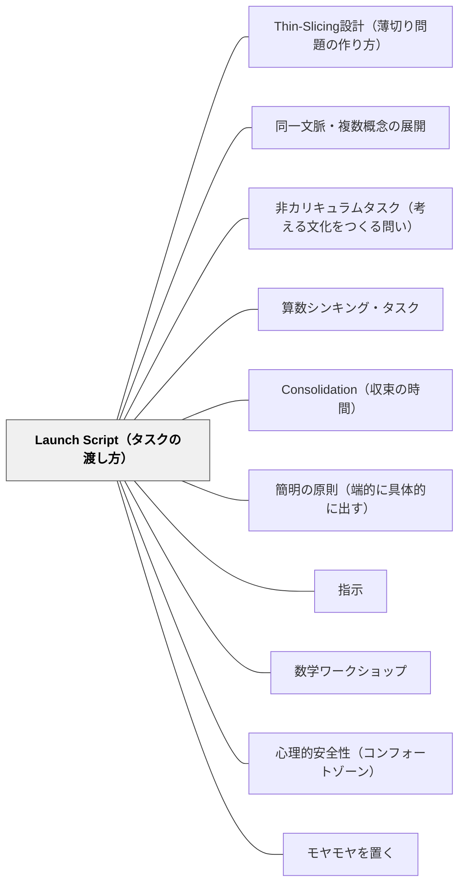

# Launch Script（タスクの渡し方）

**このパタンが完成を助ける大きなパタン**：[[パタン/ソーシャル]]

> 問いを渡す最初の30秒が、子どもが「自分で考える」か「手順を待つ」かを分ける。渡しすぎないことが最重要である。

---

## Pattern Connection

**出典**: Liljedahl, P. & Giroux, M.（2024）*Mathematics Tasks for the Thinking Classroom, Grades K-5.* Corwin.（統合：2026-05-17）

- **既存パタンとの関連**: [[パタン/簡明の原則（端的に具体的に出す）]] の算数版として機能する。「一時一事の原則」とも重なる——問いを渡す場面では、問い"だけ"を渡す。[[パタン/指示]] の「動かす指示」が算数タスクの始まりにも必要。
- **補強された点**: 「渡しすぎない」が抽象的な原則に留まらず、「口頭で渡す・授業開始から5分以内に考え始めるようにする・全員の理解を待たない」という具体的な実装が本書で示され、全タスクに台本が付いた。
- **修正・拡張された点**: 口頭で渡したときが最も思考が引き出されるという結果が、BTCの研究で示された。日本の算数授業でよく行われる「問題の状況をていねいに説明する」導入が、逆に考えることを阻害する場合があるのではないか（本Wikiの読み）。
- **他のパタンへの波及**: [[パタン/Consolidation（収束の時間）]]（新規）はLaunch Scriptとセットで機能する。Launch→探究→Consolidationの流れを支える。

---

## 背景（Context）

Peter Liljedahl（2021）の *Building Thinking Classrooms (BTC)* は、15年にわたる研究（400人を超える教師、数千のミクロな実験）にもとづき、タスクを口頭で渡したときに子どもの思考が最も引き出されることなどを示した。

Liljedahl & Giroux（2024）は、「タスクをどう渡すか」を、50タスクすべてに台本（Launch Script）として書き下ろした。著者は、どの台本も自分たちが初めて使ったときより良くなっているとし、「どう渡すかがタスクの届き方を決める」と述べる。

日本の算数授業では、問題の導入に多くの時間をかけることが多い——黒板に問題を書き、状況を説明し、補助質問を出し、動機づけをしてから問いを提示する。この手順は「全員が問いを理解してから考える」ことをねらうが、過剰な導入は逆に「この問いに対して何をすればよいか」を子どもに示してしまい、考えることの余地を奪う。

## 問題（Problem）

教師が問いを渡すとき、子どもが「入りやすいように」という配慮から、ヒント・手順・つまずきへの対処法を先に提示することがある。この行動は短期的には子どもの混乱を減らすが、長期的には「考え方を思い出す前に教師に聞く」という依存の文化を作る。

反対に、説明が少なすぎて子どもがどこから手をつければよいか全く分からない状態も問題である——「入口が狭すぎる問い」は参加者を減らす。

## 力のかたち（Forces）

- 問いを渡す前に説明しすぎると、子どもは「解法を探す」より「教師の言葉を思い出す」に向かう
- 説明が少なすぎると、多くの子が動き出せない
- 口頭で渡すと子どもは自分の言葉で問いを解釈し、考えが動き出しやすい
- 文章で渡すと、読み解く負荷が加わる（本書は、口頭で渡したほうが思考が引き出されたと報告する）
- 教師が説明を重ねすぎると、子どもが自分で動き出す機会が減る（本書: 「子どもが考える教室にする鍵の一つは、子どもの邪魔をしないこと」（訳は本Wiki））

## 解決（Solution）

**近いパタンとの見分け**：協働・対話の表では、本パタンの見分けの問いは「課題を口頭で、授業の始め5分以内に、渡しすぎずに渡しているか」。全体の表は [[パタン/ソーシャル#近いパタンとの見分け|ソーシャル]] にある。

**タスクは口頭で、授業開始から5分以内に渡す。全員が分かるのを待たず、子どもが動き出してから、困っているところに応じる。**

---

### 本書が述べる実装の要点（第2章・Part 3冒頭）

1. **口頭で渡す**——どの学年・どの場面でも、口頭で渡したときが最も思考が引き出された。ただし口頭だけではなく、表のデータは紙で、パターンは板書で渡し、それをどうするかを口頭で言う
2. **授業開始から5分以内に**——「算数の時間を始める」と宣言した時点から数えて5分以内に、子どもが考え始めているようにする
3. **全員の理解を待たない**——十分な数の子が分かればよく、残りはグループの協働が補う。口頭で渡してから、困っているところに応じる
4. **台本は場面を語り、条件を少しずつ明かす**——課題を最も単純な数学の言葉で読み上げるだけでは足りない。台本は自分のことばで語る
5. **台本のあとに入口と延長が付く**——入りにくい子への調整（Creating Access）と、終えたグループへの延長の台本（Extension Scripts）

### 台本の場面の進み方（本Wikiの整理）

本書の台本を読んで、本Wikiが場面の進み方を三つに分けたものである。本書の用語ではない。

| 部分 | 内容 | 例（Task 1 Hexagon Havocの台本から） |
|------|------|---|
| **状況を見せる** | どんな場面か・何があるかを見せる | 「これは六角形といいます。ここにいくつありますか？」 |
| **問いを出す** | 何をしてほしいかを言う | 「1が二つ、2が二つ、3が二つあります。六角形に一つずつ入れたい。1はどこに入れられる？」 |
| **条件を足す** | 取りかかったあとで条件を明かし、問いを深める | 「言い忘れたけど、同じ数の六角形は接してはいけません。では1はどこに？」 |

---

### Launch Scriptの例：本書の台本から

以下は本書の台本の一部である（英文は原文、日本語は要約）。どの台本も、解き方は言わず、場面を語って問いを渡している。

**Task 1「Hexagon Havoc（六角形の大騒ぎ）」（K-1年、非カリキュラム）：**

> "Teacher: Each of these shapes is called a hexagon. How many hexagons do you see here? …… I want to put one number in each hexagon, I have two 1s, two 2s, and two 3s. Where could I put the 1s?"
> "Teacher: …… I forgot to tell you that none of the same numbered hexagons can be touching each other. So, where can the 1s go?"

（要約）六角形を数え、1,1,2,2,3,3を一つずつ入れる場面を作ってから、「同じ数は接してはいけない」を後から足す。

---

**Task 2「Next Door Numbers（隣の数）」（K-1年、非カリキュラム）：**

> "Teacher: …… Did you know that these numbers are all brothers and sisters? …… 4 thinks that 5 smells funny. 8 thinks that 9 is too loud. And 2 thinks that 1 chews weird. They really don't like the numbers next door."

（要約）1〜10を10個の箱に、隣り合う数が横に並ばないように入れる課題を、「数の兄弟姉妹が引っ越す」という話で渡す。

---

**Task 8「Carnival Conundrum（カーニバルの謎）」（1-4年、非カリキュラム）：**

> "Teacher: The carnival worker said that all he needed to do to win was place the numbers into the circles so that each diagonal arm adds to the same sum."

（要約）カーニバルのゲームの話から入り、1〜5をV字の丸に入れて両腕の合計をそろえる課題に進む。

---

**Task 12「Tables at a Party（パーティーのテーブル）」（K-5年、非カリキュラム）：**

> "Teacher: …… I am going to rent tables for the party. …… I want all the tables that I rent to be the same size. …… I have invited 12 people to my party. What size tables should I get? What are my options?"

（要約）パーティーの準備係になってもらい、12人が空席なく座れる、同じ大きさのテーブルの大きさを探す。

---

### 「消防士的アプローチ」（Firefighter Approach）

Liljedahl & Giroux（2024）は、指示の渡し方について次のように書く（第2章）。全員が指示を理解するまで、書き、言い、見せ、ペアで話し、質問に答え、もう一度言うのは、実はとても非効率である。思考する教室では、十分な数の子が分かればよく、残りはグループの協働が補う。

> "Give the instructions verbally. Then go out and put out any fires. It is much more efficient than trying to prevent the fires."

つまり、先回りして火を防ぐより、口頭で渡してから教室を回り、起きた火に応じるほうが効率がよい、という立場である。

- **ヒントは2種類を区別する**（第4章）：①入口を下げる（チャレンジを下げるヒント）か、②能力を上げる（新しい戦略や道具を教えるヒント）か
- **困っているグループは、まず別のグループに向ける**（第3章）：「あのグループのやっているところを見てごらん」と促し、教師だけが助け手にならないようにする
- （本Wikiの提案）最初に声をかけるときは「何が分かってる？」「どこまでやった？」と聞くことから始める

---

### 日本版の応用例：おはじきの分け方（本Wikiの例）

**日本の教室で使うLaunch Script（Mild → Medium → Spicy形式）：**

> 「おはじきが10個あります。2つの山に分けてください。何通り見つけられるかな？」

Mild：「まずおはじきで実際に分けてみよう」
Medium：「全部見つけた？　どうすれば確実に全部見つけられる？」
Spicy：「おはじきが12個・15個のとき、何通り？　いつもそうなる？」

この導入では「いくつかあると分かっていて、その数を求める」のではなく、「自分でやってみたら分かっていく」構造になっている。

---

### 特別支援学級でのLaunch Scriptの調整

特別支援学級でMildがさらに入りにくい場合、Launch Scriptに次の要素を加える：

- **具体物を手元に置く**——おはじき・ブロック・積み木を最初から渡す
- **教師が一緒に最初の一手をやってみせる**——「こうやって分けてみた。次はどうする？」
- **問いを1文にする**——「これを2つに分けてみよう」だけで始める

「全員が問いを理解してから」ではなく「手を動かすことで問いが分かっていく」設計にする。

---

## 結果（Consequences）

- 子どもが「教師の言葉を待つ」のではなく「自分で試し始める」ことが増える
- 授業開始から5分以内に子どもが考え始め、最初の静寂・混乱・試行が探究への入口になる（本Wikiの読み）
- 「ヒントをもらわないと分からない」という依存が減り、「まずやってみる」文化が育つ
- ただし、Launch Scriptだけを変えても、Consolidation（収束）がないと活動で終わる
- 口頭で渡す原則は、多言語の子が多い教室でも最も思考が引き出されたと本書は報告する。文字の読み書きに困難がある子への配慮にもなりうる（本Wikiの読み）

## 関連パタン
- [[パタン/Thin-Slicing設計（薄切り問題の作り方）]]
- [[パタン/同一文脈・複数概念の展開]]
- [[パタン/非カリキュラムタスク（考える文化をつくる問い）]]

- [[パタン/算数シンキング・タスク]] — Launch Scriptが機能する全体的なタスク設計
- [[パタン/Consolidation（収束の時間）]] — Launch後の探究を概念に変える収束の設計
- [[パタン/簡明の原則（端的に具体的に出す）]] — 指示全般における「渡しすぎない」原則
- [[パタン/指示]] — 動かす指示・終末まで示す指示の基本
- [[パタン/数学ワークショップ]] — Launch→探究→Consolidationが機能する授業構造
- [[パタン/心理的安全性（コンフォートゾーン）]] — 「まずやってみる」文化の前提
- [[パタン/モヤモヤを置く]] — 最初の5分の混乱を「学びの入口」として扱う
- [[教材/算数シンキング・タスク集]] — 日本語版タスクに付いたLaunch Scriptの実例
- [[文献/Mathematics Tasks for the Thinking Classroom（Liljedahl & Giroux）]] — 一次資料

---

## クラスター図

## Actionable Insight

- **今週の算数の導入を1回だけ変えてみる**——「今日の問題は…です。どう解くかというと…」を止め、「〇〇があります。〜はいくつでしょう？　まず試してみて」の短い言葉で始める。授業が始まって5分以内に、子どもが考え始めているようにする
- **「まずやってみて」だけを準備する**——子どもが「どうやるの？」と聞いてきたとき、「まずやってみて」「もっと簡単な場合は？」「何か気づいたことある？」の3つの返しだけを事前に決めておく
- **特別支援学級では「手元に道具を置く」をLaunch Scriptに組み込む**——「おはじきを使っていいよ。これを2つに分けてみよう」——問いと道具を同時に渡すことで、理解が言葉より行動から始まる

---

## 出典

Liljedahl, P., & Giroux, M.（2024）. *Mathematics Tasks for the Thinking Classroom, Grades K-5*. Corwin（Corwin Mathematics Series）. ISBN 978-1-0719-1329-1.

Liljedahl, P.（2021）. *Building Thinking Classrooms in Mathematics*. Corwin.

> "The launch of the task is the most critical moment. Say too much and students stop thinking. Say too little and they can't get started."
> — Liljedahl & Giroux（2024）
