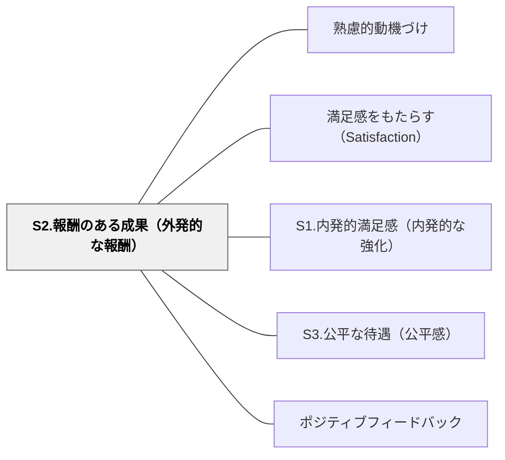

# S2.報酬のある成果（外発的な報酬）

**このパタンが完成を助ける大きなパタン**：[[パタン/熟慮的動機づけ]]

> 達成を認められ、報われる体験が、学習の意味を強化する。外部からの承認は、特に学びはじめの段階で大きな力を持つ。

## [Pattern Connection]

**研究からの補足（2026-10-17）：報酬の条件と内発的動機づけを見分ける（Deciほか1999）**

原典は参加・完了・成績を条件にした報酬を区別する（p. 636）。Wiki側の適用案として、報酬を導入する前に条件を一文で書き、後の自発性も見取る。「努力を認める報酬」なら影響がないと一括して扱わない。 出典：[[文献/報酬の条件と内発的動機づけを見分ける（Deciほか1999）]]。

## 背景（Context）
内発的満足感の補完として、外部からの報酬・承認・評価が動機付けに果たす役割がある。賞賛・成績・ポイント・資格・修了証など、多様な形態の外部報酬が学習の継続と達成の確認に機能する。

## 問題（Problem）
成果が全く認められない環境では、「頑張っても無駄」という無力感が生じる。一方で、外部報酬だけに依存すると内発的動機が損なわれるというジレンマがある。

## 力のかたち（Forces）
- 外部報酬は即効性があり、行動を強化する強力な手段だが、依存が生じやすい
- アンダーマイニング効果：内発的に楽しんでいた活動に外部報酬を与えると興味が低下することがある
- 情報的フィードバック（「ここが良かった」）は内発的動機を損なわずに機能しやすい
- 報酬の公平性・透明性が保たれないと、不満と不信を生む

## 解決（Solution）
**達成に対して適切な承認・賞賛・外部評価を与えることで満足感を補強しつつ、内発的動機を損なわないよう情報的・承認的なフィードバックを中心に設計する。**

**近いパタンとの見分け**：承認や報酬を、何ができたかの情報として届けるのが本パタン。報酬が「やる理由」になると、もともとの好きが弱まることがある（[[パタン/内発的動機づけ]] の過正当化効果）。動機づけの系列の全体の表は [[パタン/熟慮的動機づけ#近いパタンとの見分け|熟慮的動機づけ]] にある。

単なる「よくできました」ではなく、何が良かったかを具体的に伝える情報的フィードバックを中心にする、報酬がプロセスや成長に対して与えられるようにする、内発的価値を育てながら補助的に外部報酬を使うという設計が重要である。

## 結果（Consequences）
- 学習者が努力や達成を外から確認・承認され、継続意欲が維持される
- 外部報酬と内発的動機のバランスを意識した設計ができるようになる
- S1（内発的満足感）と連動させることで、長期的な動機付けの構造が強化される

## クラスター図

## Actionable Insight

- 「よくできました」だけでなく「ここの○○が特によかった」と具体的な内容を指して伝える——情報的フィードバックが内発的動機を損なわずに達成を強化する
- 報酬を「結果」だけでなく「プロセスや成長」に対しても与える（「最後まで粘り強く取り組めた」など）——プロセスへの承認が学習への取り組み方を方向づける
- 外部報酬を段階的に減らしながら「自分がどれだけできたか」という自己評価へと移行する設計を意識する——外部から内部へのシフトが自律的学習者を育てる

## 出典

- 一つの教育のパタン・ランゲージ（岩井輝久）

⚖ **緊張関係**: [[緊張関係マップ]] — [[パタン/内発的動機づけ]]・[[パタン/非随伴的な賞賛]] と拮抗する。判断軸：〈プロセスへの情報か操作かで選ぶ〉

> **研究の裏づけ（2026-10-31）**：米国教育科学研究所の小学校の行動上の問題の実践ガイド（Epstein ほか 2008）は、報酬の使い方として「小さく・すぐに・行動を名指して・いろいろな種類を・だんだん減らして自然な強化に置き換える」を勧める。また「予期されていて、形があり、成果と結びつかない報酬は、報酬のためだけに取り組むようにして学習への関与を損ないうる」とも書き、上の解決（情報的なフィードバック・プロセスへの報酬）と同じ向きである。ただし同ガイドの根拠の要約は「外的な強化の悪影響はほとんどない」とするメタ分析（Cameron ほか 2001、Akin-Little ほか 2004）に寄っており、[[文献/報酬の条件と内発的動機づけを見分ける（Deciほか1999）]] とは結論が違う。報酬の影響は種類と条件によって違うと読む。出典：[[文献/小学校の教室での行動上の問題を減らす（Epsteinほか2008）]]。

## 関連パタン
- [[文献/小学校の教室での行動上の問題を減らす（Epsteinほか2008）]] — 報酬の使い方の条件。根拠の要約は Deci ほか 1999 と別のメタ分析に寄っている
- [[パタン/熟慮的動機づけ]] — 親パタン
- [[パタン/満足感をもたらす（Satisfaction）]] — 親パタン
- [[パタン/S1.内発的満足感（内発的な強化）]] — 関連サブパターン
- [[パタン/S3.公平な待遇（公平感）]] — 関連サブパターン
- [[パタン/ポジティブフィードバック]] — 関連パタン
- [[文献/報酬の条件と内発的動機づけを見分ける（Deciほか1999）]] — 報酬の予告と、何を条件に渡すかを具体的に記録する。

