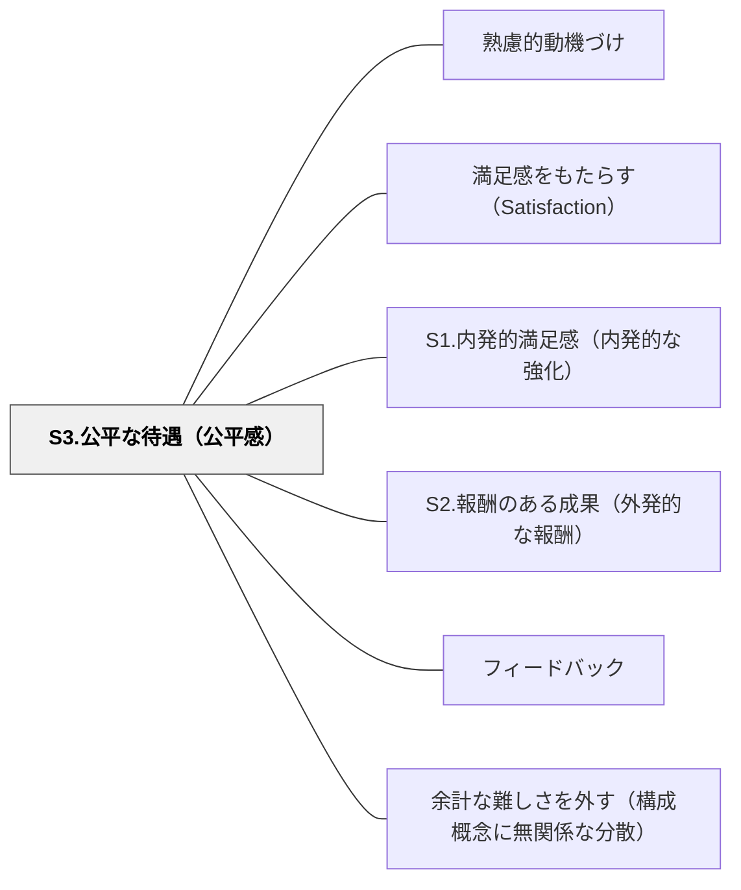

# S3.公平な待遇（公平感）

**このパタンが完成を助ける大きなパタン**：[[パタン/熟慮的動機づけ]]

> 不公平だと感じた瞬間、それまで積み上げた動機は崩れ落ちる。公平な扱いは動機の基盤にある見えにくい柱である。

## 背景（Context）
満足感をもたらすうえで、学習者が「自分は公平に扱われている」と感じることは不可欠な条件である。内発的満足感や外部報酬がいかに優れていても、不公平感があると動機全体が損なわれる。

## 問題（Problem）
学習者が「あの人は評価されるのに自分はされない」「基準がわからない」「特定の人だけ優遇されている」と感じると、動機が急速に失われる。公平感の欠如は、個人の問題ではなくクラス全体の空気を悪化させることもある。

## 力のかたち（Forces）
- 公平感は絶対的な平等ではなく、「ルールや基準が一貫して適用されている」という感覚
- 評価基準の透明性が公平感を支える
- 個別対応や差別化が「不公平」と受け取られないよう、その理由の説明が必要な場合がある
- 一度感じた不公平感は、言葉だけでは回復しにくい

## 解決（Solution）
**評価基準を明示し、それを一貫して適用することで、学習者が「公平に扱われている」という感覚を持てる学習環境を維持する。**

**近いパタンとの見分け**：動機づけ・興味の表では、本パタンの見分けの問いは「評価の規準を先に示し、全員に同じように当てているか」。全体の表は [[パタン/熟慮的動機づけ#近いパタンとの見分け|熟慮的動機づけ]] にある。

ルーブリックなどで評価基準を事前に明示する、フィードバックの機会をすべての学習者に平等に与える、個別対応が必要な場合はその理由を丁寧に伝える、学習者が疑問を表明できる場を設けるといった方法が有効である。

## 結果（Consequences）
- 学習者が「ここは公平な場所だ」という信頼を持ち、動機の土台が安定する
- 評価に対する不満や不信が減り、学習への集中が高まる
- 公平な環境は、学習者同士の関係にも肯定的な影響を与える

> **研究の裏づけ**：子どもは、先生が自分に何を期待しているかを、短い時間で読み取る。先生の期待の研究の総説（Rubie-Davies と Hattie 2024）は、Babad の研究から、子どもはおもに先生のことば以外のふるまいから、10秒もかからずに先生の期待を読み取ったこと、固定観念に引きずられる先生は、期待の低い子にことばでは積極的に教えて埋め合わせようとしながら、表情で否定的な感情を伝えていたことを紹介する（p. 359）。Babad は、偏りの強い先生は、公平に扱われるという子どもの基本的な期待を裏切り、学級全体の士気を下げうると書く（p. 359）。成績の上の子と下の子への扱いの違いには、小学1年生も5年生と同じくらい気づいていた（Weinstein ほか 1987、p. 360）。どれも本論文の紹介による孫引きで、原典は未読。公平感は、評価の規準だけでなく、だれをどれだけ待つか、だれのまちがいを掘り下げるかといった、ことば以外の扱いからも生まれる（本 Wiki の読み）。出典：[[文献/先生の期待の効き目が、先生の信念によってどれだけ違うかを、三つの研究の流れから確かめる（RubieDaviesとHattie2024）]]。

## クラスター図

## Actionable Insight

- ルーブリックなどで評価基準を活動の前に全員に示し、学習者が基準を自分で確認できるようにする——基準の透明性が「公平に扱われている」という信頼の土台になる
- フィードバック・声がけ・机間巡視の機会を特定の学習者に偏らないよう意識して設計する——全員への平等な関与が公平感を維持する具体的な行動になる
- 個別対応が必要な場面では「この人だけ特別扱い」と見えないよう理由を丁寧に伝える——なぜ違う扱いをするかの説明が公平感を守る

## 出典

- 一つの教育のパタン・ランゲージ（岩井輝久）

## 根拠の確かめ（自動生成）

<!-- source-check: 自動生成。手で編集しない。文献ページの frontmatter の source_check から作る -->
このページが引く文献を、本 Wiki が原典でどこまで確かめたかで分けた。くわしくは各文献ページの「書誌・確認した範囲」や「原文との照合」へ。

- **原典照合**（原典にあたって、引用や要約を照らした）：[[文献/先生の期待の効き目が、先生の信念によってどれだけ違うかを、三つの研究の流れから確かめる（RubieDaviesとHattie2024）|RubieDaviesとHattie2024]]

## 関連パタン
- [[パタン/熟慮的動機づけ]] — 親パタン
- [[パタン/満足感をもたらす（Satisfaction）]] — 親パタン
- [[パタン/S1.内発的満足感（内発的な強化）]] — 関連サブパターン
- [[パタン/S2.報酬のある成果（外発的な報酬）]] — 関連サブパターン
- [[パタン/フィードバック]] — 関連パタン
- [[パタン/余計な難しさを外す（構成概念に無関係な分散）]] — 公平さの二つの像（全員同一条件か、全員が力を発揮できる条件か）を測定の言葉で整理する

