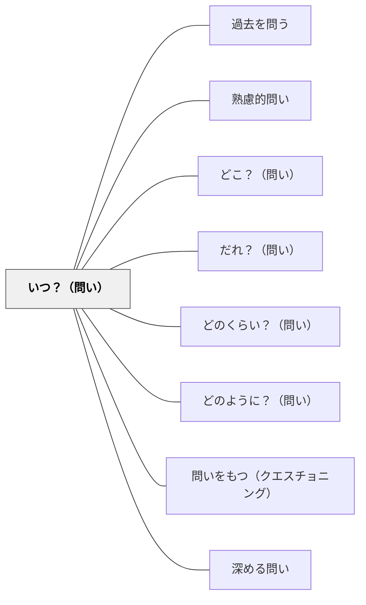

# いつ？（問い）

**このパタンが完成を助ける大きなパタン**：[[パタン/熟慮的問い]]

> 時間・時期・タイミング・順序を問うことで、出来事や知識の時間的文脈を把握する。

## 背景（Context）
知識や事実は時間的文脈の中に位置づけられて初めて意味を持つことが多い。歴史的出来事の前後関係、科学的発見のタイミング、プロセスの順序など、「いつ」という問いは時間的理解を促す基本的な認識の枠組みである。

**原典では**：土居（2026）は、子どもに問いをつくる観点として「5W1H」（「Who」「What」「When」「Where」「Why」「How」）を示すことが多いと書き、観点を明確に示すと「問いを出しましょう。」と抽象的に指導するよりも子どもはどう考えればよいかがわかり、特に学習が苦手な子に有効だと述べる（第4章12「子どもが問いをもてるようになるための指導法」、Kindle版 170/204頁表示）。もとになった深谷（2021）の「ビリヤード法」では、時の観点は「いつから？」「いつまで？」の二つに分けて挙げられている（同）。

教師の発問で時を問う例として、原典は西尾一の実践を挙げる。黒板に3mのテープを示し、「地球の誕生から現在までを3mのテープで表しています。人間は、この紙テープのどのあたりで生まれたでしょうか。」と問う（第2章7「発問自体への工夫② 具体的に問う」、Kindle版 70/204）。これを抽象的に問うと「人間は、地球の歴史の中だとどれくらいに誕生したのでしょうか。」となり、子どもはどう答えたらいいかわかりにくく、意欲的に考えるとは思いにくい、と原典は比べている（同）。時期を問うときは、時間を目に見える長さに置き換え、「どのあたりか」を指せる形にすると答えやすくなる、という例である。

**岩井の講話では**：5W1Hと言われるものとして「何々とは何か、いつ、どこ、なぜ、誰、どのように、どのくらい、どうすべきか」を並べて挙げている（講話 19:31〜19:53）。講話で示されているのは名前までである。

## 問題（Problem）
学習者は事実や知識を時間的文脈から切り離して覚えることが多く、「いつ起きたか」「なぜその順序なのか」を理解しないまま暗記する傾向がある。時間軸の理解なしには、因果関係や発展の過程を把握することが難しい。

## 力のかたち（Forces）
- 時間的順序の把握は因果関係の理解を促進する
- 「いつ」を問うことで、特定の文脈や条件が明確になる
- タイミングの重要性への気づきが、戦略的・計画的思考を育てる
- 時系列の整理は、複雑な情報を構造化する有効な方法である

## 解決（Solution）
「それはいつ起きたか？その前後には何があったか？なぜそのタイミングだったのか？」と問いかける。例えば歴史学習では「明治維新はなぜあのタイミングで起きたか？前後の出来事と関連して考えよう」と時間軸に沿った問いを立てる。年表・タイムライン・フローチャートなどの視覚ツールと組み合わせると効果的である。

---

**例：時間をテープにして「どのあたり？」と問う**（理科・6年「土地のつくりと変化」／社会・6年 歴史の導入）
1. 黒板に長いテープ（3mなど）を貼り、「左はしが地球の誕生、右はしが今日です」と示す。
2. 「人間は、このテープのどのあたりで生まれたと思う？」と問い、一人ずつ予想の位置に名前マグネットを貼る。
3. 予想の位置がばらばらになったところで、なぜそこにしたかを何人かに聞く。
4. 実際の位置（右はしのごくわずか手前）を示し、「予想とどれくらい違った？」と、予想とのずれを言葉にする。
（原典 Kindle版 70/204 で紹介された西尾一の実践をもとにした手順。2〜4は Wiki 側の組み立て）

---

**例：「いつから？」「いつまで？」で出来事に幅をもたせる**（社会・5年「わたしたちの生活と環境」など、問題の移り変わりを調べる単元）
1. 単元のテーマ（「公害」など）を板書し、「いつから」「いつまで」の二つのカードを貼る。
2. 「このテーマについて、『いつから？』『いつまで？』を使った問いを一つずつ作ろう」と指示し、付せんに書く。
3. 集めた問い（「いつから問題になったのか」「今も続いているのか」など）を、資料で調べられそうなものとそうでないものに分ける。
4. 調べられそうな問いを一つ選び、資料から始まりと終わり（または今も続いていること）を年表に書き込む。
（原典 Kindle版 170/204 のビリヤード法の観点をもとにした Wiki 側の手順）

**近いパタンとの見分け**：時期・順序・タイミングを問うのが本パタン。起源と変化を問うのは [[パタン/過去を問う]]。問いの系列の全体の表は [[パタン/熟慮的問い#近いパタンとの見分け|熟慮的問い]] にある。

## 結果（Consequences）
- 知識が時間的文脈の中に位置づけられ、理解が立体的になる
- 因果関係・前後関係の把握が深まる
- 時間軸思考が、歴史・科学・プロジェクト管理など多分野に応用できるようになる

- 注意点：「いつ？」は年号や日付の一問一答で終わりやすい。テープや年表など、時間の長さが目に見える形と組み合わせ、前後の出来事や期間の幅へ問いを広げる。

## 関連パタン
- [[パタン/過去を問う]]
- [[パタン/熟慮的問い]] — 親パタン
- [[パタン/どこ？（問い）]] — 空間的文脈を問うペアパタン

- [[パタン/だれ？（問い）]] — 5W1H の「誰」：主体を問う兄弟パタン
- [[パタン/どのくらい？（問い）]] — 5W1H の「量・程度」：時間の長さを問うときにも連携する
- [[パタン/どのように？（問い）]] — 5W1H の「方法」：時系列のプロセスを問う兄弟パタン
- [[パタン/問いをもつ（クエスチョニング）]] — 5W1H を使って問いを構造化する上位パタン
- [[パタン/深める問い]] — 時間軸の問いが探究を深める

## クラスター図

## Actionable Insight

- 歴史や科学の学習で「それはいつ起きたか？その前後には何があったか？」と時間軸に沿った問いを立てる——知識が時間的文脈の中に位置づけられ理解が立体的になる
- 「明治維新はなぜあのタイミングで起きたか？」のように「なぜそのタイミングか」を問う——タイミングへの問いが因果関係の理解を深める
- 年表・タイムラインと組み合わせて「いつ？」を問う——視覚ツールが時系列思考の足場になる

## 出典
- [[文献/熟慮的問いのパターンリスト（動画記録）]]

- 土居正博（2026）『自分で考え、学べる子を育てる！ 発問の技術』学陽書房（初版・電子書籍版） — 第2章「発問自体への工夫② 具体的に問う」、第4章「子どもが問いをもてるようになるための指導法」。頁は Kindle 版の表示（204頁中）
- 深谷達史（2021）「問いに基づく探究的な学習とその実践」小山義徳・道田泰司編『「問う力」を育てる理論と実践』ひつじ書房 — 土居（2026）による紹介で確認（原典未確認）
- 岩井輝久（年不明）『熟慮的問いのパターンリスト』［動画］ https://youtu.be/WivskVtxG34 — 2026-11-13 に文字起こしで確認（19:31〜19:53）
