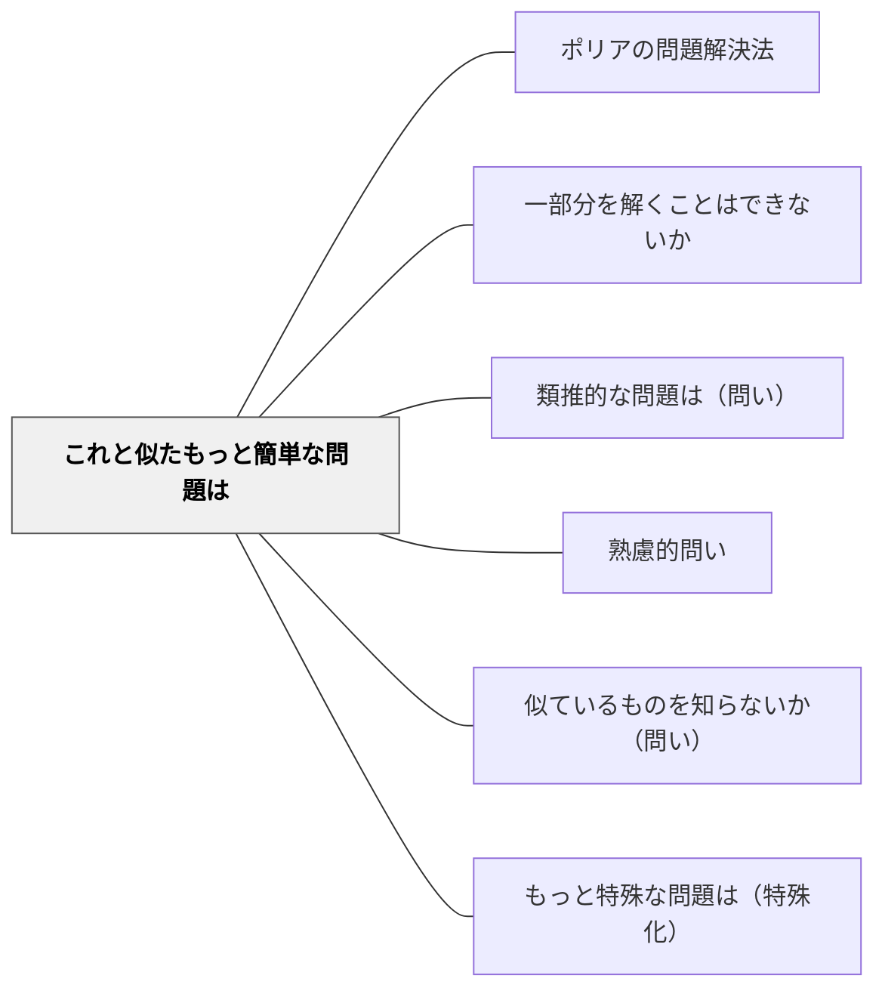

# これと似たもっと簡単な問題は

**このパタンが完成を助ける大きなパタン**：[[パタン/熟慮的問い]]

> 問題を単純化して足がかりを作り、そこから元の問題へと橋を架ける。

## 背景（Context）
難しい問題に直面したとき、全体をいきなり解こうとすると詰まってしまうことが多い。類似した単純な問題を解くことで思考のパターンを掴み、それを応用して本来の問題に取り組む戦略は、問題解決の基本的な技法である。

**岩井の講話では**：難しい問題を解くとき、子どもたちにも「もっと簡単な数字とか」「簡単な問題で考えてみるといい」と伝えていると話し、小学校の算数の問題解決でも使うと述べる（15:15〜15:33）。そのうえで、大人の自分にも世の中に難しい問題がたくさんあり、それを少し簡単な問題に置き換えて考えることが役立っている、と自分の経験として語っている（15:33〜15:42）。講話はこの問いを、もっと一般的な問題・もっと特殊な問題と続けて読み上げている（15:00〜15:15）。

**本Wikiの関連ページでは**：[[パタン/ポリアの問題解決法]] は、Nappo & Valente が冒頭に引くポリアの一文 "If you can't solve a problem, there is an easier problem you can solve: find it." を紹介し、簡単な問題に置き換えることを類推的推論の一つとして位置づけている。同ページの Schoenfeld（1992）の項は、「小さな数で試す」を選んだら、何を小さくし、どんな関係を探すかまで具体化することを挙げる。

## 問題（Problem）
学習者は難問に圧倒されると思考が停止しやすい。「何から手をつければよいか」が分からないまま時間が過ぎる。問題の核心的な構造は共通していても、数値や条件の複雑さによって思考が阻まれることがある。

## 力のかたち（Forces）
- 単純な事例は思考の練習台になり、解法の本質を浮き彫りにする
- 成功体験が小さくても自信と方向感を与える
- 単純化した問題の解法を元の問題に拡張することで、段階的理解が生まれる
- 「何を単純化できるか」を考えること自体が問題の構造分析になる

## 解決（Solution）
**近いパタンとの見分け**：問いの型の表では、本パタンの見分けの問いは「問題を単純にした足がかりをつくっているか」。全体の表は [[パタン/熟慮的問い#近いパタンとの見分け|熟慮的問い]] にある。

「この問題と同じ構造で、もっと簡単な問題を作ってみよう。数字を小さくしたら？条件を一つ減らしたら？」と問いかける。例えば「100個のものを並べる問題なら、まず3個や4個で試してみよう」と具体的に誘導する。単純な場合の解法を確認してから、元の問題に戻ることで解法が見えてくる。

---

**例：木の本数を、間の数を小さくして考える**（算数・3〜4年）
1. 「まっすぐな道に、はしからはしまで木が植えてあります。木と木の間は15か所あります。木は何本ですか」を出し、すぐ15本と答えた子に「もっと簡単な問題で確かめられないか」と問う。
2. 子どもは間が1か所、2か所、3か所の場合を図にかき、木の本数を数える（2本、3本、4本）。
3. 表にして、「木の本数は、間の数より1多い」というきまりを見つける。
4. 元の問題に戻り、15か所なら16本と答え、はしに木があるという条件を簡単な問題でも変えていないことを確かめる。

---

**例：小数のかけ算を、整数に置き換えて式を決める**（算数・5年）
1. 「1mが80円のリボンを2.4m買います。代金はいくらですか」で式に迷う子に、「数をもっと簡単にした問題なら、式はどうなるか」と問う。
2. 子どもは「2mなら 80×2」「3mなら 80×3」と、整数の場合の式を書く。
3. 「長さが2.4mに変わっても、同じ式の形でよいか」を問い、数直線で確かめて 80×2.4 と立てる。
4. 答えが 80×2 と 80×3 の間に入るかを見て、置き換えた問題とのつながりを確かめる。

## 結果（Consequences）
- 思考の詰まりが解消され、解法への道筋が開ける
- 単純化と一般化の往復によって、問題の本質的構造が理解される
- 難しい問題を、構造を保ったまま簡単な問題に置き換えて考える習慣が育つ（部分に分けるのは [[パタン/一部分を解くことはできないか]]）

- 注意点：数を小さくするとき、問題の関係まで変えてしまうと元の問題に戻れない（例：はしに木がない場面にしてしまう）。何を簡単にし、何を変えずに残すかを確かめてから置き換える。

## 関連パタン
- [[パタン/ポリアの問題解決法]]
- [[パタン/一部分を解くことはできないか]]
- [[パタン/類推的な問題は（問い）]]
- [[パタン/熟慮的問い]] — 親パタン
- [[パタン/似ているものを知らないか（問い）]] — 類似問題の探索
- [[パタン/もっと特殊な問題は（特殊化）]] — 特殊化による単純化の深化

## クラスター図

## Actionable Insight

- 難問の前に「数字を小さく（100→3）してみよう」と言い、まず単純な場合で解かせる——成功体験が小さくても方向感と自信を与え、元の問題への橋になる
- 「この問題の核心は何？一つだけ残して条件を全部取り除いたら？」と問う——本質だけの単純版を作る作業が問題の構造分析を自然に促す
- 「単純な場合で見つけたパターンを、元の難しい問題に当てはめるとどうなる？」とつなぐ——単純化から一般化への往復が問題解決の応用力を育てる

## 出典
- [[文献/熟慮的問いのパターンリスト（動画記録）]]
- ジョージ・ポリア（1954）『いかにして問題をとくか』丸善出版

- 岩井輝久（年不明）『熟慮的問いのパターンリスト』［動画］ https://youtu.be/WivskVtxG34 — 2026-11-13 に文字起こしで確認（15:00〜15:15、15:15〜15:42）
- [[文献/数学の問題解決で方略を選び直す（Schoenfeld1992）]] — [[パタン/ポリアの問題解決法]] の記述による
- [[文献/Analogical Reasoning in Science（Nappo & Valente）]] — [[パタン/ポリアの問題解決法]] の記述による
