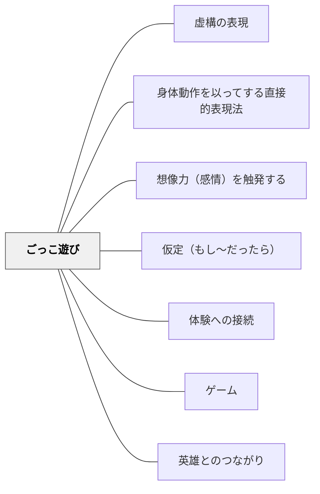

# ごっこ遊び

**このパタンが完成を助ける大きなパタン**：[[パタン/想像力（感情）を触発する]]

> 登場人物になりきることで、内側から理解する

## 背景（Context）

子どもはごっこ遊びを通じて世界を理解し、他者の視点を内側から体験する。この「なりきり」能力は学習においても強力な認知的道具となる。

## 問題（Problem）

テキストや資料を外側から「観察」するだけでは、登場人物の感情・動機・文脈への深い理解が生まれにくい。どうすれば学習者が他者の視点に感情的に入り込めるか。

## 力のかたち（Forces）

- ロールプレイは感情移入を促し、他者理解を深める
- 「なりきり」によって、学習者は自分の持つ固定観念に気づくことがある
- 実践（「飛ぶ教室」の登場人物になりきって読書会で質問に答える）が示すように、テキスト理解が深まる
- 仮想の役割に感情移入しすぎて、学習者の個人的感情と混同されることがある

## 解決（Solution）

授業にロールプレイ・なりきり活動を取り入れる。読書会では登場人物の視点から質問に答える活動を行う（例：「飛ぶ教室」のキャラクターになりきって他の学習者と対話する）。社会科・歴史では歴史的人物の立場から意思決定を模擬する。「もし自分が〇〇だったら」という視点転換を日常的に促す。

**近いパタンとの見分け**：想像力・感情（イーガン）の表では、本パタンの見分けの問いは「登場人物や役になりきって、内側から考えているか」。全体の表は [[パタン/想像力（感情）を触発する#近いパタンとの見分け|想像力（感情）を触発する]] にある。

> **研究の裏づけ**：（実践者の記録・効果の研究ではない）幼稚園で37年教えたペイリーは、ごっこ遊びを子どもの「本気の、欠かせない営み」とし、「もし〜なら」「言いかえると」の型をつくって抽象的な思考への入り口になるという。「赤ちゃんの弟をどう思う？」には答えにくい子も、「ゴルディロックスは子ぐまをどう思っているかな？」なら場面を思い描いて考えられる。子どもの遊びの中身から始めた話し合いはよく進み、先生の予定から始めると止まりがちだった。決まりを破った子を「悪い子」でなく遊びの役（どろぼう）として扱い直すと、舞台の決まりで問題を扱えるようになった。出典：[[文献/ごっこ遊びは幼い子の本気の仕事、子どもの話を書き留めて物語を演じる（Paley2009対談）]]（pp. 122–127）。

## 結果（Consequences）

- 他者の視点への感情的・認知的な理解が深まる
- テキストや歴史的事象への関与が高まる
- 役割と自分の混同を防ぐため、ロールプレイの「開始・終了」を明確にする必要がある

## 関連パタン
- [[パタン/虚構の表現]]
- [[パタン/身体動作を以ってする直接的表現法]]

- [[パタン/想像力（感情）を触発する]]
- [[パタン/仮定（もし〜だったら）]]
- [[パタン/体験への接続]]
- [[パタン/ゲーム]]
- [[パタン/英雄とのつながり]]
- [[文献/ごっこ遊びは幼い子の本気の仕事、子どもの話を書き留めて物語を演じる（Paley2009対談）]] — ごっこ遊びは幼い子の本気の仕事で、抽象的な思考への入り口（ペイリー）

## クラスター図

## Actionable Insight

- 読書会で「この登場人物の立場から、この場面でどう感じた？」と問い、キャラクターになりきって答えさせる——他者の視点に感情的に入ることがテキスト理解を内側から深める
- 歴史の授業で「あなたは当時の〇〇国の指導者です。どんな決断をしますか？」とロールプレイを設計する——意思決定のシミュレーションが歴史的文脈への理解と共感を育てる
- ロールプレイの前後に「これはごっこです」と明示する宣言の時間を作る——「開始・終了」の境界を明確にすることで役割と自己の混同を防ぎ安全な学習環境を保つ

## 出典

Egan, K. (2005). *An Imaginative Approach to Teaching*. Jossey-Bass.（邦訳（2010）『想像力を触発する教育――認知的道具を活かした授業づくり』北大路書房）

## 根拠の確かめ（自動生成）

<!-- source-check: 自動生成。手で編集しない。文献ページの frontmatter の source_check から作る -->
このページが引く文献を、本 Wiki が原典でどこまで確かめたかで分けた。くわしくは各文献ページの「書誌・確認した範囲」や「原文との照合」へ。

- **原典照合**（原典にあたって、引用や要約を照らした）：[[文献/ごっこ遊びは幼い子の本気の仕事、子どもの話を書き留めて物語を演じる（Paley2009対談）|Paley2009対談]]
