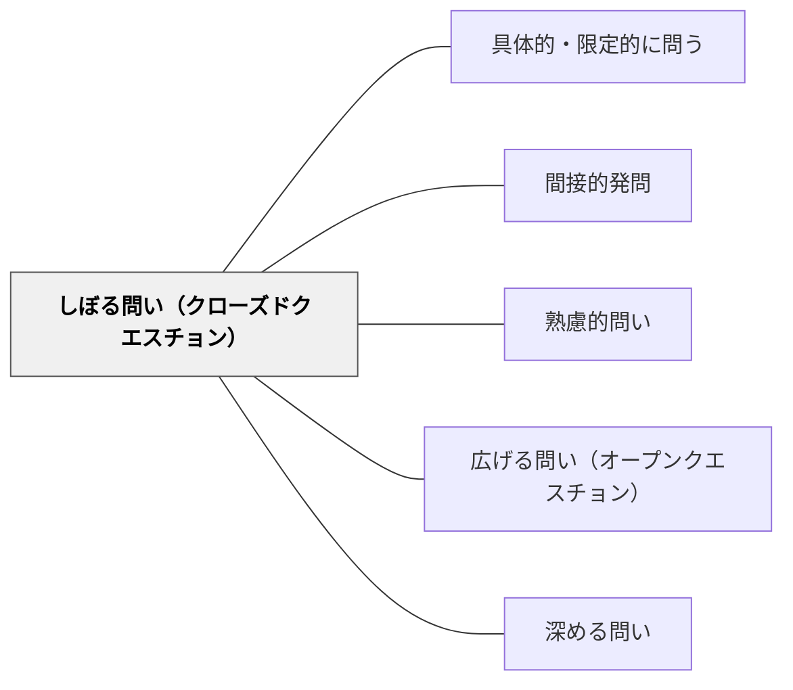

# しぼる問い（クローズドクエスチョン）

> はい・いいえや選択肢など、答えの範囲を限定した問いや、考える対象を一つに定めた問いで、焦点化・確認・評価を行う。

## 背景（Context）
学習の場では、特定の理解の確認や選択・判断を求める場面がある。答えが広がりすぎると焦点が定まらず、議論や評価が難しくなる。答えの範囲を絞った問いは、確認・判断・焦点化に効果的である。

**原典では**：土居（2026）は「クローズドクエスチョン」という語は使わないが、答えの範囲をしぼる発問の工夫を二つ挙げている。一つは「具体的（限定的）に問う」で、「ここで言う『具体的』とは、子どもにとって『聞かれていること』が明確で、今何を考えるべきかが限定されているということです」と定義する（第3章2「具体的（限定的）に問う」、Kindle版 105/204頁表示）。たとえば「なぜ内陸にも工業都市があるのだろう？」ではなく、ICチップを見せながら「これは内陸の工業都市で作られているのですが、なぜ海沿いではないのだろう？」と問うと、「作られているもの」に思考が限定され、製品の特徴と自然条件を結び付けて考えやすくなる（同）。ここでの「しぼる」は、はい・いいえで答える形にすることではなく、考える対象を一つに定めることである。

もう一つは「選択肢を入れる」で、「ごんはどんな気持ちだったのでしょうか。」より「ごんは、幸せだったのでしょうか。それとも不幸せだったのでしょうか。」の方が考えをもちやすく表現しやすい、とする（第2章10、Kindle版 77/204）。選択肢があると他の子との考えのズレも見えやすくなり、選んだ「理由」として自分の考えが自然に出てくる（第3章5、Kindle版 111/204）。

ただし原典は、しぼることの代償も繰り返し書いている。本来多様な捉え方がある中で選択肢を示して判断を迫るのは、「子ども達の考えに制限をかけることにもなりかねない」（Kindle版 77/204）。また、発問の機能として長崎（2010）の区分を引き、確認や収束の役割を果たす「小さな発問」は、思考の拡散や深化をねらう主発問への足掛かりとして補助発問で用いるものと位置づけている（第1章2、Kindle版 17/204）。さらに、子どもが育ってきたら限定の工夫を減らすよう勧め、「限定的」を外した「この説明文の中で、少しおかしいなと思う段落はあるかな。」は、子どもが課題も自分で見つけなければならないぶん難しくなる、と比べている（第4章6、Kindle版 148/204）。

**岩井の講話では**：「絞るとクローズドクエスチョン」と述べ、「広げる」（オープンクエスチョン）と対にして挙げている（講話 18:52〜19:06）。

## 問題（Problem）
すべての問いをオープンにすると、議論が発散しすぎて収拾がつかなくなる場合がある。また、学習の理解度を確認する場面では、はっきりした答えを求める問いが必要である。クローズドクエスチョンを意図的に使わなければ、確認と評価の機会が不明確になる。

## 力のかたち（Forces）
- 選択肢を与えることで、考えやすくなる学習者がいる
- 明確な答えを求めることで、知識の確認ができる
- 絞られた問いは議論の焦点を定める効果がある
- 閉じた問いだけでは思考の広がりが生まれない

## 解決（Solution）
**近いパタンとの見分け**：問いの型の表では、本パタンの見分けの問いは「はい・いいえや選択肢で、答えの範囲を限って確かめているか」。全体の表は [[パタン/熟慮的問い#近いパタンとの見分け|熟慮的問い]] にある。

「これは正しいですか？」「AとBどちらが大きいと思う？」「三つの選択肢のうち、どれが答えだと思う？」と答えの範囲を限定した問いを使う。たとえば実験結果の予測で「温度は上がる・下がる・変わらない、どれだと思う？」と三択にする。理解確認では「この公式は正しい？間違っている？」と二択で問う。

---

**例：実物で問いの的を一つにしぼる**（社会・5年「工業生産」）
1. 「工業都市は海沿いに多かったね」と、前の時間までの学習を短く確かめる。
2. 内陸にも工業都市があることを示す地図を見せる。
3. ICチップ（実物または写真）を見せ、「これは内陸の工業都市で作られているのですが、なぜ海沿いではないのだろう？」と問う。
4. 出てきた考え（軽いので運びやすい・空港や高速道路がある・きれいな水が要るなど）を「製品の特徴」と「土地の条件」に分けて板書する。
（原典 Kindle版 105、183/204 の例をもとにした手順）

---

**例：二択でしぼり、理由で広げ直す**（国語・説明文全般、高学年）
1. 筆者の主張を全体で確かめたあと、「あなたは筆者の主張に納得できますか？それとも納得できませんか？」と二択で問う。
2. どちらかに名前マグネットを貼り、学級の考えの分かれ方を目で見えるようにする。
3. 「自分の知識や経験もふまえて、そう考えたわけをノートに書きましょう」と指示する。
4. 少数の側の理由から聞き、二択では言い表せない考え（「ここまでは納得、ここからは納得できない」など）が出たら、それも板書に加える。
（原典 Kindle版 111、195/204 の例をもとにした手順。4は Wiki 側の組み立て）

## 結果（Consequences）
- 全員が参加しやすく、理解度の確認がしやすくなる
- 選択の理由を問うことで、次の深める問いへ移行できる
- 焦点が明確な議論と合意形成が生まれやすくなる

- 注意点：選択肢や限定は考えやすさと引きかえに思考の幅を狭める（土居 2026 は「子ども達の考えに制限をかけることにもなりかねない」と書く）。しぼったあとは理由を聞いて広げ直し、学級が育ってきたら限定を外していく。

## 関連パタン
- [[パタン/具体的・限定的に問う]]
- [[パタン/間接的発問]]
- [[パタン/熟慮的問い]] — 親パタン
- [[パタン/広げる問い（オープンクエスチョン）]] — 対になる問いの形式
- [[パタン/深める問い]] — 確認の後に掘り下げる

## クラスター図

## Actionable Insight

- 理解確認の場面で「正しいか・間違っているか」「AかBか」と二択・三択で問う——全員が参加しやすく理解度の確認がしやすくなる
- 「温度は上がる・下がる・変わらない、どれだと思う？」と三択にする——選択肢を与えることで考えやすくなる学習者が参加できる
- しぼる問いで答えを確認した後、「なぜそう思う？」と続けて深める問いへ移行する——確認の後の掘り下げがより深い学習へつながる

## 出典
- [[文献/熟慮的問いのパターンリスト（動画記録）]]

- 土居正博（2026）『自分で考え、学べる子を育てる！ 発問の技術』学陽書房（初版・電子書籍版） — 第1章「発問の機能を使い分ける」、第2章「発問自体への工夫⑤ 選択肢や思考のヒントを入れる」、第3章「具体的（限定的）に問う」「選択肢を入れる」、第4章「どの順番で工夫を減らすといいか」、第5章「なぜ内陸にも工業都市がある？」「筆者の主張に対してあなたはどう考えるか？」。頁は Kindle 版の表示（204頁中）
- 長崎伸仁（2010）『新国語科の具体と展望』メディア工房ステラ — 土居（2026）による紹介で確認（原典未確認）
- 岩井輝久（年不明）『熟慮的問いのパターンリスト』［動画］ https://youtu.be/WivskVtxG34 — 2026-11-13 に文字起こしで確認（18:52〜18:59）
