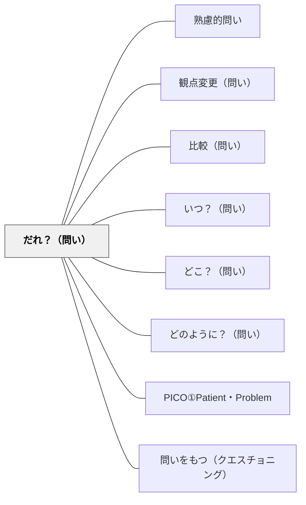

# だれ？（問い）

**このパタンが完成を助ける大きなパタン**：[[パタン/熟慮的問い]]

> 人・主体・登場人物を問うことで、議論の焦点を具体的なアクターに絞り込む。

## 背景（Context）
学習や対話の場において、物事や出来事が語られるとき、「誰がそれをしているのか」「誰が影響を受けているのか」という主体が曖昧なまま話が進みやすい。主体が不明確だと、責任の所在や行為者の意図が見えにくくなる。

**原典では**：土居（2026）は、子どもに問いをつくる観点として「5W1H」（「Who」「What」「When」「Where」「Why」「How」）を示すことが多いと書き、観点を明確に示すと「問いを出しましょう。」と抽象的に指導するよりも子どもはどう考えればよいかがわかり、特に学習が苦手な子に有効だと述べる（第4章12「子どもが問いをもてるようになるための指導法」、Kindle版 170/204頁表示）。もとになった深谷（2021）の「ビリヤード法」でも、最初に挙がる観点は「誰が」である（同）。

教師の発問としての「誰」は、原典では二つの使われ方で出てくる。一つは判断を求める問いで、道徳「ロレンゾの友達」（6年）の発問を工夫の多い順に並べた段階の中に、「誰の考え方が最もロレンゾのことを思っていると思う？」と「誰の考え方が一番良いと思う？」が置かれている（第5章「どうしたらいいのかな？」、Kindle版 187/204）。前者は「ロレンゾのことを思っている」という観点をしぼって示し、後者はその観点を外している。もう一つは主発問の前の確認で、「ちいちゃんのかげおくり」（3年）で最終場面の意味を考える前に、場面ごとのちいちゃんの様子を出し合い、「ところで中心人物は誰だった？」と尋ねて「ちいちゃん！」と確かめておく（第2章14「論理的な学びの文脈をつくる」、Kindle版 93/204）。中心人物が誰かを全員が押さえていることで、「中心人物であるちいちゃんが最終場面には出てこない」ことから「いらないのでは？」と問う、次の発問が成り立つ。

**岩井の講話では**：5W1Hと言われるものとして「何々とは何か、いつ、どこ、なぜ、誰、どのように、どのくらい、どうすべきか」を並べて挙げている（講話 19:31〜19:53）。講話で示されているのは名前までである。

## 問題（Problem）
議論が抽象的・一般論的になり、「誰の話をしているのか」がはっきりしないため、学習者が自分ごととして考えにくくなっている。主体のない語りは思考を浅くする。

## 力のかたち（Forces）
- 抽象的な議論は安全だが、学びを深めにくい。
- 主体を特定すると議論が具体化し、責任・視点・感情が浮かび上がる。
- 「誰」という問いは時に敏感な話題を開くため、場の安全性が必要となる。

## 解決（Solution）
「だれが？」「だれにとって？」「だれが決めたのか？」と主体を問う問いを意図的に挿入する。人物・立場・役割を明示させることで、議論に具体性と多様な視点をもたらす。

---

**例：「中心人物は誰だった？」で次の問いの足場をつくる**（国語・3年「ちいちゃんのかげおくり」など、最終場面で中心人物が出てこない物語）
1. 単元の終盤、場面ごとに「このとき、ちいちゃんはどんな様子だった？」を短く出し合い、板書に並べる。
2. 最終場面で子どもの言葉が止まったら、「なるほど、最後は出てこないんだね。ところで、中心人物は誰だった？」と確かめる。
3. 「中心人物が出てこない場面なら、いらないよね？」と投げかける。
4. 「いらない」「いる」に分かれて話し合い、最終場面があることで物語がどう変わるかをノートにまとめる。
（原典 Kindle版 93、179/204 の手順をもとにしたもの）

---

**例：「誰の考えが一番〜？」で立場を比べる**（道徳・高学年、登場人物が複数の考えをもつ教材）
1. 登場人物が迷う場面まで範読し、それぞれの人物の考えを短く板書で整理する。
2. 「誰の考え方が、いちばん相手のことを思っていると思う？」と、観点を示して問う。
3. 名前マグネットを人物の考えの下に貼り、選んだ理由をノートに書く。
4. 学級が慣れてきたら、観点を外して「誰の考え方が一番良いと思う？」と問い、何を「良い」としたかを話し合う。
（原典 Kindle版 187〜188/204 の段階づけをもとにした手順）

**近いパタンとの見分け**：問いの型の表では、本パタンの見分けの問いは「人・主体・登場人物を問い、話を具体的な誰かに絞っているか」。全体の表は [[パタン/熟慮的問い#近いパタンとの見分け|熟慮的問い]] にある。

## 結果（Consequences）
議論が具体的な人物・立場・視点に根ざすようになり、共感や批判的思考が促される。一方、特定の人物に焦点が当たることで話が個人攻撃にならないよう注意が必要である。

- 注意点：「誰が〜？」を学級の実在の子どもに向けて使うと、犯人探しや個人の評価になりやすい。原典の例はどれも教材の中の人物に向けた問いであり、教室の出来事を扱うときは「どの立場の人が」に言い換える。

## 関連パタン
- [[パタン/熟慮的問い]] — 親パタン
- [[パタン/観点変更（問い）]] — 「誰の立場で見るか」へと展開できる
- [[パタン/比較（問い）]] — 異なる人物・主体を比較する問いと連携する

- [[パタン/いつ？（問い）]] — 5W1H の「時」：誰・いつをセットで問う兄弟パタン
- [[パタン/どこ？（問い）]] — 5W1H の「場所」：誰・どこをセットで問う兄弟パタン
- [[パタン/どのように？（問い）]] — 5W1H の「方法」：誰がどのようにを問う兄弟パタン
- [[パタン/PICO①Patient・Problem]] — 「誰にとっての問題か」を明確化するフレームワーク
- [[パタン/問いをもつ（クエスチョニング）]] — 5W1H を使って問いを構造化する上位パタン

## クラスター図

## Actionable Insight

- 「誰がそれをしているのか」「誰が影響を受けているのか」を授業の途中で問う——主体が明確になると議論が具体化し、共感や批判的思考が生まれる
- 歴史や社会の事柄を話し合うとき、「誰の立場で語っているか」を確認する——視点を明示することで多様な立場への気づきが生まれる
- グループ討論で「誰が決めたのか？」を問う——責任の所在を問うことが当事者意識と批判的思考を促す

## 出典
- [[文献/熟慮的問いのパターンリスト（動画記録）]]

- 土居正博（2026）『自分で考え、学べる子を育てる！ 発問の技術』学陽書房（初版・電子書籍版） — 第2章「『整理』への工夫② 論理的な学びの文脈をつくる」、第4章「子どもが問いをもてるようになるための指導法」、第5章「この場面は何のためにある？」「どうしたらいいのかな？」。頁は Kindle 版の表示（204頁中）
- 岩井輝久（年不明）『熟慮的問いのパターンリスト』［動画］ https://youtu.be/WivskVtxG34 — 2026-11-13 に文字起こしで確認（19:31〜19:53）
