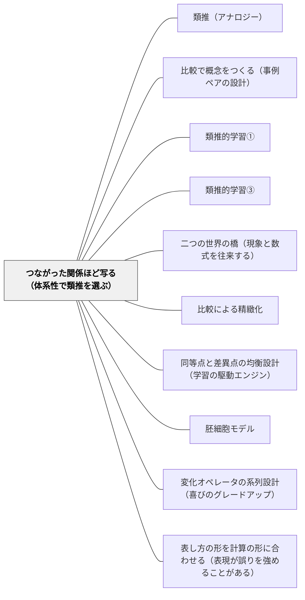

# つながった関係ほど写る（体系性で類推を選ぶ）

> 太陽系と原子の類推で、「太陽は惑星より重い」は原子に写るのに、同じ形の「太陽は惑星より熱い」は写らない。写るのは、ほかの関係とつながって一つの体系をつくっている関係である。類推やお手本を選ぶときは、写したい関係がほかの関係とつながっているかを見る。

## [Pattern Connection]

このWikiの類推のパタンは、「見た目（属性）ではなく関係が写る」という構造写像理論の核心を共有している（[[パタン/類推（アナロジー）]]・[[パタン/類推的学習③]]）。しかし、**関係のうちどれが写るのか**は書かれていなかった。

[[文献/Structure-Mapping（Gentner, 1983）]] は、その答えを**体系性の原理**として出した。互いにつながり合う関係の体系に属している関係は、孤立した関係よりもターゲットに持ち込まれやすい（p. 163）。「重い」は、距離・引力・公転とともに中心力の方程式で互いに制約し合う体系に属している。「熱い」はその体系の外にある。だから「重い」は写り、「熱い」は写らない（p. 162–164）。

- **補強点**：関係を写すと言っても、子どもは関係を一つずつばらばらに写すことがある。本パタンは、教師が類推やお手本を**選ぶ段階**で、写したい関係が体系の中にあるかを確かめる基準を足す
- **[[パタン/比較で概念をつくる（事例ペアの設計）]] との差分**：あちらは二つの事例の「何を揃え、何だけを変えるか」を設計する。本パタンは、揃えた関係が**ほかの関係とつながっているか**を点検する
- **根拠の強さについて**：体系性の原理は1983年の論文では理論として提案されたもので、本論文の中の実証は短い（関係の情報が多い解釈ほど「うまい類推」と評価された、など）。のちの研究の評価は本ページでは扱わない

---

## 背景（Context）

教室では類推がよく使われる。電気を水の流れにたとえる、物語の構成を家の設計図にたとえる、新しい文章の型をお手本の文章から学ぶ。どれも、よく知っている領域（ベース）の関係を、新しい領域（ターゲット）に写して理解する営みである。

このとき、ベースにはたくさんの関係がある。水の流れについて子どもが知っていることは、「容器に水が入っている」「蓋がある」「穴があくと流れ出す」「高いところから低いところへ流れる」など多い。そのうちどれがターゲットに写るかは、類推の選び方と、子どもがベースについて何を知っているかで変わる。

## 問題（Problem）

**写したい関係が、ベースの中で孤立していると、類推は写るべきものを写さず、写るべきでないものを写す。** 子どもは関係を一つずつ拾うので、どの関係が大事なのかが分からない。

ゲントナーの「熱は水のようなものだ」の例（p. 164）：水について「容器に水が入っていて蓋がある」（静的な位置）と「水の入った容器に穴があくと水が流れ出す」（動的な因果）の二つを知っているとき、家の熱が逃げることを説明するのに役立つのは後者である。前者を写しても「家に熱が入っていて屋根がある」という、説明の役に立たない対応しか生まれない。

お手本の文章を使う場面でも同じことが起きる。お手本の「書き出しが会話文」という特徴を写しても、それが文章全体のほかの部分とどうつながっているか（会話文で始めたことが、どう後の展開を引き出しているか）が見えなければ、子どもは「会話文で始める」だけを写す。

## 力のかたち（Forces）

- **関係は見つけにくく、属性は見つけやすい**：子どもは見た目や表面の特徴から比べ始める。これは自然なことで、字義どおりの類似は思い出しやすい（p. 167–168）
- **体系は、知らなければ見えない**：ある関係がほかの関係とつながっていることは、その領域をある程度知っていないと分からない。ゲントナーは、体系を部分的にしか知らなくても、つながりの強さはある程度感じ取れると仮定している（p. 164 脚注）
- **因果のつながりは強い手がかりになる**：「〜すると〜になる」というつながりは、ふつうより深い入れ子の構造をつくるので、体系性の原理で選ばれやすい（p. 164）
- **教師にとっては体系が見えすぎている**：教師はベースもターゲットもよく知っているので、子どもにとってどの関係がつながって見えているかを見落としやすい

## 解決（Solution）

**類推やお手本を選ぶ前に、写したい関係を書き出し、それがベースの中でほかのどの関係とつながっているかを確かめる。つながりが子どもに見えていなければ、類推を使う前に、ベースの中のつながりを子どもと一緒に確かめる。**

手順は三つ。

1. **写したい関係を一文で書く**：「この類推で、子どもに何と何の関係を写してほしいのか」
2. **その関係のつながりを確かめる**：その関係を変えると、ほかのどの関係が変わるか。変わるものがあれば体系の中にある。何も変わらなければ孤立している
3. **子どもの側の体系を確かめる**：子どもはベースについて、そのつながりを知っているか。知らなければ、類推の前にベースの中で「これを変えるとどうなる？」を一緒に確かめる

---

### 具体例①：「重い」は写り、「熱い」は写らない

ゲントナーの中心の例（p. 162–164）。太陽系と原子の類推で、

- **写る**：太陽は惑星より重い → 原子核は電子より重い。「重い」は、引力・距離・公転と結びついている。引力を弱めれば距離が広がり、重さを逆にすれば回る向きも逆になる
- **写らない**：太陽は惑星より熱い → 原子核は電子より熱い？　「熱い」はほかの関係を何も変えない

教室で類推を使うときも、同じ点検ができる。「その関係を逆にしたら、ほかに何が変わる？」と問えば、子どもは体系の中にある関係と、孤立した関係を区別できる。

---

### 具体例②：お手本の文章から型を写す

物語文のお手本を読み比べて型を学ぶとき（[[パタン/類推的学習①]]）、子どもが「会話文で始まる」「最後に気持ちを書く」のような特徴を拾い出すことがある。どれも属性に近い、孤立した特徴である。

体系性の点検をすると、問いが変わる。

- 「この書き出しの会話文がなかったら、後の場面のどこが分かりにくくなる？」
- 「最後の気持ちの文は、途中のどの出来事とつながっている？」

こう問うと、子どもは特徴どうしのつながり——書き出しが後の展開を準備し、結びが途中の出来事を受けている——を見るようになる。写す対象が、ばらばらの特徴から、つながった型に変わる。

---

### 具体例③：算数の類推——「同じ構造の問題」を選ぶ

場面を変えて同じ構造の問題を出すとき（[[パタン/変化オペレータの系列設計（喜びのグレードアップ）]]）、何を「同じ」とするかで写るものが変わる。

- 「リンゴ3個で300円」から「鉛筆3本で300円」へ：数と単位を替えただけで、関係の体系（個数・単価・代金の掛け算の関係）はそのまま。写りやすい
- 「リンゴ3個で300円」から「3時間で300km」へ：見た目は大きく違うが、個数→時間、単価→速さ、代金→距離と、**三つの関係がつながったまま**対応する。体系ごと写せる類推である

前者は字義どおりの類似に近く、後者は類推にあたる。後者を選ぶときは、子どもが前者の場面で「三つの量のどれを変えると、どれが変わるか」を確かめていることが前提になる。

---

### 特別支援の視点

関係のつながりを頭の中だけで保つのが難しい子には、つながりを目に見える形にする。ベースの関係を矢印でつないだ図を書き、「ここを変えると、こっちも変わる」を指でたどる。類推のときは、その図をターゲットの横に並べ、矢印ごと写す。孤立した特徴（色・形・名前）は図に書かないことで、写すべきでないものを最初から減らせる。

## 結果（Consequences）

**利点**

- 類推で写ってほしいものが写り、写ってほしくないものが写りにくくなる
- 子どもが「どの関係が大事か」を、ほかの関係とのつながりで判断できるようになる
- 教師の類推の選び方に基準ができ、教材研究の焦点が定まる

**注意点・リスク**

- **子どもが体系を知らなければ働かない**：体系性はベースの知識に依存する。つながりを知らない領域をベースにした類推は、どれだけよく選んでも写らない。類推の前にベースの理解を確かめる
- **体系が見えすぎると、類推の発見の喜びを奪う**：教師がつながりをすべて説明してしまうと、子どもが自分で構造に気づく機会がなくなる。点検は教師の準備として行い、授業では問いとして出す
- **理論の段階の主張である**：体系性の原理は1983年の論文では理論として提案され、本論文の中の実証は短い。「この類推は必ず写る」とは言えない。子どもが実際に何を写したかを見て確かめる

## 関連パタン

- [[パタン/類推（アナロジー）]] — 関係が写るという核心を共有する。本パタンは、関係のうちどれが写るかを決める基準を足す
- [[パタン/比較で概念をつくる（事例ペアの設計）]] — 何を揃え何だけを変えるかを設計するのがあちら。揃えた関係がほかとつながっているかを点検するのが本パタン
- [[パタン/類推的学習①]] — お手本を読み比べて型を学ぶとき、特徴どうしのつながりを問う
- [[パタン/類推的学習③]] — 文型応用主義。型を写すとは、つながった関係の体系を写すこと
- [[パタン/二つの世界の橋（現象と数式を往来する）]] — 現象と数式の橋が強いのは、関係が体系ごと対応しているとき
- [[パタン/比較による精緻化]] — 比べて違いから本質に迫る。比べる関係がほかとつながっているほど本質に届く
- [[パタン/同等点と差異点の均衡設計（学習の駆動エンジン）]] — 同じところと違うところの均衡。同じところに置く関係を、体系の中から選ぶ
- [[パタン/胚細胞モデル]] — 単元の胚細胞は、多くの関係とつながった中心の関係である。体系性の点検は胚細胞を見つける手がかりにもなる
- [[パタン/変化オペレータの系列設計（喜びのグレードアップ）]] — 場面を丸ごと替えて関係を保つ問題は、体系ごと写す類推にあたる
- [[パタン/表し方の形を計算の形に合わせる（表現が誤りを強めることがある）]] — 形と中身の対応という同じ問いを、表し方の側で立てたパタン

## クラスター図

## Actionable Insight

- 次の授業で使う類推やたとえを一つ選び、「写したい関係」を一文で書いてみる。そのうえで「その関係を逆にしたら、ほかに何が変わるか」を書き出す。何も変わらなければ、別の類推を探す
- お手本の文章で型を学ぶ時間に、子どもが挙げた特徴の一つについて「これがなかったら、どこが分かりにくくなる？」と問うてみる
- 子どもが見た目の共通点を挙げたら否定せず、「その中で、何と何の関係が同じ？」と問い返す

## 出典

Gentner, D. (1983). Structure-mapping: A theoretical framework for analogy. *Cognitive Science, 7*(2), 155–170.

> "Relations have priority over object-attributes in analogy." (p. 162)

> "The central claims of the theory are that analogy is characterized by the mapping of relations between objects, rather than attributes of objects, from base to target; and, further, that the particular relations mapped are those that are dominated by higher-order relations that belong to the mapping (the systematicity claim)." (p. 168)
>
> この理論の中心の主張は、類推の特徴は、対象の属性ではなく対象どうしの関係がベースからターゲットへ写されることにあり、さらに、写される関係は、写像に属するより高い次の関係に支配されている関係である（体系性の主張）、ということである。
