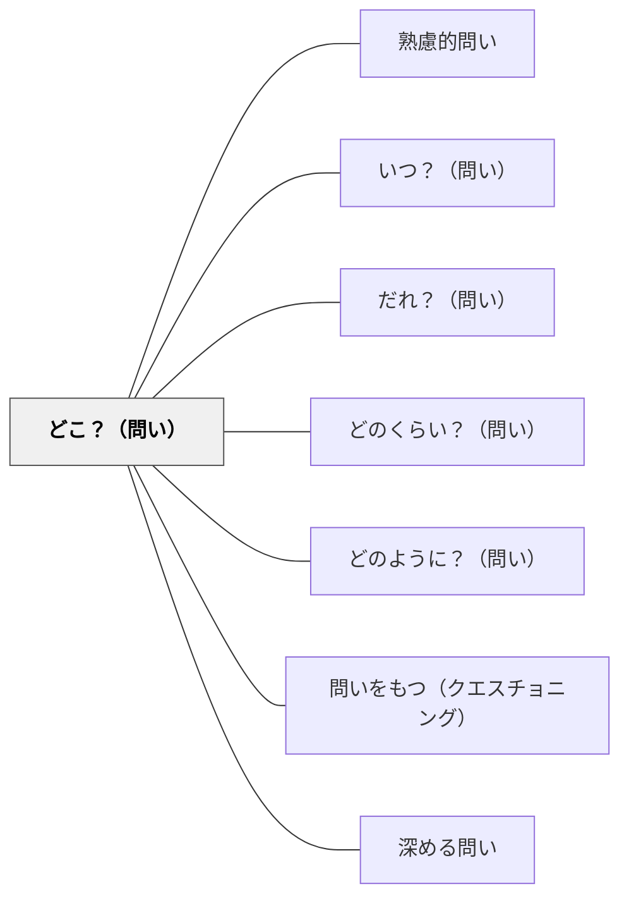

# どこ？（問い）

> 場所・位置・空間・範囲を問うことで、知識や出来事の空間的文脈を把握する。

## 背景（Context）
多くの知識や現象は特定の空間・場所・範囲と不可分に結びついている。「どこで起きたか」「どの領域の話か」という問いは、情報を地理的・概念的空間の中に位置づけ、他の事象との関係を理解するための枠組みを提供する。

**原典では**：土居（2026）は、子どもに問いをつくる観点として「5W1H」（「Who」「What」「When」「Where」「Why」「How」）を示すことが多いと書き、観点を明確に示すと「問いを出しましょう。」と抽象的に指導するよりも子どもはどう考えればよいかがわかり、特に学習が苦手な子に有効だと述べる（第4章12「子どもが問いをもてるようになるための指導法」、Kindle版 170/204頁表示）。もとになった深谷（2021）の「ビリヤード法」にも「どこで？」が観点として挙がっている（同）。

教師の発問としての「どこ」は、原典の中にいくつも出てくる。有田和正の「バスの運転手は、運転している時、どこを見ていますか。」は、「どんな仕事をしていますか。」と直接問うより、子どもが「思わず考えたい、話したい」気持ちになり、仕事の内容を直接話さなくてよいので「どんな子も参加しやすくなる」と説明される（第2章6「間接的に問う」、Kindle版 67/204）。体育の跳び箱で手をつく場所を奥にすることを身につけたいときの「手をどこにつくと跳び越えやすいでしょうか。」（第1章3、Kindle版 19〜20/204）、「ごんは、どこを通って兵十の家に入ったのだろう。経路図を書いてみましょう。」（第2章1、Kindle版 48/204）も挙がっている。さらに、正解を示して良いところを問うより、誤った計算や誤った技を示して「どこが間違っているかな。」「どこがおかしいかな。」と問う方が子どもは意欲的になり表現も豊かになる、という「否定発問」の例でも「どこ」が使われている（第2章8「否定的に問う」、Kindle版 72/204）。ただし原典は、否定発問は毎時間使うと飽きられる「劇薬」だとも書く（Kindle版 73/204）。

なお原典は、跳び箱の「手をどこにつくと…」も、発問だけでは数名が挙手して終わるので、「この箱に手をついてみてください。」などの指示をセットにする必要がある、としている（第1章3、Kindle版 20/204）。

**岩井の講話では**：5W1Hと言われるものとして「何々とは何か、いつ、どこ、なぜ、誰、どのように、どのくらい、どうすべきか」を並べて挙げている（講話 19:31〜19:53）。また知覚語を問う例として「バスの運転手は何を見ているのかな」を挙げている（18:38）。

## 問題（Problem）
学習者は事実を場所・空間から切り離して覚えることが多く、「なぜその場所で起きたか」「他の場所との違いは何か」といった空間的文脈の問いを立てない。空間的理解の欠如は、地理・生態学・社会問題など多くの分野での深い理解を妨げる。

## 力のかたち（Forces）
- 場所の特定は、その環境・条件・文脈への理解を開く
- 「どこ」を問うことで、分布・拡散・境界といった空間的思考が促される
- 空間的文脈は記憶の強力な「錨」になる（場所法）
- 「どこの問題か」という問いは、解決の主体と責任の所在を明らかにする

## 解決（Solution）
**近いパタンとの見分け**：問いの型の表では、本パタンの見分けの問いは「場所・位置・範囲を問い、空間の文脈をつかんでいるか」。全体の表は [[パタン/熟慮的問い#近いパタンとの見分け|熟慮的問い]] にある。

「それはどこで起きたか？なぜその場所だったのか？他の場所ではどうか？」と問いかける。例えば地理学習では「この気候はなぜこの地域に分布するのか」と問い、地形・気流・緯度などとの関係を探らせる。概念的には「この問題はどの学問領域に位置するか？」という問いとして応用することもできる。

---

**例：「手をどこにつくと跳び越えやすい？」を体で確かめる**（体育・中学年「跳び箱運動」）
1. 開脚跳びの練習のあと、「手をどこにつくと跳び越えやすいでしょうか。」と問う。
2. すぐに答えを言わず、「跳び箱の手前・まん中・奥の三か所に、順に手をついて跳んでみましょう。」と指示する。
3. グループごとに、どこについたときが跳び越えやすかったかを話し合い、跳び箱の絵に印をつける。
4. 印の位置と理由（「奥につくと、体が前に出やすい」など）を学級で共有する。
（原典 Kindle版 19〜20/204 の発問と指示の例をもとにした手順。手前・まん中・奥の三か所は Wiki 側の組み立て）

---

**例：「どこを通った？」を経路図に描く**（国語・4年「ごんぎつね」）
1. ごんが兵十の家に入る場面を音読する。
2. 「ごんは、どこを通って兵十の家に入ったのだろう。経路図を書いてみましょう。」と問う。
3. 描いた経路図を隣どうしで見比べ、違うところがあれば「本文のどの言葉からそう描いた？」と確かめ合う。
4. 本文の言葉を根拠に経路を一つにまとめ、そこからごんの様子や気持ちについてわかることを話し合う。
（原典 Kindle版 48/204 の発問をもとにした手順。3・4は Wiki 側の組み立て）

## 結果（Consequences）
- 地理的・空間的思考が発達し、知識が文脈の中に定着する
- 分布・範囲・境界への意識が高まり、比較分析力が育つ
- 場所と文脈の結びつきが記憶の定着を助ける

- 注意点：「どこ？」は答えが場所の名前一つで終わりやすい。指で示す・図に描く・その場所で試すなどの指示を添え、「どうしてそこなのか」へつなげる。

## 関連パタン
- [[パタン/熟慮的問い]] — 親パタン
- [[パタン/いつ？（問い）]] — 時間的文脈を問うペアパタン

- [[パタン/だれ？（問い）]] — 5W1H の「誰」：場所・人をセットで問う兄弟パタン
- [[パタン/どのくらい？（問い）]] — 5W1H の「量・範囲」：どこまでの範囲かを問うときに連携
- [[パタン/どのように？（問い）]] — 5W1H の「方法」：場所とプロセスをセットで問う兄弟パタン
- [[パタン/問いをもつ（クエスチョニング）]] — 5W1H を使って問いを構造化する上位パタン
- [[パタン/深める問い]] — 空間的文脈の問いが探究を深める

## クラスター図

## Actionable Insight

- 「それはどこで起きたか？なぜその場所だったのか？」と問いかける——知識が地理的・空間的文脈の中に位置づけられ理解が立体的になる
- 地理学習で「この気候はなぜこの地域に分布するのか」と問い、地形・気流・緯度との関係を探らせる——空間的思考が発達し分布・境界への意識が高まる
- 「どこの問題か」という問いで解決の主体と責任の所在を明らかにする——空間的文脈が記憶の強力な錨になる

## 出典
- [[文献/熟慮的問いのパターンリスト（動画記録）]]

- 土居正博（2026）『自分で考え、学べる子を育てる！ 発問の技術』学陽書房（初版・電子書籍版） — 第1章「『発問セット指示』①」、第2章「発問の『内容』とは」「発問自体への工夫① 間接的に問う」「発問自体への工夫③ 否定的に問う」、第4章「子どもが問いをもてるようになるための指導法」。頁は Kindle 版の表示（204頁中）
- 岩井輝久（年不明）『熟慮的問いのパターンリスト』［動画］ https://youtu.be/WivskVtxG34 — 2026-11-13 に文字起こしで確認（18:38、19:31〜19:53）
