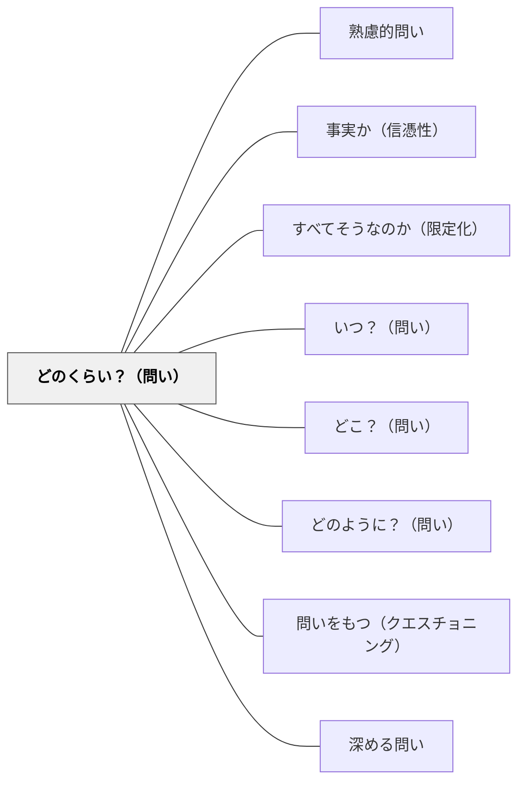

# どのくらい？（問い）

**このパタンが完成を助ける大きなパタン**：[[パタン/熟慮的問い]]

> 量・程度・割合・頻度を問うことで、曖昧な言葉に数値的根拠と具体性をもたらす。

## 背景（Context）
議論や説明の中で「多い」「少ない」「よく」「たまに」などの曖昧な量的表現が使われることが多い。話者によってその感覚は大きく異なり、共通理解が成立しないまま議論が進んでしまう。

**原典では**：土居（2026）は、教師の工夫を削ぎ落した「普通で、自然な問い」の例として、「子ども達が普段口にするような『なぜ〜なのだろう』とか『〜なのはどれくらいかな』とか『このときどんな気持ちだったのだろう』などというような問い」を挙げている（第1章9「発問をなくしていく③ 『普通で自然な問い』にする」、Kindle版 44/204頁表示）。「どれくらい」は、ここでは子どもが自分でもつ問いの一つとして置かれている。

一方、教師の工夫としての「程度」の問いも原典に出てくる。発問に選択肢を入れる工夫の派生型として、「5段階中、幸福度はいくつですか。」や「1を不幸、5を最高に幸せとしたら、いくつくらいですか。」など段階や数字を入れる発問があり、自分の考えを示しやすくなると同時に、「幸福度4」と「幸福度1」のような他者との考えのズレが「手に取るようにわかる」ようになる、という（第2章10、Kindle版 77/204）。指示の側でも、「すごく幸せを5、すごく不幸せを1として、数字で表してみてください。」が、考えのズレを明確にする工夫として挙がっている（第2章11、Kindle版 83/204）。

ただし原典は、この数値化の工夫に二つの限界を書いている。一つは、本来多様な捉え方があるものに選択肢を示して判断を迫ると「子ども達の考えに制限をかけることにもなりかねない」こと（Kindle版 77/204）。もう一つは不自然さで、「このとき、〇〇の幸せメーターはいくつくらいかな？」は活発な議論が起こる優れた工夫だが、子どもが普段読書をするときにわざわざ幸せメーターを考えることは現実的ではなく、授業を離れたら横から教師が尋ねることもできない、と指摘する（第4章1、Kindle版 131/204）。

**岩井の講話では**：5W1Hと言われるものとして「何々とは何か、いつ、どこ、なぜ、誰、どのように、どのくらい、どうすべきか」を並べて挙げ、「どのくらい」もこの列に含めている（講話 19:31〜19:53）。講話で示されているのは名前までである。

## 問題（Problem）
量・程度・頻度が曖昧なまま語られると、聞き手が具体的なイメージを持てず、議論が地に足のつかないものになる。エビデンスや根拠の検討もできない。

## 力のかたち（Forces）
- 数値化は議論を明確にするが、測りにくいものを無理に数値化すると本質を歪める。
- 「どのくらい」を問うと、主張の根拠を問うことにもなり、批判的思考を促す。
- 頻度や程度への問いは、個人差・文化差を浮き彫りにする効果もある。

## 解決（Solution）
「どのくらい？」「何回？」「どのくらいの割合で？」「どの程度大きいのか？」と量的・程度的な具体化を求める問いを投げる。数値や比率だけでなく、比較対象を示させることも有効である。

---

**例：気持ちの度合いを数字で示し、ズレから話し合う**（国語・物語文、中学年）
1. 心情を考えたい場面を音読する。
2. 「このときの〇〇の気持ちは、すごく幸せを5、すごく不幸せを1とすると、いくつくらい？」と問う。
3. 指で数字を出す（またはノートに書く）よう指示し、数字ごとに人数を板書する。
4. 数字が離れている子どうしから理由を聞き、「本文のどの言葉から、その数字にした？」と叙述に戻る。
（原典 Kindle版 77、83/204 の例をもとにした手順）

---

**例：数字の足場を外して「どれくらい？」を子どもの問いにする**（同じ学級で、学期の後半）
1. 前の単元で数字で表す問いを何度か経験したあと、物語を読み終えた段階で「気になったことを問いにしてみよう」と投げかける。
2. 子どもの問いの中に「〜はどれくらい悲しかったのかな」のような程度の問いがあれば取り上げ、「どうやったら比べられそう？」と考え方を子どもに聞く。
3. 子どもから「前みたいに数字にしてみる」「別の場面と比べる」などの方法が出たら、その方法で話し合う。
4. 振り返りで「どれくらい？と問うと、どんなことが考えられた？」と、問いの視点そのものを言葉にする。
（原典 Kindle版 44、131/204 の「普通で自然な問い」への移行の考えをもとにした Wiki 側の手順）

**近いパタンとの見分け**：問いの型の表では、本パタンの見分けの問いは「量・程度・割合・頻度を問い、あいまいな言葉に数を与えているか」。全体の表は [[パタン/熟慮的問い#近いパタンとの見分け|熟慮的問い]] にある。

## 結果（Consequences）
議論の根拠が明確になり、思い込みや過度な一般化を防ぐことができる。数値を求めることで学習者の調査・データ収集意欲が高まる一方、数字に頼りすぎて質的な側面を見失う危険もある。

- 注意点：数字や段階で程度を問う工夫はズレを見えやすくするが、気持ちのように多様な捉え方があるものを一つの数に押しこめることにもなる（土居 2026）。数字は話し合いの入口として使い、理由と叙述に戻ることで終える。

## 関連パタン
- [[パタン/熟慮的問い]] — 親パタン
- [[パタン/事実か（信憑性）]] — 量的根拠の確認と連携する
- [[パタン/すべてそうなのか（限定化）]] — 一般化の誤りを問う問いと連携する

- [[パタン/いつ？（問い）]] — 5W1H の「時」：「どのくらい続いたか」で連携する兄弟パタン
- [[パタン/どこ？（問い）]] — 5W1H の「場所・範囲」：空間的範囲を量的に問うときに連携
- [[パタン/どのように？（問い）]] — 5W1H の「方法」：程度とプロセスをセットで問う兄弟パタン
- [[パタン/問いをもつ（クエスチョニング）]] — 5W1H を使って問いを構造化する上位パタン
- [[パタン/深める問い]] — 量的な問いが証拠・根拠への探究を深める

## クラスター図

## Actionable Insight

- 学習者が「多い」「少ない」「よく」と言ったとき、「どのくらい？」と問い返す——曖昧な量的表現に数値的根拠と具体性をもたらす
- 主張の根拠を問うとき「どのくらいの割合で？」「何回？」という形で数値化を促す——批判的思考と調査・データ収集の意欲が高まる
- 「どのくらい大きい？」という問いで比較対象を示させる——比率や比較が議論に具体性と地に足のついた根拠を生む

## 出典
- [[文献/熟慮的問いのパターンリスト（動画記録）]]

- 土居正博（2026）『自分で考え、学べる子を育てる！ 発問の技術』学陽書房（初版・電子書籍版） — 第1章「発問をなくしていく③ 『普通で自然な問い』にする」、第2章「発問自体への工夫⑤ 選択肢や思考のヒントを入れる」「『発問セット指示』への工夫①」、第4章「子どもの実態に合った授業とは」。頁は Kindle 版の表示（204頁中）
- 岩井輝久（年不明）『熟慮的問いのパターンリスト』［動画］ https://youtu.be/WivskVtxG34 — 2026-11-13 に文字起こしで確認（19:31〜19:53）
