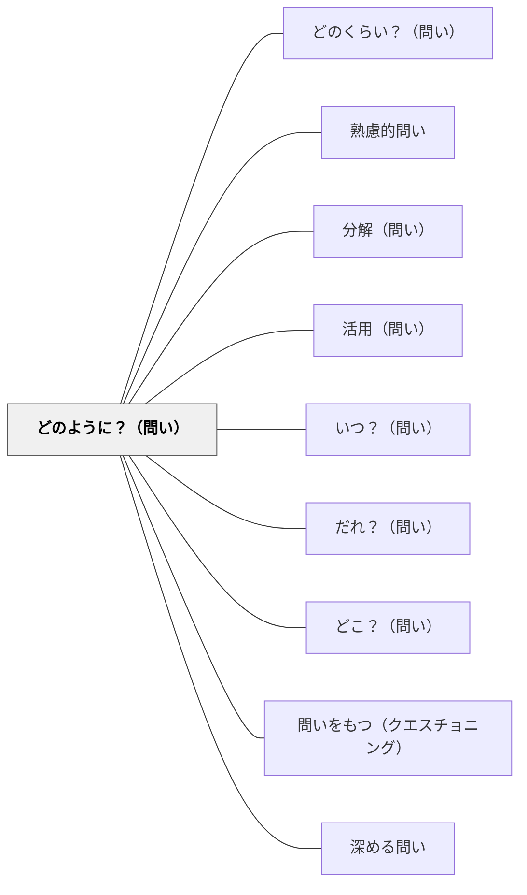

# どのように？（問い）

**このパタンが完成を助ける大きなパタン**：[[パタン/熟慮的問い]]

> 方法・プロセス・手順を問うことで、「何か」から「いかに」へと思考を深める。

## 背景（Context）
学習の場では、「何が起きたか」「何が正解か」という知識の確認にとどまりがちで、そのプロセスや方法論への問いが後回しになることが多い。「どのように」を問わないと、知識は孤立した事実のままとなる。

**原典では**：土居（2026）は、子どもに問いをつくる観点として「5W1H」を示すことが多いと書き、「Who」「What」「When」「Where」「Why」「How」の6つを問いをつくる視点として明確に指導すると、「問いを出しましょう。」と抽象的に指導するよりも、子どもはどう考えればよいかがわかり、特に学習が苦手な子に有効だ、と述べる（第4章12「子どもが問いをもてるようになるための指導法」、Kindle版 170/204頁表示）。これは深谷（2021）の「ビリヤード法」（「誰が」「どういう意味？」「いつから？」「いつまで？」「どこで？」「なぜ？」「どのように？」「事実か？」などの観点をテーマにぶつけて具体的な問いをつくる方法）を援用したものである（同）。

教師の発問としての「どのように」については、原典は、それだけでは子どもが動きにくいことを指摘する。「ごんの心情はどのように変わったのでしょうか。」は正解中の正解の発問だが、育っていない学級では数人が発言して終わることもあり、「一番大きく変化したと思うところ（〇ページ〇行目）を見つけてください。」と指示を添えるだけで授業展開が変わる、という（第1章3、Kindle版 20/204）。説明文「ビーバーの大工事」で「ビーバーのダムはどのようになっていますか。」に「図で描いてみましょう。」と添えた長崎伸仁の実践では、描かれた図の違い（ダム湖の位置、巣の位置など）から子どもの読みのズレが見え、本文を読み直すきっかけになった（第2章11、Kindle版 81〜83/204）。「腕の骨はどのようになっていますか。絵を描いてみましょう。」も、内容と工夫の両面が練られた発問の例に挙げられている（第2章1、Kindle版 48/204）。

また原典は、桂聖らの「Which型課題」を、「なぜ」（Why）や「どのように」（How）という発問では子どもの思考は活性化しにくく、「どちらがいい」（Which）の発問の方が活発に考える、という提案として紹介している（第2章10、Kindle版 77/204／第4章9、Kindle版 161/204）。第5章の「大造じいさんとガン」の例では、「残雪を一生懸命世話したのかな？」（選択肢）と「残雪をどのように世話していたのかな？」（どのように）を、教師の工夫の多い順に並べた段階の中に置いている（第5章「このときの登場人物の心情は？」、Kindle版 189/204）。

**岩井の講話では**：「何か」「いつ」「どこ」など5W1Hと言われるものとして、「何々とは何か、いつ、どこ、なぜ、誰、どのように、どのくらい、どうすべきか」を並べて挙げている（講話 19:31〜19:53）。講話で示されているのは名前までである。

## 問題（Problem）
「何か」は分かっていても「どのように」が問われないため、応用・実践・再現の手がかりが学習者に渡らない。プロセスが不可視のまま終わる。

## 力のかたち（Forces）
- 「何」への問いは答えやすいが、「どのように」は複雑で複数の経路がある。
- プロセスへの問いは、暗黙知や経験知を言語化するよい機会となる。
- 手順を問いすぎると本質的な問いが失われる危険もある。

## 解決（Solution）
**近いパタンとの見分け**：問いの型の表では、本パタンの見分けの問いは「方法・過程・手順を問い、「何か」から「いかに」へ進んでいるか」。全体の表は [[パタン/熟慮的問い#近いパタンとの見分け|熟慮的問い]] にある。

「どのようにして？」「どういう手順で？」「どのようなプロセスを経たのか？」と明示的に問いかける。方法や経路を複数想定させることで、多様なアプローチへの気づきを促す。

---

**例：「どのようになっている？」を図にして読みのズレを見る**（国語・2年「ビーバーの大工事」などの説明文）
1. 構造が書かれている段落を読んだあと、「ビーバーのダムは、どのようになっていますか。」と問う。
2. すぐに話し合わず、「図で描いてみましょう。」と指示し、一人ずつ図を描く。
3. 描いた図を並べて見せ合い、違うところ（ダムの手前と奥、巣の位置など）に印をつける。
4. 「どちらが本文に合っている？本文のどの言葉からわかる？」と、違うところごとに本文に戻って確かめる。
（原典 Kindle版 81〜83/204 で紹介された長崎伸仁の実践をもとにした手順）

---

**例：5W1Hカードで、自分たちの問いをつくる**（国語・説明文や社会の単元の導入、中学年以上）
1. 単元の最初に教材文（または資料）を読み、「思ったことを隣の人と話してごらん」と自由に話す時間をとる。
2. 「だれ・なに・いつ・どこ・なぜ・どのように」の6枚のカードを黒板に貼る。
3. 「このカードの言葉を一つ使って、問いを一つ作ろう」と指示し、付せんに書く。
4. 「どのように」で作った問いを集めて読み、「この問いを考えると、何がわかりそう？」と単元の学習計画につなげる。
（原典 Kindle版 164、170/204 をもとにした手順。カードの形は Wiki 側の組み立て）

## 結果（Consequences）
学習者がプロセスや方法を言語化・可視化するようになり、メタ認知が促される。実践への橋渡しになる一方、手順の詳細に拘泥して本質を見失わないよう注意が必要。

- 注意点：「どのように」の問いは、答え方が決まっていないぶん、問うだけでは動けない子が出やすい（土居 2026）。図に描く・線を引く・指で示すなど、答え方を指示で添える。

## 関連パタン
- [[パタン/どのくらい？（問い）]]
- [[パタン/熟慮的問い]] — 親パタン
- [[パタン/分解（問い）]] — プロセスをステップに分解する問いと連携する
- [[パタン/活用（問い）]] — 「どのように使うか」へ発展する

- [[パタン/いつ？（問い）]] — 5W1H の「時」：プロセスの時系列を問う兄弟パタン
- [[パタン/だれ？（問い）]] — 5W1H の「誰」：誰がどのようにを問う兄弟パタン
- [[パタン/どこ？（問い）]] — 5W1H の「場所」：どこでどのようにを問う兄弟パタン
- [[パタン/問いをもつ（クエスチョニング）]] — 5W1H を使って問いを構造化する上位パタン
- [[パタン/深める問い]] — プロセスへの問いが表面的理解を深める探究へ転換する

## クラスター図

## Actionable Insight

- 「何が起きたか」に答えさせた後、「どのようにして？」「どういうプロセスを経たのか？」と続けて問う——プロセスが可視化されてメタ認知が促される
- 学習者の解法や思考を「どのように考えたの？」と問い返す——暗黙知が言語化される機会になる
- 「別のどのような方法があるか？」と問うことで複数の経路への気づきを促す——多様なアプローチへの柔軟性が育つ

## 出典
- [[文献/熟慮的問いのパターンリスト（動画記録）]]

- 土居正博（2026）『自分で考え、学べる子を育てる！ 発問の技術』学陽書房（初版・電子書籍版） — 第1章「『発問セット指示』①」、第2章「発問の『内容』とは」「発問自体への工夫⑤」「『発問セット指示』への工夫①」、第4章「発問をなくしていく」「子どもが問いをもてるようになるための指導法」、第5章「このときの登場人物の心情は？」。頁は Kindle 版の表示（204頁中）
- 深谷達史（2021）「問いに基づく探究的な学習とその実践」小山義徳・道田泰司編『「問う力」を育てる理論と実践』ひつじ書房 — 土居（2026）による紹介で確認（原典未確認）
- 岩井輝久（年不明）『熟慮的問いのパターンリスト』［動画］ https://youtu.be/WivskVtxG34 — 2026-11-13 に文字起こしで確認（19:31〜19:53）
