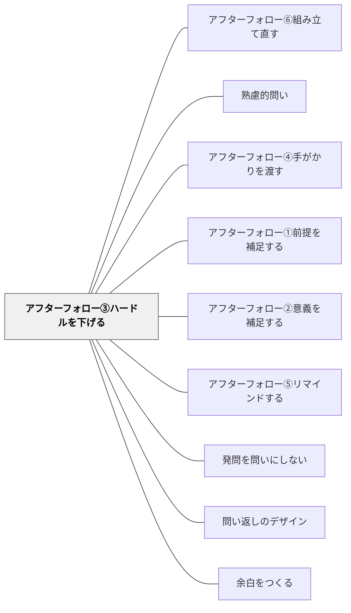

# アフターフォロー③ハードルを下げる

**このパタンが完成を助ける大きなパタン**：[[パタン/熟慮的問い]]

> 「何でも言っていいよ」「正解はないよ」と安心感を与える

## 背景（Context）
問いに答えることへの心理的障壁は、「間違えたら恥ずかしい」「正しい答えを言わなければいけない」という思い込みから生まれることが多い。ファシリテーターが明示的に「正解はない」「何でも歓迎する」と伝えることで、学習者は安心して自分の考えを表現できるようになる。心理的安全性の構築は、深い対話の前提条件である。

**原典では**：安斎（2021）は、問いを投げかけた直後の反応を見てフォローを選ぶ「アフターフォローの見取り図」を示し、意見が出ない場合の「質問に答えやすくする足場かけ」を六つ挙げる。本パタンはその三つ目で、「うまく答えられない場合」に「手がかりを渡す」と並べて置かれる（第5章、Kindle版 87%）。想定されているのは、問いを正しく理解し、考える動機もあるのに、「答えは頭の中に思い浮かんでいるものの、プレッシャーを感じていて発言できない」ケースである（MANNERS 25、88%）。シンプルなやり方は期待値をはっきり下げることで、「無理に良いアイデアを言おうとしなくてよいですよ」のような声かけが例に挙がる（同）。発言で自分の評価が下がることを気にしている相手には、注意を引くアプローチの「共感」を応用して相手の心の声を代弁し、「変な意見」こそ歓迎だと伝えるとよいという（同、88〜89%）。応用として、答えにくい問いの後から「もしあなたがユーザーだったら」のように仮定法の制約を足し、立場を変えて答えやすくする方法も示される（同、89%）。原典は、この足場かけを「アフターフォローにおいて多用することになります」と述べ、意見は出ても本音が語られていない場合にも有効だとしている（同、89%・93%）。

**岩井の講話では**：安斎の本のアフターフォローを紹介し、授業で教師が発問するときも「質問説明したら終わりじゃない」として、問いの後のフォローが大事だと述べている（31:11〜31:29）。そのうえで六つの足場かけを読み上げ、三つ目に「ハードルを下げる」を挙げている（31:29〜31:39）。

## 問題（Problem）
学習者が問いに沈黙で応じるとき、その原因は問いへの無関心よりも、失敗への恐れや評価への不安であることが多い。教室や職場では、「正しいことを言わなければ」という暗黙の規範が発言を抑制する。ファシリテーターがこの障壁を意識せずにいると、表面的な沈黙が深い思考の欠如と誤解される。

## 力のかたち（Forces）
- 心理的安全 vs 誠実な評価への期待
- 発言の促進 vs 内省の時間の確保
- 安心感の提供 vs 思考の緊張の維持
- 開放的な雰囲気 vs 問いの真剣さ

## 解決（Solution）
問いを投げかけた後、「正解はありません」「思いついたことを気軽に言ってみてください」「間違っていても全然大丈夫です」のように、評価不安を解消する言葉を添える。さらに「最初は断片的でいい」「一言でも歓迎」と最低限のハードルを示すと、最初の発言が生まれやすくなる。

---

**例：一言でよいと伝えてから、もう一度問う**（国語・2年）
1. 物語を読んだ後、「この話でいちばん心に残ったところはどこ？」と問い、手が挙がらないときは、すぐに指名せず「上手に言おうとしなくていいよ。どの場面か、指でさすだけでもいいよ」と声をかける。
2. 子どもは教科書の挿絵や本文を指でさし、隣の子に見せる。
3. 指でさしたところを何人かに聞き、「どうしてそこ？」と続けて問う。理由が言えないときは「そこが好き、だけでもいいよ」と返す。

---

**例：答えにくい問いの後から、立場を足す**（社会・5年）
1. 「よい町とは、どんな町だろう？」と問い、考え込んで手が挙がらないときに、「大きな問いだから、考えにくいよね」と受け止める。
2. 続けて「もし自分が、車いすを使う人だったら、どんな町がよい町だと言うだろう？」「もし自分が、町で店を開いている人だったら？」と、立場を一つ足して問い直す。
3. 子どもはどちらかの立場を選んで、一つずつカードに書き、立場ごとに黒板に貼る。
4. 二つの立場のカードを見比べてから、最初の「よい町とは？」に戻る。

**近いパタンとの見分け**：発問（問いをつくる・出す）の表では、本パタンの見分けの問いは「「正解はない」「一言でいい」と、言い出しやすくしているか」。全体の表は [[パタン/発問のグラデーション#近いパタンとの見分け|発問のグラデーション]] にある。

## 結果（Consequences）
- 発言への心理的障壁が下がり、より多くの学習者が参加する
- 未完成・断片的な思考も表現されるようになり、議論が深まる
- 失敗を恐れない学習文化の形成に貢献する

- 注意点：ハードルを下げる声かけは、問いの意味が伝わっていない場合（→ [[パタン/アフターフォロー①前提を補足する]]）や、知識が足りない場合（→ [[パタン/アフターフォロー④手がかりを渡す]]）には効かない。原典は、答えは浮かんでいるのにプレッシャーで言えない場合に使う足場かけとしており、まず沈黙の理由を見立ててから選ぶ（安斎 2021、第5章）。

## 関連パタン
- [[パタン/アフターフォロー⑥組み立て直す]]
- [[パタン/熟慮的問い]] — 親パタン
- [[パタン/アフターフォロー④手がかりを渡す]] — どちらも答えられない学習者への介入手法——障壁を下げるか、思考の道具を渡すか
- [[パタン/アフターフォロー①前提を補足する]] — 問いへの参加の前提を整える第1手法
- [[パタン/アフターフォロー②意義を補足する]] — 問いの意義を伝えて動機づける兄弟手法
- [[パタン/アフターフォロー⑤リマインドする]] — 議論が止まったとき問いを蘇らせる手法
- [[パタン/発問を問いにしない]] — 問いの出し方・雰囲気そのものを変える関連手法
- [[パタン/問い返しのデザイン]] — 応答を次の思考へとつなぐ問い返し設計
- [[概念/動機づけ]] — 問いへの向き合いを促す動機付けの理論的背景
- [[パタン/余白をつくる]] — 問いかけの後に沈黙・余白を置くことで思考の深化を待つ

## クラスター図

## Actionable Insight

- 問いを投げかけた後、「正解はありません」「思いついたことを気軽に言ってみて」と添える——発言への心理的障壁が下がり、より多くの学習者が参加する
- 「最初は一言だけでいい」「断片的でも歓迎」と最低限のハードルを示す——最初の発言が生まれやすくなりその後の発言が続く
- 「間違っていても全然大丈夫です」と明示的に伝える——失敗を恐れない学習文化の形成に貢献する

## 出典
- [[文献/熟慮的問いのパターンリスト（動画記録）]]

- 安斎勇樹（2021）『問いかけの作法 チームの魅力と才能を引き出す技術』ディスカヴァー・トゥエンティワン 第5章「初期反応に基づくアフターフォローの見取り図」・MANNERS 25「質問に答えやすくする足場かけ③ ハードルを下げる」 — Kindle版 87〜89%、93% で確認。[[文献/問いかけの作法（安斎勇樹）]]
- 岩井輝久（年不明）『熟慮的問いのパターンリスト』［動画］ https://youtu.be/WivskVtxG34 — 2026-11-13 に文字起こしで確認（31:11〜31:39）
