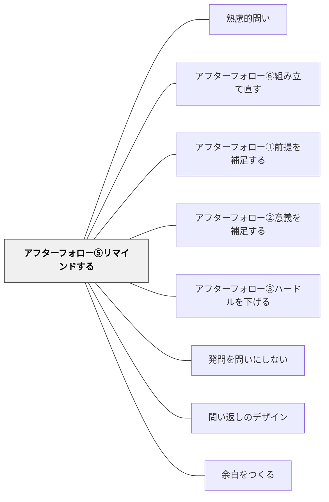

# アフターフォロー⑤リマインドする

**このパタンが完成を助ける大きなパタン**：[[パタン/熟慮的問い]]

> 問いを繰り返す・再提示することで意識を戻す

## 背景（Context）
問いは一度投げかけただけでは意識から薄れていく。特に長い議論やグループ活動の中では、最初の問いから離れて話が脱線したり、問いの本質が忘れられたりすることが多い。問いを適切なタイミングで再提示することは、思考の方向性を維持し、議論の焦点を取り戻すための重要なファシリテーション技術である。

**原典では**：安斎（2021）の「アフターフォローの見取り図」では、意見が出ない場合のうち「質問から脱線している場合」に「リマインドする」を当てる（第5章、Kindle版 87%）。原典はその前提として、「相手は、答えを出すまでのあいだ、ずっと質問を覚えているとは限りません」と述べる（MANNERS 27、90%）。リマインドが要るのは三つの場合である。問いを聞き漏らした人がいる場合、聞いてはいたが悩んでいるうちに頭から抜けてしまった場合、そしてアイデアを発散する話し合いが盛り上がるほど、話題が行き来して問いの本筋から少しずれたところで盛り上がる場合である（同）。著者自身も、考えているうちに思考が活性化して脱線し、「いま聞かれていた質問ってなんだったっけ」となることがあると書く（同、90%）。手立ては、問いを改めてもう一度投げかけるか、見えるところに示すことである（同）。投げかけ直すときは補足を付け加えられるので、「前提を補足する」「意義を補足する」と併用してもよい（同）。原典が「一番手っ取り早い支援」とするのは問いを見えるところに示すことで、ホワイトボードに書き留める、スライドに載せて投影する、オンライン会議のチャット欄に投稿する、などが挙がる（同）。

**岩井の講話では**：グループで話し合ううちに脱線して、そもそもどんな問いについて話し合っていたのかが分からなくなったときにリマインドする、と説明したうえで、脱線を元に戻すことは、教師の場合は子どもが自分で自己修正できるようになる必要があるのではないか、と述べている（31:39〜32:03）。

## 問題（Problem）
議論が活発になるにつれ、最初の問いから離れた方向へ流れていくことがある。参加者が問いの原点を見失うと、議論は豊かであっても問いへの答えには近づかない。ファシリテーターが問いの再提示をしなければ、問いは形骸化し、議論のための議論になってしまう。

## 力のかたち（Forces）
- 問いへの集中 vs 自由な議論の流れ
- リマインドの適切なタイミング vs 議論の妨げ
- 問いの維持 vs 問いの発展・更新
- ファシリテーターの介入 vs 自律的な学習者の問い直し

## 解決（Solution）
議論の途中や活動の節目で、「最初の問いに戻ると、〇〇でした」「ここで改めて問いを確認すると…」のように、元の問いを繰り返す。板書・スライド・カードなどに問いを可視化しておくと、言葉でのリマインドなしに問いへの意識を維持しやすい。完全に同じ表現でなくても、問いの本質を保ちながら再提示することで、議論の枠組みを取り戻す。

---

**例：問いを黒板に残し、時間の途中で指でさす**（算数・5年）
1. 「平行四辺形の面積は、どうすれば求められるだろう？」を、黒板の左上の決まった場所に書き、授業の終わりまで消さない。
2. 自力解決やペアでの話し合いの途中、話が「どの図形が好きか」などにそれ始めたら、教師は言葉で注意するより先に、黒板の問いを指でさしてから「いま、どこまで来た？」と聞く。
3. まとめの前に、子どもが自分で問いを読み上げ、「この問いに、今日の答えは言えるか」を確かめてからノートにまとめを書く。

---

**例：子どもが自分で問いに戻る合図をつくる**（国語・6年、グループでの話し合い）
1. 話し合いの前に、各グループの机の真ん中に、今日の問い（たとえば「筆者がいちばん伝えたいことは、どの段落にあるか」）を書いたカードを置く。
2. グループで「問いに戻る係」を一人決め、話がそれたと感じたらカードを指でさして「問いに戻ろう」と言う役にする。係は話し合いごとに交代する。
3. 話し合いの後、「問いに戻った回数」と「戻ったきっかけ」を各グループが一言ずつ報告し、次からは係がいなくても、だれでも戻れることをめざす。

**近いパタンとの見分け**：発問（問いをつくる・出す）の表では、本パタンの見分けの問いは「議論がそれたとき、もとの問いに戻しているか」。全体の表は [[パタン/発問のグラデーション#近いパタンとの見分け|発問のグラデーション]] にある。

## 結果（Consequences）
- 議論の焦点が維持され、問いへの答えに向かって思考が深まる
- 脱線した議論が問いの文脈で再評価され、新たな洞察が生まれることがある
- 問いを繰り返す行為そのものが、問いの重要性を参加者に印象づける

- 注意点：リマインドは脱線を止めるためだけのものではない。原典は、聞き漏らした人や、考えているうちに問いを忘れた人を支える足場かけとしても位置づけている（安斎 2021、第5章 MANNERS 27）。脱線を責める調子にならないよう、言葉より先に、見えるところに書いた問いを示す。

## 関連パタン
- [[パタン/熟慮的問い]] — 親パタン
- [[パタン/アフターフォロー⑥組み立て直す]] — どちらも止まった議論を蘇らせる手法——問いを繰り返すか、問いを作り直すか
- [[パタン/アフターフォロー①前提を補足する]] — 問いへの参加の前提を整える第1手法
- [[パタン/アフターフォロー②意義を補足する]] — 問いの意義を伝えて動機づける手法
- [[パタン/アフターフォロー③ハードルを下げる]] — 参加障壁を下げる兄弟手法
- [[パタン/発問を問いにしない]] — 問いの出し方・雰囲気そのものを変える関連手法
- [[パタン/問い返しのデザイン]] — 応答を次の思考へとつなぐ問い返し設計
- [[概念/動機づけ]] — 問いへの向き合いを促す動機付けの理論的背景
- [[パタン/余白をつくる]] — 問いかけの後に沈黙・余白を置くことで思考の深化を待つ

## クラスター図

## Actionable Insight

- 議論の途中や活動の節目で「最初の問いに戻ると、○○でした」と問いを繰り返す——脱線した議論が問いの文脈で再評価され、焦点が戻る
- 板書・スライド・カードに問いを可視化しておく——言葉でのリマインドなしに問いへの意識を維持できる
- グループ活動の最後に「最初の問いへの答えを一文で」と問う——問いへの回帰が議論を締める力になる

## 出典
- [[文献/熟慮的問いのパターンリスト（動画記録）]]

- 安斎勇樹（2021）『問いかけの作法 チームの魅力と才能を引き出す技術』ディスカヴァー・トゥエンティワン 第5章「初期反応に基づくアフターフォローの見取り図」・MANNERS 27「質問に答えやすくする足場かけ⑤ リマインドする」 — Kindle版 87%、90% で確認。[[文献/問いかけの作法（安斎勇樹）]]
- 岩井輝久（年不明）『熟慮的問いのパターンリスト』［動画］ https://youtu.be/WivskVtxG34 — 2026-11-13 に文字起こしで確認（31:39〜32:03）
