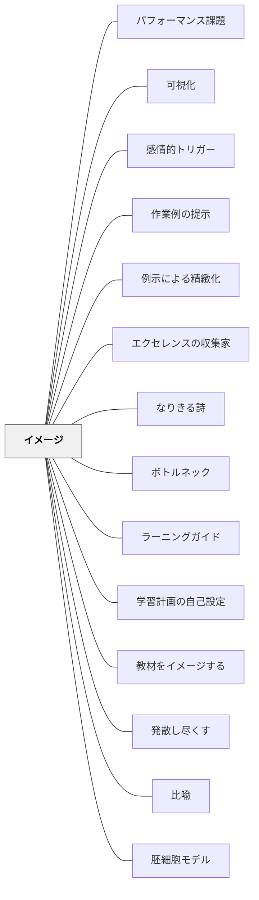

# イメージ

**このパタンが完成を助ける大きなパタン**：[[パタン/熟慮的動機づけ]]・[[パタン/熟慮的教材教具]]・[[パタン/想像力（感情）を触発する]]

**一文でいうと**：目指す姿・完成形の具体的なイメージを、複数のお手本で先に持てるようにする。

## 使いどころ・使いすぎ注意

| 観点 | 内容 |
| --- | --- |
| 使いどころ | 単元の始め。作品づくりや技能の練習に入る前。 |
| 使いすぎ注意 | お手本が一つだけだと、まねるだけになる（下の Sadler）。完成形を見せすぎると、自分で考える余地が減る。 |

> 良いイメージを持てなければ、学習は成功しない。

## 背景（Context）

「エクセレンスの文化」とも深く関わるパタン。良いものを作ろうとしても、どんな良いものがあるのかというイメージがなければ目指すことができない。感情・想像力を触発する要素として、目指すべき具体的なイメージを持てることが不可欠である。

## 問題（Problem）

学習者がゴールや目指すべき姿のイメージを持てないまま学習すると、方向が定まらず意欲も上がらない。「どうなりたいのかわからない」「求められていることがわからない」状態では達成感が生まれない。

## 力のかたち（Forces）

- 具体的なイメージがあってこそ、到達するための方法を考えられる
- 良い事例（モデル）を見ることでイメージが豊かになる
- 想像できることは実現できる——イメージの力（棚橋弘至）
- 良いイメージは内発的動機を高め、目標設定を精緻にする

## 解決（Solution）

**学習者が目指すべき状態・完成形の良いイメージを持てるよう、具体的なモデル・事例・作品を提示する。**

**近いパタンとの見分け**：想像力・感情（イーガン）の表では、本パタンの見分けの問いは「ことばを聞いて、頭の中に像を思い描いているか」。全体の表は [[パタン/想像力（感情）を触発する#近いパタンとの見分け|想像力（感情）を触発する]] にある。

- ジャンル学習では、複数の良い日記・俳句などの事例を読み比べてイメージを形成する
- 体育では、自分がやってみせる・できる人にやってもらう・動画を見せるなどしてイメージを共有する
- ガイド付き動画で「軸のある動き」の完成イメージを言葉より先に受け取る（[[特別支援/身体と学習]] のヤキトリの軸）——動きのイメージは身体で先取りするほうが有効
- アンテナを張って良い事例（モデル）となる教材を収集し続ける

### この楕円の下で働くパタン

| パタン | どう働くか |
| --- | --- |
| [[パタン/エクセレンスの収集家]] | よい作品・事例を集めておき、見せられるようにする |
| [[パタン/作業例の提示]] | 解き方・やり方の完成した例を先に見せる |
| [[パタン/最終イメージ（目指す具体の姿）]] | 指示の中で、到達する具体的な姿を示す |
| [[パタン/目標設定]] | イメージを、自分の目標に変える |

### 研究の裏づけ

> **研究の裏づけ**：Sadler（1989）は、質の標準を学習者に伝える道として、言葉で書いた記述と、具体的な作品の範例の二つを挙げ、組み合わせるのが実際的だとする。そのうえで「単一の範例では標準を伝えられない」と書く。一つの標準について複数の範例に出会うことで、同じ質が違う表れ方をしうることを学ぶからである。範例が模倣を招くという懸念には、模倣は古くからの学び方で、得るものを得たら教師が引き離せばよいと応じる（pp. 127–129）。上の「複数の良い事例を読み比べる」と同じ向きである。出典：[[文献/Formative Assessment and the Design of Instructional Systems（Sadler）]]。

> **研究の裏づけ**：米国教育科学研究所の小学生の作文の実践ガイド（Graham ほか 2012）は、根拠が strong の勧め「目的に応じて書く過程を教える」の手順の一つに、よい文章の特徴をまねることを挙げる。語・文・文章のレベルでまね、書くのが苦手な子や低学年は文型と物語の枠から始める（pp. 22–23）。ただし strong の根拠は勧めの全体に対するもので、まねる手順だけを確かめた研究ではない。出典：[[文献/Teaching Elementary School Students to Be Effective Writers（Graham et al., 2012）]]。

> **研究の裏づけ**：4〜12年生（主に中学・高校）の作文指導のメタ分析『Writing Next』では、よい作文のお手本を読み、分析し、その要素・型・形を自分の作文でまねる指導（お手本の研究）の効果は 0.25 で、6研究すべてで正だったが小さかった。力の弱い書き手について分けた研究はなかった（p. 20）。一方、小学生の作文指導のメタ分析（Graham ほか 2012）では、お手本の研究は効果量が4つに満たず、分析から外されている（p. 881）。小学校で複数のお手本を先に見せる効果は、まだ数で確かめられていない。出典：[[文献/作文指導の有効な要素を組み合わせる（Writing Next2007）]]、[[文献/小学生の作文指導を要素ごとに確かめる（Grahamほか2012）]]。

> **研究の裏づけ**：目指す姿を、言葉で先に示すことにも裏づけがある。評価の観点と質の段階を表にしたルーブリックを学習者に渡して使った、対照群のある23の研究のメタ分析では、成績の効果は g = 0.57（出版の偏りを補正して 0.45）だった（pp. 12–14）。ほとんどの研究で、ルーブリックは課題に取り組む前に渡され、すべての研究が自己評価か相互評価と組み合わせていた（pp. 7, 23）。観点や段階の数は効果と関係がなかった。ただし小学校の研究では効果がはっきりせず、年少の学習者にはより長い取り組みが要るかもしれないと著者は解釈する（pp. 15, 22）。お手本（実物）ではなく、完成形の言葉による説明の研究である。出典：[[文献/ルーブリックを使うと、成績・自己調整・自己効力感はどのくらい変わるかを、23の研究から確かめる（Panaderoほか2023）]]。

> **研究の裏づけ**：目指す姿を、短いお手本の文章と、要素ごとの表で示すフィードバックの無作為化比較がある。ドイツの9年生（中学3年相当）294人が外国語の英語で意見文を書く4.5時間の単元で、下書きに、要素ごとのルーブリック（できている／一部／まだ）と短いお手本を返すと、意見文の質（d = 0.90）と、意見文の要素を見分ける知識（d = 0.98）が大きく伸びた（pp. 5–7）。単元で要素を教わっても、自分の文章へのフィードバックがない組では、知識は補正後に有意に伸びなかった（p. 8）。ただし、組どうしの差の多くは有意に届かず、ルーブリックとお手本のどちらが効いたかも切り分けていない（p. 9）。研究者が教えた短い単元である。出典：[[文献/意見文へのフィードバックを、書き込みのコメントにするか、ルーブリックとお手本にするかで、書く力の伸びは変わるかを、無作為に分けて確かめる（Peltzerほか2024）]]。

## 結果（Consequences）

- 学習者が目標を具体的にイメージでき、意欲が高まる
- 「こうなりたい」という方向性が明確になり、自己調整が働く
- 良いイメージが感情と想像力を触発し、学習への没入を生む

## 関連パタン
- [[パタン/パフォーマンス課題]]
- [[パタン/可視化]]
- [[実践/ノート指導（読み書きハンドブック・ノート検定）]]
- [[パタン/感情的トリガー]]
- [[パタン/作業例の提示]]
- [[パタン/例示による精緻化]]
- [[パタン/エクセレンスの収集家]]
- [[パタン/なりきる詩]]
- [[パタン/ボトルネック]]
- [[パタン/ラーニングガイド]]
- [[パタン/学習計画の自己設定]]
- [[パタン/教材をイメージする]]
- [[パタン/発散し尽くす]]
- [[パタン/比喩]]
- [[パタン/胚細胞モデル]]

- [[パタン/想像力（感情）を触発する]] — 親パタン
- [[パタン/エクセレンスの文化]] — 良いものを目指す文化
- [[パタン/目標設定]] — イメージを目標に変換する
- [[パタン/最終イメージ（目指す具体の姿）]] — 指示における最終イメージの提示
- [[パタン/研究動機の先行執筆]] — 「おわりの姿を先にもつ」という原則の探究学習版
- [[パタン/問いと結論のタイトル化]] — タイトル（最後の姿）を先にイメージすることとの共鳴
- [[文献/Formative Assessment and the Design of Instructional Systems（Sadler）]] — 単一の範例では標準を伝えられない。複数の範例と記述を組み合わせる（pp. 127–129）
- [[文献/Teaching Elementary School Students to Be Effective Writers（Graham et al., 2012）]] — よい文章の特徴をまねる手順（strong の勧めの一部）
- [[文献/作文指導の有効な要素を組み合わせる（Writing Next2007）]] — お手本を読み、分析し、まねる指導（4〜12年生・0.25）
- [[文献/小学生の作文指導を要素ごとに確かめる（Grahamほか2012）]] — 小学校ではお手本の研究が4研究に満たず、分析から外された
- [[文献/ルーブリックを使うと、成績・自己調整・自己効力感はどのくらい変わるかを、23の研究から確かめる（Panaderoほか2023）]] — 目指す姿を観点と質の段階の言葉で先に示す（ルーブリックのメタ分析）
- [[文献/意見文へのフィードバックを、書き込みのコメントにするか、ルーブリックとお手本にするかで、書く力の伸びは変わるかを、無作為に分けて確かめる（Peltzerほか2024）]] — お手本の文章と要素ごとの表で目指す姿を示す（意見文の無作為化比較・中学3年相当）

## クラスター図

## Actionable Insight

- 単元の最初に「こんなことができるようになる」という具体例・実物・動画を見せる——良いイメージを先に持つことが学習者の方向性と意欲を変える
- 体育では自分がやって見せるか動画を使い、「動きのイメージ」を言葉より先に共有する——身体技能のイメージは言語より先に身体で受け取るほうが有効
- ジャンル学習で書く前に同ジャンルの優れた作品を2〜3本読み比べ「良さの条件」を言語化する——複数例の比較がイメージを豊かにする最も確実な方法

## 出典
- [[文献/一つの教育のパタン・ランゲージ]]

- キアラン・イーガン（2010）『想像力を触発する教育――認知的道具を活かした授業づくり』北大路書房
- 棚橋弘至（2013）『棚橋弘至はなぜ新日本プロレスを変えることができたのか』飛鳥新社
- [[文献/想像力を触発するパターンリスト（動画記録）]]
