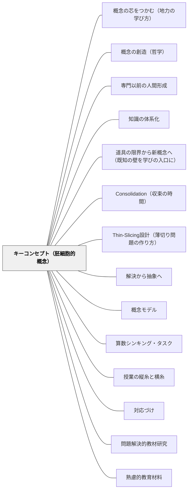

# キーコンセプト（胚細胞的概念）

**一文でいうと**：単元・教科の核になる少数の概念を見つけ、それを中心に教材と問いを組む。

## 使いどころ・使いすぎ注意

| 観点 | 内容 |
| --- | --- |
| 使いどころ | 単元を設計するとき。内容が事実の羅列になりそうなとき。 |
| 使いすぎ注意 | 急いで決めると、単元名の言い換えにとどまる。教材を分析して見つける（力のかたち）。 |

> 教科の核となる概念が、深い理解と転移の鍵を握る教育材料。

## 背景（Context）

ウィギンズ&マクタイ（Understanding by Design）・エリクソン（Concept-Based Curriculum）・エンゲストローム（活動理論）が指摘するように、教育材料の分析・研究を深めると教科の核となる「キーコンセプト」に出会う。このキーコンセプトが教育材料として最重要となる。「胚細胞的概念」はヴィゴツキー・エンゲストロームの用語で、単元・教科の核となる発生的概念のこと。

## 問題（Problem）

教材が個別の事実・知識の羅列になると、学習者は転移できる概念的理解を得られない。

## 力のかたち（Forces）

- キーコンセプトは少数で強力
- 概念的理解は知識の転移を可能にする
- キーコンセプトの特定には教材分析が必要

## 解決（Solution）

**教材を設計・分析する際に「この単元・教科のキーコンセプトは何か」を問い、そのコンセプトを中心に据えた教材設計をする。**

---

具体例：体育・自立活動「軸を作る」
特別支援での朝の運動指導（[[特別支援/身体と学習]]）では、頭からお尻に一本の芯を通す「軸」を運動の胚細胞的概念に据える。子どもには「ヤキトリの軸」という具体イメージで渡す。この「軸」という一つの概念は、槍投げ・砲丸投げ・短距離走・長距離走といった陸上種目だけでなく、ダンス・ヨガ・格闘技・ボール運動にまで広く転移する。種目ごとにゼロから学び直さずに応用できるのは、少数で強力なキーコンセプトが転移の鍵を握るからだ——概念の圧縮による教育の経済性がそのまま現れている。

### 研究の裏づけ

> **研究の裏づけ（2026-11-01）**：『How People Learn』（2000）は、低学年の「海の哺乳類」の単元を例に挙げる。ふつうは種類の名前や魚との違いを扱うが、「なぜ海に哺乳類がいるのか」という問いで組めば、適応と自然選択という中心の概念につながり、「進化は一方向に進む」というよくある誤解に向き合うこともできる（p. 260）。報告書は、単元ごとのこうした概念の枠組みを、教科の専門家が明らかにする研究を勧める。出典：[[文献/人の学び方の研究を授業の設計につなぐ（全米研究評議会2000）]]。

> **研究の裏づけ（2026-11-04）**：（理論）エンゲストローム（2020）は、胚細胞の性質を5つ挙げる。①複雑な全体の、もっとも小さく単純な最初の単位である。②全体の根本の矛盾と、それを乗り越える種を、自らのうちにもつ。③ありふれていて、当たり前すぎて気づかれないことが多い。④多くの応用・拡張・発展への見通しを開く。⑤行為として実際に行われ、言葉やモデルになる前から実践のなかにあることが多い（p. 36）。「胚細胞そのものは概念ではない。概念の出発点であり、核である」。ワーゲンシャインの範例学習やマイヤーとランドの閾値概念も核となる考えを重んじるが、何を核に選ぶかの基準がないと批判する（p. 33）。5つの性質は、単元の核を選ぶ基準の候補になる。理論と、学校の外の大人の三つの事例の論文で、学級での効果は確かめていない。出典：[[文献/胚細胞から具体へ上向する学びを、学校の外の三つの研究から描く（Engeström2020）]]。

> **研究の裏づけ（2026-11-04）**：大きな考え（キーコンセプト）を先に決める逆向き設計（ウィギンズとマクタイ）について、作者の一人マクタイ自身が、2011年に置いた資料で「現時点では、学力への効果について直接の因果の証拠を示すことはできない」「正式な研究はまだ行われていない」と書いている（pp. 2, 14）。転移には根底の概念の理解が要ることなど、設計を支える原理の研究は別にある。2025年の一覧は「多くの実証研究が示している」と言い方を強めたが、挙がった学力の研究は主に小規模な準実験で、一覧は生成AI（Perplexity Pro）で集めたものと明記されている（p. 4）。核となる概念を中心に組む設計そのものの効果は、独立した研究ではまだ確かめられていない。出典：[[文献/逆向き設計が学力を伸ばすという根拠を、作者自身のまとめから確かめる（McTigheとSeif・McTighe2025）]]。

> **研究の裏づけ（2026-11-05）**：（実践の記述）胚細胞を教室で使った設計実験の報告がある。Hedegaard（2020）は、デンマークの3〜5年生の一つの学級を3年間（1987〜1990年）教え、大学の研究者と作った胚細胞のモデル（自然・種・群れの関係）を、人類の起源（環境・人の暮らし・共同体）、社会の変化へと広げて、生物・地理・歴史をつないだ（pp. 47–49）。教師は、子どもがふしぎに思うことから出発し、胚細胞に導かれた分析に進み、また子どもの理解に戻る「二重の動き」で教え（p. 46）、毎時間「何を調べているか／何を知っているか／何を知らないか／どうモデルに表すか／どう調べるか／モデルを直すか」の手順を使った（pp. 52–53）。胚細胞は単純なので低学年でも使え、子どもが自分の道具にできると著者は書く（p. 50）。ただしこの論文には学びの結果のデータはなく、著者自身の回顧の報告である。教師の準備の時間の足りなさが、広がらなかった理由の一つとされる（p. 55）。出典：[[文献/胚細胞のモデルで小学校の生物・地理・歴史をつなぎ、子どもの関心と教科の概念のあいだを行き来して教える（Hedegaard2020）]]。

> **研究の裏づけ（2026-11-06）**：（理論）教科の中には、通ると見え方が一変し（変容的）、忘れにくく（不可逆的）、それまで隠れていたつながりを見せる（統合的）「閾値概念」がある、と Meyer と Land は提案する（pp. 373–374）。閾値の手前では、古い見方と新しい見方の「どっちつかず」の時期が長く続き、分かったふりや立ち往生が起きやすい（pp. 375–377）。数学の「極限」は、日常の「行き止まり」という意味が邪魔をし、学生は定義を教わったあとも授業前の語の意味に頼り続ける（p. 385）。閾値概念を「やさしく」しようと最初の示し方を単純にすると、その版に満足して閾値を越えにくくなる、という指摘も紹介するが、原典自身が「まだ確かめていない」と書く（p. 381）。大学の科目の例による理論の提案で、どの概念が閾値概念に当たるかの基準も示されていない。段は仮説。出典：[[文献/通ると見え方が一変する「閾値概念」と、その手前で子どもが立ち往生するところを、教える人のための枠組みに整理する（MeyerとLand2005）]]。

## 結果（Consequences）

- 学習者が概念的理解を得て、他の場面に転移できる
- 教科の本質に迫る学習が実現する

## 関連パタン
- [[パタン/概念の芯をつかむ（地力の学び方）]]
- [[パタン/概念の創造（哲学）]]
- [[パタン/専門以前の人間形成]]
- [[パタン/知識の体系化]]
- [[パタン/道具の限界から新概念へ（既知の壁を学びの入口に）]]
- [[パタン/Consolidation（収束の時間）]]
- [[パタン/Thin-Slicing設計（薄切り問題の作り方）]]
- [[パタン/解決から抽象へ]]
- [[パタン/概念モデル]]
- [[パタン/算数シンキング・タスク]]
- [[パタン/授業の縦糸と横糸]]
- [[パタン/対応づけ]]
- [[パタン/問題解決的教材研究]]

- [[パタン/熟慮的教材教具]] — 親パタン
- [[パタン/胚細胞モデル]] — 胚細胞的概念の実践
- [[パタン/概念型の目標]] — 概念を目標にする
- [[パタン/教材の構造を見極める]] — キーコンセプトの発見
- [[概念/認知加速とダイナミック・アセスメント（学習する力そのものを狙う）]] — ヴィゴツキー学派との接続点。学ぶ力そのものを狙うプログラムの理論的背景
- [[パタン/教科に対しても責任を負う（教えすぎと放任のあいだ）]] — 「教科の本質」を具体的に持つための一つの形
- [[文献/人の学び方の研究を授業の設計につなぐ（全米研究評議会2000）]] — 「なぜ海に哺乳類がいるのか」で単元を組む（p. 260）
- [[文献/胚細胞から具体へ上向する学びを、学校の外の三つの研究から描く（Engeström2020）]] — 胚細胞の5つの性質と、範例学習・閾値概念との比較（理論）
- [[文献/逆向き設計が学力を伸ばすという根拠を、作者自身のまとめから確かめる（McTigheとSeif・McTighe2025）]] — 逆向き設計の根拠を作者自身がまとめた資料。直接の因果の証拠はまだないと書く
- [[文献/胚細胞のモデルで小学校の生物・地理・歴史をつなぎ、子どもの関心と教科の概念のあいだを行き来して教える（Hedegaard2020）]] — 胚細胞のモデルで小学校の3年間の授業を組んだ設計実験（二重の動き）
- [[文献/通ると見え方が一変する「閾値概念」と、その手前で子どもが立ち往生するところを、教える人のための枠組みに整理する（MeyerとLand2005）]] — 通ると見え方が一変する閾値概念と、その手前の立ち往生（理論）

## このパタンが働く実践
- [[特別支援/身体と学習]] — 「軸を作る」を運動の胚細胞的概念に据え、多くのスポーツへ転移させる（ヤキトリの軸）

## クラスター図

## Actionable Insight

- 単元設計の前に「この単元が終わったとき、学習者に持ち帰ってほしい核となる概念は何か？」を一言で書く——キーコンセプトの特定が教材の構造と優先順位を整理する
- そのキーコンセプトを「他の場面でも使える問いの形」に変換する（例：「なぜ文化は変化するのか？」）——転移可能な概念問いが深い理解の道具になる
- 単元の授業ごとに「今日の学習は核となる概念とどうつながっているか」を学習者が一言で言う時間をとる——授業の個々の内容をキーコンセプトへと統合する習慣が概念的理解を育てる

## 出典

- G. ウィギンズ・J. マクタイ（2005）『Understanding by Design』ASCD
- H.L. エリクソン（Concept-Based Curriculum）
- [[文献/熟慮的教育材料のパターンリスト（動画記録）]]
