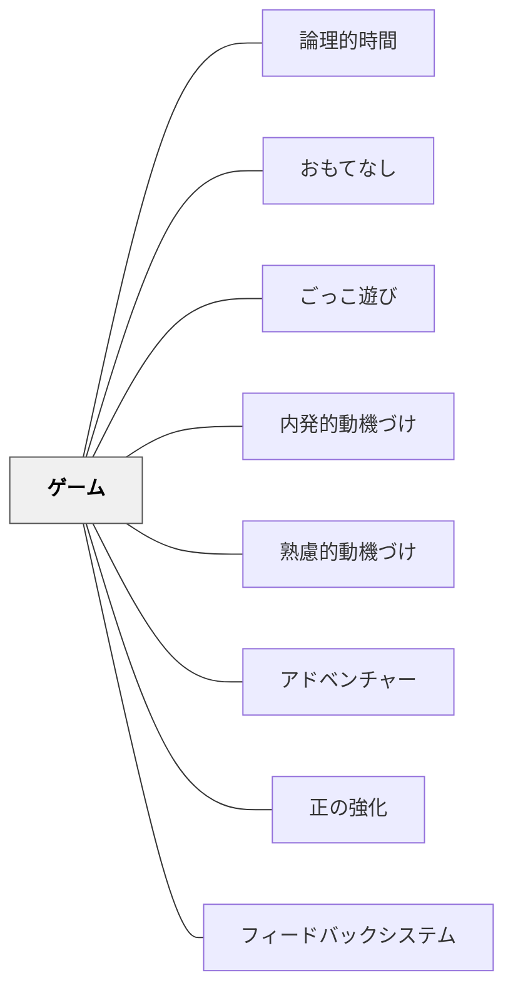

# ゲーム

**一文でいうと**：即時のフィードバック・明確なゴール・挑戦と達成のくり返し・自分で選ぶ余地を、学習の構造に組み込む。

## 使いどころ・使いすぎ注意

| 観点 | 内容 |
| --- | --- |
| 使いどころ | 義務感で取り組んでいる練習を、続けたくなる形にしたいとき。 |
| 使いすぎ注意 | ゲーム要素が学習内容より目立つと本末転倒になる。報酬を条件にすると、報酬がなくなったあとの自発的な取り組みが減ることがある（下の研究の裏づけ）。 |

> 楽しいこと自体が「やってみよう」という動機の源泉になる。

## 背景（Context）
ゲーム的要素（ポイント・レベルアップ・達成バッジ・競争・協力・即時フィードバック）を学習に取り入れることで、楽しさと動機を生み出す。ゲーミフィケーションという概念として広まっており、内発的動機付けの観点からも「有能感・自律感・関係性」を提供しやすい形式である。

## 問題（Problem）
学習が義務感・強制感で満ちていると、取り組む気持ちが生まれにくい。「やらなければならない」から「やりたい」への転換をどのように実現するかが課題である。外発的報酬に頼りすぎると内発的動機が損なわれる。

## 力のかたち（Forces）
- ゲームの即時フィードバックが達成感を高める
- 競争要素は人によっては逆にプレッシャーになる
- ゲーム要素が学習内容より目立つと本末転倒になる
- ゲームへの没入（フロー状態）は強力な内発的動機付けの形

## 解決（Solution）
**学習にゲーム的な構造（即時フィードバック・明確なゴール・挑戦と達成のサイクル・自律的な選択）を組み込み、楽しさから動機を生み出す。**

ポイントシステム・クエスト形式・バッジ・レベルアップなどのゲーミフィケーション要素を活用する。チーム協力・競争を適切に組み合わせる。ゲームそのものを使った学習（シリアスゲーム・シミュレーション）も効果的。

### 研究の裏づけ

> **研究の裏づけ（2026-11-01）**：128研究のメタ分析（Deci ほか 1999）は、参加・完了・成績を条件にした報酬が、報酬がなくなったあとの自由選択行動を全体として減らしたとする。肯定的なフィードバックは平均的には興味を高めたが、自由選択行動の増加は子どもでは確認されなかった（pp. 627, 653, 656）。ポイントやバッジを使うなら、それが活動そのものの面白さに置き換わっていないかを見る。出典：[[文献/報酬の条件と内発的動機づけを見分ける（Deciほか1999）]]。

> **研究の裏づけ（2026-11-01）**：幼稚園〜大学のデジタルゲームの69研究のメタ分析（Clark ほか 2016）では、ゲームはゲームでない授業より学びを伸ばした（0.33）が、効き方は設計で変わった。何回かに分けて遊ぶと効き、1回だけでは差がなかった。一人で競わずに遊ぶ形が最も効き、一人で競う形が最も弱かった。教師が手助けするゲームは、点数や正誤を示すだけのゲームより効いた。見た目のリアルさや物語の厚さが増すほど効果は小さかった。同じゲームの手助けを強めた版は、元の版より 0.41 伸ばした。著者は、ゲームがいつでも優れているという単純な引用をしないよう求める（PMC 版の結果・考察・限界の節）。出典：[[文献/デジタルゲームの学びの効果が、ゲームの設計でどう変わるかを確かめる（Clarkほか2016）]]。

> **研究の裏づけ（2026-11-04）**：学習にゲームの要素（点数・バッジ・順位表・物語・アバターなど）を入れた研究のメタ分析（38論文・40実験、2013〜2017年）では、効果の大きさは知識 0.49、意欲 0.36、行動 0.25 だった。ただし、無作為化か事前テストのある研究だけにすると、知識（0.42）は残ったが、意欲と行動は有意でなくなった。効き方を分けたのは人とのやりとりで、行動では、班で協力しながらほかの班と競う形が 0.70、競争だけが 0.12、やりとりなしが −0.06 だった。方法のしっかりした研究だけでも、意欲で協力を組み合わせた競争が競争だけを上回った。物語の世界は、行動にだけ効いた（0.41 対 0.10）。行動の効果はほとんどゲームの最中に測ったもので、ゲームの外でも同じとは限らない。時間をおいて測った研究は1つだけである。出典：[[文献/学習にゲームの要素を入れると、知識・意欲・行動はどのくらい変わるかを確かめる（SailerとHomner2020）]]。

> **研究の裏づけ（2026-11-05）**：ゲームにするなら、学ぶ内容を遊びの中心に置く。英国の小学校で、割り算をゲームの中心の動き（胸に数字のある敵を、割り切れる数の攻撃で倒す）に組み込んだ版と、算数と関係なく戦ってレベルの終わりに同じ割り算のクイズが出る版と、算数のない版を、7〜8歳の子どもに無作為に割り当てた。計100分あまり遊び、同じ中身の振り返りの授業を一回受けたあと、2週間後の試験では、中心に組み込んだ版の組がいちばん高かった（58%・41%・38%、pp. 20–21, 29）。9〜11歳16人が二つの版を自由に選べたときは、中心に組み込んだ版で7倍以上長く遊び、クイズの版を「楽しい部分が終わったらテスト。もうやめようと思う」と話した（pp. 27–28）。著者は、大事なのは物語や設定ではなく中心の動きだとする（p. 35）。ただし一つの学校の少人数で、研究者が作ったゲームであり、事後の試験では差がなかった。出典：[[文献/学ぶ内容をゲームの中心の動きに組み込むと、子どもはよく学び、長く遊ぶかを、割り算のゲームで確かめる（HabgoodとAinsworth2011）]]。

> **研究の裏づけ（2026-11-05）**：コンピュータを使わないすごろくでも、教室で学びが起きる。1〜10の数を一直線に並べたすごろくを、出た数と進むマスの数を声に出しながら、2〜3人の小グループで20〜25分ずつ4回遊ぶと、米国の低所得の家庭の3歳半〜5歳半の子ども（2つの実験で計167人）の数直線の見積もりと数字の読みが、同じ盤で色で進む版より伸びた（pp. 664–665, 667）。研究者ではなく、1時間の研修を受けただけの学級の補助の先生が遊んでも伸び、補助の先生は、数の力の低い子どもほど強く手助けし、回を追って手助けを減らしていた（pp. 668–670）。子どもは4回目でも時間の9割以上をゲームに向けていた。先行研究では、数を円形に並べた盤では同じようには伸びなかった（p. 662）。ただし遊んだ直後の測定だけで、大小の比べと数えることの伸びは補正後の基準にわずかに届かないなど、「四つの力すべてが伸びた」という著者の書き方は結果より強い。出典：[[文献/数を一直線に並べたすごろくを、教室の小グループで補助の先生と遊ぶと、幼児の数の力は伸びるかを確かめる（Ramaniほか2012）]]。

## 結果（Consequences）
- 学習への参加意欲・継続意欲が高まる
- フロー状態が深い学習を促す
- 外的報酬への依存が生じないよう設計に注意が必要

## [Pattern Connection]

**出典**: 深田浩嗣（2012）.『ゲームにすればうまくいく ―＜ゲーミフィケーション＞９つのフレームワーク』NHK出版

- **既存パタンとの関連**：本パタンが「ゲーム的要素を取り入れる」という方向性を示すのに対して、深田（2012）は「どう取り入れるか」の9つのフレームワーク（gデザインブロック）を提供する。本パタンの解像度を大幅に上げる補助線として機能する。
- **補強された点**：深田（2012）の核心的な区別——「ゲームをつくる」vs「ゲームにする」——を追加する。ゲーム要素を「外付け」するのでなく、学習活動そのものの中にゲームの構造を組み込むことが重要。ゲームを「客寄せパンダ」にしない。
- **修正・拡張された点**：gデザインブロックの9つの構造を解説セクションとして追加。これにより「どの要素を取り入れるか」の判断枠組みが具体的になる。
- **他のパタンへの波及**：[[パタン/オンボーディング]]（最初の一歩の設計）、[[パタン/可視化]]（ゲームの最基本要素）、[[パタン/世界観]]（ゲームの深度を決める要素）、[[パタン/ソーシャル]]（インタラクションの設計）、[[パタン/おもてなし]]（すべての道具の基盤となるマインド）がそれぞれgデザインブロックの各レベルに対応する。

**gデザインブロック（9つのフレームワーク）概要**：

```
【FINAL】おもてなし（道具をどう使うかというマインド）
【LV5】ゴール（深い動機・目的——目標とは異なる）
【LV4】チューニング（KPI→データ→施策の改善ループ） / 上級者向け
【LV3】世界観（所属感・アイデンティティ） / ソーシャル（人同士のインタラクション）
【LV2】オンボーディング（最初の一歩）
【LV1】可視化（フィードバックの見える化） / 目標（具体的な行動ゴール）
```

**目標とゴールの決定的な区別**：
- **目標**：「今週のレッスンを完了する」「算数のドリルp.30まで終わらせる」——具体的・達成可能
- **ゴール**：「英会話が上達したい」「数が好きな自分になりたい」——終わりがない深い動機
- 目標がゴールに向いていないとき「これ、何のためにやってるんだっけ」という「われに返る」瞬間が生じ、モチベーションが急落する

## クラスター図



## Actionable Insight

- 学習にクエスト形式・バッジ・レベルアップなどのゲーミフィケーション要素を一つ取り入れてみる——即時フィードバックと達成感が学習への参加意欲を高める
- チーム協力型のゲームを一単元に一度組み込む——競争でなく協力の要素が全員の参加を促す
- 学習の進捗を「ポイント」や「レベル」で可視化する——フロー状態が生まれると深い学習が促される

## 出典

- 一つの教育のパタン・ランゲージ（岩井輝久）／深田浩嗣（2012）ゲームにすればうまくいく NHK出版

---

## 関連パタン
- [[パタン/論理的時間]]
- [[教科/算数・数学で使うパタン]]
- [[パタン/おもてなし]]
- [[パタン/ごっこ遊び]]
- [[パタン/内発的動機づけ]]

- [[パタン/熟慮的動機づけ]] — 親パタン
- [[パタン/アドベンチャー]] — 挑戦と発見の動機を扱うパタン
- [[パタン/正の強化]] — ゲームの報酬要素と連動
- [[パタン/フィードバックシステム]] — ゲームの即時フィードバックの設計
- [[文献/報酬の条件と内発的動機づけを見分ける（Deciほか1999）]] — 条件つきの報酬は、報酬がなくなったあとの自発性を減らす
- [[文献/デジタルゲームの学びの効果が、ゲームの設計でどう変わるかを確かめる（Clarkほか2016）]] — 回数・競い方・手助け・見た目と物語で、ゲームの効き方が変わったメタ分析
- [[文献/学習にゲームの要素を入れると、知識・意欲・行動はどのくらい変わるかを確かめる（SailerとHomner2020）]] — ゲーミフィケーションのメタ分析：知識・意欲・行動と、競争・協力・物語
- [[文献/学ぶ内容をゲームの中心の動きに組み込むと、子どもはよく学び、長く遊ぶかを、割り算のゲームで確かめる（HabgoodとAinsworth2011）]] — 学ぶ内容をゲームの中心の動きに組み込むと、よく学び、長く遊んだ
- [[文献/数を一直線に並べたすごろくを、教室の小グループで補助の先生と遊ぶと、幼児の数の力は伸びるかを確かめる（Ramaniほか2012）]] — 数を一直線に並べたすごろくを、教室の小グループで補助の先生と遊ぶ

## このパタンが働く実践

| 実践パタン | どのようにゲームが働くか |
|------------|--------------------------|
| [[実践/カエルの算数：勝ちやすさを表で考えよう]] | サイコロとカエルのゲームが、「どれが勝ちやすいか」を考えたくなる入口になる |
| [[教材/カエルの算数ゲームボード]] | ゲームボードそのものが、勝ちやすさを予想して確かめる学習活動を生み出す |
