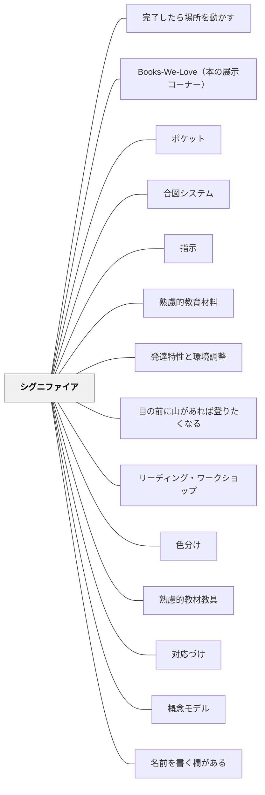

# シグニファイア

**一文でいうと**：教材の各部分が「何のためのものか」を、見ただけで分かるように示す。

## 使いどころ・使いすぎ注意

| 観点 | 内容 |
| --- | --- |
| 使いどころ | 教材の使い方の説明に時間がかかるとき。新しいワークシートを作るとき。 |
| 使いすぎ注意 | 印を増やしすぎると、かえって混乱する（力のかたち）。 |

> 「何ができるか」が分かる教材が、学習者を自然に導く。— D.A. ノーマン

## 背景（Context）

D.A. ノーマン（「デザインと人間行動」）の概念。シグニファイアとは、ある道具・教材を知覚した時に「これで何ができるか・何をするか」を示す指標となる要素のこと。良い教材は、学習者が見ただけで「どう使うか」が分かるようにシグニファイアが設計されている。対応づけ・概念モデルとも深く関連する。

## 問題（Problem）

教材の使い方が分かりにくいと、学習者は教材の操作そのものに認知的エネルギーを使ってしまい、本来の学習に集中できない。

## 力のかたち（Forces）

- 直感的に使えるシグニファイアが学習者の認知負荷を下げる
- 名前を書く欄・ポケット・色分けもシグニファイアの一例
- 過剰なシグニファイアはかえって混乱を生む

## 解決（Solution）

**教材の各要素が「何をするためのものか」を学習者が見ただけで理解できるよう、視覚的・構造的なシグニファイアを設計する。**

実践例：
- 名前を書く欄がある（「自分のもの」という所有の知覚）
- ポケットがある（「ここに入れる」という行動を誘導）
- 色分けで意味の違いを示す
- 矢印・番号で手順を示す

### 研究の裏づけ

> **研究の裏づけ（2026-11-02）**：図と文の「ここがここに当たる」を色分け・指し示し・ラベルで示す手がかりのメタ分析（45比較・2,464人、Richter 2016）では、効果は小〜中（r = 0.17）で、効果を左右したのは学習者の前の知識だけだった（少ない〜中くらいで r = 0.19、多いと r = −0.08）。ドイツの8年生127人の化学のデジタル教科書の実験では、前の知識の多い生徒は、手がかりを足した版でかえって成績が下がった（pp. 61–62, 92）。印は、初めて学ぶ子の助けになる一方、知っている子には回り道になりうる。「使いすぎ注意」の研究の側からの裏づけ。出典：[[文献/図と文の対応を示す手がかりが、だれに効き、だれの邪魔になるかを確かめる（Richter2016）]]。

> **研究の裏づけ（2026-11-04）**：教材の各部分が「何のためのものか」を示す手がかりは、例題でも確かめられている。米国の大学の初級プログラミングの授業（265人）では、新しい手順を習う5週分の例題の各段階に、その段階の目的を短い見出しで書き添えた（サブゴール・ラベル）。たとえば「if 文の結果を読む」を「どの文がまとまりかを図に描く」「条件が真か偽かを決める」「正しい分かれ道をたどる」と分けた。ラベルの組は、習って1週間以内の小テストで 48% 対 41%（d = 0.44）とよくでき、途中で試験を受けなくなった学生と不合格の学生がほぼ半分だった。試験の平均点には有意差がなかった。組は学生が選んだ準実験で、ラベルの組の教師は研究者の一人である。出典：[[文献/例題の各段階に「何のための段階か」を書き添えると、つまずきやすい学生がやめずに続けられるかを確かめる（Margulieuxほか2020）]]。

> **研究の裏づけ（2026-11-05）**：注意の向け先を示す印の効果は、別のメタ分析でも確かめられている。文と絵を使う教材に、矢印・色分け・点滅・スポットライトなどの手がかりを足した実験32本（3,597人）をまとめると、覚えることは d = 0.27、使うことは d = 0.34 伸び、頭の負担の感じ方はわずかに減った（d = −0.11）。負担の感じ方が減った研究ほど、学びも伸びていた（研究どうしの比較、pp. 11–14）。ただし32本のうち22本は大学生・大学院生の研究で、負担は少数の質問への自己評定である（著者も慎重に扱うよう書く、p. 17）。動く教材（動画・アニメーション）では効果がはっきりしなかった、という別のメタ分析も紹介されている（p. 16）。出典：[[文献/図や文に注意の向け先を示す手がかりが、負担を減らし、覚えることと使うことを助けるかを、32の研究から確かめる（Xieほか2017）]]。

> **研究の裏づけ（2026-11-05）**：「ここがここに当たる」を示す印は、教室の類推でも使われている。米国・香港・日本の中学2年生の数学の授業ビデオ（国ごとに10本）では、方程式の等号の真下にてんびんの図をかくといった、位置や矢印で対応を示す支えを、香港と日本の教師は米国の教師の2倍以上使っていた。てんびんと方程式の間を行き来して指さすような、比べることを示す身ぶりもずっと多かった（p. 1129）。教師の行動を記録した研究で、印が子どもの理解を伸ばすかは確かめていない。出典：[[文献/数学の授業で類推を使うとき、教師がどんな支えを添えているかを、米国・香港・日本の授業ビデオで比べる（Richlandほか2007）]]。

> **研究の裏づけ（2026-11-06）**：「何のためのものか」を示すことは、教材の部分だけでなく、課題そのものにも当てはまる。米国の少数派の学生が多い7大学（学生1,800人・教員35人）で、教員が同じ科目の2クラスのうち片方で、持ち帰り課題2つについて、学生が取りかかる前に「目的・やること・評価の規準」を話した（透明な課題設計、TILT）。計画どおり実施した科目どうしで比べると、学業への自信（効果量 0.30）と所属感（0.32）の自己評定が高く、家族で初めて大学に進んだ学生で伸びが大きかった。学生がもっとも多く挙げたのは「この授業では、各課題の目的が分かっていた」だった。ただし大学協会の機関誌の報告で、主な分析は学生が感じた透明さによる比較、結果は自己評定であり、比べるクラスにも介入が漏れた。段は仮説。出典：[[文献/課題の目的・やること・評価の規準をはっきり示すと、大学1年生、とくに家族で初めて大学に進んだ学生の自信と所属感は伸びるかを確かめる（Winkelmesほか2016）]]。

## 結果（Consequences）

- 学習者が教材の使い方を直感的に理解できる
- 教材の説明時間が減り、学習時間を確保できる

## Pattern Connection

### 岩井輝久（2023）——シグニファイアは可視化の小パタン

> 「シグニファイアは可視化の一部だな。可視化にもいろいろなパタンがあるけど、可視化という大パタンの中の一つの小パタン。そういう関係になっていそうだ。」（岩井輝久、2023）

- **既存パタンとの関連**：[[パタン/可視化]] はすでに「アフォーダンス・シグニファイア（教材の可視化）」を内部アプローチ②として記述している。岩井の洞察はこの構造を明示的に言語化したもの——シグニファイアは「見えないことをボトルネックとする」という大パタン・可視化の具体的実装である
- **補強された点**：シグニファイアをノーマンの概念として独立させるだけでなく、「大パタンの中の小パタン」として位置づけることで、パタン・ネットワーク上の構造的な立ち位置が明確になる。これはパタン・ランゲージを「大パタンから小パタンへ」という階層として読む視点（[[自分のパタンを作る]] の三層構造）とも対応する
- **他のパタンへの波及**：[[パタン/可視化]]（親パタン——シグニファイアはその実装の一形態）・[[パタン/目の前に山があれば登りたくなる]]（「次にできることが見て分かる」という機能でシグニファイアと重なる）

## 関連パタン
- [[特別支援/特別支援で使えるパタン]]
- [[特別支援/太田ステージ]]
- [[特別支援/視覚支援]]
- [[パタン/完了したら場所を動かす]]
- [[教科/算数]]
- [[学級経営/オンボーディング]]
- [[特別支援/TEACCHとシグニファイア]]
- [[特別支援/特別支援級の算数指導]]
- [[実践/個別教材の設計]]
- [[実践/発達特性別の環境調整]]
- [[パタン/Books-We-Love（本の展示コーナー）]]
- [[パタン/ポケット]]
- [[パタン/合図システム]]
- [[パタン/指示]]
- [[パタン/熟慮的教材教具]]
- [[パタン/発達特性と環境調整]]
- [[パタン/目の前に山があれば登りたくなる]]

- [[パタン/リーディング・ワークショップ]] — 読書コーナーの設計にシグニファイアが働く
- [[パタン/色分け]] — 色による意味の伝達

- [[パタン/熟慮的教材教具]] — 親パタン
- [[パタン/対応づけ]] — シグニファイアの詳細実装
- [[パタン/概念モデル]] — 使い方のメンタルモデル
- [[パタン/名前を書く欄がある]] — シグニファイアの実例
- [[文献/図と文の対応を示す手がかりが、だれに効き、だれの邪魔になるかを確かめる（Richter2016）]] — 図と文の対応を示す印は、前の知識の少ない子に効き、多い子には回り道になりうる
- [[文献/例題の各段階に「何のための段階か」を書き添えると、つまずきやすい学生がやめずに続けられるかを確かめる（Margulieuxほか2020）]] — 例題の各段階に目的の見出しを添える（サブゴール・ラベル）。大学のプログラミングの準実験
- [[文献/図や文に注意の向け先を示す手がかりが、負担を減らし、覚えることと使うことを助けるかを、32の研究から確かめる（Xieほか2017）]] — 注意の向け先を示す手がかりのメタ分析：覚えること・使うことが小〜中くらい伸びる
- [[文献/数学の授業で類推を使うとき、教師がどんな支えを添えているかを、米国・香港・日本の授業ビデオで比べる（Richlandほか2007）]] — 対応を位置・矢印・身ぶりで示す（米国・香港・日本の数学の授業ビデオ）
- [[文献/課題の目的・やること・評価の規準をはっきり示すと、大学1年生、とくに家族で初めて大学に進んだ学生の自信と所属感は伸びるかを確かめる（Winkelmesほか2016）]] — 課題の目的・やること・評価の規準を、取りかかる前に示す（透明な課題設計。大学1年生、自己評定）

## このパタンが働く教材

| 教材 | どのようにシグニファイアとして働くか |
|------|--------------------------------------|
| [[教材/リーディング・ワークショップの小さい付箋]] | 本文中の話したい箇所、根拠になる箇所、分からなかった箇所を目に見える印として示す |

## クラスター図

## Actionable Insight

- 新しいワークシートを渡すとき「名前を書く欄・記入欄・参照欄」を視覚的に区別して設計する——学習者が見ただけで使い方が分かる教材は説明時間を減らし学習時間を増やす
- 教材の手順を矢印や番号で示す——「次に何をすべきか」を学習者が自分で判断できる構造が自律的な活動を支える
- 色分けや形の違いで「これとこれは意味が違う」ことを示す——視覚的な差異が認知的負荷を下げ本来の学習に集中できるようにする

## 出典

- D.A. ノーマン（1990）『誰のためのデザイン？――認知科学者のデザイン原論』新曜社
- [[文献/熟慮的教育材料のパターンリスト（動画記録）]]
