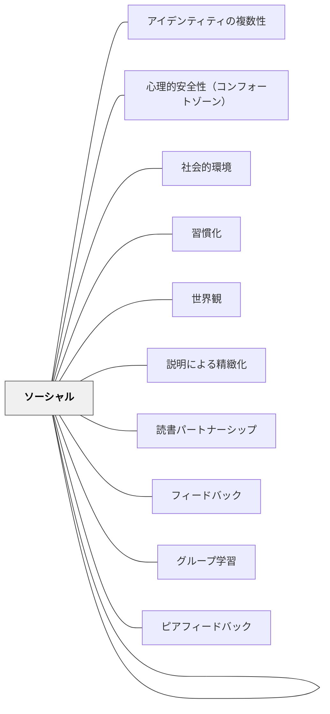

# ソーシャル

**一文でいうと**：仲間とのやり取り（一緒に取り組む・競う直接のやり取りと、見せ合う・評価し合う間接のやり取り）を、学びの資源として設計する。

## 使いどころ・使いすぎ注意

| 観点 | 内容 |
| --- | --- |
| 使いどころ | 一人で考えて止まっている子が多いとき。学級の関係づくりと学習を一緒に進めたいとき。 |
| 使いすぎ注意 | グループにすれば学べるわけではない。いつも同じ子が主導し、一部の子の理解の不足が隠れることがある（下の研究の裏づけ）。 |

> 人間同士のインタラクションがなく、学習は停滞している。

## 背景（Context）

ソーシャル性がもたらすインタラクション（相互作用）によって得られる教育効果は絶大です。

## 問題（Problem）

人間同士のインタラクションがなく、学習は停滞している。

## 力のかたち（Forces）

- 仲間からの肯定的なフィードバックは、教師によるフィードバックよりも意欲の向上につながる（ケーガン 2021。本 Wiki では原典を確かめていない）
- 協同学習がうまく働くには原理がある：①互恵的な相互依存、②個人の責任、③平等な参加、④活動の同時性（ケーガン 2021）
- インタラクションには、一緒に取り組む・競う直接のものだけでなく、作品を見せる・評価し合う間接のものもある（深田 2012、下の補足）
- ソーシャルは協同学習だけでなく学級経営まで含む大きな概念で、抽象度が高いからこそ実践的である（岩井 2023、下の補足）

## 解決（Solution）

**人間同士のインタラクションによる教育効果が最大になるように教育を設計せよ。**

### この楕円の下で働くパタン

| パタン | どう働くか |
| --- | --- |
| [[パタン/グループ学習]] | 一緒に考え、互いにフィードバックし合う場をつくる |
| [[パタン/ピアフィードバック]] | 仲間同士で、作品や考えに反応を返し合う |
| [[パタン/読書パートナーシップ]] | 二人組で読み、話し合う |
| [[パタン/説明による精緻化]] | 仲間に説明することで、自分の理解を組み立て直す |
| [[パタン/世界観]] | 共有する世界観が豊かなほど、やり取りの質が上がる |
| [[パタン/心理的安全性（コンフォートゾーン）]] | 考えを出しても大丈夫だという土台 |

### 研究の裏づけ

> **研究の裏づけ（2026-11-01）**：『How People Learn』（2000）は、グループでの問題解決や仲間との議論の利点を認めたうえで、特に低学年では欠点もあるとする。社会の固定観念や学級での評判が、誰が主導し、誰の考えが重んじられるかを決めてしまうことがある。いつも同じ子が主導し、同じ子がついていくこともある。グループの作品は、一人ひとりの理解を進めることもあれば、一部の子の理解の不足を覆い隠すこともある（pp. 279–280）。報告書は、すべての子に役立つ協同学習の設計を今後の研究課題としている。ケーガンの「個人の責任」「平等な参加」は、この欠点への手立てとして読める（本 Wiki の読み）。出典：[[文献/人の学び方の研究を授業の設計につなぐ（全米研究評議会2000）]]。

> **研究の裏づけ（2026-11-01）**：大学の理系の授業の225研究のメタ分析（Freeman ほか 2014）が比べた「能動的な学び」には、授業中のグループでの問題解決などが含まれ、多くがグループ活動を伴った（pp. 8410, 8414）。全体として講義だけの授業より成績が上がったが、グループ活動という種類だけを取り出して効果を比べてはいない（p. 8413）。対象は大学である。出典：[[文献/講義だけの授業と能動的な学びを比べる（Freemanほか2014）]]。

> **研究の裏づけ（2026-11-01）**：グループにするだけでは協力は生まれない。Johnson と Johnson（2009）と Gillies（2016）は、協同学習が成り立つ条件として、肯定的な相互依存・個人の責任・学びを促す相互作用・対人技能・グループの振り返りを挙げる。聴く・説明する・意見の違いを扱う方法は、教師が明示的に教える対象になる（Johnson と Johnson pp. 366–369、Gillies pp. 41–42）。上の力のかたちのケーガンの四原理と重なる。出典：[[文献/協同学習を成立させる五つの条件（JohnsonとJohnson2009）]]・[[文献/協同学習の対話を教師が支える（Gillies2016）]]。

> **研究の裏づけ（2026-11-01）**：話し合いの量と、一人ひとりの理解は別に確かめる。読書の討議方法の42文書の分析（Murphy ほか 2009）では、子どもの発話が増えても、理解が同じように伸びるとは限らなかった（p. 760）。英国の9〜10歳の研究（Mercer ほか 1999）では、理由を求める・異論を受け止めるといった話し合いの約束を学級の言葉にして教えると、個人の推論の得点の伸びは比較学級より大きかったが（片側 p = .04）、グループの得点の差は有意でなかった。4学級ずつの比較で、無作為の割り付けではない（pp. 101, 107）。23週間の続く研究（Mercer ほか 2004）では、理科の理解と推論の成績で比較学級を上回ったが、教師の指導と話し合いの約束のどちらが効いたかは分けられない（pp. 371–374）。出典：[[文献/読書の対話と個人の理解を分けて確かめる（Murphyほか2009）]]・[[文献/話し合いの約束と個人の推論を確かめる（Mercerほか1999）]]・[[文献/理由を出し合う対話を育てる（Mercerほか2004）]]。

> **研究の裏づけ（2026-11-01）**：仲間同士の評価は、受け取った側が行動して初めて役に立つ。Topping（1998）は大学の相互評価の研究109件を整理し、評価の規準と実例を使った検討、練習、教師の観察と支援を実施の条件に挙げる。コメントの量だけでは学習の改善は示せない（pp. 255, 265–267）。出典：[[文献/相互評価の設計と実施条件を確かめる（Topping1998）]]。

> **研究の裏づけ（2026-11-01）**：学習に困難のある、またはそのおそれのある幼稚園〜6年生への支援の系統的レビュー（Dietrichson ほか 2021）では、子ども同士の教え合いが、単独の方法で 0.39 と大きく、研究どうしのばらつきも小さかった（予測区間 0.06〜0.71）。多くは同じ学年の二人組の、手順の決まった教え合いで、二人組（0.42）はより大きなグループ（0.28）より大きかった。一方、学習障害のある子どもの算数の別のレビューでは、同じ学年の教え合いの効果は小さく、著者は「困難の最も大きい子どもにはあまり効かないのかもしれない」とする。出典：[[文献/学習に困難のある小学生への支援の効き方を確かめる（Dietrichsonほか2021）]]。

> **研究の裏づけ（2026-11-01）**：小学校の算数のメタ分析（Pellegrini ほか 2021）では、学級の組織と経営の研修（子どもをチームにして互いに助け合い、チームの平均の行動と成績で小さな特権を得る仕組みなど）が +0.19（7研究）で、算数の内容と教え方の研修（+0.03）より大きかった。ただし7研究には協同学習のほか、行動のゲームや振り返りの指導も含まれ、協同学習だけの効果ではない（pp. 13, 22–23）。出典：[[文献/小学校の算数で効いたプログラムの種類を確かめる（Pellegriniほか2021）]]。

> **研究の裏づけ（2026-11-01）**：読みに困難のある小学生へのメタ分析（Neitzel ほか 2022）では、協同学習と音の読みを柱にした学級全体の指導（CIRC・PALS など、5研究）が、困難のある子に +0.31 と、個別指導全体（+0.26）と同じくらいだった。研究数が少なく有意ではなく、同じ研究の中で直接比べたものもない（pp. 24, 33）。学級全体の授業を強くすることが、個別指導と並ぶ選択肢になりうる。出典：[[文献/読みに困難のある小学生への支援の効き方を確かめる（Neitzelほか2022）]]。

## 結果（Consequences）

- 協同学習など、人間同士のインタラクションを生かすことによって、学習をより楽しく効果的にすることができる
- ただし、グループにすれば学べるわけではない。役割と一人ひとりの責任が見えないと、理解の不足がグループの作品に隠れる（上の研究の裏づけ）

## [Pattern Connection]

**出典**: 深田浩嗣（2012）.『ゲームにすればうまくいく ―＜ゲーミフィケーション＞９つのフレームワーク』NHK出版（LEVEL 3：ソーシャル）

- **既存パタンとの関連**：本パタンはすでに深田（2012）を参照していた。今回の再統合で「間接的インタラクション」という具体的な概念を追加し、解像度を上げる。ケーガン（2021）の協同学習理論と深田のソーシャル概念は相互補完的である。
- **補強された点**：深田（2012）の重要な視点——「ソーシャルとはSNSではなく人間同士のインタラクションのこと」「直接的な交流だけでなく**間接的なインタラクション**も重要」——を追加する。間接的インタラクションとは、「あいつのカスタムはすごい」「あの班の発表はよかった」という競争心・達成感・評価への満足感。
- **修正・拡張された点**：ソーシャルは「世界観が強いほど豊かになる」という依存関係を明記する。同じ世界観を共有する仲間同士のインタラクションは、そうでない場合とは質が根本的に違う。
- **他のパタンへの波及**：[[パタン/世界観]] が豊かなほどソーシャルの質が高まる。[[パタン/グループ学習]] の設計に「間接的インタラクション」の視点を加えることで、グループ内の暗黙の刺激を意図的に設計できる。

**ソーシャルのインタラクション4類型（深田, 2012 に基づく）**：

| 類型 | 内容 | 教育での例 |
|------|------|-----------|
| 直接的協力 | 目標に向かって共に働く | グループ学習・協同解決 |
| 直接的競争 | 同じゲームで争う | チーム対抗・ランキング |
| 間接的自慢 | 成果を他者に見せる | 作品展示・発表会 |
| 間接的評価 | 他者の成果を評価する | 相互評価・投票 |

**間接的インタラクションの設計**：グリー「探検ドリランド」では「レアキング（強大な敵）」を1人では倒せない設計にすることで、仲間を呼ぶ必然性が生まれた。教育版：「1人では答えられない問いを持つ」「クラス全体で取り組む長期プロジェクト」が間接的な協力・競争を自然に生む。

**岩井輝久（2023）——抽象度が高い＝実践的という洞察**

> 「ソーシャルという概念を気に入っているのは、ここにいわゆる、大きな領域として協同学習のようなものだけではなく学級経営など、様々な大きな要素が入ってくる、さらに大きな概念だということ。抽象度が高い。抽象度が高いというのは、実はとても実践的なのだ。」（岩井輝久、2023）

- **既存パタンとの関連**：深田（2012）のインタラクション4類型は「ソーシャルの小パタン群」として機能する。このツイートはその逆から「ソーシャルが大きな概念であるからこそ多様な実践を包括できる」という大パタンとしての位置づけを明確にする
- **補強された点**：「抽象度が高い＝実践的」という逆説的洞察が加わった。協同学習・学級経営・コミュニティ形成という多様な実践を貫く大パタンだからこそ、どんな場面でも視点として機能する。[[自分のパタンを作る]]の「理論は実践的」という論理と同じ構造である
- **他のパタンへの波及**：[[パタン/世界観]]（同じ大きな概念のもとで実践の選択肢が広がる）・[[自分のパタンを作る]]（大パタンから整理することの重要性を例示する）

## 関連パタン
- [[パタン/アイデンティティの複数性]]
- [[パタン/心理的安全性（コンフォートゾーン）]]
- [[パタン/社会的環境]]
- [[パタン/習慣化]]
- [[パタン/世界観]]
- [[パタン/説明による精緻化]]
- [[パタン/読書パートナーシップ]]

- [[パタン/フィードバック]]
- [[パタン/ソーシャル]] （原典パタン集に存在する場合）
- [[パタン/グループ学習]] — 一緒に考え、互いにフィードバックし合う場（この楕円の下で働くパタン）
- [[パタン/ピアフィードバック]] — 仲間同士の反応の返し合い（この楕円の下で働くパタン）
- [[文献/人の学び方の研究を授業の設計につなぐ（全米研究評議会2000）]] — 協同の利点と、評判や固定観念が主導を決める欠点（pp. 279–280）
- [[文献/講義だけの授業と能動的な学びを比べる（Freemanほか2014）]] — 能動的な学びの多くがグループ活動を伴った（大学・グループ活動だけの効果は未分離）
- [[文献/協同学習を成立させる五つの条件（JohnsonとJohnson2009）]] — 協同学習の五つの条件
- [[文献/協同学習の対話を教師が支える（Gillies2016）]] — グループに分けただけでは協力は成立しない
- [[文献/読書の対話と個人の理解を分けて確かめる（Murphyほか2009）]] — 発話が増えても理解が伸びるとは限らない
- [[文献/話し合いの約束と個人の推論を確かめる（Mercerほか1999）]] — 話し合いの約束を教えると個人の推論が伸びた（片側 p = .04）
- [[文献/理由を出し合う対話を育てる（Mercerほか2004）]] — 理由を出し合う対話と理科の理解
- [[文献/相互評価の設計と実施条件を確かめる（Topping1998）]] — 相互評価は受け取った側が行動して役に立つ
- [[文献/学習に困難のある小学生への支援の効き方を確かめる（Dietrichsonほか2021）]] — 子ども同士の教え合い（二人組 0.42）と、効きにくい相手
- [[文献/小学校の算数で効いたプログラムの種類を確かめる（Pellegriniほか2021）]] — チームで助け合う学級の仕組みの算数への効果（+0.19）
- [[文献/読みに困難のある小学生への支援の効き方を確かめる（Neitzelほか2022）]] — 協同学習を柱にした学級全体の読みの指導（+0.31）

## クラスター図

## Actionable Insight

- 1つの授業に「隣の人と30秒話す」を1回入れる——ソーシャルなインタラクションの最小単位が他の学習を活性化する
- 課題の後に「自分の考えをペアで交換する→全体で聞く」の流れを1度試す——仲間のフィードバックは教師のフィードバックより意欲の向上につながるとされる（ケーガン 2021。本 Wiki では原典を確かめていない）
- グループ活動で「誰が何の役割か」を明示する——協同学習の原理（互恵的依存・個人の責任）を満たすとグループの質が上がる

## 出典
- [[文献/一つの教育のパタン・ランゲージ]]

岩井輝久「岩井輝久『一つの教育のパタン・ランゲージ』」（2026-04-29 vault収録）  
スペンサー・ケーガン（2021）『ケーガン協同学習入門』大学図書出版  
深田浩嗣（2012）『ゲームにすればうまくいく――〈ゲーミフィケーション〉9つのフレームワーク』NHK出版
