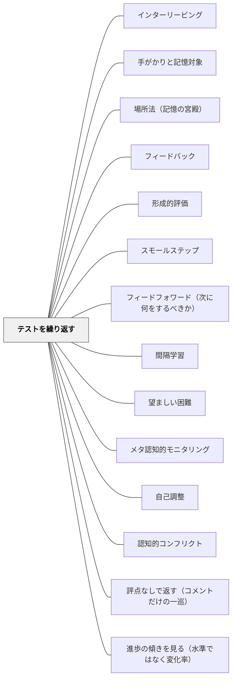

# テストを繰り返す

> テストは学習の終わりではなく、記憶を強化する最良の練習だ。

---

## Pattern Connection

**研究からの補足（2026-10-19）：復習間隔と保持期間を合わせて考える（Cepedaほか2006）**

Cepedaほか（2006, pp. 354–357）は、学習機会の時間配置を検討したレビューであり、再読と想起テストの比較だけを集めた研究ではない。本パタンへのWiki側の適用案として、答えを思い出す活動を複数日に置く際には、想起の方法・復習の間隔・最後の確認時点を別々に記録する。論文からテスト回数の上限や固定日程を導かず、想起できない場合は手がかりや学び直しを加えて後日確かめる。 出典：[[文献/復習間隔と保持期間を合わせて考える（Cepedaほか2006）]]。

**原典補足（2026-10-14）：学習方法の効果と適用条件（Dunloskyほか2013）**

想起練習は幅広い条件で有効だが、低い正答率のまま試すだけでは再学習への優位が出ない場合がある。正答フィードバック付きの効果はより頑健と整理される（p. 35）。授業案として、思い出した後に確認・修正する時間を確保する。 出典：[[文献/学習方法の効果と適用条件（Dunloskyほか2013）]]。

**原典の接続（2026-10-14）**：小学生の想起練習を支える手がかり（Karpickeほか2014）を参照し、小学生に必要な想起の支援と測定時点を補うための補足を本ページに加えた。

**原典の接続（2026-10-14）**：想起テストによる長期保持（RoedigerとKarpicke2006）を参照し、大学生の原典実験と適用範囲を確認するための補足を本ページに加えた。

**Weinstein & Sumeracki（2018）統合（2026-05-14）：**

*Understanding How We Learn*（東京書籍, 2022）は、検索練習（Retrieval Practice）を6つの学習方略の1つとして体系化し、エビデンスと教室実装の両面から整理している。

- **補強された点**：本パタンの「低リスク・高頻度テスト」の実装方法（エグジットチケット・自由再生・ペア説明・穴埋め）が具体化された。「書く・話す・キーワードから展開する」など形式の多様化が明確になった。
- **接続した概念**：「望ましい困難（Desirable Difficulties）」——想起が難しく感じられるほど記憶が強化される。完全に覚えている状態での再読より、思い出しにくい状態での検索の方が効果的。
- **他のパタンへの波及**：[[パタン/間隔学習]] と組み合わせることで「間隔を空けた検索練習」という最強の組み合わせになる。[[実践/学習科学の6方略]] で6方略の文脈に位置づけられた。
- **再統合（2026-05-20）：フリーリコールとロエディガー実験**：
  - **フリーリコール（free recall）**：何も見ずに覚えているすべてを白紙に書き出す——最もシンプルかつ強力な検索練習の形式。「脳が何を知っていて何を知らないか」を正確に明示するため、メタ認知の向上にも寄与する。「教科書を閉じて、今日学んだことを全部書いてみよう」がその最小実装。
  - **ロエディガー＆カーピキ（2006）の実験2（原典照合で訂正、2026-10-14）**：大学生180人を3条件（SSSS・SSST・STTT、S＝学習、T＝想起テスト）で比較した。5分後の平均再生率は順に83%・78%・71%、1週間後は40%・56%・61%。両テスト条件は1週間後にSSSSより高かったが、STTTとSSSTの差は著者がmarginalと記述している。旧記述のTTTT条件は存在しない。実験2のSは5分、Tは10分で、四つの期間の総時間が等しいわけではない（pp. 251–253）。
  - **望ましい困難との接続**：[[パタン/望ましい困難]] — 検索練習は「まだ完全に覚えていない状態を露出させる」ため難しく感じる。しかしその困難感こそが記憶を強化する。
  - **多肢選択問題の注意点**：誤答選択肢が記憶に残る「誤情報効果」がある。即座に正答フィードバックを与えることでこの効果を打ち消せる。

---

## 背景（Context）

認知心理学の研究は、情報を「思い出す」行為（検索練習・想起練習）が記憶の定着に極めて効果的であることを繰り返し示してきた。これを「テスト効果（Testing Effect）」または「検索練習効果（Retrieval Practice Effect）」と呼ぶ。

ジョン・ハッティのメタ分析においても、テストを繰り返す実践は高い効果量（約0.54）を示しており、学習内容の長期記憶への定着において、再読や復習よりも有効なことが明らかになっている。テストは「評価のため」だけでなく、「学習のため」の強力なツールだ。

## 問題（Problem）

多くの教育現場では、テストは「学習の終わりに何を覚えたかを確認する」ためのものとして位置づけられている。このため、テストは学習者にとって不安や緊張の源となり、学習を促進するのではなく阻害する存在になりやすい。

また、一度だけのテストでは記憶の定着には不十分で、「テストのために詰め込んだが、後で忘れた」という経験が繰り返される。テストの持つ学習促進機能が活かされていない。

## 力のかたち（Forces）

- テストは学習者に心理的プレッシャーを与えることがあり、不安が高い学習者には逆効果になる
- 低リスク・形成的なテストを繰り返すことで、テストへの恐怖を減らしながら学習効果を得られる
- テストの間隔（spaced practice）と組み合わせることで、忘却曲線に対抗する記憶定着が可能になる

## 解決（Solution）

> **小学生への適用：白紙で止まったら手がかりを調整する（2026-10-14）**：Karpickeほか（2014, pp. 200–204）の9〜11歳の教室実験では、自由再生が初回7%、再読後9%にとどまった。質問マップを用いた別の実験では、直後の自由再生が再読より高かった（40%対28%）。Wiki側の適用案として、白紙に全部書くことだけを求めず、主題と具体的な問いを手がかりにし、実際に思い出せているかを見て調整する。この論文の質問マップ実験は長期保持の改善までは測っていない。出典：[[文献/小学生の想起練習を支える手がかり（Karpickeほか2014）]]。

テストを評価のためだけでなく、想起練習（Retrieval Practice）として設計する。具体的には、授業の冒頭に「前回学んだことを三つ書く」というウォームアップ、授業の終わりに「今日学んだ重要なことを書く」というエグジットチケット、週1回の短い小テスト（採点は速やかにフィードバックとして返す）などを組み込む。

重要なのは、これらのテストが「評価（成績に入る）」としてではなく「学習の練習」として学習者に理解されることだ。低リスク・高頻度のテストを繰り返し、間隔を空けて（翌日・1週間後・1ヶ月後）同じ内容を問うことで、長期記憶への定着が促進される。

---

### 「豚の体重を量っても太らない」への反証、そして頻度の上限（Black & Wiliam, 1998）

ブラックとウィリアム（1998）のレビューは、本パタンに二つの補強と一つの警告を与える。

**補強1——テストは測るだけでなく促進する。** Dempster の一連の仕事についてレビューはこう書く。「テストは学習を標本抽出するだけでなく、**学習を促進もする**。これはよく引用される『**豚の体重を量っても豚は太らない**』という比喩と矛盾する」（p.51）。評価は学習の外にある観測行為ではない、というのが本パタンの根拠である。

**補強2——最適な頻度には形がある。** Bangert-Drowns et al.（1991b）の40研究のメタ分析によれば、テスト頻度が上がるほど成績は改善するが、それは一定の水準までで、**週1〜2回のどこかを超えると再び低下しうる**。また**複数の短いテストのほうが、少数の長いテストより効果的**である。効果量は3週に1回で約0.5、週1回で約0.6、週2回で0.75。本パタンの「週1回・5問・5分」という Actionable は、この曲線のほぼ最適点にある。加えて Dempster は、**間隔を次第に長くしていくこと**と、**最初のテストを当該指導の直後に置くこと**を重視する。ただし**最初のテストで成功感を得られなかった子には、続くテストの効果が減じる**。

> **研究の裏づけ（2026-10-11）**：[[文献/Organizing Instruction and Study to Improve Student Learning（Pashler et al., 2007）]] は、7つの勧めのうち根拠が **strong** の二つの一つにこれを挙げる（勧め5b）。教科書を閉じて答えを思い出す小テスト（多肢選択より穴埋め・短い記述）は、同じ時間をもう一度学ぶことに使うよりほとんど常に強い。誤りが多く出そうなときは必ず正しい答えを返す。ただし自信がないときの当て推量の害は、事実や語彙の記憶では示されていない（p. 21–22）。

**警告——頻繁なテストは、それだけでは形成的評価ではない。** これが本パタンにとって最も重要な留保である。

> そのテストが形成的評価の機能を果たしているのかどうか……テストが学習についてのフィードバックを与えるために使われず、**最終的なハイステークスの総括テストの指標にすぎない**なら、あるいはそれらが継続的評価スキームの構成要素であって**すべてがハイステークスの含意を帯びる**なら、その状況は**頻繁な総括的テスト以上のものにはなりえない**。（p.36）

Tan（1992）は、頻繁な総括テストが低次スキルしか要求せず「隠れたカリキュラム」を作り、高次の概念的発達を阻害した例を報告している。Khalaf & Hanna（1992）のサウジアラビアの大規模調査（10年生・93クラス・2000名）では効果量は約0.3だったが、用いられたテストは正誤問題と多肢選択のみで、**問題となっている学習は比較的表面的**だった。

したがって本パタンを実装するときは、回数ではなく次の二点を点検する。

- そのテストの結果は、**子どもの次の行動**を変えているか（変えていなければ [[パタン/形成的評価]] ではなく単なる測定である）
- そのテストは**成績に入るか**。入るなら、回数を増やすほど [[パタン/評定（成績評価）]] の害が積み上がる。低リスクであることは付随的な配慮ではなく、成立条件である

---

## 結果（Consequences）

> **原典による補足：対象と測定時点を区別する（2026-10-14）**：RoedigerとKarpicke（2006, pp. 250–254）の対象は大学生で、短い説明文の自由再生を測っている。5分後は再読、2日・1週間後は想起テストが有利だった。学習時のテストには正答フィードバックがないが、それは教室で誤答を放置する勧めではない。難しさそのものやテストの回数だけで効果を判断せず、想起できた内容と後日の保持を確かめる。出典：[[文献/想起テストによる長期保持（RoedigerとKarpicke2006）]]。

- 学習内容の長期記憶への定着が向上し、忘却が緩やかになる
- テストが「評価の恐怖」ではなく「学習の道具」として機能するようになる
- 形成的なフィードバックとして機能し、学習者と教師の双方が理解状況を把握できる

## 関連パタン
- [[文献/学習方法の効果と適用条件（Dunloskyほか2013）]] — 想起後の正答確認を練習に組み込む。

- [[文献/小学生の想起練習を支える手がかり（Karpickeほか2014）]] — 小学生に必要な想起の支援と測定時点を補う。
- [[文献/想起テストによる長期保持（RoedigerとKarpicke2006）]] — 大学生の原典実験と適用範囲を確認する。
- [[特別支援/身体と学習]]
- [[教科/算数]]
- [[教科/国語]]
- [[実践/リテラシー・ワークステーションの起動]]
- [[実践/書き出しのクラフト]]
- [[教科/算数・数学で使うパタン]]
- [[パタン/インターリービング]]
- [[パタン/手がかりと記憶対象]]
- [[パタン/場所法（記憶の宮殿）]]

- [[パタン/フィードバック]] — 親パタン
- [[パタン/形成的評価]] — テストを形成的に活用する実践
- [[パタン/スモールステップ]] — 小さな単位での繰り返しの練習と組み合わさる
- [[パタン/フィードフォワード（次に何をするべきか）]] — テスト結果が明らかにしたギャップへの対応
- [[パタン/間隔学習]] — 組み合わせると「間隔を空けた検索練習」になる
- [[パタン/望ましい困難]] — 検索練習の困難感は望ましい困難の典型
- [[パタン/メタ認知的モニタリング]] — フリーリコールが「何を知っていて何を知らないか」を明示する
- [[実践/学習科学の6方略]] — 6方略の文脈
- [[実践/思考の記録サイクル]] — 記録した思考を振り返るサイクルが検索練習（テスト効果）を実現する
- [[実践/文学討論グループの設計]] — 討論で読んだことを想起・説明する行為が検索練習になる
- [[文献/認知心理学者が教える最適の学習法（Weinstein & Sumeracki）]] — 一次資料
- [[パタン/自己調整]] — テスト結果が自己調整サイクルへの形成的フィードバックになる
- [[パタン/認知的コンフリクト]] — 想起練習が既有概念との矛盾を見える化し認知的コンフリクトを生む
- [[特別支援/特別支援級の算数指導]] — ウォームアップのプリントが採点なしの検索練習として機能する
- [[パタン/評点なしで返す（コメントだけの一巡）]] — 低リスクであることを制度として担保する。採点が入った瞬間に検索練習は総括的テストに変わる
- [[パタン/進歩の傾きを見る（水準ではなく変化率）]] — 繰り返すテストを、点の記録ではなく軌跡の測定として使う
- [[文献/Assessment and Classroom Learning（Black & Wiliam）]] — 最適頻度の曲線と「頻繁なテスト≠形成的評価」という警告の出所（Black & Wiliam, 1998）

- [[パタン/理解のしるしを読む（fit と match）]] — 慣習を外した一問は、テストの促進機能の側を狙って置く診断問題
- [[パタン/見取ったあとの手を決めておく（データ利用のルール化）]] — 見取りの機会を増やしても、使い方が決まっていなければ効果量は0.42側にとどまる

- [[概念/形成的評価の5つの戦略（3×3の枠組み）]] — 総括的テストの形成的利用。テストは価値づけの伝達でもある
- [[文献/Making Things Hard on Yourself, But in a Good Way（Bjork & Bjork, 2011）]] — テストを学習の機会として使う。間違えることが確実な条件でもその後の学習を助ける
- [[パタン/時間をおいてから、答えを見ずに「わかったか」を確かめる（遅延した学習判断）]] — 答えを思い出す小テストは、何が身についていないかを見つける道具にもなる
- [[文献/Organizing Instruction and Study to Improve Student Learning（Pashler et al., 2007）]] — 答えを思い出す小テストは根拠が strong（勧め5b）
- [[文献/復習間隔と保持期間を合わせて考える（Cepedaほか2006）]] — 想起する効果と、学習機会の間隔を空ける効果を区別する。

## クラスター図

## Actionable Insight

- 授業の最初に「前回学んだことを3つ書く」想起練習を3分間行う——検索練習は再読より効果的に長期記憶への定着を促す
- 週1回の短い確認テスト（5問・5分）を採点プレッシャーなしで行う——低リスク・高頻度のテストがテストへの恐怖を減らしながら記憶を強化する
- 同じ内容を翌日・1週間後・1ヶ月後の3回確認する間隔を設ける——間隔を空けた想起練習が忘却曲線に対抗する最も有効な方法

## 出典

Roediger, H. L. & Karpicke, J. D. (2006). Test-Enhanced Learning. *Psychological Science*, 17(3), 249–255.
Hattie, J. (2009). *Visible Learning*. Routledge.
Brown, P. C., Roediger, H. L., & McDaniel, M. A. (2014). *Make It Stick*. Harvard University Press.
Black, P., & Wiliam, D. (1998). Assessment and classroom learning. *Assessment in Education: Principles, Policy & Practice, 5*(1), 7–74.
Bangert-Drowns, R. L., Kulik, J. A., & Kulik, C.-L. C. (1991). Effects of frequent classroom testing. *Journal of Educational Research, 85*, 89–99.
