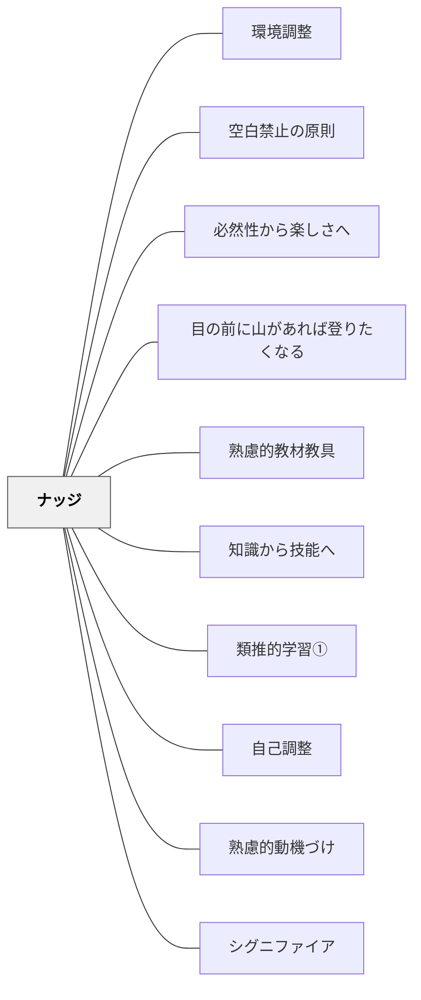

# ナッジ

**このパタンが完成を助ける大きなパタン**：[[パタン/熟慮的教材教具]]・[[パタン/環境調整]]

> ナッジがあることで、自己選択・自己決定は教育になる。

## 背景（Context）

現在バイアスによって、人は不合理になってしまうことがある。人には、合理的に選択することを阻む無意識のバイアスや無知がある。自己選択・自己決定を大切にする子ども中心の教育は、ともすれば「放置教育」と誤解されてきた——子どもたちに任せるってただ放置しているだけじゃないの、と。

## 問題（Problem）

指示・命令・禁止で行動を制御することなく、学習者の自己選択・自己決定が意図する成長につながるようにするにはどうすればよいか。

## 力のかたち（Forces）

- 外発的動機づけは短期的には有効だが、長期的な内発的動機づけの育成には限界がある
- 強制せずに望ましい行動へ誘導できる設計は学習者の自律性を損なわない
- 無意識のバイアスは意識的に抗うことが難しい——バイアスを逆手に取る設計が有効

## 解決（Solution）

**ナッジを張り巡らせよ。**

**近いパタンとの見分け**：選択肢を閉じずに行動をそっと押す配置が本パタン。教材の「何ができるか」を示す印は [[パタン/シグニファイア]]。教材の系列の全体の表は [[パタン/熟慮的教材教具#近いパタンとの見分け|熟慮的教材教具]] にある。

**ナッジとは**、どんな選択肢も閉ざさず、その行動を予測可能な方向に改める選択的アーキテクチャの全要素である（キャス・サンスティーン）。「ナッジ（nudge）」は「肘でそっと押す」という意味で、無意識のバイアスを利用して人の行動をよりよい方向に導く手段だ。行動経済学から生まれた概念で、公共政策や街の設計などさまざまな場面で使われている。

ナッジという言葉が生まれる以前から、教育現場にはナッジに含むことができる無数の実践があった。指示や命令・禁止ではない、広く様々な環境調整はナッジに含まれると考えてよい。

---

### 教室・学校でのナッジの具体例

**机の位置を示すタイルのマーク**  
日本の小学校の教室で、正方形のタイルの角をマジックでなぞって机の位置が分かるようにしていることがある。「ここに机を置く」と指示しなくても、床のマークが自然に机の位置を示す。

**廊下の右側通行マーク**  
他校で観察したことだが、廊下に右側通行ができるよう印をつけていることがある。「右側を歩け」と言わなくても、床の印が行動を自然に導く。

**意図的に精選された図書コーナー**  
子どもたちがすぐ手に取って読めるように図書コーナーを作る。そこに置く本は意図的に精選されたものだ。お気に入りのシリーズの本を読み切っていくうちに、自然に読書の魅力に気づき、読む力がついていく。「本を読みなさい」ではなく、手が届く場所に魅力的な本が並んでいることが読書へのナッジになる。

**先行オーガナイザーと類推的学習**  
知識から技能へ至ることができるように、先行オーガナイザー（事前に全体像や枠組みを示す）や類推的学習（似た構造の例を複数見せて型を発見させる）もナッジとして機能する。学習者が「気づいたら理解していた」「気づいたらできていた」という経路を設計することがナッジの本質だ。

---

### 子ども中心の教育とナッジ

成功している子ども中心の教育（自己選択・自己決定を大切にするもの）をよく観察すると、無数のナッジが張り巡らされていることが分かる。指示や命令・禁止ではなく、子どもたちの自己選択・自己決定が意図する成長につながるように教材を設計し環境を調整している——そういうことを優れた子ども中心の教育者はやっている。

---

### 外発的動機づけについての補足

内発的動機づけにつながる自己選択・自己決定をよりよい教育経験として設計するためにナッジを張り巡らせることが重要だ。外発的動機づけよりも内発的動機づけの方が望ましいとは考えている——が、外発的動機づけが不要だとは全く思っていない。シールなど外発的動機づけとなるものは、時に状況に応じて効果的である。

### 岩井の原稿から（ナッジ）

ナッジがあることで自己選択・自己決定は、教育になる。

現在バイアスによって、人は不合理になってしまうことがある。生徒には、合理的に選択することを阻む無意識のバイアスや無知がある。

ナッジとは、どんな選択肢も閉ざさず、その行動を予測可能な方向に改める選択的アーキテクチャの全要素である。ナッジは、肘でそっと押すという意味で、無意識のバイアスを利用して、人の行動をよりよい方向に導く手段である。

ナッジは、行動経済学から生まれた概念で、公共政策や街の設計など様々な場面で使われている。

ナッジという言葉はなかったが、ナッジに含むことができる無数の実践が教育現場にあったと思う。例えば、指示や命令、禁止ではない、広く様々な環境調整は、ナッジに含まれると考えてもいいだろう。

日本の小学校の教室で、机の位置がわかるように正方形のタイルの角がマジックでなぞられていることがある。子どもたちがすぐ手に取って読めるように図書コーナーがある。その図書コーナーの本は、意図的で精選されたものである。お気に入りのシリーズの本を読み切っていくうちに自然に読書の魅力に気づき、読む力がついていくようになっている。

自己選択・自己決定を大切にする子ども中心の教育は、放置教育と誤解されてきた。しかし、成功する自己選択・自己決定を大切にする子ども中心の教育には、無数のナッジが張り巡らされていることを観察できる。指示や命令、禁止ではなく、子どもたちの自己選択・自己決定が意図する成長につながるように教材設計したり、環境調整したりしている。

**ナッジを張り巡らせろ**

外発的動機づけよりも内発的動機づけの方が望ましい。内発的動機づけにつながる自己選択・自己決定をよりよい教育経験として設計するために、例えば、知識から技能へ至ることができるように、先行オーガナイザーや類推的学習などナッジを張り巡らせること。

#### 参考文献　

キャス・サンティーン(２０２１)『入門・行動科学と公共政策』勁草書房

（以上、岩井の原稿「教育のパタン・ランゲージ 集約」の「パタン　ナッジ」から。）

## 結果（Consequences）

- 強制せずに学習者が望ましい行動・選択をするようになる
- 自己選択・自己決定の感覚が保たれるため内発的動機づけが損なわれない
- 教育者の意図が環境・教材に埋め込まれ、言葉による介入コストが下がる

## 関連パタン
- [[パタン/環境調整]]
- [[パタン/空白禁止の原則]]
- [[パタン/必然性から楽しさへ]]
- [[パタン/目の前に山があれば登りたくなる]]

- [[パタン/熟慮的教材教具]] — 教材・教具の選定と配置そのものがナッジになる
- [[パタン/知識から技能へ]] — 先行オーガナイザー・類推的学習によるナッジ
- [[パタン/類推的学習①]] — 型の発見を自然に促す学習設計
- [[パタン/自己調整]] — ナッジによって自己調整が促される
- [[パタン/熟慮的動機づけ]] — 外発的・内発的動機づけの設計
- [[パタン/シグニファイア]] — 環境に埋め込まれたナッジとして働く印
- [[文献/市場か国家かの二択を越えて、利用者が共有資源を自分たちで治める仕組みを調べる（Ostrom2009）]] — 「強制する（あるいはナッジする）」制度ではなく、人の最もよいところを引き出す制度を、という結論（pp. 434–435）

## クラスター図

## Actionable Insight

- 机の位置を床のマークで示す・廊下に右側通行の印をつける——「言わなくても行動が自然に変わる」設計がナッジの核心
- 本棚に「今週の推薦図書」を表紙向きに1冊だけ置く——手が届く場所に並べるだけで読書行動が変わる
- 授業の冒頭に「今日はどちらからやりたいか」と2択を提示する——命令ではなく選択肢の設計が自己決定感を保ちながら意図した行動を引き出す

## 出典
- [[文献/一つの教育のパタン・ランゲージ]]

キャス・サンスティーン「ナッジ」（行動経済学、選択的アーキテクチャ）  
岩井輝久「岩井輝久『一つの教育のパタン・ランゲージ』」（2026-04-29 vault収録）  
岩井輝久「パタン　ナッジ（動画記録）」https://youtu.be/NVN8Xl96TVY

## 根拠の確かめ（自動生成）

<!-- source-check: 自動生成。手で編集しない。文献ページの frontmatter の source_check から作る -->
このページが引く文献を、本 Wiki が原典でどこまで確かめたかで分けた。くわしくは各文献ページの「書誌・確認した範囲」や「原文との照合」へ。

- **原典照合**（原典にあたって、引用や要約を照らした）：[[文献/市場か国家かの二択を越えて、利用者が共有資源を自分たちで治める仕組みを調べる（Ostrom2009）|Ostrom2009]]
- **その他**（動画の記録や本 Wiki の作者自身の本など）：[[文献/一つの教育のパタン・ランゲージ|一つの教育のパタン・ランゲージ]]
