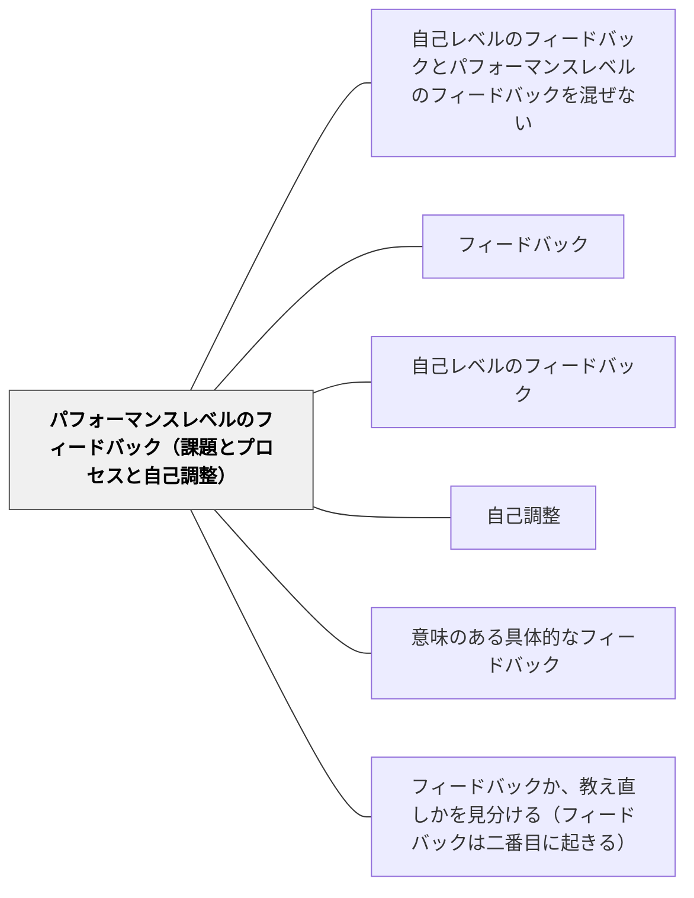

# パフォーマンスレベルのフィードバック（課題とプロセスと自己調整）

> 課題・プロセス・自己調整への具体的なフィードバックが最も学習改善に効く。— ハッティ

## [Pattern Connection]

**研究からの補足（2026-10-18）：フィードバックの効果を注意の向きから捉える（KlugerとDeNisi1996）**

原典はFIによる当面の遂行改善が、保持・転移まで支えるとは限らないと論じる（p. 278）。Wiki側の適用案として、返却直後の修正と、次の課題で自分で選んだ手順を別欄に記録する。FITの三過程をHattieとTimperleyの四レベルと完全に同一の分類として扱わない。 出典：[[文献/フィードバックの効果を注意の向きから捉える（KlugerとDeNisi1996）]]。

## 背景（Context）

ハッティの4レベル分類のうち、学習改善に効果的なのは「課題レベル（正誤・完成度）」「プロセスレベル（思考・戦略・方法）」「自己調整レベル（モニタリング・計画・評価）」の3つである。

> **原文との照合（2026-10-11）**：[[文献/The Power of Feedback（Hattie & Timperley, 2007）]] は、三つを同じ強さとは書いていない。過程と自己調整のレベルは深い処理と習熟に強いが、課題レベルは「その情報がのちに方略の処理や自己調整に役立つときに強い（そうなることはめったにないが）」（p. 90–91）。さらに課題レベルは**誤った解釈**に向いたときに強く、**情報の欠如**には教え直しのほうが効く（p. 91。[[パタン/フィードバックか、教え直しかを見分ける（フィードバックは二番目に起きる）]]）。もっとも効くのは、課題から過程へ、過程から自己調整へと移っていくフィードバックである。

## 問題（Problem）

フィードバックが「自己レベル（人格への評価）」や漠然とした「良かった・悪かった」に留まると、学習者が何を改善すれば良いか具体的にわからない。

## 力のかたち（Forces）

- 課題レベル：最も扱いやすいが表面的になりやすい
- プロセスレベル：思考の可視化が必要で難度が高いが深い学習を促す
- 自己調整レベル：最も高次で、自律的な学習者の育成に繋がる

## 解決（Solution）

**フィードバックを3つのパフォーマンスレベルで与える：**

| レベル | 問い | 例 |
|--------|------|-----|
| 課題 | 何が正しいか・完成しているか | 「ここの計算が間違っている」 |
| プロセス | どのような思考・戦略を使ったか | 「この考え方が効果的だった」 |
| 自己調整 | どのように学習を調整しているか | 「ここで立ち止まって確認したのはなぜ？」 |

## 結果（Consequences）

- 学習者が具体的に何を改善するかがわかる
- 特にプロセス・自己調整レベルのフィードバックは深い学習と自律性を育てる

## 関連パタン
- [[パタン/自己レベルのフィードバックとパフォーマンスレベルのフィードバックを混ぜない]]

- [[パタン/フィードバック]] — 親パタン
- [[パタン/自己レベルのフィードバック]] — 効果の低いレベルとの対比
- [[パタン/自己調整]] — 自己調整レベルのフィードバックの先
- [[パタン/意味のある具体的なフィードバック]] — 具体性の重要性
- [[パタン/フィードバックか、教え直しかを見分ける（フィードバックは二番目に起きる）]] — 課題レベルは誤った解釈に向いたときに強く、情報の欠如には教え直しのほうが効く
- [[文献/The Power of Feedback（Hattie & Timperley, 2007）]] — 四つのレベル（課題・過程・自己調整・自己）の原典
- [[文献/フィードバックの効果を注意の向きから捉える（KlugerとDeNisi1996）]] — 課題遂行の改善と長期の学びを別に確認する。

## クラスター図

## Actionable Insight

- コメントを書く前に「課題・プロセス・自己調整のどのレベルのフィードバックか」を意識して1つ選ぶ——レベルを意識するだけでフィードバックの具体性が上がる
- 「この作業で、どんな方法を使って考えたか」と問う——プロセスレベルのフィードバックは思考の可視化から始まる
- 「ここで立ち止まって確認したのはなぜ？」と聞いてみる——自己調整レベルへの問いが学習者の自律的な学習モニタリングを育てる

## 出典

- Hattie, J. (2009). *Visible Learning: A Synthesis of Over 800 Meta-Analyses Relating to Achievement*. Routledge.（邦訳：原田信之訳（2018）『教育の効果―メタ分析による学力に影響を与える要因の効果の可視化』図書文化社）
