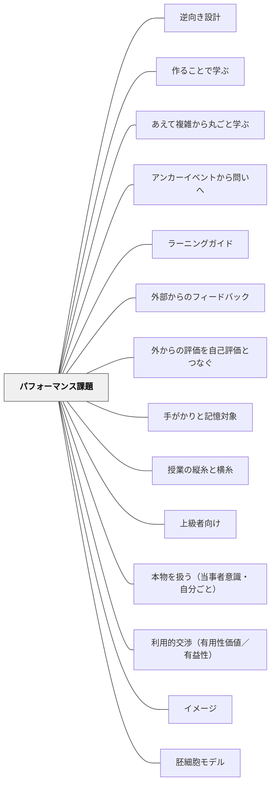

# パフォーマンス課題

**一文でいうと**：知識や技能を、現実に近い複雑な状況で使わせる課題として設計する。

## 使いどころ・使いすぎ注意

| 観点         | 内容                                             |
| ------------ | ------------------------------------------------ |
| 使いどころ   | 知識を使う複雑な課題にしたいとき。               |
| 使いすぎ注意 | 評価課題が大きすぎると、途中の学びが見えにくい。 |

> 単元終末に魅力的なゴールを設定することで、子供は「何のために学ぶか」を見通しながら学べる。

## 背景（Context）

子供たちは、「今日は○ページをやりましょう」という授業を繰り返す中で、**なぜ学んでいるのかが見えなくなる**。各時間の内容は理解していても、単元全体の意味や使い道が不明なまま学習が進む。

「ワクワク」と「資質・能力の育成」を両立したい——しかし、楽しい活動が資質・能力につながっているかどうか確かめにくい。

## 問題（Problem）

学習の目的が見えない子供は、指示待ちになる。教師が毎時間つないでいかないと学習が成立しない。子供が「自分で学ぼう」とする理由が生まれない。

## 力のかたち（Forces）

- 子供の動機付けには「何のためか（目的）」の見通しが必要
- 単元内の知識・技能の習得が、終末のゴールに向かう手段として意味を持つ必要がある
- 「資質・能力」の育成は、知識の習得だけでは不十分——実際に使う場面が必要

## 解決（Solution）

**近いパタンとの見分け**：単元の終わりの本物に近い課題を先に決める設計が本パタン。課題・素材・受け手を本物にする考え方は [[パタン/本物を扱う（当事者意識・自分ごと）]]。探究・課題の系列の全体の表は [[パタン/作ることで学ぶ#近いパタンとの見分け|作ることで学ぶ]] にある。

単元を設計する最初に、**社会の実際の課題解決に近い、実物の完成品・プレゼン・実技などによる課題（パフォーマンス課題）を終末に設定する**。

子供たちはこのゴールを知った上で、途中の学習（個別探究・協働）を進める。「このスキルを身に付けたら、あのゴールに近づく」という見通しが生まれる。

**戸田東小学校（実践編①）の設計:**

1. 単元終末のパフォーマンス課題を先に決める
2. 単元導入で子供の興味・関心を引き出す
3. 途中の学習で個別探究と協働を織り交ぜる
4. 終末でパフォーマンス課題に取り組む

### 研究の裏づけ

> **研究の裏づけ（2026-11-06）**：（観察研究）考える課題は基礎学力を犠牲にするか、という心配に答える研究がある。シカゴの公立校（低所得の家庭が約9割）の3・6・8年生の教師が出した算数と作文の課題2,017点を、知識の組み立て・結論を長く書いて裏づけること・生活とのつながり、の三つの規準で採点し、約4,900人のテストの伸びと結びつけた。前の年の点と背景をそろえても、課題の質が上位4分の1の教室では、全米の標準学力テストの1年間の伸びが全米平均より20%大きく、下位4分の1の教室では22〜25%小さかった。州のテストでは効果量 0.43〜0.64 だった（pp. 23, 25）。前の学力の高い子も低い子も伸びた。著者らは、これを体験的な学習の推奨と読むことを戒め、大事なのは教え方の形ではなく課題に込められた知的な要求だとする（p. 31）。無作為の比較ではなく、研究所の報告書である。出典：[[文献/考えを組み立て、詳しく書き、生活とつながる課題を出す教室では、基礎学力のテストの伸びも大きいかを、シカゴの3・6・8年生で確かめる（Newmannほか2001）]]。

## 結果（Consequences）

- 子供が「なぜ学ぶか」を自分の言葉で語れるようになる
- 個別学習の時間に「自分で調べよう」とする理由が生まれる（自己調整の起点）
- 「ワクワク」と「資質・能力」を両立した単元設計ができる
- 評価の場面が自然に生まれる（課題の達成度で資質・能力を測れる）

## 関連パタン
- [[パタン/逆向き設計]]
- [[パタン/作ることで学ぶ]]
- [[パタン/あえて複雑から丸ごと学ぶ]]
- [[パタン/アンカーイベントから問いへ]]
- [[パタン/ラーニングガイド]]
- [[パタン/外部からのフィードバック]]
- [[パタン/外からの評価を自己評価とつなぐ]]
- [[パタン/手がかりと記憶対象]]
- [[パタン/授業の縦糸と横糸]]
- [[パタン/上級者向け]]
- [[パタン/本物を扱う（当事者意識・自分ごと）]]
- [[パタン/利用的交渉（有用性価値／有益性）]]

- [[パタン/イメージ]] — ゴールのイメージが学びを導く（同一原理）
- [[パタン/胚細胞モデル]] — 単元を貫くBig Ideaの設定
- [[パタン/概念型の目標]] — 転移可能な理解を目指す単元設計
- [[パタン/自己調整]] — 目的が見えることで自己調整が始まる

- [[パタン/その過程が本当に働いたかを確かめる]] — 文脈が豊かな課題ほど意図しない近道が増える。過程が働いたかの検証がとくに要る場面
- [[パタン/測れていないものを疑う（構成概念の過少代表）]] — 一つの課題を深く見ることと領域を広くカバーすることのトレードオフ。交渉すべき設計問題
- [[文献/考えを組み立て、詳しく書き、生活とつながる課題を出す教室では、基礎学力のテストの伸びも大きいかを、シカゴの3・6・8年生で確かめる（Newmannほか2001）]] — 考えを組み立て、詳しく書き、生活とつながる課題の教室で、基礎学力のテストも伸びた（シカゴの3・6・8年生・観察研究）

## このパタンが働く実践
- [[実践/個別支援級の複式算数：重さと面積をわたり・ずらしで学ぶ]]

| 実践パタン                                      | どのようにパフォーマンス課題になっているか                                         |
| ----------------------------------------------- | ---------------------------------------------------------------------------------- |
| [[実践/カエルの算数：勝ちやすさを表で考えよう]] | 表を使って勝ちやすいカエルを判断し、理由を説明することが単元の具体的なゴールになる |

- [[概念/個別最適な学びと協働的な学び]]

## クラスター図

## Actionable Insight

- 単元の最初の授業で「この単元の終わりには○○をします（発表・制作・実技）」と伝える——ゴールが見えることで「なぜ学ぶか」が子ども自身の問いになる
- 単元終末の課題を「実際に誰かの役に立つ・社会とつながる」形にする——本物性が当事者意識を生み、自己調整の強い動機になる
- パフォーマンス課題の評価基準を授業の最初に子どもと確認する——到達点が明確なほど途中の学習が目的を持って進む

## 出典
- [[文献/みるみる（個別最適な学び）]]

文科省「みるみる」実践編①戸田市立戸田東小学校（清水教諭の実践）（2026-04-29 vault収録）
