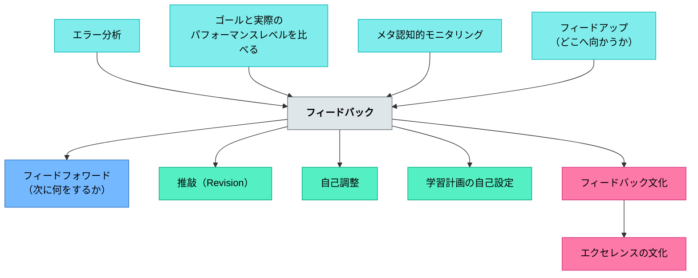

# フィードバック

**一文でいうと**：ゴール、現在地、次の一手を伝え、学習者が改善できる情報を返す。

## 使いどころ・使いすぎ注意

| 観点         | 内容                                 |
| ------------ | ------------------------------------ |
| 使いどころ   | 次の改善行動を明確にしたいとき。     |
| 使いすぎ注意 | 返しすぎると、自己判断の機会を奪う。 |

> 教育者は自らが被教育者へ適切なフィードバックを心がけるとともに、多様なフィードバックを組織せよ。また被教育者や被教育者の作品からのフィードバックを解釈し、教育を修正し続けよ。

## 背景（Context）

※旧パタン「評価（フィードバック）」を本ページに統合（2026-06-13）

教育は「意図的に、目的的に、設計・構造化された経験」である。そこには必ず介入があり、介入には反応がある。学習者の作品・声・表情・行動、授業後のアンケート——これらはすべてフィードバックである。ハッティの研究では、フィードバックは学習に最も影響を与える要因の一つとして示されている。

**フィードバックは教育者にも被教育者にも重要な情報を与える。**

被教育者にとって：自信がない・どこへ向かっているのかわからない・どれだけできているか自己評価できない・次に何をすれば良いか新しい目標が分からない——そういう状況を解決する。

教育者にとって：自分の課題を知るきっかけとなり、教育を改善することの助けとなる。

## 問題（Problem）

フィードバックがない、または機能しないと、学習者はどこへ向かっているかも、今どこにいるかも、次に何をすべきかもわからないまま繰り返す。教師も改善の手がかりを得られず、同じ指導を繰り返す。

## 力のかたち（Forces）

- フィードバックの効果は「与えられ方」より「受け取られ方」で決まる（ハッティ）
- 自己レベルへのフィードバック（褒め）はパフォーマンスに対するフィードバックより効果が低い
- 適切な文化的土台（安全・成長マインドセット）がなければフィードバックは機能しない
- フィードバックは他のパタンと組み合わせることで効果が高まる
- フィードバックは「与えられれば終わり」ではない——受け止められたかまで見届ける必要がある

## 解決（Solution）

どのフィードバックのパタンを使うかで迷ったら、下の「[[#近いパタンとの見分け|近いパタンとの見分け]]」の表を見る。

**ギャップ原則**（サドラー）に基づき、ゴール・現状・次のステップを明確にすることでフィードバックを機能させる。

---

### フィードバックとは何か——ハッティとバルターの定義

**ハッティによる定義**：

> 「フィードバックとは、学習者に関わりを持つ人々——例えば教師・仲間・本・保護者・学習者自身の経験など——から与えられる、学習者の到達状況や理解の程度に関する情報である。」

**ハッティが引用したバルターの定義**：

> 「フィードバックとは、学習者が自身の記憶に保持されている知識を確認し、またその知識に追加したり上書きしたり調整したり再構築したりするために用いられる情報のことである。」

フィードバックは被教育者が**構想を立て・計画し・調整し・再考し**、その結果として現実的でバランスの取れた方法で**自己調整することを助ける**。

---

### 最も効果の高いフィードバック（ハッティ）

ハッティとティンパリー（2007）の原典（p. 84）によると、最も効果の高いフィードバックは：

1. **手がかり（cues）や強化を与えるもの**
2. **ビデオ・音声・コンピュータによるもの**
3. **目標に関わるもの**（到達基準が明確）

逆に、最も効果が低いのは、プログラム学習・ほめ言葉・罰・外的な報酬である。

→ フィードバックは**学習目標・到達基準が明らかになる時に効果的**だ。

> **原文との照合（2026-10-11、2026-11-01 に本文を原典に合わせた）**：以前の本文は、ハッティの日本語訳の本（2018）から三つ（コンピューターによるもの・達成目標と照らし合わせたもの・学習を喚起し維持するもの）を挙げていた。原典の一つ [[文献/The Power of Feedback（Hattie & Timperley, 2007）]] の対応箇所（p. 84）に合わせて、上の三つに直した。三つめの「学習を喚起し維持するもの」は2007年の論文には見当たらない。また同論文の平均効果量0.79は、やり直しのメタ分析（Wisniewski, Zierer & Hattie, 2020）で0.48になった。数字より「情報の多いフィードバックほど効く」という知見のほうが安定している。

---

### 類推的学習との組み合わせ——アトウェルの実践例

類推的学習を組み合わせることでフィードバックはより効果的になる。類推的学習では被教育者が評価基準を自ら構成し、自己調整を促す。

**ナンシー・アトウェルのライティングワークショップの例**：

優れた物語を読み比べることで、優れた書き手がどのようなことをしているのか、その特徴を生徒たちと構成する。その特徴が生徒が目指す**到達基準**になる。

- その到達基準に照らし合わせて教育者がフィードバックする
- 被教育者は同じ到達基準で**自己評価**もする
- ピアフィードバックの時にも、その到達基準に照らし合わせてフィードバックし合う

到達基準を生徒と共に構成することで、フィードバックが一方向の評価ではなく、学習者自身の自己調整のツールになる。

---

### テストもフィードバックの一つ

テストは多様なフィードバックの一つであり、学習経験だ。被教育者はテストを繰り返すことで到達基準や自分の課題がより明らかになる。エラー分析をして練習することで学習内容をよく理解し、自己修正することができる。

---

### ポートフォリオによるフィードバック

ポートフォリオは元々美術大学で学生が自分の作品をまとめるファイルのことだったと言われている。そこから他の教育にも応用されるようになった。ポートフォリオとして作品をまとめることで被教育者の振り返りを促し、自己評価を助けることができる。**ポートフォリオ評価は類推的学習と合わせることでさらに効果的**になる。

---

### フィードバックは受け止められたかまで見届ける

フィードバックは多様にあれば終わりではない。**フィードバックがどう受け止められたかまで見届け、解釈し、教育を修正し続ける必要がある。**

**教師への教育改善フィードバックの例**：中学校などで1組→2組→3組の順で同じ授業を行う場合、1組でうまくいかなかったところを情報（フィードバック）として受け取り、2組・3組での授業を修正していくことができる。授業がうまくいかなかった経験そのものが次の設計へのフィードバックになる。

---

### ギャップ原則の3要素

| 問い                     | パタン                                              |
| ------------------------ | --------------------------------------------------- |
| どこに向かっているのか？ | [[パタン/フィードアップ（どこに向かっているのか）]] |
| 進み具合はどうか？       | [[パタン/フィードバック（進み具合はどうか）]]       |
| 次に何をするべきか？     | [[パタン/フィードフォワード（次に何をするべきか）]] |

### 達成規準の構築

| パタン                                  | 内容                                 |
| --------------------------------------- | ------------------------------------ |
| [[パタン/達成規準の共同構築]]           | 教育者と被教育者が一緒に規準をつくる |
| [[パタン/脱文脈化された達成規準]]       | 転移できる汎用的な規準               |
| [[パタン/おきまりの学習のねらい]]       | 全員が達成すべき必須目標             |
| [[パタン/多様に想定される学習のねらい]] | 多様な表現が現れる目標               |
| [[パタン/実例を比べて分析する]]         | 作品比較で基準を共同構築する         |
| [[パタン/技術やスキルの実演を分析する]] | 実演分析で何ができれば良いかを可視化 |
| [[パタン/間違ったやり方をする]]         | 対比から基準を浮かび上がらせる       |
| [[パタン/悪い実例を示す]]               | 悪例から基準を引き出す               |
| [[パタン/不備のある実例を示す]]         | 改善点を考えることで基準を構築       |
| [[パタン/振り返りでのねらいの共同構築]] | 学習後の振り返りで達成規準を更新     |
| [[パタン/ジグソーパズル]]               | 優れた実例を分解して組み立て直す     |
| [[パタン/間違いがある達成規準を示す]]   | 誤りを含む規準で批評的思考を育てる   |
| [[パタン/最初から良い例を見て分析する]] | ポジティブな出発点で基準を形成       |

### フィードバックのレベル（ハッティ）

| パタン                                                                                | 内容                                 |
| ------------------------------------------------------------------------------------- | ------------------------------------ |
| [[パタン/自己レベルのフィードバック]]                                                 | 人格・自己への評価（効果が最も低い） |
| [[パタン/パフォーマンスレベルのフィードバック（課題とプロセスと自己調整）]]           | 課題・プロセス・自己調整への評価     |

### フィードバックの方向性

| パタン                                                          | 内容                                   |
| --------------------------------------------------------------- | -------------------------------------- |
| [[パタン/被教育者からのフィードバックを利用して教育改善をする]] | 得た情報を授業改善に繋げる             |
| [[パタン/被教育者にフィードバックを提供し理解できるようにする]] | 理解可能な形でフィードバックを届ける   |
| [[パタン/外部からのフィードバック]]                             | 地域・専門家・コンクールなど外部の基準 |
| [[パタン/ピアフィードバック]]                                   | 仲間同士のフィードバック               |
| [[パタン/ピアコーチング]]                                       | 仲間が継続的にコーチする               |
| [[パタン/全体へのフィードバック]]                               | クラス全体に向けたフィードバック       |
| [[パタン/保護者と他の学校協力者のフィードバック]]               | 保護者・地域からのフィードバック       |

### フィードバック文化の土台

| パタン                                                | 内容                                     |
| ----------------------------------------------------- | ---------------------------------------- |
| [[パタン/共通概念やキャラクター（ナラティブ）の共有]] | フィードバックのための共通言語           |
| [[パタン/エクセレンスの文化]]                         | 高い基準への志向                         |
| [[パタン/間違いや失敗から学ぶ文化]]                   | 失敗をフィードバックとして受け取る文化   |
| [[パタン/成長マインドセット]]                         | フィードバックを成長の情報として受け取る |

### 評価・記録ツール

| パタン                            | 内容                               |
| --------------------------------- | ---------------------------------- |
| [[パタン/形成的評価]]             | 学習過程での継続的な評価           |
| [[パタン/総括的評価]]             | 学習終了後の評価                   |
| [[パタン/ルーブリック]]           | 達成規準を多次元で記述した評価表   |
| [[パタン/ポートフォリオファイル]] | 学習成長を記録する作品集           |
| [[パタン/到達レベルの自己評価]]   | 学習者が自分の達成度を評価する     |
| [[パタン/ドキュメンテーション]]   | 学習過程の記録・可視化             |
| [[パタン/作品例を集める]]         | 参照できる作品集をつくる           |
| [[パタン/テストを繰り返す]]       | 想起練習としてのテスト             |
| [[パタン/フィードバックシステム]] | フィードバックを循環させる仕組み   |
| [[パタン/評定（成績評価）]]       | 評定による総括的フィードバック     |
| [[パタン/記述式フィードバック]]   | コメント・文章によるフィードバック |

### 授業中の実践

| パタン                                                                          | 内容                             |
| ------------------------------------------------------------------------------- | -------------------------------- |
| [[パタン/授業中の学習のストップ（批評）]]                                       | 途中で立ち止まり批評する         |
| [[パタン/授業の中で批評する]]                                                   | 学習物を全体で批評する           |
| [[パタン/授業中に学習パートナーが協働して成功を確認し改善案を示す]]             | パートナーと協働で確認・改善     |
| [[パタン/被教育者は一時に一つの学習物を協働して話し合う]]                       | 全員で一つの作品を協働で話し合う |
| [[パタン/無作為の学習物による改善のモデルを示す]]                               | 匿名の作品で改善モデルを見せる   |
| [[パタン/一つ又はそれ以上の成功規準に焦点化し最も良い学習物を探し改善案を示す]] | 最良作を探し改善案を示す         |
| [[パタン/自分の学習物が学級で批評される]]                                       | 本人の作品がクラスで批評される   |
| [[パタン/フィッシュボウル（金魚鉢）]]                                           | 内側の対話を外側が観察する       |
| [[パタン/1対1の面談]]                                                           | 個別カンファランス               |

### フィードバックの形式

| パタン                                          | 内容                                       |
| ----------------------------------------------- | ------------------------------------------ |
| [[パタン/サンドウィッチフィードバック]]         | 良い点→改善点→良い点の順                   |
| [[パタン/大切な友だち（クリティカルフレンド）]] | 批評的な友人として改善を促す               |
| [[パタン/Iメッセージ]]                          | 一人称で感じたことを伝える                 |
| [[パタン/近接賞賛]]                             | 隣の行動を褒めることで誘導する             |
| [[パタン/非随伴的な賞賛]]                       | 行動と無関係な賞賛（効果が低い）           |
| [[パタン/確証フィードバック]]                   | 正しいことを確認するフィードバック         |
| [[パタン/非確証フィードバック]]                 | 誤りを指摘するフィードバック               |
| [[パタン/誤りフィードバック]]                   | 誤りの種類を特定し修正を促す               |
| [[パタン/即時的なフィードバック]]               | タイムリーに与えるフィードバック           |
| [[パタン/意味のある具体的なフィードバック]]     | 漠然とせず具体的で行動可能なフィードバック |

### 誘発・支援

| パタン                      | 内容                             |
| --------------------------- | -------------------------------- |
| [[パタン/想起させる誘発]]   | 既習事項とつないで、解決への手がかりにする |
| [[パタン/足場がけへの誘発]] | ヒント・足場へ誘導する           |
| [[パタン/例示による誘発]]   | 参照できる情報・例を示す         |
| [[パタン/ノートの余白]]     | 話し合いでメモできる余白         |

### 研究の裏づけ

> **研究の裏づけ（2026-10-31）**：英国の Education Endowment Foundation のフィードバックの指針（2021）は、書くか話すかという方法の議論から離れ、三つの原則を中心に置く。①フィードバックの前に良い授業と形成的評価（ねらいの共有・学びの証拠を引き出す）で土台をつくる、②時機を見て、課題・教科・自己調整に焦点を当てて学びを前に進める、③子どもがどう受け取り、どう使うかを計画する（pp. 10–11）。子どもがフィードバックを使う時間と機会があって初めて「ループが閉じる」とし、「入れ替えるとよくなる段落が二つある。どれか見つけて」のように、受け取ったあとを子どもの課題にする例を挙げる（pp. 29–30）。根拠は限られていると何度も断っている。出典：[[文献/学びを前に進める教師のフィードバックを整える（英国EEF2021）]]。

> **研究の裏づけ（2026-11-01）**：ほめ言葉の効き方について、128研究のメタ分析（Deci ほか 1999）は、肯定的なフィードバックが平均的には報酬後の自由選択行動と興味を高めたとする。ただし自由選択行動の増加は大学生で見られ、子どもでは確認されなかった。情報として伝えるか、指図する調子で伝えるかで違うという補足分析もあるが、4研究にもとづく（pp. 627, 652–656）。子どもへのほめ言葉を、意欲を上げる確かな手立てとは扱わない。出典：[[文献/報酬の条件と内発的動機づけを見分ける（Deciほか1999）]]。

> **研究の裏づけ（2026-11-01）**：フィードバックは平均では効くが、逆効果になることも多い。Kluger と DeNisi（1996）のメタ分析では、607の効果量の平均は 0.41 だったが、38%を超える効果量が負だった（p. 258）。注意が課題から自分自身へ向くと効果が下がると説明し、ほめ言葉を含む研究群の平均 0.09、含まない研究群 0.34 という比較を示す。ただしこれは研究どうしの比較で、どちらも正である（p. 273）。出典：[[文献/フィードバックの効果を注意の向きから捉える（KlugerとDeNisi1996）]]。

> **研究の裏づけ（2026-11-01）**：評点を添えると、コメントが読まれにくくなる。イスラエルの小学5・6年生の実験（Butler 1988）では、コメントだけの群が、評点だけ・評点とコメントの群より、最後の場面で興味と課題の成績が高かった。評点とコメントを併記すると、コメントは評点より思い出されにくかった（pp. 7–10）。誤りについて、Metcalfe（2017）は、正誤を知らせるだけでは足りず、正しい答えや理由が分かる訂正の情報が要るとする。高い確信で出した誤答ほど訂正されやすい（ハイパーコレクション）という知見も紹介する（pp. 6.6–6.9）。出典：[[文献/評点とコメントが向ける注意を確かめる（Butler1988）]]・[[文献/誤りを訂正につないで学ぶ（Metcalfe2017）]]。

> **研究の裏づけ（2026-11-06）**：フィードバックの効き方は、どんな情報を返すかで大きく変わる。2007年の数字（0.79）を、もとの一次研究に戻ってメタ分析でやり直した研究（Wisniewski・Zierer・Hattie 2020。435研究・994効果量・約61,000人）では、外れ値を除いた平均は0.48だった。種類別では、ほめる・罰するといった強化や罰が0.24、正誤と正しい答えを返す訂正のフィードバックが0.46、それに加えて自己調整の情報まで含む情報の多いフィードバックが0.99だった（p. 11, 表3）。動機づけへの効果は0.33と小さく、動機づけへの負の効果の86%は、報酬や罰のような情報のないフィードバックから来ていた（p. 12）。ただし、ばらつきが非常に大きく（I² ≈ 83%）、一次研究の出版年の中央値は1985年で、事前事後だけの研究（0.63）は対照群のある研究（0.42）より大きく出る。子どもどうしのフィードバック（0.85）は8研究だけにもとづく。出典：[[文献/The Power of Feedback（Hattie & Timperley, 2007）]] の「2020年の検証」の節。

## 近いパタンとの見分け

「フィードバック」の名をもつパタンは30ほどある。多くは、本ページの一つの面——返す前の判断、何に向けるか、中身の向き、形、宛先、時、だれが返すか、子どもから教師への向き、仕組み——を取り出したものである。返すときに迷う順に並べる。

| 迷いどころ | パタン | 見分けの問い |
| --- | --- | --- |
| 返す前 | [[パタン/フィードバックか、教え直しかを見分ける（フィードバックは二番目に起きる）]] | 誤答の中に正しい筋があるか。筋があれば誤った解釈なのでフィードバック、筋がなければ理解がまだないので教え直し |
| 3つの問い | [[パタン/フィードアップ（どこに向かっているのか）]] | どこへ向かっているか（ゴール）を、子どもが言えるか |
| 3つの問い | [[パタン/フィードバック（進み具合はどうか）]] | ゴールと今の位置を、子どもが並べて見ているか。返すのは、その比べる動作の材料 |
| 3つの問い | [[パタン/フィードフォワード（次に何をするべきか）]] | 次に何をするかが、一つに決まっているか |
| 何に向けるか | [[パタン/自己レベルのフィードバック]] | 「すごいね」「頭がいいね」と人に向けた言葉か。関係づくりには使い、学習の返しとは場面を分ける |
| 何に向けるか | [[パタン/パフォーマンスレベルのフィードバック（課題とプロセスと自己調整）]] | 課題（合っているか）・プロセス（どう考えたか）・自己調整（どう立て直したか）のどれに向けて返すか |
| 中身：正誤 | [[パタン/確証フィードバック]] | 合っているのに迷っている子に「その考えで合っている」と伝えるか |
| 中身：正誤 | [[パタン/非確証フィードバック]] | 誤りを、あいまいにせず、直す方向と一緒に伝えるか |
| 中身：正誤 | [[パタン/誤りフィードバック]] | 誤りの種類（ケアレスミス・概念の誤解・やり方の誤り）を見て、返し方を変えるか |
| 中身：質 | [[パタン/ポジティブフィードバック]] | うまくいっている点を、何が・なぜよいかまで言って強めるか |
| 中身：質 | [[パタン/ネガティブフィードバック]] | 直す点を、人ではなく作品に向けて、行動できる形で言うか |
| 形 | [[パタン/記述式フィードバック]] | 記号や点ではなく文章で、到達点・ずれ・次の一歩を書くか（形の話） |
| 形 | [[パタン/意味のある具体的なフィードバック]] | 受け取った子の次の一手が決まる中身か（中身の話。口頭でも同じ） |
| 形 | [[パタン/被教育者にフィードバックを提供し理解できるようにする]] | その子の語彙と理解の水準で読んでわかるか（受け手の側の話） |
| 形 | [[パタン/サンドウィッチフィードバック]] | よい点で改善点を包む順序。関係が浅いうちの足場として使い、改善点がうもれていないかを見る |
| 形 | [[パタン/評定（成績評価）]] | 認定・証明のための記号か。学習の途中の返しには使わない |
| 形 | [[パタン/評点なしで返す（コメントだけの一巡）]] | 点数とコメントを同じ紙・同じ時に載せていないか。点は直す一巡のあとへずらす |
| 宛先 | [[パタン/個別評定の原則]] | 一人ひとりの具体的な行動に、その子あてに言うか |
| 宛先 | [[パタン/全体へのフィードバック]] | 多くの子に共通する誤りを、名指しせずに全員で扱うか |
| 時 | [[パタン/即時的なフィードバック]] | 練習・小テストはすぐ返す。じっくり考える課題では、考えたあとに返すほうがよいこともある |
| だれが返すか | [[パタン/ピアフィードバック]] | 子どもどうしが、共有した規準と手順を使って返すか |
| だれが返すか | [[パタン/自己内フィードバック]] | 子どもが自分で、規準と自分の作品を照らして返すか |
| だれが返すか | [[パタン/外部からのフィードバック]] | コンクール・専門家など、学校の外の水準で見てもらうか |
| だれが返すか | [[パタン/保護者と他の学校協力者のフィードバック]] | 保護者・地域・他の教員に、見てほしい点を伝えたうえで、学びのパートナーとして加わってもらうか |
| だれが返すか | [[パタン/AIフィードバックと教師の二重ループ]] | 表記などの低次はAI、内容とその子への応答は教師、と分けて返すか |
| 子どもから教師へ | [[パタン/フィードバックの要請]] | 「わからない」と言える形で、教師のほうから引き出しているか（引き出す） |
| 子どもから教師へ | [[パタン/被教育者からのフィードバックを利用して教育改善をする]] | 日々の手がかりを集め、授業の終わりに授業そのものへの声を聞き、その声で授業を変えて、変えたことを伝えているか（集める・授業後に聞く・反映して伝える） |
| 仕組み | [[パタン/フィードバックシステム]] | 「集める→読む→直す→もう一度見る」の循環が回っているか（手順の話） |
| 仕組み | [[パタン/フィードバック文化]] | 批評を贈り物として受け取れる関係と約束があるか（関係の話） |

**混同しやすい組**：
- **確証・非確証** と **ポジティブ・ネガティブ**：前者は「合っているか」、後者は「どれだけよいか・どこを直すか」を返す。計算の答えには確証・非確証、作文の構成にはポジティブ・ネガティブ、と考えると分けやすい。誤りの種類まで見て返し方を変えるのが誤りフィードバックである。
- **記述式・意味のある具体的・被教育者に提供し理解できるようにする**：同じ赤ペンのコメントを、形（文章か）、中身（次の一手が決まるか）、受け手（その子が読めるか）の三方向から見たものである。
- **子どもから教師への2枚**：引き出す→集める→授業後に聞く→反映して伝える、の一つの循環のうち、フィードバックの要請は「引き出す」と子どもが自分から求める力を、被教育者からのフィードバックを利用して教育改善をするは残りの三段を扱う。

**緊張**：
- [[パタン/サンドウィッチフィードバック]] と [[パタン/自己レベルのフィードバック]]：サンドウィッチは改善点をよい点で包むが、包む言葉が「あなたはすごい」だと、注意が人に向いて改善点が残りにくい。両方を生かすなら、包むよい点を人ではなく作品のよさ（パフォーマンスレベル）で言う。
- [[パタン/即時的なフィードバック]] と [[パタン/フィードバックか、教え直しかを見分ける（フィードバックは二番目に起きる）]]：速く返すほど効くのは、子どもに正しい筋があるときである。筋がないときは、速さより教え直しを選ぶ。

### 系列の中の小さなまとまり（2026-11-13 追加）

上の表に入れなかった、フィードバックのまわりの手（ゴールを見せる、学級で批評する、一人に返す、詰まった子に手がかりを出す、見取って手を打つ、返したあと、記録と声）を、まとまりごとに並べる。

| 迷いどころ | パタン | 見分けの問い |
| --- | --- | --- |
| ゴールを見せる | [[パタン/ギャップ]] | ゴール・現状・その差・埋める行動の四つが、子どもに見えているか（サドラー） |
| ゴールを見せる | [[パタン/最初から良い例を見て分析する]] | 学習の最初に優れた完成例を見せ、何がなぜよいかを分析しているか |
| ゴールを見せる | [[パタン/技術やスキルの実演を分析する]] | 優れた実演（やってみせる過程）を見て、何をしているかを分析しているか |
| ゴールを見せる | [[パタン/間違ったやり方をする]] | 教師がわざと間違ったやり方を見せ、正しいやり方との違いで規準をつくっているか |
| ゴールを見せる | [[パタン/質の根拠を見えるようにする（伝えることからの脱却）]] | 赤ペンやルーブリックで伝えるのではなく、質の根拠を子ども自身が見て判断できるようにしているか |
| 学級で批評する | [[パタン/授業の中で批評する]] | 「星と願い」のような批評の手順（プロトコル）を、学級で決めて使っているか |
| 学級で批評する | [[パタン/授業中の学習のストップ（批評）]] | 作業の途中で全員を止め、一つの作品をみんなで見て、よい点と直せる点を話し合っているか |
| 学級で批評する | [[パタン/無作為の学習物による改善のモデルを示す]] | 批評する作品を、くじなどで選び、名前を伏せて示しているか |
| 学級で批評する | [[パタン/自分の学習物が学級で批評される]] | 本人の同意・批評の約束・改善の機会、の三つをそろえてから、その子の作品を学級で批評しているか |
| 学級で批評する | [[パタン/共通概念やキャラクター（ナラティブ）の共有]] | 「温かい友人」などのキャラクターや共通の言葉で、安全に批評できる枠をつくっているか |
| 一人に返す | [[パタン/1対1の面談]] | ほかの子の作業中に、一人と短く面談し、まず聞いてから一つだけ返しているか |
| 一人に返す | [[パタン/Iメッセージ]] | 「あなたは〜だ」ではなく、「私には〜に見えた」と一人称で返しているか |
| 一人に返す | [[パタン/近接賞賛]] | やっていない子を注意する代わりに、隣でやっている子をほめているか |
| 一人に返す | [[パタン/非随伴的な賞賛]] | その賞賛は、具体的な行動や出来ばえに向いているか（「いつもよくやっているね」だけで終わっていないか） |
| 一人に返す | [[パタン/レターエッセイ（Letter-Essay）]] | 読んでいる本について、教師や友だちに手紙で書き、返事のやりとりをしているか |
| 詰まった子に手がかりを出す | [[パタン/足場がけへの誘発]] | 答えではなく、資料・ヒントカード・教科書のページなど、使える道具の場所を示しているか（誘発の二段め） |
| 詰まった子に手がかりを出す | [[パタン/例示による誘発]] | それでも進めない子に、似た例や別の人の考え方を見せているか（誘発の三段め） |
| 見取って手を打つ | [[パタン/早期警告]] | 遅れや不振に、本人より先に気づいて、成功への道筋とともに早く声をかけているか |
| 見取って手を打つ | [[パタン/見取ったあとの手を決めておく（データ利用のルール化）]] | 見取った結果に応じて何をするかを、見取る前に決めているか |
| 見取って手を打つ | [[パタン/進歩の傾きを見る（水準ではなく変化率）]] | 点数の高さではなく、同じ物差しで測った伸びの角度を見ているか |
| 見取って手を打つ | [[パタン/答えの出どころを推し量る（誤答の解釈）]] | 見当外れに見える答えを正す前に、その答えがどこから来たのかを推し量っているか |
| 見取って手を打つ | [[パタン/まずやってみる]] | 説明の途中で止めて短い演習を入れ、その場で答え合わせまでしているか |
| 返したあと | [[パタン/返したことと届いたことを分ける（返却の五段）]] | 返した・届いた・受け取った・応えた・使った、を別々に確かめているか |
| 返したあと | [[パタン/修正を受け入れる]] | フィードバックを受けて作品を直す時間と機会を、授業の中に組み込んでいるか |
| 返したあと | [[パタン/再提出を許す（リトライ・サイクル）]] | 評価を一発勝負にせず、直して出し直せる仕組みにしているか |
| 記録と声 | [[パタン/ドキュメンテーション]] | 学びの途中と節目を、写真・短い文・音声で、子どもも一緒に記録しているか |
| 記録と声 | [[パタン/声を聞く仕組みを四段で確かめる（欄・行使・考慮・反映）]] | 声を書く欄がある・実際に書かれる・読まれる・何かが変わる、の四つを分けて確かめているか |
| 一人に返す | [[パタン/適切な行動に注目する]] | できていないことより、適切な行動に注目して言葉を返しているか（岩井） |

**この表の中で混同しやすい組**：
- [[パタン/修正を受け入れる]] と [[パタン/再提出を許す（リトライ・サイクル）]]：修正を受け入れるは、授業の中に直す時間をとる。再提出を許すは、評価の制度として出し直しを認める。
- [[パタン/授業の中で批評する]] と [[パタン/授業中の学習のストップ（批評）]]：前者は批評の手順（星と願いなど）を決めること、後者は作業の途中で全員を止めて一つの作品を見る場面。
- [[パタン/無作為の学習物による改善のモデルを示す]] と [[パタン/自分の学習物が学級で批評される]]：前者は名前を伏せて作品だけを見る。後者は、本人の同意を得て、その子の作品として批評を受ける経験。
- [[パタン/最初から良い例を見て分析する]]・[[パタン/技術やスキルの実演を分析する]]・[[パタン/間違ったやり方をする]]：完成品の質を見るか、やってみせる過程を見るか、わざと間違えた例と比べるか。上・中・下の幅をそろえた作品の束で判断するのは [[パタン/質の幅ぜんぶに出会わせる（作品の束）]]。
- [[パタン/近接賞賛]] と [[パタン/非随伴的な賞賛]]：近接賞賛は、ほかの子への賞賛で行動を促す手。非随伴的な賞賛は、行動に結びつかない賞賛は情報を持たない、という注意。
- [[パタン/想起させる誘発]]・[[パタン/足場がけへの誘発]]・[[パタン/例示による誘発]]：詰まった子への誘発の三段。まず既習を思い出す声をかけ、だめなら道具の場所を示し、それでもだめなら例を見せる。
- [[パタン/早期警告]]・[[パタン/見取ったあとの手を決めておく（データ利用のルール化）]]・[[パタン/進歩の傾きを見る（水準ではなく変化率）]]：早期警告は、気づいたらすぐ働きかけること。見取ったあとの手は、働きかけ方を前もって決めておくこと。進歩の傾きは、何を見て気づくか（伸びの角度）。
- [[パタン/ギャップ]] と [[パタン/フィードアップ（どこに向かっているのか）]]・[[パタン/フィードフォワード（次に何をするべきか）]]：ギャップは、ゴール・現状・差・行動の四つをまとめた考え方。3つの問いは、それを子どもへの問いに分けたもの。
- [[パタン/適切な行動に注目する]] と [[パタン/近接賞賛]]：前者は、注目したものが増えるという原理。近接賞賛は、その原理を使って隣の子をほめる具体的な手。

## 結果（Consequences）

- 学習者が自分の学習を自己調整できるようになる
- 教師が介入の効果を情報として受け取り授業を改善できる
- フィードバックの文化が形成されることで、学習共同体として機能し始める

## このパタンが働く実践
- [[実践/リテラチャー・サークルの起動]]
- [[実践/2列メモ（シンクシート）]]
- [[実践/BDA読解授業の設計]]
- [[実践/ライティング・ワークショップ年度初め]]
- [[実践/リーダーズ・ノートの起動]]

| 実践                                                    | どのように働くか                                               |
| ------------------------------------------------------- | -------------------------------------------------------------- |
| [[実践/カンファリング（読書会議）]]                     | 1対1の対話で、読みの現在地と次の一手を短く返す                 |
| [[実践/ローベルみたいな物語を書こう]]                   | 構想メモや交流会を通して、書き手が次に直す場所を見つける       |
| [[実践/詩を紹介する・詩を創作する]]                     | 付箋コメントや共有で、読み手の反応を次の表現に生かす           |
| [[実践/ノート指導（読み書きハンドブック・ノート検定）]] | 基準を見える形にし、自己評価・教師評価でノートを改善する       |
| [[実践/学習科学の6方略]]                                | 検索練習やエグジットチケットを、理解の状態を返す情報として使う |

## [Pattern Connection]

**研究からの補足（2026-10-17）：報酬の条件と内発的動機づけを見分ける（Deciほか1999）**

原典の肯定的フィードバックの結果は、主として報酬後の自由選択行動と興味についてのものである（pp. 627, 635–636）。Wiki側の適用案として、前向きな反応が見られた後も、どこを直せたか、内容を説明できるかを別に確かめる。 出典：[[文献/報酬の条件と内発的動機づけを見分ける（Deciほか1999）]]。

### プラトン『プロタゴラス』（前387年頃）——罰の目的論：未来のための指導

プラトン『プロタゴラス』（324b〜c）でプロタゴラスは、罰の目的を哲学的に定式化する：

> 「合理的な人間が誰かを罰するとき、それは過去に起きた不正のためではない——なされてしまったことを取り消しはできないのだから——未来のためである。不正を犯した者自身も、それを目撃した者も、再び不正を犯さないようにするために。」（324b〜c）

| 罰の種類 | 目的 | フィードバックとしての性格 |
|--------|------|------------|
| 報復的罰（アンティティモリア） | 過去への返報 | 情報を持たない（改善に使えない） |
| 目的的罰（コラシス） | 未来の改善 | 次の行動を変えるフィードバック |

**既存パタンとの関連**：本パタンの核心「ゴール・現在地・次の一手を伝える」は、プロタゴラスの罰の目的論と同じ構造を持つ——「過去の誤りを責める（報復的）」ではなく「未来の改善のための情報を与える（目的的）」。優れたフィードバックは本質的に「目的的罰（コラシス）」の論理で動いている。

**補強された点**：フィードバックが「指摘・批判・叱責」と混同される場面で、「これは未来の改善のためか、それとも過去の返報か」という問い直しが有効になる。教師が誤りを指摘するとき「この子が将来よりよくなるために何を伝えるか」が出発点になる——これは2400年前の哲学的定式化である。

**波及するパタン**：[[パタン/計量術（メトレーティケー）]] — 誤りを「悪い性格」でなく「計量の誤り（無知）」として扱う視点はフィードバックの設計に直結する；[[文献/プロタゴラス（プラトン）]] — 本統合の出典

## 関連パタン
- [[パタン/コラケイア（おべっか）]]
- [[学級経営/学級経営で使えるパタン]]
- [[教科/算数]]
- [[パタン/1対1の面談]]
- [[パタン/ドキュメンテーション]]
- [[パタン/ピアフィードバック]]
- [[パタン/ポートフォリオファイル]]
- [[パタン/大切な友だち（クリティカルフレンド）]]
- [[パタン/到達レベルの自己評価]]
- [[パタン/問いをもつ視点を指導する]]
- [[教科/国語]]
- [[パタン/S3.公平な待遇（公平感）]]
- [[パタン/おきまりの学習のねらい]]
- [[パタン/ジグソーパズル]]
- [[パタン/ネガティブフィードバック]]
- [[パタン/フィードバックの要請]]
- [[パタン/悪い実例を示す]]
- [[パタン/間違いがある達成規準を示す]]
- [[パタン/間違ったやり方をする]]
- [[パタン/帰属志向性]]
- [[パタン/技術やスキルの実演を分析する]]
- [[パタン/行動を評価する]]
- [[パタン/最初から良い例を見て分析する]]
- [[パタン/最適化]]
- [[パタン/実例を比べて分析する]]
- [[パタン/振り返りでのねらいの共同構築]]
- [[パタン/多様に想定される学習のねらい]]
- [[パタン/脱文脈化された達成規準]]
- [[パタン/被教育者からのフィードバックを利用して教育改善をする]]
- [[パタン/不備のある実例を示す]]
- [[パタン/Iメッセージ]]
- [[パタン/アドベンチャー]]
- [[パタン/ギャップ]]
- [[パタン/ゴールドスター]]
- [[パタン/サンドウィッチフィードバック]]
- [[パタン/スタミナを育てる]]
- [[パタン/ソーシャル]]
- [[パタン/テストを繰り返す]]
- [[パタン/ノートの余白]]
- [[パタン/パタンは、フッサールの言う本質と言えるのだろうか。]]
- [[パタン/パフォーマンスレベルのフィードバック（課題とプロセスと自己調整）]]
- [[パタン/ピアコーチング]]
- [[パタン/フィードアップ（どこに向かっているのか）]]
- [[パタン/フィードバック（進み具合はどうか）]]
- [[パタン/フィードバックシステム]]
- [[パタン/フィードフォワード（次に何をするべきか）]]
- [[パタン/フィッシュボウル（金魚鉢）]]
- [[パタン/ポジティブフィードバック]]
- [[パタン/ルーブリック]]
- [[パタン/意味のある具体的なフィードバック]]
- [[パタン/一つ又はそれ以上の成功規準に焦点化し最も良い学習物を探し改善案を示す]]
- [[パタン/外部からのフィードバック]]
- [[パタン/概念型の目標]]
- [[パタン/確証フィードバック]]
- [[パタン/学習のための評価（A4L）]]
- [[パタン/環境調整]]
- [[パタン/間隔学習]]
- [[パタン/記述式フィードバック]]
- [[パタン/共通概念やキャラクター（ナラティブ）の共有]]
- [[パタン/近接賞賛]]
- [[パタン/形成的評価]]
- [[パタン/誤りフィードバック]]
- [[パタン/作品例を集める]]
- [[パタン/自己レベルのフィードバック]]
- [[パタン/自己内フィードバック]]
- [[パタン/自分の学習物が学級で批評される]]
- [[パタン/主要概念で評価する]]
- [[パタン/授業の中で批評する]]
- [[パタン/授業中に学習パートナーが協働して成功を確認し改善案を示す]]
- [[パタン/授業中の学習のストップ（批評）]]
- [[パタン/修正を受け入れる]]
- [[パタン/熟慮的インストラクション]]
- [[パタン/熟慮的動機づけ]]
- [[パタン/熟慮的問い]]
- [[パタン/省察的評価]]
- [[パタン/全体へのフィードバック]]
- [[パタン/想起させる誘発]]
- [[パタン/早期警告]]
- [[パタン/総括的評価]]
- [[パタン/即時的なフィードバック]]
- [[パタン/足場がけへの誘発]]
- [[パタン/達成規準の共同構築]]
- [[パタン/段階的手放し]]
- [[パタン/被教育者にフィードバックを提供し理解できるようにする]]
- [[パタン/被教育者は一時に一つの学習物を協働して話し合う]]
- [[パタン/非確証フィードバック]]
- [[パタン/非随伴的な賞賛]]
- [[パタン/評定（成績評価）]]
- [[パタン/文化をつくる]]
- [[パタン/保護者と他の学校協力者のフィードバック]]
- [[パタン/無作為の学習物による改善のモデルを示す]]
- [[パタン/例示による誘発]]
- [[文献/学びを前に進める教師のフィードバックを整える（英国EEF2021）]] — 三つの原則（土台・時機と焦点・受け取りと使用）。方法より原則

- [[パタン/自己調整]] — フィードバックを活用した自己調整学習
- [[パタン/可視化]] — フィードバックを可視化する実践
- [[パタン/フィードバック文化]] — フィードバックを支える文化的土台
- [[パタン/エクセレンスの文化]] — 高い基準がフィードバックを意味あるものにする
- [[パタン/類推的学習①]] — 到達基準を共に構成することでフィードバックが機能する
- [[パタン/エラー分析]] — エラーを分析することで次の改善を具体化する
- [[パタン/推敲（Revision）]] — フィードバックを受けて書き直すプロセス
- [[パタン/リーディング・ワークショップ]] — カンファランスでの個別フィードバックが読書の成長を支える
- [[パタン/ライティング・カンファリング]] — 書き手へのフィードバックを個別対話で行う実践
- [[パタン/内発的動機づけ]] — フィードバックの質が内発的動機を高めるか損なうかを左右する
- [[パタン/問い返しのデザイン]] — 問い返しは評価でなく思考を深めるフィードバック
- [[パタン/メタ認知的モニタリング]] — 自分の理解状態を監視することがフィードバックの受け取りを可能にする
- [[パタン/学習計画の自己設定]] — フィードバックを次の計画に組み込む自己調整サイクル
- [[パタン/計量術（メトレーティケー）]] — 誤りを「悪い性格」でなく「計量の誤り（無知）」として扱い直す——フィードバックを報復でなく計量補正として設計する
- [[パタン/フィールドワークの段取り]] — 専門家のツッコミが研究をさらに深める外部フィードバックの典型
- [[パタン/精緻化]] — フィードバックを受けて新旧知識を結びつける精緻化が起きることで定着が深まる
- [[パタン/質問（教材設計）]] — 問いへの応答としてフィードバックが機能する
- [[パタン/テストを作成する]] — 評価設計とフィードバック設計は一体
- [[パタン/教材を改善する]] — フィードバックに基づく教材の継続的改善
- [[パタン/熟慮的教材教具]] — 教材の内容要素としてフィードバックを組み込む親パタン
- [[パタン/AIフィードバックと教師の二重ループ]] — フィードバックの担い手にAIを加える設計。低次はAI・高次は人間が担う
- [[パタン/評価的専門性を渡す（ギルド知識のダウンロード）]] — フィードバックの最終目的地。ギャップを測る力そのものを学習者へ渡す（Sadler, 1989）
- [[文献/Formative Assessment and the Design of Instructional Systems（Sadler）]] — 本パタンのギャップ原則の原典。フィードバックは「ギャップを変えるために使われたときにだけ」フィードバックである（Sadler, 1989）

- [[概念/自我関与と課題関与（フィードバックが向ける先）]] — 「効くかどうか」ではなく「どこに注意を向けるか」を問う軸（Kluger & DeNisi の負の効果）
- [[パタン/見取ったあとの手を決めておく（データ利用のルール化）]] — 返し方ではなく、見取った教師の側が次に何をするかを事前に決める（Fuchs & Fuchs, 1986）
- [[パタン/質の根拠を見えるようにする（伝えることからの脱却）]] — フィードバックそのものへの根本的な異議。「伝えること」への依存を問う（Sadler, 2010）
- [[パタン/返したことと届いたことを分ける（返却の五段）]] — 返した後に受け手の側で何が起きたかを五段に分けて見る。サドラーの「宙ぶらりんのデータ」を点検できる粒度に割ったもの
- [[パタン/一回できたことと続いていることを分ける（記録の列）]] — フィードバックの効き目を、一件ではなく記録の列として読む
- [[パタン/フィードバックか、教え直しかを見分ける（フィードバックは二番目に起きる）]] — フィードバックを返す前に、返すのか教え直すのかを決める
- [[文献/The Power of Feedback（Hattie & Timperley, 2007）]] — 三つの問いと四つのレベルの原典。原文との照合と2020年の検証
- [[文献/報酬の条件と内発的動機づけを見分ける（Deciほか1999）]] — 理解への効果と、興味への効果を分けて見る。
- [[文献/フィードバックの効果を注意の向きから捉える（KlugerとDeNisi1996）]] — 平均 0.41 だが 38% を超える効果量が負
- [[文献/評点とコメントが向ける注意を確かめる（Butler1988）]] — コメントだけの群が興味と成績で上回った（小5・6）
- [[文献/誤りを訂正につないで学ぶ（Metcalfe2017）]] — 正誤だけでなく訂正の情報が要る
- [[パタン/研究の中の堪能者を読む（だれに・どんな条件で効いたか）]] — この親パタンの手立てが、だれに・どんな条件でとくに効いたか
- [[文献/熟慮的練習の定義をそろえて練習と熟達の関係を読み直す（EricssonとHarwell2019）]] — すぐに得られる情報は、熟慮的練習の条件の一つ
- [[文献/熟慮的練習の語が生まれた音楽家の練習の研究を読む（Ericssonほか1993）]] — すぐの結果の情報がなければ練習しても上達はわずか（熟慮的練習の原典）

## クラスター図
<!-- cluster: manual -->

## Actionable Insight

- 授業の最後に「今日の自分の学び：○○ができた / まだできていないのは○○」を1行書く——自己フィードバックの習慣が内発的調整を育てる
- 生徒の作品を1つ選び（匿名で）「良いところ1つ・改善点1つ」をクラスで話し合う——ピアフィードバックの入門として最もハードルが低い
- 1組で試した指示・活動がうまくいかなかったら、次のクラスに向けて何を変えるかを一言メモする——教師にとって最もシンプルな形成的フィードバックの活用

## 出典
- [[文献/一つの教育のパタン・ランゲージ]]
- [[文献/みるみる（個別最適な学び）]]

Hattie, J. (2009). _Visible Learning: A Synthesis of Over 800 Meta-Analyses Relating to Achievement_. Routledge.（邦訳：原田信之訳（2018）『教育の効果―メタ分析による学力に影響を与える要因の効果の可視化』図書文化社）  
Sadler, D. R. (1989). Formative assessment and the design of instructional systems. _Instructional Science_, 18(2), 119–144.  
Butler, D. L., & Winne, P. H. (1994). Feedback and self-regulated learning: A theoretical synthesis. _Review of Educational Research_, 65(3), 245–281.（ハッティによる引用）  
Nancie Atwell（ライティングワークショップ・ジャンル学習）  
動画記録：[[文献/フィードバックのパターンリスト（動画記録）]]  
岩井輝久「パタン　フィードバック（動画記録）」https://youtu.be/aUlIgZD7FQI

---

## 下位パタン一覧

| パタン                                                                                | サマリー                                                                                                       |
| ------------------------------------------------------------------------------------- | -------------------------------------------------------------------------------------------------------------- |
| [[パタン/1対1の面談]]                                                                 | 一人ひとりへの言葉だけが、その人の核心に届く。                                                                 |
| [[パタン/おきまりの学習のねらい]]                                                     | 全員が達成すべき、ゆるがぬ基礎的な目標。                                                                       |
| [[パタン/ギャップ]]                                                                   | 効果的なフィードバックの核心は、ゴールと現状のギャップを認識し、埋めることである。— サドラー                   |
| [[パタン/サンドウィッチフィードバック]]                                               | 「よかった点→改善点→よかった点」という順序でフィードバックを構造化する。批評を受け入れやすくする工夫だ…        |
| [[パタン/ジグソーパズル]]                                                             | 優れた作品を切り刻んで組み立てることで、その構造が見えてくる。                                                 |
| [[パタン/テストを繰り返す]]                                                           | テストは学習の終わりではなく、記憶を強化する最良の練習だ。                                                     |
| [[パタン/ノートの余白]]                                                               | ノートに余白を設けることで、学習パートナーとの対話やフィードバックのメモが書き込めるようになる。フィード…      |
| [[パタン/パフォーマンスレベルのフィードバック（課題とプロセスと自己調整）]]           | 課題・プロセス・自己調整への具体的なフィードバックが最も学習改善に効く。— ハッティ                             |
| [[パタン/ピアコーチング]]                                                             | 一回のフィードバック交換を超えて、学習者同士が継続的に互いを支え観察し励ます関係を築く。                       |
| [[パタン/フィッシュボウル（金魚鉢）]]                                                 | 内側の魚たちが泳ぐのを、外から見ることで、自分の泳ぎ方を学ぶ。                                                 |
| [[パタン/フィードバックシステム]]                                                     | 一度のフィードバックは贈り物だ。仕組みとしてのフィードバックは文化だ。                                         |
| [[パタン/ポジティブフィードバック]]                                                   | うまくいっていることを認め、それを強化するフィードバック。改善を求めるフィードバックとの適切なバランスが…      |
| [[パタン/一つ又はそれ以上の成功規準に焦点化し最も良い学習物を探し改善案を示す]]       | すべてを同時に見ようとすると、何も見えない。一つに絞ることで、本質が見えてくる。                               |
| [[パタン/不備のある実例を示す]]                                                       | 「ほぼ良いが、何かが足りない」例が、改善の視点を育てる。                                                       |
| [[パタン/作品例を集める]]                                                             | 「こういうものを作りたい」という憧れは、実物を見るところから始まる。                                           |
| [[パタン/例示による誘発]]                                                             | 「こういう例があるよ」——直接教えるのではなく、参照できる事例・モデルを示すことで、学習者が自分で考えな…        |
| [[パタン/保護者と他の学校協力者のフィードバック]]                                     | 保護者・地域・他の教員・専門家という外部の視点が、学習を内側からでは見えない角度から豊かにする。               |
| [[パタン/全体へのフィードバック]]                                                     | 個人ではなくクラス全体に向けてフィードバックする。共通の傾向・パターンを一度に扱うことで、全員に届く効率…      |
| [[パタン/共通概念やキャラクター（ナラティブ）の共有]]                                 | 安全に批評できるのは、みんなが同じ言葉と物語を共有しているからだ。                                             |
| [[パタン/到達レベルの自己評価]]                                                       | 自分の現在地を知る者だけが、次の一歩を選べる。                                                                 |
| [[パタン/即時的なフィードバック]]                                                     | 行動の直後にフィードバックが届くほど、その情報は学習に活きる。時間が経つほど文脈と記憶が薄れ、フィードバ…      |
| [[パタン/外部からのフィードバック]]                                                   | 学校の内側だけで閉じた評価を超え、コンクール・地域・専門家・保護者といった外部の視点が学習の水準を引き上げる。 |
| [[パタン/多様に想定される学習のねらい]]                                               | 「書き出しを工夫する」という目標に対して、正解は一つではない。                                                 |
| [[パタン/実例を比べて分析する]]                                                       | 良い作品と比較することで、言葉にできない「よさ」が見えてくる。                                                 |
| [[パタン/悪い実例を示す]]                                                             | 「昔おじいさんとおばあさんがいました。終わり。」これはいい物語か？                                             |
| [[パタン/想起させる誘発]]                                                             | 「前に似た問題をやったよね」——答えを教えるのではなく、既習の知識・経験を思い出すことで、学習者が自ら解…        |
| [[パタン/意味のある具体的なフィードバック]]                                           | 「よかった」「もっと頑張れ」ではなく、「この段落の根拠が弱い。具体例を一つ加えると説得力が増す」——行動…        |
| [[パタン/技術やスキルの実演を分析する]]                                               | 「こうやってみせる」ことで、スキルの要素が見えてくる。                                                         |
| [[パタン/授業の中で批評する]]                                                         | 批評は個人を傷つけるためにあるのではなく、作品をより良くするためにある。                                       |
| [[パタン/授業中に学習パートナーが協働して成功を確認し改善案を示す]]                   | 友人から受けるフィードバックは、教師からのそれとは違う温度と説得力がある。                                     |
| [[パタン/授業中の学習のストップ（批評）]]                                             | 学びを止めることで、学びが加速する。                                                                           |
| [[パタン/最初から良い例を見て分析する]]                                               | 「これが目指すべき姿」というポジティブなビジョンから始める。                                                   |
| [[パタン/無作為の学習物による改善のモデルを示す]]                                     | 誰のものかを隠すことで、作品だけが語れるようになる。                                                           |
| [[パタン/確証フィードバック]]                                                         | 「その理解で合っています」「そのやり方は正しい方向です」——学習者の方向性と自信を確認するフィードバック。       |
| [[パタン/総括的評価]]                                                                 | 学習の旅が終わったとき、どこまで到達したかを確かめる。                                                         |
| [[パタン/脱文脈化された達成規準]]                                                     | 特定の問題だけに使える規準ではなく、どこでも使える規準を目指す。                                               |
| [[パタン/自分の学習物が学級で批評される]]                                             | 自分の作品がクラスの目にさらされるとき、それが傷つきではなく誇りになるなら、その教室は本物の学習共同体だ。     |
| [[パタン/自己レベルのフィードバック]]                                                 | 「すごいね！」は気持ちを高めるが、学習を改善しない。— ハッティ                                                 |
| [[パタン/被教育者からのフィードバックを利用して教育改善をする]]                       | 学習者から得た情報を使って授業を変えることが、真の双方向フィードバックである。                                 |
| [[パタン/被教育者にフィードバックを提供し理解できるようにする]]                       | フィードバックは届いてはじめて意味をもつ。理解されないフィードバックは存在しないも同然だ。                     |
| [[パタン/被教育者は一時に一つの学習物を協働して話し合う]]                             | 一つのことに全員が集中するとき、議論の深さはどんな個別学習も超える。                                           |
| [[パタン/ネガティブフィードバック]]                                                   | 改善すべき点を伝えることも、誠実な贈り物である。                                                               |
| [[パタン/主要概念で評価する]]                                                         | 配点の重みで「何が大切か」を示す——最重要の概念を最も高く評価することで学習の優先順位を明示する。               |
| [[パタン/記述式フィードバック]]                                                       | 「B+」ではなく、「この段落の主張は明確だが、根拠が一例しかない。もう一つ追加するとより説得力が増す」と書く。   |
| [[パタン/評定（成績評価）]]                                                           | AやBや1〜5という数値・記号で学習の到達度を表すことは、認定や序列化には便利だが、学習改善の情報として…          |
| [[パタン/誤りフィードバック]]                                                         | 誤りを「悪いもの」としてではなく学習データとして扱い、誤りの種類を特定して種類に応じた修正を促す。             |
| [[パタン/足場がけへの誘発]]                                                           | 答えを与えるのではなく、「ヒントカードを見てみて」「この資料を参考にして」と解決の道具を示す。学習者が自…      |
| [[パタン/近接賞賛]]                                                                   | 目的の行動をしていない学習者を直接注意するのではなく、隣でその行動をしている学習者を褒めることで、間接的…      |
| [[パタン/達成規準の共同構築]]                                                         | 達成規準（成功規準）は、教育者と被教育者が一緒に作ることが望ましい。                                           |
| [[パタン/間違いがある達成規準を示す]]                                                 | 誤りを含む規準を批評することで、批評的思考力と規準の理解が深まる。                                             |
| [[パタン/間違ったやり方をする]]                                                       | わざと間違えることで、正しいやり方との違いが際立つ。                                                           |
| [[パタン/非確証フィードバック]]                                                       | 「そこは間違っています」——誤りを指摘するフィードバック。単なる否定ではなく、修正の方向と組み合わせるこ…        |
| [[パタン/非随伴的な賞賛]]                                                             | 「いつもよくやっているね」という言葉は温かいが、学習改善の情報を持たない。賞賛は行動・パフォーマンスに随…      |
