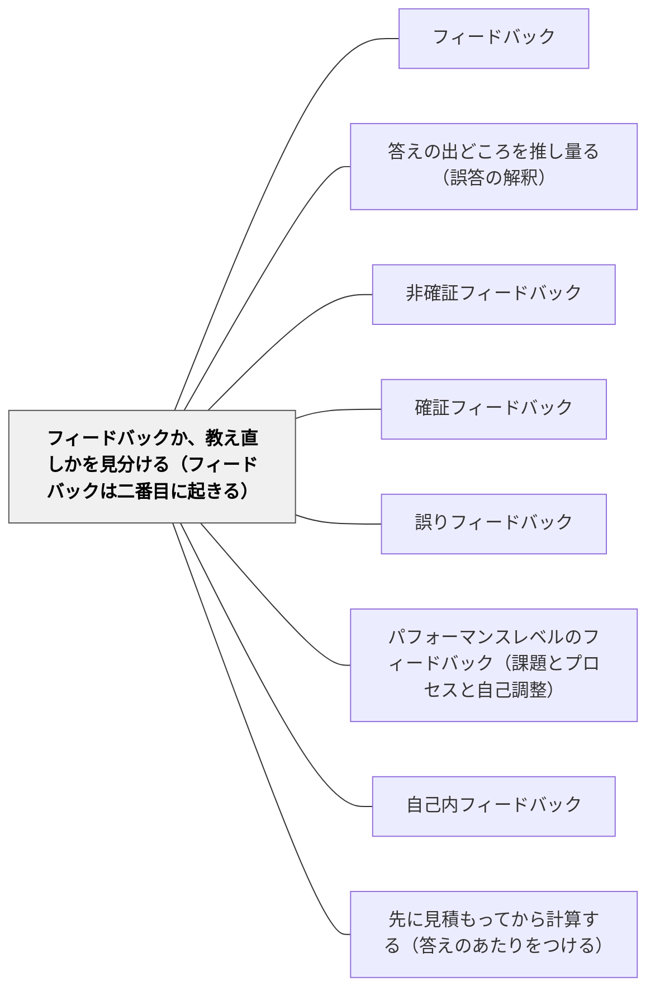

# フィードバックか、教え直しかを見分ける（フィードバックは二番目に起きる）

> 赤ペンでどれだけ丁寧に書いても、まったく分かっていない子には届かない。フィードバックは、最初の教えのあとに「二番目に起きる」ものである。誤って理解している子にはフィードバックが効き、理解がまだない子には教え直しが効く。返す前に、どちらなのかを見分ける。

## [Pattern Connection]

[[文献/The Power of Feedback（Hattie & Timperley, 2007）]] は、フィードバックを「教えるという過程の一部にすぎず、二番目に起きるもの」と位置づけた（p. 82）。そして、フィードバックは**誤った解釈**に向けられたときにもっとも強く、**理解がまったくない**ときにはほとんど効かない、と繰り返し書く（p. 82, 91, 104）。

> FT is more powerful when it is about faulty interpretations, not lack of information. If students lack necessary knowledge, further instruction is more powerful than feedback information. (p. 91)
>
> 課題レベルのフィードバックは、情報の欠如ではなく誤った解釈に向いているときに強い。生徒が必要な知識を欠いているなら、フィードバックの情報より、さらに教えることのほうが強い。

このWikiのフィードバックのパタン群は、**どう返すか**（具体的に・レベルを選んで・次の一歩を示して）を詳しく書いている。本パタンはその手前に入り、**そもそも返すのか、教え直すのか**を決める。

- **[[パタン/答えの出どころを推し量る（誤答の解釈）]] との関係**：あちらは誤答が自己調整の過程のどこで分岐したかを推し量る。本パタンは、その見立ての結果を「フィードバックで足りるか、教え直しが要るか」という行動の分かれ目に変える
- **[[パタン/非確証フィードバック]] との関係**：誤りを指摘し修正の方向を示すのがあちら。本パタンは、指摘が届く前提（誤った解釈がある＝足場になる理解がある）が成り立っているかを先に確かめる
- **2020年の検証との関係**：Wisniewski ほか（2020）のやり直しのメタ分析でも、情報の多いフィードバックほど効いた（0.99）。情報が多いフィードバックは、受け取る側に、その情報を結びつける理解があって初めて働く

---

## 背景（Context）

ノートやテストを返すとき、教師は誤りに印をつけ、コメントを書く。授業中の机間指導でも、つまずいている子に一言かける。フィードバックは形成的評価の中心であり、多く返すほどよいと考えられやすい。

一方で、誤りの中身は子どもによって違う。途中まで正しく考えて一か所で取り違えた子もいれば、問題が何を聞いているのかがそもそも分かっていない子もいる。答えが同じように「×」でも、その下にある理解の状態はまったく違う。

## 問題（Problem）

**理解がまだない子に、誤った解釈を直すためのフィードバックを重ねても届かない。** 返された情報を結びつける既有の理解がないので、子どもはそれを使えない。ハッティらは Kulhavy（1977）を引いて、こう書く。

> "If the material studied is unfamiliar or abstruse, providing feedback should have little effect on criterion performance, since there is no way to relate the new information to what is already known" (Kulhavy, 1977, p. 220; Hattie & Timperley, 2007, p. 82)
>
> 学んでいる内容がなじみのないものや難解なものなら、フィードバックを与えても成績にはほとんど効果がないはずである。新しい情報を、すでに知っていることに結びつける方法がないからである。

さらに、そうした状況ではフィードバックがかえって**脅威**になりうる（p. 82）。分からないところに赤ペンが重なるほど、子どもは「自分はできない」という情報だけを受け取る。

## 力のかたち（Forces）

- **フィードバックは安く、教え直しは高い**：コメントを書くのは数十秒で済む。教え直しには時間と、その子のための場面が要る。教師は安いほうに流れやすい
- **誤答は見た目では区別できない**：誤った解釈による誤答と、理解の欠如による誤答は、答案の上では同じ「×」に見える
- **確信度が手がかりになる**：自信をもって答えて間違えた子にフィードバックはもっとも効く。自信がなく間違えた子ではフィードバックはほとんど無視され、教え直しと情報のほうが効く（Kulhavy & Stock, 1989; Hattie & Timperley, 2007, p. 95）
- **教え直しは「できない子」の印にもなりうる**：取り出して教え直すことが、子どもや周りにとって特別扱いの印になる場合がある

## 解決（Solution）

**返す前に、その誤りが「誤った解釈」なのか「理解の欠如」なのかを見分ける。誤った解釈にはフィードバックを、理解の欠如には教え直しを選ぶ。** 見分ける手がかりとして、子どもの説明と確信度を使う。

手順は三つ。

1. **誤答の中に、正しい部分があるかを見る**：途中まで筋が通っていて一か所で取り違えているなら、誤った解釈である。筋そのものがないなら、理解の欠如を疑う
2. **確信度を聞く**：「この答え、どのくらい自信がある？」。自信があって間違えているなら、フィードバックがもっとも効く場面である。自信がなく間違えているなら、フィードバックを重ねずに教え直す
3. **行動を分ける**：
   - **誤った解釈** → どこで取り違えたかを示すフィードバック（[[パタン/非確証フィードバック]]・[[パタン/意味のある具体的なフィードバック]]）
   - **理解の欠如** → コメントではなく、もう一度教える場面をつくる（小集団での教え直し、別の表し方での説明、もっと易しい例から）

---

### 具体例①：算数のノート——同じ「×」を二つに分ける

5年の分数のたし算で、二人の子が 1/2 + 1/3 を間違えた。

- **A児**：「1/2 = 3/6、1/3 = 2/6、だから 3/6 + 2/6 = 5/12」。通分までは正しく、最後に分母どうしも足している。**誤った解釈**である。「分母の 6 は何を表していた？」という一言のフィードバックで、本人が直せる
- **B児**：「1/2 + 1/3 = 2/5」。通分の手続きそのものが出てこない。「分母が違うと、そのままでは足せない」こと自体がまだつかめていない。**理解の欠如**である。ノートに「通分しよう」と書いても、通分の意味が分からなければ使えない。テープ図で単位をそろえる場面から、もう一度一緒にやる

答案の上ではどちらも「×」だが、A児にはフィードバックを、B児には教え直しを選ぶ。

---

### 具体例②：確信度を一行書いてもらう

小テストやプリントの答えの横に、自信の度合いを「◎・○・△」で書いてもらう。

- **◎で×**：自信をもって間違えた。もっともフィードバックが効く。誤りを指摘し、なぜ違うかを示す。ハッティらの引く Kulhavy & Stock（1989）は、こうした「自信のある誤り」で、学習者は誤概念を正そうとして長く項目に取り組むと述べている（p. 95）
- **△で×**：自信がなく間違えた。フィードバックはほとんど無視される。コメントを書く代わりに、次の授業で教え直す子の名簿に入れる
- **△で○**：自信がないのに合っていた。[[パタン/確証フィードバック]]で「その考え方で合っている」と伝える

確信度は、教師が誤答を見分けるための情報であると同時に、子どもが自分の理解を見る練習にもなる（[[パタン/自己内フィードバック]]）。

---

### 特別支援の視点

理解の欠如による誤答に赤ペンが重なる経験は、学習への苦手意識を強める。とくに失敗経験が積み重なっている子にとって、届かないフィードバックは「また分からなかった」という情報だけを残す。こうした子には、返却のときにコメントで直そうとせず、短い時間でも一対一で教え直す場面を先に用意する。教え直しが特別扱いの印にならないよう、「今日は何人かと一緒にもう一回やる」のように、日常の授業の形として組み込む。

## 結果（Consequences）

**利点**

- 届かないフィードバックに費やしていた時間を、教え直しに回せる
- 誤った解釈をしている子には、短いフィードバックで本人が直せる場面が増える
- 「分からないところに赤ペンが重なる」経験が減り、学習への苦手意識を強めにくい

**注意点・リスク**

- **見分けは仮説にすぎない**：誤った解釈か理解の欠如かは、答案だけでは確定しない。説明を聞く、もう一問出すなどで確かめる（[[パタン/答えの出どころを推し量る（誤答の解釈）]]）
- **確信度の答えは正直とは限らない**：自信を低く書いておけば教え直してもらえる、と受け取られると情報が崩れる。確信度を成績に結びつけない
- **「教え直し」を固定のグループにしない**：理解の欠如は単元や内容ごとに違う。同じ子をいつも教え直しの側に置かない
- **根拠は総説の中の議論**：本パタンの中心の主張は、ハッティらが Kulhavy（1977）や Kulhavy & Stock（1989）を引いて述べたものである。どの程度の理解があればフィードバックが効き始めるかの境目は、論文の中でも示されていない

## 関連パタン

- [[パタン/フィードバック]] — ハブ。本パタンはフィードバックを返す前の判断を担う
- [[パタン/答えの出どころを推し量る（誤答の解釈）]] — 誤答の分岐点を推し量るのがあちら、その結果を「返すか教え直すか」に変えるのが本パタン
- [[パタン/非確証フィードバック]] — 誤りを指摘するフィードバック。誤った解釈に向いているときに効く
- [[パタン/確証フィードバック]] — 自信がないのに正しかった子に、その方向で合っていると伝える
- [[パタン/誤りフィードバック]] — 誤りを扱うフィードバック全般。その前に誤りの種類を見分ける
- [[パタン/パフォーマンスレベルのフィードバック（課題とプロセスと自己調整）]] — 課題レベルのフィードバックは誤った解釈に向いているときに強い、という条件を本パタンが担う
- [[パタン/自己内フィードバック]] — 確信度を書くことは、子どもが自分の理解を見る練習になる
- [[パタン/先に見積もってから計算する（答えのあたりをつける）]] — 見積もりは、自信のある誤りに子ども自身が気づく手がかりになる

## クラスター図

## Actionable Insight

- 次にノートを返す前に、誤答を「途中まで筋が通っている」と「筋そのものがない」の二つの山に分けてみる。後者の山の子には、コメントを書かずに次の授業で教え直す時間を5分取る
- 小テストの答えの横に、自信の度合いを◎・○・△で書いてもらう。「◎で×」の子に最初にフィードバックを返す
- 赤ペンで同じ子に三回以上同じ種類のコメントを書いていたら、それはフィードバックではなく教え直しが要るしるしだと考えてみる

## 出典

Hattie, J., & Timperley, H. (2007). The power of feedback. *Review of Educational Research, 77*(1), 81–112.

> "FT is more powerful when it is about faulty interpretations, not lack of information. If students lack necessary knowledge, further instruction is more powerful than feedback information." (p. 91)

> "Feedback has no effect in a vacuum; to be powerful in its effect, there must be a learning context to which feedback is addressed. It is but part of the teaching process and is that which happens second" (p. 82)

Kulhavy, R. W. (1977). Feedback in written instruction. *Review of Educational Research, 47*(1), 211–232.（Hattie & Timperley, 2007 による引用）

Kulhavy, R. W., & Stock, W. A. (1989). Feedback in written instruction: The place of response certitude. *Educational Psychology Review, 1*(4), 279–308.（Hattie & Timperley, 2007 による引用）

Wisniewski, B., Zierer, K., & Hattie, J. (2020). The power of feedback revisited: A meta-analysis of educational feedback research. *Frontiers in Psychology, 10*, 3087.
