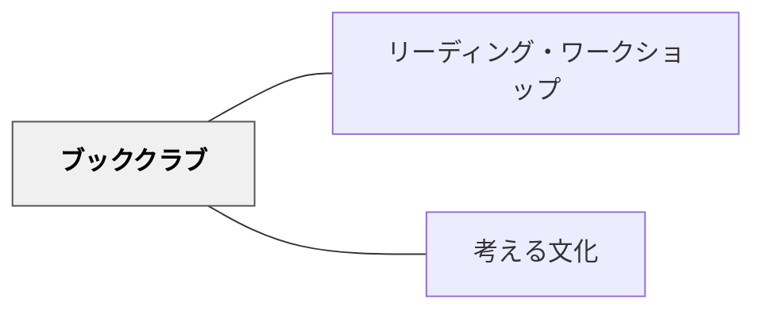

# ブッククラブ

**このパタンが完成を助ける大きなパタン**：[[パタン/リーディング・ワークショップ]]

> 一冊の本をグループで読み、語り合う——この読書会の中に、読み書きの文化、聴き合う文化、協同学習、アドベンチャーなど複数のパタンが重なっている。

---

## Pattern Connection

**出典**: Daniels, H.（2002）*Literature Circles: Voice and Choice in Book Clubs & Reading Groups*（2nd ed.）. Stenhouse. / Daniels, H., & Bizar, M.（2005）*Teaching the Best Practice Way*. Stenhouse.

- **既存パタンとの関連**: [[パタン/リテラチャー・サークル]] はブッククラブの特定実装形式として位置づけられる。ブッククラブが「本を読んで語り合う学習活動の総体」を扱うのに対して、リテラチャー・サークルは「役割シートによる足場かけ→段階的消去」「本の自由選択」「教師が対話の外に出る」という3つの固有設計を持つ。このパタンはその上位パタンとして機能する
- **補強された点**: 「よくある失敗と対処」（あらすじ確認で終わる・発言が偏る）に対して、役割シートが構造的な解決策を提供することが明確になった——「討議リーダーの問い」「コネクターのつながり」などの役割が「どの子も準備して来る」個人的アカウンタビリティを保証する
- **修正・拡張された点**: 役割シートは「永続的な構造」ではなく段階的に消すべきもの（Daniels の最重要原則）——導入期（全役割）→練習期（役割選択）→移行期（準備メモ）→自律期（役割なし）という段階が「よい読書会」の到達点を具体化した。これは [[パタン/段階的手放し]] の観点をブッククラブに加える
- **他のパタンへの波及**: [[パタン/リテラチャー・サークル]] — ブッククラブの具体的実装（役割・消去・選択）。[[パタン/自己選択自己決定]] — 本の選択が生徒主導の前提。[[パタン/聴き合う文化]] — 役割が消えた後の自然な対話を支える

---

## 背景（Context）

ブッククラブ（読書会）は、同じ本を読んだ学習者がグループで語り合い、読みを深める学習活動である。リテラチャーサークルなど近い実践もあるが、ここでは細かな違いよりも「本を読んで語り合う学習活動」として捉える。

岩井輝久（2018）は、ブッククラブを「パタンを重ねていくこと」を考えるための実践として記述している。よい教育には、複数のパタンが小さな活動の中に重なり、圧縮されている。ブッククラブはその典型である。

一冊の本を一人で読むだけでは、読みは個人の内側に閉じやすい。しかし、同じ本を読んだ仲間と語り合うと、登場人物の見方、場面の意味、作品全体のテーマが他者の言葉によって開かれていく。

## 問題（Problem）

読書指導が、あらすじの確認や教師の発問への応答だけになると、学習者は本を「自分たちで意味づける」経験を持ちにくい。読む力を伸ばしたいのに、読書が受け身の活動になってしまう。

また、話し合いだけを先に置いても、読む準備がなければ対話は浅くなる。逆に、一人で読むだけでは、多様な解釈や読みの深まりに出会いにくい。

## 力のかたち（Forces）

- 読書には一人で沈潜する時間と、他者と語り合う時間の両方が必要である
- 同じ本を読んでいても、心に残る場面や解釈は一人ひとり異なる
- 語り合うためには、事前に読んで考えを準備する個人の責任が必要になる
- 読み応えのある本は挑戦になるが、その挑戦が読書の力と楽しさを育てる
- グループで読むと、互恵的な協力、参加の平等性、活動の同時性が生まれやすい
- よい読書会は、複数の教育パタンが重なってはじめて成立する

## 解決（Solution）

**一冊の本を小グループで読み、事前に考えを準備してから語り合うブッククラブを設計する。**

**近いパタンとの見分け**：役割を使わず、準備した考えを持ち寄って同じ本を語り合うのが本パタン。役割シートを足場にするのは [[パタン/リテラチャー・サークル]]。系列の全体の表は [[パタン/リーディング・ワークショップ#近いパタンとの見分け|リーディング・ワークショップ]] にある。

本は、子どもたちにとって読み応えがあり、語り合う価値のあるものを選ぶ。グループは3〜4人程度を基本にし、全員が読んで考えを持ち寄れるようにする。読みを何回かに分けてもよいし、一冊を読んでから語り合ってもよい。

---

### 基本的な進め方

1. **本を選ぶ**——読み応えがあり、複数の解釈や感想が生まれる本を用意する
2. **グループを作る**——同じ本を読む3〜4人程度のグループにする
3. **読む範囲を決める**——一冊を分けて読むか、全体を読んでから話すかを決める
4. **考えを準備する**——印象に残った場面、疑問、語りたいことをメモする
5. **語り合う**——一人ずつ考えを出し、仲間の言葉を聴きながら読みを深める
6. **振り返る**——話し合いで考えが変わったこと、深まったことを書く

---

### 最初の1回の台本

初回は「正解を探す時間」ではなく「読みを持ち寄る時間」であることを明確にする。

1. 「今日は、一冊の本について、同じ本を読んだ人同士で話します」
2. 「正しい答えを一つに決める時間ではありません」
3. 「自分が気になった場面、疑問に思ったこと、誰かに聞いてみたいことを持ってきます」
4. 「話す人は、本のどこからそう思ったのかを伝えます」
5. 「聴く人は、同じところ・違うところ・もっと聞きたいところを探します」
6. 「最後に、話し合いで自分の読みがどう変わったかを書きます」

### 話し合いの入口になる問い

| 問い | ねらい |
|------|--------|
| 一番心に残った場面はどこか | 読みの入口を作る |
| 登場人物の行動で気になったところはどこか | 人物理解を深める |
| 自分ならどうしたか | 自分の経験と結びつける |
| この本が問いかけていることは何か | 作品のテーマへ向かう |
| 友だちの話を聞いて、読みが変わったところはあるか | 対話による変化を振り返る |

### よくある失敗と対処

| 起きやすいこと | 対処 |
|----------------|------|
| あらすじ確認だけで終わる | 「どこでそう思った？」と根拠になる場面へ戻す |
| 発言する子が偏る | 最初に一人ずつ「話したいこと」を出す時間を置く |
| 読んでこない子が出る | 読む範囲を小さくし、授業内にも読む時間を確保する |
| 感想の言い合いで深まらない | 「友だちの読みで変わったところ」を最後に書かせる |
| 本が易しすぎて語ることがない | 葛藤、多視点、曖昧さのある本を選ぶ |
| 本が難しすぎて止まる | 範囲を分ける、読み語りを入れる、問いの入口を絞る |

### 発展パターン

| 発展 | 進め方 | つながるパタン |
|------|--------|----------------|
| テーマで集まる | 話し合いたいテーマごとにグループを組み直す | [[パタン/概念型の目標]]、[[パタン/可視化]] |
| 役になりきる | 登場人物の立場から問いに答える | [[パタン/ごっこ遊び]] |
| 読書記録を残す | 読書会で考えが変わったことを蓄積する | [[パタン/ポートフォリオファイル]] |
| 友だちに問い返す | 仲間の発言を受けて、さらに考えが続く問いを返す | [[パタン/問い返しのデザイン]] |
| 次の本を選ぶ | 読書会後に次に読みたい本を自分たちで選ぶ | [[パタン/自己選択自己決定]] |

### 岩井の原稿から（ブッククラブ）

（原稿のうち、すでに本ページの上の節にそのまま入っている段落は、ここでは繰り返さない。）

　　　　　　　　　　　　　　　　　　　　　岩井輝久

「できるだけ小空間に、できるだけ多くのパタンを圧縮することに目を向けることが肝要である。このパタンの圧縮のプロセスこそ、必要なパタンを組み込み、かつ経済的な建物を作る道と考えてよい。しかもこれが、パタン・ランゲージという言語を用いて、建物という詩をつくる唯一の方法なのである。」(『パタン・ランゲージ―環境設計の手引』xxvii)

#### はじめに

私は、パタンを重ねていくことが教育においても経済であると考えています。よい教育を観察すると、パタンの圧縮を見出すことができます。私は、ある状況において共通してうまくいくときのコツ、特徴などを総称してパタンと呼んでいます。また経済であるとは、教育から不要な苦しみ、時間、費用などコストを省いていくことです。もしパタン・ランゲージをもっと知りたいという方は、アレグザンダーや井庭崇らの著書を読んでみてください。アレグザンダーや井庭崇らから影響を受けた中で、私が教育を研究、実践する上で大切に考えていることは、このパタンが状況に応じて問題解決するためのコツや条件などを言語化したものであること、そして状況に応じてパタンを重ね圧縮していくことが経済であるということです。

この原稿では、ブッククラブ（読書会） という学習を通して、私がどのようにパタンを重ねていったのかということを中心に授業の計画、デザインのプロセスについて説明を試みます。また、ブッククラブ（読書会）の実践報告でもあります。ブッククラブ （読書会）とは、本を読んでグループで語り合う学習活動です。読書会、ブッククラブ 、また似たような学習活動にリテラチャーサークルなどがありますが、ここではそれらの違いの説明を必要なだけにして細かくは省きます（リテラチャーサークルの中の役割読みとの違いだけは必要なだけ後で説明します）。私がお伝えしたことについては、ブッククラブ （読書会）が本を読んで語り合うことだという捉えでほぼ問題ないからです。

もう１０年くらい前のことです。今は風越学園を作るために奔走している岩瀬直樹さんが小学校でブッククラブ の研究授業を公開していたのを見る機会に恵まれました。その時に子どもたちが本について豊かに語り合っていた光景を見た衝撃は、忘れ難いものとして心に刻まれました。後に日本のブッククラブ の先駆的な実践者である岩瀬直樹さんや甲斐崎博史さんから学び、私も小学校の教員としてブッククラブ の授業を実践するようになりました。

#### ブッククラブ の良さと自分の授業の課題

私は、ブッククラブ 自体がパタンの重なりのある優れた学習活動だと考えています。ブッククラブ を授業でやってみると確かな手応えがありました。ブッククラブ で読み応えのある本にチャレンジし、読む力を伸ばしたり、本が好きになったりする子どもたちの姿をたくさん見ることができました。それは、ブッククラブ 自体に、効果的な教育のいくつかのパタンの重なりを観察でき、その学習活動の構造が優れているものだからだと考えています。ブッククラブ には、スペンサー・ケーガンが指摘する協同学習の４つの条件が含まれています。この４つの条件として挙げられているものも、私は協同学習がうまくいく時のパタンの一種であると考えています。その４つの条件とは、

・互恵的な協力関係がある。

・個人の責任が明確である。

・参加の平等性が確保されている。

・活動の同時性が配慮されている。

というものです（『授業づくりネットワークNo４　協同学習で授業を変える！』学事出版）。

例えば、ブッククラブ では、読んで考えを準備しないと語り合えないので、個人の責任は明確です。一冊の本を何回かに分けて読んで（課題を分けること自体が問題解決を容易にするもので、ここにもパタンの重なりを見出すことができます）、自分の考えを準備し、語り合うという方法でやるブッククラブ があります（一気に一冊丸ごと読んでブッククラブ をすることもあります）。私も大人のブッククラブ を何回か経験しています。ブッククラブ では、大人も子どもも一人で読むよりも、個人の責任が明確で相手意識がある分、必死に読んで準備する傾向にあるのです。またブッククラブ では、日頃読まないようなその人にとって少し難しい本でも読めて、ブッククラブ が終わった後に一つステージが上がっているというような経験をする人もいます。

しかし、自分が見る機会に恵まれた岩瀬直樹さんや甲斐崎博史さんのような授業のレベルには至れませんでした。それどころか大きな課題が残ることがありました。

ブッククラブ で語り合う本を選んでグループを作る時のことです。選書の目安として、１ページに分からない言葉は、２、３個までだと子どもたちには伝えます。分からない言葉が２、３個までなら、文脈から意味を推理することができるからです。分からない言葉が多くなれば、それだけ分からない言葉の推理は、前後の分かる言葉に頼ることになるので困難になります。こうやって教えても子どもたちは難しすぎる本を選んでしまって、約束のページまで本を読んでこれないということが起きました。

また、いざブッククラブ で語り合う段階では、そのブッククラブ の語り合いの質はグループによってバラバラでした。うまくいかないグループは、準備してきた考えを伝え合うだけで話題が尽きてしまい語り合いが終わってしまいました。ブッククラブ （読書会）ではなく、報告会のようになってしまい、話が続かないのです。

そこで私は、ブッククラブ 自体がパタンの重なりを見出すことができる優れた学習活動だとしても、自分の授業の課題、問題を解決するために、さらにパタンを重ねていく必要があると実感しました。岩瀬直樹さんの授業を見てから、１０年間の時を経て、今自分のできる全てを出し切って、研究授業をしたいと考えました。ちょうど校内研究で国語の物語の読む単元で授業をしようという時だったのです。

※リテラチャー・サークルという本を読んで語り合う学習活動の中には、質問する人、あらすじをまとめる人などグループで役割を決めて、本のことについて語り合う実践があります。私は、役割読みをするリテラチャーサークルをブッククラブ に発展していく一つのステップと考えたり、目的や状況によっては有効だと考えたりしています。リテラチャーサークルは、個人の責任をさらに明確にするという点で、読むことの方略を分けることで課題を簡単にするという点ではメリットがあります。しかし、自分の授業や子どもたちの状況としては、グループによって本を読んで語り合うパフォーマンスの質にバラツキがあり、中には報告会のようになってしまっている状況があるということから、リテラチャーサークルのような役割読みではなく、ブッククラブ の話題・テーマ・話し合うことを中心に、子どもたちのブッククラブ の話題が続いていくように授業計画を工夫していく、パタンを重ねていくという方針にしました。

#### 課題を解決していくためにパタンを重ねていく

（以上、岩井の原稿「教育のパタン・ランゲージ 集約」の「パタン　ブッククラブ」から。）

### 岩井の原稿から（精選された中での選択）

私がこれまでやっていたブッククラブ は、自分の蔵書の中から８〜１０の作品をピックアップしたものを子どもたちに選んでもらうというものでした。難易度も内容も幅広いものになっていて、読書が得意な子にも、本が苦手な子にも、多様な相手にも対応できるようにという意図からでした。しかし、その意図に反して、難しすぎる合わない本を選んでしまい、そのあとのブッククラブ で自分の考えや質問を準備できない子どもたちが出てきてしまいました。本の選び方を教えるだけでは足りませんでしたので、私は、さらにブッククラブ の本を精選していく必要を感じました。

小学校の４年生で『プラタナスの木』という教科書教材との並行読書としてブッククラブ の授業を計画しました。『プラタナスの木』でブッククラブ の練習をして、子どもたちが選んだ本でもブッククラブ を実践するという流れです。そこで子どもたちの実態や『プラタナスの木』との関係も考えて４冊の本に精選しました。

並行読書一覧

| 本の名前 | 出版社 | 著者名 |
| --- | --- | --- |
| 流れ星におねがい | 童心社 | 森絵都 |
| オレンジソース | 佼成出版社 | 魚住直子 |
| びりっかすの神さま | 偕成社 | 岡田淳 |
| 学校ウサギをつかまえろ | 偕成社 | 岡田淳 |

（この表は、原稿の docx 版から写した。）

（教科書教材『プラタナスの木』との関係）

主に学習者と同じ4年生が登場人物である作品を他にも用意しました。教科書教材の『プラタナスの木』は、学習者と同じ4年生が登場人物の作品です。いつも遊んでいる公園で出会ったおじいさんの話を伏線に、プラタナスの木がなくなってしまった出来事を通して、自然の生命力や神秘さに気づきます。『プラタナスの木』も私が選んだ他の作品も、登場人物が等身大であることから子どもたちは作品に感情移入し易いと考えました。

（難易度の考慮）

どの子がどの作品を選んでも最後まで読み進めて、チャレンジしがいのある経験ができるようにするために、作品の難易度は、かつてよりもバラツキを少なくしました。子どもたちのこれまでの学習経験や読書経験を踏まえて、簡単すぎず、難しすぎないように苦慮しました。

（本の内容）

作品にメッセージ性があると考えられるもの、登場人物に変容があるもの、読み手の考えが読んでいくうちに変わっていきそうなものなど、子どもたちが読んで語り合う価値があり、ブッククラブ で語り易いだろうと判断できる内容の本を選びました。『学校ウサギをつかまえろ』には、山田という登場人物が出てきます。山田は、ウサギがプレハブに下に逃げ込み捕まえることを大変にしてしまうきっかけを作り、塾の時間が近づくとこの場を去っていくという登場人物です。多くの子どもたちの山田に対するはじめの印象は悪いです。しかし、このあとの山田の言動が子どもたちの山田に対する印象を変えていくことになります。他の作品も、このように読み手が登場人物に対して見方、考え方が変わっていく可能性がある、登場人物が重厚にしっかりと描かれているものを選びました。今回、はじめてブッククラブ に採用した本に魚住直子の『オレンジソース 』という作品があります。私が小学校4年性のブッククラブ に良い本はないでしょうかとSNSで問いかけたところ、唯一答えてくださったのが、甲斐崎博史さんでした。その答えが『オレンジソース 』です。この作品には、みさきとリエという中心的な登場人物が出てきます。この二人と周りの人たちが対比的に描かれていて、『ごんぎつね』ような鮮烈な終わり方をする詩的な作品です。子どもたちの話し合いはとても弾んで盛り上がっていて、『オレンジソース 』は、ブッククラブ 向けの良い本だと思いました。学習指導要領についても本を選ぶときに考えています。学習指導要領の国語科の目標も意識して、それを達成するのに教材が適切であるかということです。例えば、学習指導要領には、叙述から登場人物の性格や気持ちを想像することができるという内容の目標があります。その目標から考えれば、登場人物が魅力的で読み手が理解したいと思える内容で、さらには登場人物について、ストーリーに中で重厚に優れた表現で書かれていて、読み手が書いてあることから登場人物について推理する価値があるものであることが望ましいと思います。

（以上、岩井の原稿「教育のパタン・ランゲージ 集約」の「パタン　精選された中での選択」から。）

### 岩井の原稿から（付箋の活用）

話し合いたいページに付箋で印を付けたり、付箋に自分の考えと理由を書けるようにしました。印に付箋を使う際は、小さい付箋を使うようにする。付箋で本に印をつけることで、子どもたちの記憶を補助し、叙述に基づいて話し合うことを助けることができると考えました。読んで自分の考えを書く際は、大きな付箋を使うようにして、一つの付箋に自分の一つの考えと理由を可視化できるようにしました。

大きな付箋の使い方

→本を読んで考えたことや質問を書く。考えには理由も書く。どこから考えたのかページ数も書く。

小さい付箋の使い方

・読書会で、グループのメンバーとお話したいところに印をつける。

・登場人物の性格や特ちょうがわかるところに印をつける。

・設定（時・場所・登場人物）が大きく変わるページに印をつける。

・自分の心が動いたところに印をつける。

・疑問解決の手がかり／糸口に印をつける。

・自分の考えの証拠に印をつける。

・重要な登場人物の説明や態度、考え方・判断に印をつける。

・重要な登場人物がどのような人かわかるところに印をつける。

・新しい登場人物に印をつける。

・目標のページに印をつける。

・大切だと考えたところに印をつける。

・よく分からなかったところに印をつける。

以上の、文学YOUBERベルさんの動画などを参考に付箋の使い方をまとめたものをさらに以下の使い方に絞りました。

大きな付箋の使い方

・本を読んで考えたことや質問を書く。考えには理由も書く。どこから考えたのかページ数も書く。

小さい付箋の使い方

・自分の心が動いたところ・大切だと考えたところ・読書会でグループのメンバーと話し合いたいところに印をつける（青色の付箋）。

・登場人物の性格や気持ちなどが分かるところに印をつける（緑色の付箋）。

・よく分からなかったところに印をつける（赤色の付箋）。

色分けに関しては、最初は面倒だと思っていたのですが、同僚の先生のアドバイスがあり実際にやってみました。まず自分自身が試してみて、さらに子どもたちの様子を見ていて、とても効果的だったと思います。付箋を色分けして使用することが、ブッククラブで話題にしたいページへのアクセスをさらに容易にしてくれました。

（以上、岩井の原稿「教育のパタン・ランゲージ 集約」の「パタン　付箋の活用」から。）

### 岩井の原稿から（学習の手引き）

○書き出しの手引き

　本を読んで考えを書き出すときに参考となる書き出しのリストを用意しました。

○テーマ（問い／話題）の手引き

　質問を重ねて、話し合いが続けられるようにテーマ（問い／話題）のリストを用意しました。話が途切れてしまった時には、このリストを参考に話し合いが続けられようにしました。

○聞き手になっているときの手引きとメモ欄

　聞き手として、他の人に考えを補強したり、発展したりする時に参考となる型を示したものとメモができるスペースのある紙を用意しました。

この後に参考になればと思い、資料とワークシートを載せます。電子書籍にする時に元のデータとどうしてもズレが出てきてしまうという問題が改善できないので、DropBoxを使って元のWordのデータも共有することにしました。指定のアドレスにアクセスすれば、元のWordのデータをダウンロードできます。指導案の単元計画の表などずれているところがあると思いますが、ご了承下さい。

国語科学習指導案　

単元名　読書会で友達と感想を交流して、読書をもっと楽しもう

※選書のリストの中に森絵都『流れ星におねがい』がないのは、2人にしか選ばられずグループができなかったため、指導案に載せなかったからです（話し合い易い人数を考えて、３人から４人のグループを作りました）。しかし、『流れ星におねがい』は小学校中学年のブッククラブ にうってつけの本だと思います。ブッククラブ を意識したものですが、指導案では読書会という名称で計画しています。

（原稿では、ここに資料の共有リンクが入っている。個人の共有リンクは wiki には載せない。）

ブッククラブ で読みたい本を選ぼう

本を選んでもらう時に使ったワークシートです。

（共有リンクは省いた。）

ブッククラブ のための質問集

（共有リンクは省いた。）

書き出しの手引き

（共有リンクは省いた。）

ブッククラブ 学習計画シート

（共有リンクは省いた。）

ブッククラブ 振り返りシートと聞き手になっている時の手引きとメモ欄

（共有リンクは省いた。）

(資料・ワークシート）

#### 国語科学習指導案

授業者　岩井　輝久

単元名　読書会で友達と感想を交流して、読書をもっと楽しもう

教材名　「プラタナスの木」（光村図書　4年下）他

１．日時　　　　　令和元年１２月１３日（金）　４校時

２．学年・組　　　第４学年１組　３４名　

３．指導事項と言語活動

（１）指導事項

〇文章を読んで感じたことや考えたことを共有し、一人一人の感じ方などに違いがあることに気付くこと。

（「C読むこと」カ）

・登場人物の気持ちの変化や性格、情景について、場面の移り変わりと結び付けて具体的に想像すること。

（「C読むこと」エ）

・様子や行動、気持ちや性格を表す語句の量を増し、語や文章の中で使うとともに、言葉による語句のまとまりがあることに気付き、語彙を豊かにすること。

（「知識及び技能」オ）

（２）言語活動

●物語を読み、内容を説明したり、考えたことなどを伝え合ったりする活動

「物語」は、子どもたちが日常的に親しんでいる文学である。言葉の量が多く、具体的に書かれているため、叙述から登場人物の気持ちの変化や性格、情景について想像し、筆者の描く世界を捉えやすい。そのよさを感じ、子ども一人ひとりが様々な感想をもつだろうと考える。

　読書会では、テーマを決めて自分の考えを述べる。自分の考えを述べる際に、登場人物の気持ちの変化や性格、情景について、場面の移り変わりと結び付けて具体的に想像することとなり、「C読むこと」エの力を付けることにつながる。また、読書会で友達の考えを聞く中で、「C読むこと」のカの力をつけていく機会になると考えている。このように、物語を読み、その物語について自分が感じた感想を述べ合うことによって身に付けたい力が付くものと考える。以上の事から、上記の言語活動が適切だと考え、本言語活動を位置付ける。

４．単元目標

○様子や行動、気持ちや性格を表す語句の量を増やし、読書会の中で感想語彙を増やす。

○読んで考えたことを交流し合い、感じ方の違いに気付き、登場人物の性格や気持ちの変化、情景などについて、叙述をもとに想像して読む。

○文章を読んで感じたことや考えたことを共有し、文章のどこに着目しているか、どのような思考と感情、経験と結び付けて読んでいるかによって一人ひとりの違いがあることに気付き、互いの考えを理解しようする。

５．評価規準

| 知識・技能 | 思考・判断・表現 | 主体的に学習に取り組む態度 |
| --- | --- | --- |
| ①様子や行動、気持ちや性格を表す語句の量を増やし、読書会の中で感想語彙を増やしている。 （１）オ ②読書によって、新しい世界に触れて自分の興味が広がる楽しさを味わい、自分の読書の幅を広げている。（３）オ | ③複数の叙述を結び付け、気持ちの変化や変化のきっかけ、登場人物の性格を思い描いたり、場面の移り変わりとともに変化する登場人物の気持ちと併せて情景を想像したりしている。（エ） ④文章を読んで感じたことや考えたことを共有し、文章のどこに着目しているか、どのような思考と感情、経験と結び付けて読んでいるかによって一人ひとりの違いがあることに気付き、互いの考えを理解している。（カ） | ⑤文章を読んで感じたことや考えたことを繰り返し共有する活動を通して、文章のどこに着目しているか、どのような思考と感情、経験と結び付けて読んでいるかによって一人ひとりの違いがあることに気付き、互いの考えを理解しようとしている。 |

（この表は、原稿の docx 版から写した。）

６．児童の実態

「白いぼうし」では、叙述を基に登場人物の気持ちを想像して、表現読みをする学習活動をしてきている。どのように音読すればよいのか考えることで、登場人物の性格や気持ち、情景などについて読み取ることができた。

　「一つの花」では、場面ごとの人物の行動や会話に注目して読んだり、作者が特別な意味を込めた言葉の使われ方に着目して読んだりする経験をしてきている。

　「ごんぎつね」では、叙述を基に問いや考えを出し合い、グループごとにテーマ（問い）を決め、読書会を経験してきている。問いに対する考えを伝え合うことができた。しかし、質問をしながら話をつなげて、他の人の考えを補強したり発展させたりすること、自分の考えを読みの交流の中で深めたりすることに課題がある。

７．単元について

　学習者と同じ4年生が登場人物の作品である。いつも遊んでいる公園で出会ったおじいさんの話を伏線に、プラタナスの木がなくなってしまった出来事を通して、自然の生命力や神秘さに気づく。行動や会話から、人物の性格や気持ち考えの変容を叙述に即して読み取らせようにする。

「プラタナスの木」は、登場人物が等身大であることから、児童は作品に感情移入しやすく、感想をもちやすいと考えられる。また、主に学習者と同じ4年生が登場人物である作品を他にも用意して、平行読書を行っていく。一冊の本を丸ごと読んで小グループで語り合うことで、読む能力を伸ばしていける機会にしたい。

並行読書一覧

| 本の名前 | 出版社 | 著者名 |
| --- | --- | --- |
| オレンジソース | 佼成出版社 | 魚住直子 |
| びりっかすの神さま | 偕成社 | 岡田淳 |
| 学校ウサギをつかまえろ | 偕成社 | 岡田淳 |

（この表は、原稿の docx 版から写した。）

８　研究主題にせまるための手立て

【研究主題】

教育課程の見直しと編成から、＜自分づくりに関する力＞及び、各教科等で育てたい資質・能力を明確にした授業を目指して

＜自分づくりに関する力の資質能力＞

【伝えあうことで、自分の考えを深化させる力】

＜中＞自分と友だちの考えを比べ、似ているところやちがいに気付き、自分の考えに自信をもったり、友だちの考えを取り入れたりすること

本を読んで考えたことを付せんに書いている。自分の考えを友だちに伝え、自分の考えと友だちの考えを比べている。友だちの考えを聞くことで、自分の考えに自信をもったり、友だちの考えを取り入れたりすることで、互いの考えの良さを感じている。

○読む能力の向上と読書の幅を広げていくために――――並行読書で読書会

　教科書教材で読書会について学んで練習したことを、一冊の本を読むことでも繰り返すことで、読む能力の向上や読書の価値への気づきに繋げたい。本を読んで話し合う楽しい経験を繰り返すことで、自分の興味が広がる楽しさを味わい、これからの読書の幅も広がっていくと考える。

○自分の考えを可視化したり、叙述に基づいて話し合ったりすることを支援するために――――付箋の活用

　話し合いたいページに付箋で印を付けたり、付箋に自分の考えと理由を書けるようにする。印に付箋を使う際は、小さい付箋を使うようにする。付箋で本に印をつけることで、子どもたちの記憶を補助し、叙述に基づいて話し合うことを助けることができると考える。読んで自分の考えを書く際は、大きな付箋を使うようにして、一つの付箋に自分の一つの考えと理由を可視化できるようにする。

大きな付箋の使い方

・本を読んだ考えたことや質問を書く。考えには理由も書く。どこから考えたのかページ数も書く。

小さい付箋の使い方

・自分の心が動いたところ・大切だと考えたところ・読書会でグループのメンバーと話し合いたいところに印をつける（青色の付箋）。

・登場人物の性格や気持ちなどが分かるところに印をつける（緑色の付箋）。

・よく分からなかったところに印をつける（赤色の付箋）。

○自分の考えを書くことを支援するために――――書き出しの手引き

　本を読んで考えを書き出すときに参考となる書き出しのリストを用意する。

○読書会の話し合いを支援するために――――テーマ（問い）の手引き

　質問を重ねて、話し合いが続けられるようにテーマ（問い／話題）のリストを用意する。話し合いが途切れてしまった時には、このリストを参考に話し合いが続けられるようにする。

○自分と友だちの考えを比べることを支援するために――――聞き手になっているときの手引きとメモ欄

　聞き手として、自分の考えと比べたり、他の人の考えを補強したり、発展したりする時に参考となる型とメモ欄のある用紙を用意する。

９．指導計画（読むこと　１２時間）

| 学習活動と内容 | 評価規準〈評価方法〉と指導の手立て（☆） |
| --- | --- |
| １．学習課題を設定し、学習計画を立てる。 ・「白いぼうし」など、これまでの読むことの学習を振り返ること ・「プラタナスの木」と他の本で読書会をすることを伝えること ・読書会で読みたい他の本を試しに読んで選ぶこと ２．「プラタナスの木」の第一場面から第三場面を読んで、考えたことや質問を書き出し、「プラタナスの木」の読書会の準備をする。 ・質問には、開かれた質問と閉じた質問があることを確認する ・付箋の使い方を確認すること ・「プラタナスの木」を読んで、考えたことや質問を付箋に書き出すこと ・書き出した質問の中から、読書会で話し合いたいテーマを決めること ３．「プラタナスの木」の読書会で考えたことや質問について話し合う。 ・読んで考えたことや質問（テーマ）をグループで交流すること ・各テーマについて話し合うこと ・グループの話し合いを振り返ること ・グループで解決できなかったことがあったら、クラス全体で話し合うこと ４．「プラタナスの木」の第四場面から第五場面を読んで、考えたことや質問を書き出し、「プラタナスの木」の読書会の準備をすること ・質問には、開かれた質問と閉じた質問があることを確認すること ・付箋の使い方を確認すること ・「プラタナスの木」を読んで、考えたことや質問を付箋に書き出すこと ・書き出した質問の中から、読書会で話し合いたいテーマを決めること ５．「プラタナスの木」の読書会で考えたことや質問について話し合う。 ・読んで考えたことや質問（テーマ）をグループで交流すること ・各テーマについて話し合うこと ・グループの話し合いを振り返ること ・グループで解決できなかったことがあったら、クラス全体で話し合うこと ６．グループの課題の本を決められたページまで読んで、考えたことや質問を書き出し、他の本の読書会①の準備をする。 ・決められたページまで読んで、考えたことや質問を付箋に書き出すこと ・書き出した質問の中から、読書会で話し合いたいテーマを決めること ７．他の本の読書会①で考えたことや質問について話し合うこと ・読んで考えたことや質問をグループで交流すること ・各テーマについて話し合うこと ・グループの話し合いを振り返ること ８．グループの課題の本を決められたページまで読んで、考えたことや質問を書き出し、他の本の読書会②の準備をする。 ・決められたページまで読んで、考えたことや質問を付箋に書き出すこと ・書き出した質問の中から、読書会で話し合いたいテーマを決めること ９．他の本の読書会②で考えたことや質問について話し合う。 ・読んで考えたことや質問をグループで交流すること。 ・各テーマについて話し合うこ。 ・グループの話し合いを振り返ること １０．グループの課題の本を決められたページまで読んで、考えたことや質問を書き出し、他の本の読書会③の準備をする ・決められたページまで読んで、考えたことや質問を付箋に書き出すこと ・書き出した質問の中から、読書会で話し合いたいテーマを決めること １１．他の本の読書会③で考えたことや質問について話し合う。 ・読んで考えたことや質問をグループで交流すること。 ・各テーマについて話し合うこと ・グループの話し合いを振り返ること １２．読書会で、心に残ったことや感じたことを感想文に書く。 ・夏休みの前に優れた読書感想文を読み比べて考えた、優れた感想文の特徴を確認すること ・８００字以内に感想文をまとめること | ②これまでの学習経験を想起し、これからの学習に見通しをもとうとしている。 〈ワークシート、発言〉 ☆「ごんぎつね」の学習で、グループでテーマごとに感想交流したことを想起させる。 ☆読んだ感想や考えを交流し合う読書会について興味をもっている。 ③叙述をもとに考えたことや質問について付箋紙に書いている。 〈付箋、発言〉 ☆「ごんぎつね」の学習を振り返り、開かれた質問は、読書会のテーマになることを確認する。 ☆本を読んで自分の考えを書く際にどのような書き出しがあるのか例を紹介し、「ごんぎつね」の学習で学んだ、７つの優れた読み方とのつながりを確認する。 ☆大きな付箋には考えの根拠となったページ数と自分の考えや質問を書くようにする。 ☆考えの根拠となるページや話し合いと思ったページなどに小さい付箋で印をつけるようにする。 ④読書会で話し合うことで、互いの感じたことや考えたことを理解し、一人一人の感じ方のよさなどに違いがあると気付くことができる。 〈ワークシート・発言〉 ☆本を読んで考えたことを伝え合い、開かれた質問を中心に話し合うことができるようにする。 ☆聞き手となっているときの手引きを参考にするよう助言する。 ☆話し合いが続かない時には、テーマの手引きを参考にするよう助言する。 ③叙述をもとに考えたことや質問について付箋紙に書いている。 〈付箋、発言〉 ☆「ごんぎつね」の学習を振り返り、開かれた質問は、読書会のテーマになることを確認する。 ☆本を読んで自分の考えを書く際にどのような書き出しがあるのか例を紹介し、「ごんぎつね」の学習で学んだ、７つの優れた読み方とのつながりを確認する。 ☆大きな付箋には考えの根拠となったページ数と自分の考えや質問を書くようにする。 ☆考えの根拠となるページや話し合いと思ったページなどに小さい付箋で印をつけるようにする。 ④読書会で話し合うことで、互いの感じたことや考えたことを理解し、一人一人の感じ方のよさなどに違いがあると気付くことができる。 〈ワークシート・発言〉 ☆本を読んで考えたことを伝え合い、開かれた質問を中心に話し合うことができるようにする。 ☆聞き手となっているときの手引きを参考にするよう助言する。 ☆話し合いが続かない時には、テーマの手引きを参考にするよう助言する。 ③叙述をもとに考えたことや質問について付箋紙に書いている。 〈付箋、発言〉 ☆開かれた質問は、読書会のテーマになることを確認する。 ☆本を読んで自分の考えを書く際にどのような書き出しがあるのか確認する。 ☆物語の部分によって、話し合いのテーマがもてるように、一冊の本を３つの部分に分けて読む計画とした。物語の設定が読者に伝わり、物語がゆっくりと動き出す部分、大きく物語が展開していく部分、クライマックスから終わりにかけての部分に課題の本を分けた。 ④読書会で話し合うことで、互いの感じたことや考えたことを理解し、一人一人の感じ方のよさなどに違いがあると気付くことができる。 〈ワークシート・発言〉 ☆本を読んで考えたことを伝え合い、開かれた質問を中心に話し合うことができるようにする。 ☆話し合いが続かない時には、テーマのリストを参考に話し合いが続けられるように助言する。 ③叙述をもとに考えたことや質問について付箋紙に書いている。 〈付箋、発言〉 ☆開かれた質問は、読書会のテーマになることを確認する。 ☆本を読んで自分の考えを書く際にどのような書き出しがあるのか確認する。 ☆本を読んで自分の考えを書く際に理由も書くように助言する。 ④読書会で話し合うことで、互いの感じたことや考えたことを理解し、一人一人の感じ方のよさなどに違いがあると気付くことができる。 〈ワークシート・発言〉 ☆本を読んで考えたことを伝え合い、開かれた質問を中心に話し合うことができるようにする。 ③叙述をもとに考えたことや質問について付箋紙に書いている。 〈付箋、発言〉 ☆開かれた質問は、読書会のテーマになることを確認する。 ☆本を読んで自分の考えを書く際にどのような書き出しがあるのか確認する。 ☆本を読んで自分の考えを書く際に理由も書くように助言する。 ④読書会で話し合うことで、互いの感じたことや考えたことを理解し、一人一人の感じ方のよさなどに違いがあると気付くことができる。 〈ワークシート・発言〉 ☆本を読んで考えたことを伝え合い、開かれた質問を中心に話し合うことができるようにする。 ⑤読書会で話し合うことで、互いの感じたことや考えたことを理解し、一人一人の感じ方のよさなどに違いがあると気付くことを読書感想文に表している。 〈文・発言〉 ☆夏休みの前に優れた読書感想文を読み比べて考えた、優れた感想文の特徴を活用して書けないか助言する。 |

（この表は、原稿の docx 版から写した。）

１０．本時目標

読書会で話し合うことで、作者が伝えたかったことなどについて、互いの感じたことや考えたことを理解し、一人一人の感じ方のよさなどに違いがあると気付くことができる。

１１．本時展開（１１／１２時間）

| 学習活動と内容（・） 予想される子どもの発言（◇） | 評価規準〈評価方法〉と指導の手立て（☆） |
| --- | --- |
| １．本時のめあてとふりかえりの視点を確かめる。 ２．読んで考えたことや質問をグループで順番に伝え合う。 ・あらすじを確認すること ・読んで考えたことや質問をグループで交流すること ３．各テーマについて話し合う。 ・用意した質問（テーマ）を中心に本について話し合うこと ◇この結末（終わり方）についてどう考えますか？ ◇この本で作者が伝えたかったことは？ ◇作者が伝えたかったことは、競争することよりも大切なことがあるということだと考えます。なぜなら…。 ◇作者が伝えたかったことは、周りの人がどうであれ、自分が正しいと考えたことを行動することは大切だと考えます。なぜなら…。 ４．グループの話し合いを振り返る。 ・グループの話し合いを振り返ること ◇他の人の考えを聞いて、自分の考えに自信をもてました。 ◇自分と違う考えも理由を聞いてよいと思いました。 ５．振り返りを全体で共有する。 ６．次時の見通しをもつ。 | ☆本を読んで考えたことを伝え合い、開かれた質問を中心に話し合うことができるようにする。 ☆聞き手となっているときの手引きを参考にするよう助言する。 ☆話し合いが続かない時には、テーマの手引きの中でも、読み終わった後のテーマを参考にするよう助言する。 ☆どのようなテーマでどのようなことを話し合ったのか、何が深まったのかなど、振り返りの視点を確認する。 |

（この表は、原稿の docx 版から写した。）

#### 読書会　学習計画シート

　　　　　　　　　　　　　　　　名前（　　　　　　　　　　　）

チームのメンバー

本のタイトル

チームの目標

（読みの目標、話し合いの目標、準備の目標、書きの目標など）

大きな付箋の使い方

→本を読んだ考えたことや質問を書く。考えには理由も書く。どこから考えたのかページ数も書く。

小さい付箋の使い方

・読書会で、グループのメンバーとお話したいところに印をつける。

・登場人物の性格や特ちょうがわかるところに印をつける。

・設定（時・場所・登場人物）が大きく変わるページに印をつける。

・自分の心が動いたところに印をつける。

・疑問解決の手がかり／糸口に印をつける。

・自分の考えの証拠に印をつける。

・重要な登場人物の説明や態度、考え方・判断に印をつける。

・重要な登場人物がどのような人かわかるところに印をつける。

・新しい登場人物に印をつける。

・目標のページに印をつける。

・大切だと考えたところに印をつける。

・よく分からなかったところに印をつける。

#### ブッククラブのための質問集

★読む前に

・本のタイトルからどんなお話だと想像しますか？

・本の表紙、裏表紙の絵から何がわかりますか？　どんなお話だと想像しますか？

・この作者の他の本を読んだことはありますか？どんなお話でしたか？

読んでいる途中に

★感想

・どこが面白かった？どこがつまらなかった？

・どこが印象に残った？それはなぜ？

・どの登場人物が好き？どの人物がきらい？それはなぜ？

★書いてあることの確認

・今回の範囲のあらすじは？

・だれがでてきた？　・どんなことが起きた？

・ここまでの話を整理すると～

・登場人物はどんな性格？どんな外見？それはどこからわかる？

★読んだことで考えよう

・ここがよくわからなかったんだけど～

・自分が考えていたこと(思っていたこと)が変わってきたんだけど～みんなはどう？

・なぜ登場人物は～のような行動をしたの？～のようなことを言ったの？

・なぜ作者は～のような書き方をしたのだろう？

・なぜこんな表現にしたのだろう？

・「なぜ～？」

・この後どうなるだろう？　その理由は～

・前回の予想と同じだった？ちがった？なぜちがったのだろう？

・この登場人物が変わってきたのでは？どのように変わったというと～、なぜ変わったかというと～

・登場人物のとった行動(言ったこと)に賛成？反対？どう思う？

・もし自分がこの人物だったら～　　

・自分が作者ならこんなストーリーにするな。こんな風に書くな。

・似たような経験ある？

・登場人物同士の関係が変わってきた？どのように変わった？それはどこからわかる？

・○○と○○を比べてみると、

・作者はこの文から(この章から)何を伝えたいのだろう？

・何がこのお話の大事なポイントだろう？なにが大事な話し合いのテーマだろう？　

★読み終えた後に

・この本は好き？嫌い？点数を付けるとしたら？その理由は？

・誰におすすめする？

・この作品の結末に賛成？反対？結末についてどう思う？

・作者が伝えたかったテーマは何だろう？そのテーマについてどう思う？

・登場人物はどのように変わった？なぜ変わった？

・自分ならどんなタイトルにする？

・この本で覚えておきたいことは～

★話し合いの途中で・・

・もっとくわしく教えて

・どこからそう思った？

・どこに書いてある？

・今のに付け足しだけど

・賛成！その理由は～

・私は違うふうに考えたんだけど、それは

・例をあげてくれる？

・その理由は？

・もう一回言ってくれる？

・○○はどう思う？

・もう一度読む時間とって整理する？

#### 書き出しの手引き

※自分の考えを書き出したら、理由も合わせてふせんに書くようにしましょう。

●この〔登場人物／出来事／場所〕は～を思い出せてくれます。なぜなら…。

●わたしはこの本が好き。なぜなら…。

●わたしは本のこの部分が好き。なぜなら…。

●この場面は自分の人生に起きた～を思い出させます。

●わたしが好きな／きらいな／尊敬する登場人物は～です。なぜなら…。

●わたしは物語のこの部分が好き／嫌いです。なぜなら…。

●この物語の～という設定（時・場所・人物）は重要です。なぜなら…。

●この本は～について考えさせてくれます。

●この本について不思議／疑問に思ったことは～です。なぜなら～です。

●この本を読んだ時に感じたことは～です。

●もし自分が登場人物だったら～。

●この登場人物は〔自分自身／友達／家族〕を思い出させてくれます。

なぜなら～

●もしこの本の登場人物の一人とお話できるとしたら、私は…。

●わたしは～と予想します。なぜなら…。

●この〔文／段落〕は作文のお手本になります。

●わたしは〔登場人物〕を尊敬します。なぜなら…。

●わたしは物語のこの部分についてよく理解ができませんでした。

●この本は他に読んだ本を思い出させてくれます。

●この本で最もわくわくするところは…。

●この本で作者が伝えたいことは…。

●わたしが気づいた大切なところは…。

●この物語で一番のお気に入りのところは…。

●作者は～のためにこの本を書いたと思います。

●この本は～について本当に…。

●この本の結末の後を予想すると…。

●この登場人物とにているところは、違うところは…。

●わたしが学んだことは…。

●この本は～したいと思わせてくれました。

●最初の〔段落／ページ／章〕を読んでみて、わたしの感想は…。

●この本の題名から言えることは…

●もしこの本の登場人物になれるならば、～をしたいです。なぜなら…。

●この本について覚えておきたいことは…。

●作者の他の本も読んでみたいと思いました。なぜなら…。

●最も重要な〔言葉、一節、アイデア、挿絵〕は…。

●～の時、この〔本／登場人物〕について気持ちが変わりました。

●この本は効果的な書き方をしています。なぜなら…。

●同じ作者／テーマの他の本と比べると、この本は…。

●この本は現実的／非現実的だと思いました。なぜなら…。

●わたしは作者の～についてさんせい／同感／反対です。

●わたしはこのさし絵について～だと考えます。

●わたしが作者について気づいたことは…。

●もし自分が作者だったら…違う書き方を／違う物語の展開にするだろう。例えば…。

●この物語のあらすじは…。

●この本はわたしが～することを助けてくれました。

#### 聞き手になっているときのための手引きとメモらん

★話し合いの途中で・・

・もっとくわしく教えて。

・どこからそう思った？

・どこに書いてある？

・今のに付け足しだけど

・賛成！その理由は～。

・私は違うふうに考えたんだけど、それは～。

・例をあげてくれる？

・その理由は？

・もう一回言ってくれる？

・○○はどう思う？

・もう一度読む時間とって整理する？

・ほんとにそうだと思います。同感です。その理由は～

・それから、こういうこともありましたが、どう思いますか。

・それから、こういうこともありましたが、どう考えたらいいのでしょう。

・しかし、こういうことがありました。これはどう思いますか。

・しかし、こういうこともありました。この点、どう考えたらいいのでしょうか。

・それは、わたしは、こう思います。

・それは、こういうわけではないでしょうか。

・それは、こうも考えらえると思います。

#### 読書会　学習のふりかえり

　日付　　月　　日　名前　　　　　　　　　　　　　　　

本の題名「　　　　　　　　　　　」　ｐ　　　　～ｐ　　　　

●どのようなテーマ（問い）で、どのようなことを話し合いましたか。自分と友だちの考えをくらべて考えこと（にていたこと・ちがったこと・友だちの考えのよさなど）。そのほかじゆうにどうぞ！

【参考文献】

アレグザンダー、C他/平田 翰那訳（１９８４）『パタン・ランゲージー環境設計の手引き』鹿島出版会

井庭崇編著（２０１３）『パターン・ランゲージ　創造的な未来をつくるための言語』慶應義塾大学出版会

岩井輝久（２０１８）「教育のパタン・ランゲージ」『AND ON vol.1』あんどん出版

岩井輝久（２０１９）『リーディング・ワークショップの研究と実践』デザインエッグ社

大村はま（１９８４）『大村はま国語教室 第7巻 読書生活指導の実際 1』筑摩書房

大村はま（１９８４）『大村はま国語教室 第7巻 読書生活指導の実際 ２』筑摩書房

日本読書学会編（２０１９）『読書教育の未来』ひつじ書房

ジェニ・ポラック デイら／山元隆春訳（２０１３）『本を読んで語り合うリテラチャー・サークル実践入門』溪水社 

タフィー・E. ラファエル 、キャシー ハイフィールド（２０１２）『言語力を育てるブッククラブ―ディスカッションを通した新たな指導法』ミネルヴァ書房

ネットワーク編集委員会編（２０１２）『授業づくりネットワークNo４　協同学習で授業を変える！』学事出版

文学YouTuberベル（２０１９）「私が本に付箋を貼る理由をお話します」

https://www.youtube.com/watch?v=5i2ehsMIFzs&t=

吉田新一郎（２０１３）『読書がさらに楽しくなるブッククラブ-読書会より面白く、人とつながる学びの深さ』新評論

Harvey Daniels, Nancy Steineke(2004),Mini-Lessons for Literature Circles, Heinemann

（以上、岩井の原稿「教育のパタン・ランゲージ 集約」の「パタン　学習の手引き」から。）

## 結果（Consequences）

- 一人で読むよりも、多様な視点から作品を理解できる
- 本について語る経験が、読書を共同体の文化にする
- 読んで考えを準備する個人の責任が生まれる
- 仲間の言葉によって、自分の読みが変化する経験が積み重なる
- 読み応えのある本に挑戦することで、読む力と読書への意欲が育つ
- 複数のパタンを重ねることで、教育の経済性が高まる

> **研究の裏づけ**：米国教育科学研究所の幼稚園〜3年生の読解の実践ガイド（Shanahan ほか 2010）は、文章の意味について焦点のある話し合いを導く勧めの根拠を **minimal** とした。幼稚園〜3年生で、話し合いが読解を伸ばすことを基準を満たす形で確かめた研究は、方略指導と一体の1研究しかない。ガイドは、それは「年少の子で試されてこなかった」からで、「効果がないと分かった」からではないと書き、年長の子では研究があるとする。上の利点は、低学年では研究で確かめられたものではなく、実践の見通しとして読む。ガイドは、子どもが進める小グループの話し合いのために、役割・ルールの表・「全員が1回話すまでは、一人3回まで」などの工夫を挙げる。出典：[[文献/幼稚園〜3年生の読解指導を研究から組み立てる（Shanahanほか2010）]]。

## パタンのつながり
- [[パタン/本]]
- [[教科/国語]]
- [[文献/幼稚園〜3年生の読解指導を研究から組み立てる（Shanahanほか2010）]] — 低学年での話し合いの根拠は minimal（試されてこなかった）。子どもが進める話し合いの工夫
- [[実践/リテラチャー・サークルの起動]]
- [[実践/文学討論グループの設計]]
- [[パタン/リーディング・ゾーン]]
- [[パタン/リテラチャー・サークル]]
- [[パタン/作業活動の時間]]
- [[パタン/深い理解（表層と深層）]]
- [[パタン/読書センター]]
- [[パタン/物語①]]
- [[パタン/文学討論グループ]]
- [[パタン/類推的学習①]]

### 圧縮されているパタン

ブッククラブは一つの読書活動だが、その中に複数のパタンが圧縮されている。だから、単に「グループで本の感想を話す」だけではなく、読む・聴く・考える・問い返す・挑戦する・振り返るという複数の学習が同時に起きる。

| ブッククラブの場面 | 圧縮されているパタン | 何が起きているか |
|--------------------|----------------------|------------------|
| 同じ本を読む仲間で集まる | [[パタン/ソーシャル]] | 一人の読書を、共同で意味を作る読書へ変える |
| 読んで考えを準備する | [[パタン/能動的関与]] | 読み手が受け身でなく、自分の問いや考えを持つ |
| 語り合う | [[パタン/聴き合う文化]]、[[パタン/考える文化]] | 他者の読みを聴き、自分の読みを考え直す |
| 読み応えのある本に挑戦する | [[パタン/アドベンチャー]] | 少し難しい本が、挑戦と成長の機会になる |
| 友だちの発言に応答する | [[パタン/大切な友だち（クリティカルフレンド）]]、[[パタン/ピアフィードバック]] | 仲間の読みを大切にしながら、互いに深め合う |
| テーマや進行状況を見えるようにする | [[パタン/可視化]] | 何について話しているか、どこまで深まったかが共有される |
| 読書会後に振り返る | [[パタン/精緻化]] | 読みと対話を自分の言葉で再構成する |
| 読書が共同体の習慣になる | [[パタン/読み書きの文化]] | 本を読むこと・語ることがクラスの文化になる |

この意味で、ブッククラブは「一冊の本をグループで読む実践」であると同時に、パタンを重ね、圧縮することそのものを学ぶ実践パタンでもある。

### 関連パタン

- [[パタン/リーディング・ワークショップ]] — ブッククラブを組み込む親構造

- [[パタン/考える文化]] — 読みを考えとして共有する

## このパタンが働く教材

| 教材 | どのようにブッククラブを支えるか |
|------|----------------------------------|
| [[教材/リーディング・ワークショップの小さい付箋]] | 読書会で話したい箇所に印をつけ、対話の入口を準備する |
| [[教材/読書反応の書き出しの手引き]] | 読書会の前に、自分の考えと理由を短く準備する |
| [[教材/読書会の質問（テーマ）集]] | 読む前・読んでいる途中・読み終えた後・話し合い中の問いを用意し、読書会の焦点と問い返しを支える |
| [[教材/読書の道具棚]] | ブッククラブをリーディング・ワークショップ全体の流れの中に位置づける |

- [[文献/リーディング・ワークショップの研究と実践（第５版）]] — 読書指導全体の枠組み

## クラスター図

## Actionable Insight

- 3〜4人グループで1冊の本を読んで話し合うブッククラブを1回試してみる——まずは「一番心に残った場面」から始める
- 読書会の前に、印象に残った場面・疑問・話したいことを1つずつメモさせる——準備があることで個人の責任が生まれる
- 読書会後に「友だちの話で読みが変わったところ」を一文で書かせる——対話による読みの変化が見えるようになる

## 出典
- [[文献/教育のパタン・ランゲージ入門]]
- [[文献/一つの教育のパタン・ランゲージ]]

岩井輝久（2018）「パタン　ブッククラブ −パタンを重ねていくことについてー」『一つの教育のパタン・ランゲージ』あんどん出版  
[[文献/リーディング・ワークショップの研究と実践（第５版）]]
Daniels, H., & Bizar, M. (2005). *Teaching the Best Practice Way: Methods That Matter, K-12*. Stenhouse Publishers. → [[文献/Teaching the Best Practice Way（Daniels & Bizar）]]
