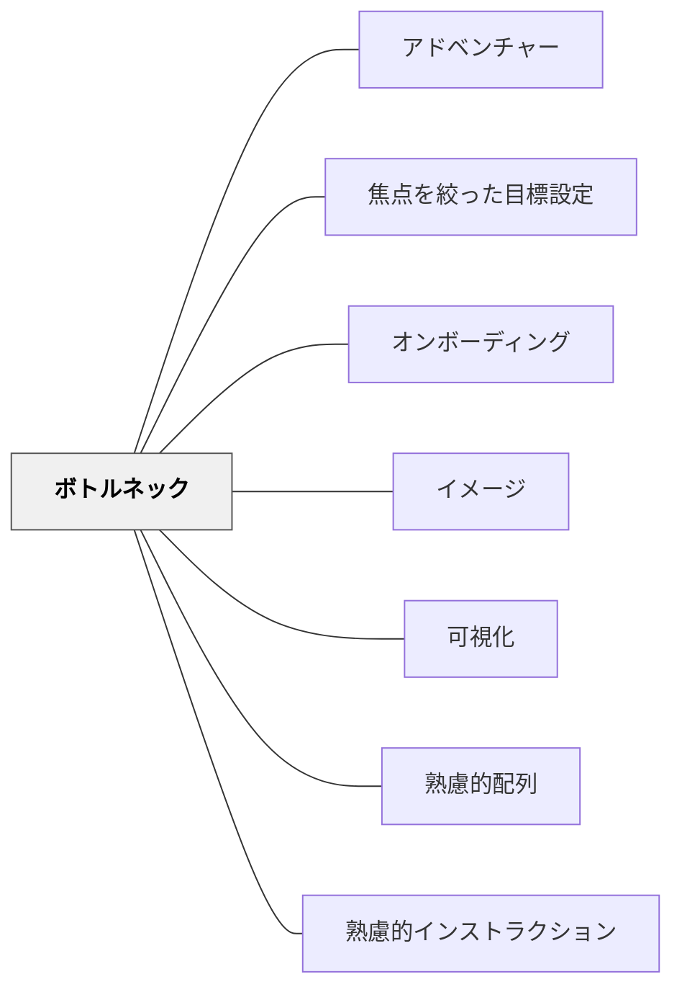

# ボトルネック

**このパタンが完成を助ける大きなパタン**：[[パタン/熟慮的配列]]

> まずはボトルネックを見つけよ。教育には、結果を決定づけるボトルネックとなる場所（こと）がある。

## Pattern Connection

### 岩井輝久（2023）——ボトルネックを起点にパタンを設計する

> 「重要なパタンはボトルネックに対応している。ここは間違いなさそうだ。だからボトルネックとなるものは何かまず考えてみつける方向で良い。ボトルネックに対応するパタンを取り上げる。それを胚細胞的概念のカテゴリーで整理していく感じかな。」（岩井輝久、2023）

- **既存パタンとの関連**：解決セクションに「大きなパターンはボトルネックに対応している」として記述されているが、このツイートはその逆方向の設計論を明示する——「ボトルネックを先に見つけ、対応するパタンを選ぶ」という出発点の転換
- **補強された点**：パタン・ランゲージをどう設計するかという問いへの答えとして、「まずボトルネックを見つける」という方向性が明確になった。パタンから入るのではなくボトルネックから入る——これにより教育設計の優先順位が定まる
- **修正・拡張された点**：「胚細胞的概念のカテゴリーで整理する」という方針が加わった。ボトルネックを特定したあと、それを胚細胞的概念（大パタン）として束ねていく設計論として読める
- **他のパタンへの波及**：[[自分のパタンを作る]]（「ボトルネックを起点にパタンを設計する」はパタンの作り方の実践的方針）・[[パタン/キーコンセプト（胚細胞的概念）]]（ボトルネックを胚細胞的概念として束ねる整理との接続）

---

## 背景（Context）

教育についてたくさん学んでも、実際に使うアイデアはごくわずかだ。他の学校や他の人の授業を見る、教育書を読むなどして様々なアイデアをインプットする。その中でも**決定的に結果を左右することを見極めること**が大切だ。

学んだことの中から良さそうなことを試してみる。局所的には効果が見られるが、全体的にはうまくいかない——教育を改善するときに闇雲に修正しても効果は上がらない、そういう状況がある。

## 問題（Problem）

どこを改善しても結果が変わらない、あるいはある部分だけ良くなっても全体が改善しない。それは改善すべきボトルネックを見極めずに修正しているからではないか。

## 力のかたち（Forces）

- 教育には目に見えにくい部分が多く、どこが結果を左右しているか気づきにくい
- 局所的な改善（細かい工夫）は手がつけやすいが、ボトルネック以外の改善は効果が限定的
- ボトルネックを外したまま他をいくら磨いても、全体の結果は変わらない
- 著しく良い結果を出している授業と悪い授業は、ボトルネックの状態が違う

## 解決（Solution）

**まずはボトルネックを見つけよ。**

**近いパタンとの見分け**：配列・順序の表では、本パタンの見分けの問いは「結果を決めているいちばんの詰まりどころを、最初に見つけているか」。全体の表は [[パタン/熟慮的配列#近いパタンとの見分け|熟慮的配列]] にある。

**ボトルネック**とは、システムのパフォーマンスを決定づける場所の名前だ。語源はボトル（瓶）のネック（首）——瓶に入った水を出そうとするなら、その瓶の首の太さが水を出す時間を決定づける。水をすぐに出したいなら、瓶の首を太くすればよい。教育においても、**結果を決定的に左右する場所・こと**がある。

---

### 教育のボトルネック例

動画では以下がボトルネックになりうるものとして挙げられている：

| ボトルネック | 内容 |
|------------|------|
| **イメージ** | どのようなイメージがあるのか。良いイメージを持たずに学ぶのはどこへ行くのかも分からずに船出するようなもの |
| **目的・目標** | 何のために学ぶのかが明確になっているか |
| **配列** | どのような順番にしたら結果が変わるか |
| **感情** | 学習者の感情状態が学習を支えているか |
| **思考** | どのような思考が促されているか |
| **ソーシャル** | 人間同士のインタラクティブな部分がうまく機能しているか |
| **習慣** | その学級・子どもたちにどのような習慣があるか |
| **制限（無制限になっていないか）** | 学習の範囲・量が適切に絞られているか |
| **深さ** | 表面には見えていないが影響している部分 |
| **指示・説明** | 指示がどうなっているか。うまい指示・下手な指示は露骨に結果に現れる |
| **質問・発問** | 教師から生徒への発問、生徒から生まれる質問がどうなっているか |
| **学習環境** | 物理的・社会的な学習環境が学習を支えているか |
| **評価** | 学習の進みをどう見取り、どうフィードバックしているか |
| **オンボーディング** | 学習者がその学習の土台に乗れているか。全員が学習に参加できる土台が整っているか |

---

### 具体例①：イメージというボトルネック

何を学ぶ・身につけるにしても、**良いイメージを持たずにうまく学ぶことはできない**。良いイメージを持たずに学ぶのはどこへ行くのかも分からずに船出するようなものだ。

→ 1つの授業の見通し（イメージ）を持てること、ゴールの姿をイメージできるように足場がけすることが、このボトルネックの修正につながる。

---

### 具体例②：指示というボトルネック

**指示もボトルネックだ。** うまい指示・下手な指示は、露骨に結果に現れる——自分でも「うまくいかなかった」「うまくいった」と即座に分かるほどに。的確に指示するには、状況に応じたパターンがある。

---

### 「大きなパターン」はボトルネックに対応している

このパターンランゲージの中でも**「大きなパターン」**と呼ばれるもの——可視化・イメージ・配列・オンボーディングなど——は、教育のボトルネックの改善に対応している。肝心のパターンがボトルネックを修正するものになっているのは偶然ではない。

---

### 動画後半：授業研究での経験（岩井）

10年以上教育現場で仕事をしてきて、**結果を大きく左右するところは本当にある**という実感がある。

授業研究でフィードバックをいただくとき、指摘されるのはたいていボトルネックに当たる部分だ——「こうした方がいい」「ああした方がいい」という言葉が、それを指している。

ボトルネックになる部分をちゃんとどうにかしないと、いくら細かい改善をしてもやっぱり変わらない。**「そこを外してしまっては、結果がよくならない」**——そういう失敗を繰り返して、ボトルネックを見極めることが教育設計の肝なのだと分かってきた。

うまくいかないときには、「どこか決定的に大事なところを外しているんじゃないか」と振り返る。その視点を持ち続けることがボトルネックを見抜く力につながっている。

### 岩井の原稿から（ボトルネック）

（原稿のうち、すでに本ページの上の節にそのまま入っている段落は、ここでは繰り返さない。）

教育についてたくさん学んでも、実際に使うアイデアはごく僅かだ。他の学校や他の人の授業を見る、教育書を読むなどして、さまざまなアイデアをインプットする。その中でも決定的に結果を左右することを見極めることが大切だ。

学んだことの中から良さそうなことを試してみる。局所的には効果が見られるが、全体的にはうまくいかない。教育を改善するときに、闇雲に修正しても効果は上がらない。

教育という現象には、ボトルネックと呼べる場所がある。

ボトルネックとは、システムのパフォーマンスを決定づける場所の名前である。ボトルネックの元々の意味は、瓶（ボトル）の首（ネック）。瓶に入った水を出そうとするなら、瓶の首の太さが水を出す時間を決定づける。もし水をすぐに出したいなら、瓶の首を太くするべきだろう。

教育においても、その結果を決定的に左右する場所（こと）がある。

わたしたちは、著しくよい結果を出している学校や授業を見ることがある。その逆もある。それらの学校や授業のボトルネックはどこにあるのだろうか。

例えば、何を学ぶ、身につけるにしても、よいイメージをもたずにうまく学ぶことができるだろうか。よいイメージをもたずに学ぶのはどこに行くのかも分からずに船出するようなものだろう。イメージは、教育のボトルネックとなる。一つの授業の見通し（イメージ）を持てること、またゴールの姿をイメージできるように足場がけすることなどがボトルネックの修正につながる。指示はボトルネックだ。上手い指示、下手な指示は、露骨に結果にあらわれる。的確に指示するには、状況に応じたパタンがある。

教育には、結果を決定づけるボトルネックとなる場所（こと）がある。「オンボーディング」「ソーシャル」「制限化」「可視化」「習慣化」「イメージ」など、肝心のパタンは、ボトルネックの改善に対応している。

#### 教育のボトルネック

　・イメージ

　・目的（目標）

　・配列

　・感情

　・思考

　・ソーシャル

　・習慣

　・無制限

　・不可視

　・指示・説明

　・質問（発問）

　・学習環境

　・評価

　・オンボーディング

（以上、岩井の原稿「教育のパタン・ランゲージ 集約」の「パタン　ボトルネック」から。）

### 岩井の原稿から（パタン・ランゲージに関するツイート：ボトルネック）

#### ボトルネック　固定化

ボトルネックは技術用語で全体の結果を大きく左右させる要因となるもの（これも問うべき教育設計の大事なパタンですね）。教育設計でその一つに固定化がある。固定化は習慣を生み出す。いわゆる自動化、習慣化につながるもので、僕たちも子どもたちも考えないでやれることは多い（実際に考えてやっていることは、考えないでやることよりも少ない）。その習慣化された部分をどのように作っていくかということか、何を習慣するか（内容）などが大きく教育の結果を変えていくのは間違い無いだろう。

自動化することで、本当に考えるべきことに被教育者は集中できるようになる。

教育パタンというのは、大きなパタンから小さなパタンまで確実に教育に影響を与えている。どちらかということなく、一つ一つのパタンが関係し合って教材や被教育者など具体と共に全体を織り成し、大きなパタンも小さなパタンも互いに力をもっている。

技術者の用語に「ボトルネック」というものがあるらしい。一つの要因でものすごく結果を変化させるようなものを意味するらしい。僕は、何がボトルネックなのか問うことを大切にしています。人生でも仕事でも。でも、これは自然に脳みそがやってくれることなのかな。そう思ったけど、こういうことも自分は自覚的にやりたいので、「ボトルネック」という概念だったり、自覚的にボトルネックは何だろうかと問うことだったりには、大きな意味があります。ボトルネックは、パタン・ランゲージを作ることそのものに繋がる概念であり問いとなります。

https://gakumado.mynavi.jp/freshers/articles/43640

仮に教育設計にもボトルネックと呼べる場所があるならば、そのボトルネックを改善するパタンは、規範的な意味を持つだろう。

教育のパタン・ランゲージで、ボトルネックに対応する大きなパタンとして、かなりシンプルに大きなパタンで整理できるかもしれない。小さいパタンは多いし、実践例は無数にある。大きなパタンで、使い勝手の良いハンガー掛けを作ること。

ボトルネックという技術概念が大きかった。ここの改善として大きなパタンにまとめることができそう。

無制限とか、不可視っていうような否定系の接頭語をつけることによって表せる教育のボトルネックがあることが、発見というか気づき、というか明確になりました。他にもないかな。

ハイデガー的にいうと不安か。ボトルネックって、ニュートラルではなくて否定的な意味で使われることがある。安心（安全）よりも、不安の方がいいのかもしれない。ここの改善のために色々なパタンがあるわけだ。この世界に生まれ落ちた時から不安が完全にないということはない。ボトルネックの言葉としては、ニュートラルか、不安、無制限、不可視などの否定系の言葉もいいのかもしれない。どちらにしても、ボトルネックは、パタン・ランゲージのカテゴリーになってくれそうです。

ボトルネックが教育パタンのカテゴリーになるかと思ったのですが、ならないな。ある教育パタンは、記憶と思考に効く。ピップエレキバンは、肩と腰に効くみたいなwボトルネックに効果があるのがパタンなんだな。時にその効果は複数のボトルネックに効く。

複雑な関係で他の場所に間接的に影響があるのは当たり前か。特に制限化（無制限）に関しては、かなり抽象度の高い概念で、どれにも関係してきそう。例えば質問するというのは思考に方向性を与えるもので、制限していくものだ。可視化（不可視）も多くに関係していくる。

配列のパタンは確実にあるし、指示のパタンもある。配列も指示も教育パタンのカテゴリーになる。配列のパタンがあって、説明にもパタンがあるけど、配列のパタンが説明にパタンに組み込まれていくということなど、そういうことがあるんだな。

不可視と無制限というのは、何も文化がないところに部分として自然にあると仮定できるものだ。生まれた時から死ぬことが決まっているという意味では、私という現象は、制限的、有限的なのだ（つまり無制限ではない。しかし文化のないところに無制限は部分的にあるのだ）。

ボトルネックでカテゴリー分けするのがそもそも無理なのかもしれない。ゲームの要素って、思考、感情、記憶、どれにも作用する。

ボトルネックと胚細胞的概念は、重なるところもあるけど、区別した方がいいのか。まあ、違うか。重なるところはあるんだけど。

重なったとしても、カテゴリーごとにリスト化した方が使いやすいものになると思う。自分はもっとも使いやすいものにまずはしていくことかな。

重要なパタンはボトルネックに対応している。ここは間違いなさそう。だからボトルネックとなるものは何かまず考えてみつける方向で良い。ボトルネックに対応するパタンを取り上げる。それを胚細胞的概念のカテゴリーで整理していく感じかな。

教育パタンの胚細胞的概念（大きなパタン）があるとしたら、それはボトルに対応するものとなりそうだ。

国語は全ての教科の基本となるものだと言われるけれど、確かに話す、聞く、読む、書く、どれも教育のボトルネックとなる。それぞれのボトルネックでどれだけ子どもたちが楽しく力を伸ばしていけるように教育を設計できるか。

教育のボトルネックはいくつもあるけど、それぞれのボトルネックを貫いているような教育パタンがある。パタン・ランゲージを作っていて、そういうことに気付けるのもかなり大きいと思います。

それぞれの教育のボトルネックを貫いていくようなパタンがあるので、それらが重なるのは妥当。指示なら指示、ゲームならゲームというそれぞれのボトルネックの中で重なりがせめてないようにすること。

聞くは、ボトルネック。制限化とか可視化とか大きなパタンが使われている。大きなパタンというのは、さまざまなボトルネックを貫いて出てくる。

https://www.amazon.co.jp/全員を聞く子どもにする教室の作り方-多賀-一郎/dp/4654018735/

おそらく、国語の授業が上手い人は学級経営も成功しやすいと思う。これだけだと無理かもしれないけど、国語で扱う話す、聞く、読む、書くという領域は、それぞれボトルネックで、教育の結果は大きく左右するところだから。

教育のパタン・ランゲージのパタンのカテゴリーになるものが区別できてきた。とりあえずこの三つは整理する時に有効だと思う。①大きなパタン（大きなパタンに小さなパタンが含まれる）②胚細胞的な概念（教育材料や評価や目的など）③ボトルネック（聞くなど、教育の結果を大きく左右する領域）

「教育のパタン・ランゲージのパタンのカテゴリーになるものが区別できてきた。とりあえずこの三つは整理する時に有効だと思う。①大きなパタン（大きなパタンに小さなパタンが含まれる）②胚細胞的な概念（教育材料や評価や目的など）③ボトルネック（聞くなど、教育の結果を大きく左右する領域）」

大きなパタンというカテゴリーはこれは必要。まず教育設計上、具体的な状況と一緒に考えるのは、この視点のレベルでどうなっているか、またどうするか。胚細胞的概念が教育というテーマの中には間違いなくある。その評価とか教材といったカテゴリーの中でパタンが色々あることも間違いない。ボトルネックも教育というテーマには存在する。聞くことができない個人、集団は教育に何もできない。そういう聞くのような結果を大きく左右する領域が複数ある。その領域の改善は、確実な教育改善に繋がることが観察できる。運用上どうか。大きなパタンというカテゴリーは欠かせない。胚細胞的な概念とボトルネックに含まれるカテゴリーについても、設計上、欠かすことができない。動機付けは、ボトルネックであり、胚細胞的概念でもあるところ。大きなパタンが何度も、そういった胚細胞的概念やボトルネックで登場することは避けられない。大きなパタンは、複数の領域を横断して働くからだ。大きなパタンは、それらが一つ一つカテゴリーになる。リストが冗長になってくるのは避けられないので、大事なのは、大きなパタンのリストだけでも一覧した時に教育設計に役立つ視点になっているかということ。そこで、さらに詳しく見たい場合に一つの一つの大きなパタンに含まれる小さなパタンを見る。また教育の問題状況、ボトルネックがあるから、そういったところでも、詳しく考えたい時には、それぞれの胚細胞的概念やボトルネックの概念に含まれる小パタンを考察することになる。

（以上、岩井の原稿「教育のパタン・ランゲージ 集約」の「パタン・ランゲージに関するツイート」から。）

## 結果（Consequences）

- ボトルネックを修正することで、細かい改善では得られなかった全体的な改善が生まれる
- どこに集中すべきかが分かり、教育設計の無駄が減る（教育の経済性）
- 良い結果を出している授業・学校のボトルネック状態を見る視点が育つ
- 失敗を「ボトルネックを外した」という視点で分析できるようになる

## 関連パタン
- [[パタン/アドベンチャー]]
- [[パタン/焦点を絞った目標設定]]

- [[パタン/オンボーディング]] — 学習者を土台に乗せるボトルネック
- [[パタン/イメージ]] — 見通し・ゴールイメージというボトルネック
- [[パタン/可視化]] — 学習の進みを見えるようにするボトルネック
- [[パタン/熟慮的配列]] — 順序・配列というボトルネック
- [[パタン/熟慮的インストラクション]] — 指示・説明というボトルネック

## クラスター図

## Actionable Insight

- 今の授業でうまくいっていない点を1つ挙げ、「そこを直したら全体が変わるか」と問い直す——局所的な改善より根本のボトルネックを特定する
- 「イメージ・目的・配列・感情・思考・ソーシャル・習慣・指示」の中から今の授業で最も弱い一つを選んで改善する
- 授業研究のとき「何が決定的に結果を左右したか」を一言で言える状態を目指す——それがボトルネックの特定につながる

## 出典
- [[文献/一つの教育のパタン・ランゲージ]]

結城浩（2021）『再発見の発想法』SBクリエイティブ  
岩井輝久「岩井輝久『一つの教育のパタン・ランゲージ』」（2026-04-29 vault収録）  
岩井輝久「パタン　ボトルネック（動画記録）」https://youtu.be/stbfaZ8kvQU
