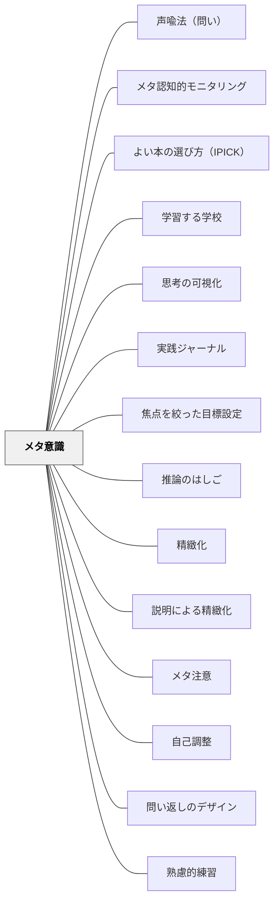

# メタ意識

**このパタンが完成を助ける大きなパタン**：[[パタン/自己調整]]

**一文でいうと**：自分の思考・感情・身体・関係の状態に気づき直す構えを、問いと言語化の場で育てる。

## 使いどころ・使いすぎ注意

| 観点 | 内容 |
| --- | --- |
| 使いどころ | 活動に夢中で、目的や前提を見失いがちなとき。振り返りが「楽しかった」で終わるとき。 |
| 使いすぎ注意 | 内面の言語化を常に求めない。学習の目的に役立つ気づきを扱う（下の Flavell の補足）。 |

## 背景（Context）

学習者が活動や思考を進める中で、**自分が何をしているのか・どんな状態にあるのか**を把握できないと、誤った理解や学びの停滞が生じやすい。教員にとっても、子どもの思考や感情の動きに気づくには、**自身の思考や指導の在り方を客観視する力**が必要である。

## 問題（Problem）

思考や行動に夢中になるあまり、**自分の状態・視点・前提・目的**に気づかずに活動が流れてしまう。その結果、学びが自己目的化したり、感情が置き去りになったりする。

## 力のかたち（Forces）

- 学びの場では、活動の没入と客観的な内省が同時に求められる
- 「自分の内面を見る」ことは訓練なしには困難
- 教師と子ども、子ども同士の相互関係の中で、"いま起きていること"をことばにする力が重要

## 解決（Solution）

自分の状態（思考・感情・身体・関係）を観察し、「気づき直す」構え＝**メタ意識**を育てる。

「いま、自分は○○しているな」「これって、〜だからかもしれない」と、**自分の認知・情動・行動を一歩引いて捉える**言語化の場面や問いを意図的に設ける。

**実践例：**
- 授業後のふりかえりカードに「今日の自分はどんなことに気づいた？」と問いを設ける
- 子どものつぶやきを拾い上げて「今のって、どんなことに気づいたの？」と返す
- 教師自身が「このとき、私はこう考えてたんだ」と自らメタ意識を言語化して見せる（モデリング）

**近いパタンとの見分け**：考え・気持ち・体を一歩引いて見る構えが本パタン。わかり具合を見て直す働きは [[パタン/メタ認知的モニタリング]]。自己調整の系列の全体の表は [[パタン/自己調整#近いパタンとの見分け|自己調整]] にある。

### 研究の裏づけ

> **研究の裏づけ**：英国 EEF のメタ認知と自己調整の指針（2018）は、計画・点検・評価の方略を、教科の内容と課題の中で明示的に教えるよう勧め、「学び方を学ぶ」別の時間で教える効果の根拠は乏しいとする。メタ認知は年長の子だけのものではなく3歳でも見られるが、自分の知識の見積もりは8歳ごろまで楽観的で不正確である。初学者には、課題の最中ではなく、終えてからふり返るほうがよいかもしれない。子どもは一夜漬けでも「よく学べた」と感じやすく、フィードバックを与えるだけでは判断のずれは減らなかった（pp. 10, 15, 17, 24）。出典：[[文献/メタ認知と自己調整を教科の中で育てる（英国EEF2018）]]。

> **研究の裏づけ**：子どもが「考えること」をどうとらえているかは、概念地図で見える形にできる。3〜11年生239人の地図では、方略を書いた割合が3・4年 16.47%、5・6年 23.09%、7〜11年 41.02% と学年で増え、年少の子の多くは「いつ・どこで・何について考えるか」を書いた。感情や意欲にかかわる項目はどの学年にも出た（表1、pp. 155, 157）。思考を見える形にする学級で1年過ごすと、方略の割合はさらに増えた（比べる群なし）。出典：[[文献/思考を見える形にする学級で1年過ごすと、子どもの「考えること」のとらえ方が変わるかを確かめる（Ritchhartほか2009）]]。

> **研究の裏づけ**：自分の学び方に気づき、方略をいつ・なぜ使うかを知り、計画・点検・ふり返りをする力（メタ認知）を教える取り組みは、教え終えたあとも効果が残る。1〜8年生の48の取り組み（36論文）のメタ分析では、学力への効果は教え終えた直後に g = 0.50、平均21.6週後の追跡テストで 0.63 だった（p. 106）。直後から追跡への伸び（0.12）は有意だったが、極端な値を置き換えずに分析すると p = 0.056 でわずかに有意でなかった（p. 110）。「残る」は確かだが、「さらに増える」はまだ弱い。くり返し覚える方略を教えた取り組み（3つ）は伸びが小さかった。出典：[[文献/学び方の方略を教えた効果は、教え終えたあとも残るかを48の取り組みから確かめる（deBoerほか2018）]]。

> **研究の裏づけ**：自分の学びの見積もりは当てにならない。読み返した学生と自分でテストした学生を比べると、2日後・3週間後には自分でテストした学生のほうがよく覚えていたのに、「よく学べた」と感じていたのは読み返した学生のほうだった（p. 10）。学習方略の総説は、学生はたいてい自分の学びをうまく判断できないとし、要約する・概念地図をつくる・自分でテストする、といった方法が、自分の理解の見積もりを正確にする助けにもなると書く（p. 18）。主に大学生の研究である。出典：[[文献/学んだことを自分で作り変える八つの学び方は、だれに・どんな条件で効くかを整理する（FiorellaとMayer2016）]]。

> **研究の裏づけ**：メタ認知を教えるときの条件として、学校でメタ認知を教える研究51本を見直した Perry ほか（2019）は、Veenman らの研究から三つを挙げる。独立した「メタ認知の授業」ではなく教科の中に組み込む、メタ認知の部分も含めて学ぶねらいを子どもに説明する、長い期間続ける、である（p. 15）。教師が自分の考える過程をやって見せることの大事さにも触れる（p. 24）。ただしこの論文は文献の見直しで、効果の数字は既存のメタ分析からの引用である。幸福感への効果は、教室での研究がほとんどなく大半が実験室の研究だと著者自身が書いている（p. 19）。メタ認知の測り方の多くが子どもの自己報告に頼ることも、大きな限界とされる（p. 20）。出典：[[文献/学校でメタ認知を教えると、学力と幸福感はどう変わるかを、51の研究の見直しから考える（Perryほか2019）]]。

## 結果（Consequences）

- 学習が「ただの活動」ではなく、「意味づけされた経験」になる
- 子どもが自己理解と他者理解の回路を持ち始める
- 教師も実践に対する自覚的な立場を持てるようになる
- メタ意識の共有によって、教室が「気づきの交差点」になる

## 注記

[[パタン/メタ注意]] は「注意に注意を払う」という実践的な操作面に焦点を当てたパタン。メタ意識はその上位の構えとして、自己の状態全体を俯瞰する視座を指す。

---

## Pattern Connection

**研究からの補足：理解の点検を次の行動につなぐ（Flavell1979）**

Flavell（1979, pp. 907–908）は、人・課題・方略に関する知識と、その時に意識される認知的経験を区別しつつ、両者が関わると説明する。Wiki側の適用案として、「何となく難しい」という気づきに「どの語・関係・手順が難しいのか」を一つ添え、調べる場所を選ぶ。内面の言語化を常時求めず、学習目的に役立つ気づきを扱う。本Wikiの身体や関係まで含むメタ意識全体を、この論文の概念と同一視しない。 出典：[[文献/理解の点検を次の行動につなぐ（Flavell1979）]]。

**Senge et al.（2000/2012）統合：**

*Schools That Learn* のメンタル・モデル（Mental Models）ディシプリンは、本パタンの実践的拡張として機能する。

- **補強された点**：本パタンが「自分の状態・思考・感情を観察する構え」を扱うのに対し、メンタル・モデルのディシプリンはより具体的に「無意識の仮定・前提・信念を表面化し検討する」ことを目的とする。メタ意識は「気づくこと」を、メンタル・モデルは「気づいた後に検討・修正すること」を強調する。
- **接続した概念**：[[パタン/推論のはしご]] — 推論のはしごは「自分のメタ意識を可視化する最も具体的なツール」。はしごを描くこと自体がメタ意識の練習になる。Left-Hand Column演習は「自分が話したこと」と「考えていたこと」のギャップを書き出す形でメタ意識を構造化する。
- **他のパタンへの波及**：[[パタン/ダイアログ]] では「仮定を宙吊りにする」実践が、集団レベルでのメタ意識として機能する。

## 関連パタン
- [[パタン/声喩法（問い）]]
- [[特別支援/特別支援級の算数指導]]
- [[パタン/メタ認知的モニタリング]]
- [[パタン/よい本の選び方（IPICK）]]
- [[パタン/学習する学校]]
- [[パタン/思考の可視化]]
- [[パタン/実践ジャーナル]]
- [[パタン/焦点を絞った目標設定]]
- [[パタン/推論のはしご]]
- [[パタン/精緻化]]
- [[パタン/説明による精緻化]]

- [[パタン/メタ注意]] — 注意に注意を払うことで集中力を育む（実践的操作版）
- [[パタン/自己調整]] — 学習者が自分の学習を調整する力
- [[パタン/問い返しのデザイン]] — 子どもの発言を深める問い返し
- [[パタン/熟慮的練習]] — 意図的な目標と振り返りをもった練習
- [[概念/メタパターン]] — 文脈依存的なパタン活用の視点
- [[概念/思考の三層（科学・論理・メタ）]] — メタの層の哲学的基盤
- [[パタン/制作しながら質を判断する（産出中のモニタリング）]] — 一歩引いて自分を見る力が、作品を作っているただ中で働く場合（Sadler, 1989）

- [[概念/自己調整学習の内側（成長の道とウェルビーイングの道）]] — 自己調整の統制・監視の機能を、モデルの中に位置づける
- [[文献/理解の点検を次の行動につなぐ（Flavell1979）]] — 気づいた感覚と、認知について持っている知識を区別する。
- [[文献/メタ認知と自己調整を教科の中で育てる（英国EEF2018）]] — メタ認知の方略を教科の中で教える英国の指針。年齢と自己判断のずれ
- [[文献/思考を見える形にする学級で1年過ごすと、子どもの「考えること」のとらえ方が変わるかを確かめる（Ritchhartほか2009）]] — 子どもの「考えること」のとらえ方を概念地図で見える形にする
- [[文献/学び方の方略を教えた効果は、教え終えたあとも残るかを48の取り組みから確かめる（deBoerほか2018）]] — メタ認知の方略を教えた効果は、教え終えて平均21.6週後も残った（1〜8年生・48の取り組み）
- [[文献/学んだことを自分で作り変える八つの学び方は、だれに・どんな条件で効くかを整理する（FiorellaとMayer2016）]] — 学生は自分の学びをうまく判断できない。生成的な方法は見積もりを正確にする（総説）
- [[文献/学校でメタ認知を教えると、学力と幸福感はどう変わるかを、51の研究の見直しから考える（Perryほか2019）]] — メタ認知を教科の中に組み込み、ねらいを説明し、長く続ける（文献の見直し）
- [[文献/学び方の方略は、学びのどの段階で使うかで効き方が変わるかを、228のメタ分析から整理する（HattieとDonoghue2016）]] — 学び方の方略は、教科の中で、いつ使うかとともに教える

## クラスター図

## Actionable Insight

- 授業の振り返りで「今日気づいたこと」に加えて「自分が何を感じていたか」を1行書く欄を設ける——認知だけでなく情動も含めたメタ意識を育てる
- 教師自身が「今先生はこう考えていたんだ」と声に出してモデリングする——教師のメタ意識の言語化が子どもにとって最も強いモデルになる
- 子どものつぶやきに「今のって、どんなことに気づいたの？」と返す——発言を深める問い返しがメタ意識の芽を育てる

## 出典

- パタン集/メタ意識.md
