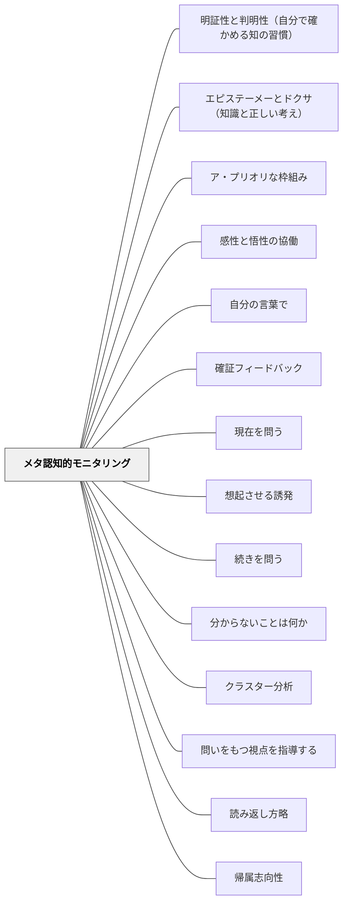

# メタ認知的モニタリング

> 「今どのくらいわかっているか」を知ることが、自己調整の出発点となる。

## [Pattern Connection]

**原典の接続（2026-10-14）**：想起テストによる長期保持（RoedigerとKarpicke2006）を参照し、主観的な自信を実際の保持で確かめるための補足を本ページに加えた。

**原典の接続（2026-10-14）**：自己調整学習の六モデル（Panadero2017）を参照し、モニタリングを基準との照合と行動変更に接続するための補足を本ページに加えた。

Harvey & Goudvis（2007）の **Strategies That Work** は、読書における「モニタリング」を「Huh?」コードという具体的な実践ツールとして提供する。「自分の理解が崩れた瞬間に気づき、記録する」という行為そのものが、このパタンの解決策を読書指導の文脈で体現している。

- **補強点**：「わからない」を声に出す・記録することを教室文化として許可することの重要性。「先生も Huh? になる」とモデリングすることが最も効果的
- **拡張点**：モニタリングは「授業の終わりに理解度を問う」だけでなく、**読書中・活動中にリアルタイムで起きる**——混乱の瞬間を捉えることが鍵
- **他のパタンへの波及**：[[パタン/シンクアラウド]]・[[パタン/読みとつながる]]・[[実践/テキストコーディング]]

**Weinstein & Sumeracki（2018）統合（2026-05-20）：**

*Understanding How We Learn*（東京書籍, 2022）は、メタ認知に関わる3つの話題（マインドワンダリング・流暢に読める感覚・確証バイアス）を扱う。「メタ認知失敗を3つの形で整理」するのは本Wikiの整理であり、本書の枠組みではない。

- **マインドワンダリング（Mind-wandering）**：学習中、注意が課題から離れてさまよう現象。本書は、平均を出すのは困難で役に立たないとしつつ、**約半分の生徒が教師の話に注意を向けられていない**ことを示唆する研究（Smallwood et al., 2007）を挙げる（「30〜50%」は本書の記述ではない）。自分が「学んでいる」と思っていても注意が外れている——これはメタ認知的モニタリングの失敗の最も一般的な形。対策として「授業中に頻繁に問いを挟む（[[パタン/テストを繰り返す]]）」が考えられる（本Wikiの提案）。
- **流暢性の錯覚（Illusion of Fluency）**：教科書やノートの繰り返しの読み直しは、流暢に読めても深い理解や将来の使用につながらない（ch.3。蛍光ペン・単語の反復書きは本書の記述ではなく、「流暢性の錯覚」の語も本Wikiの用語）。テキストを見ながら「これは知っている」と感じる流暢性が、記憶の強さと混同される。診断する問いは「**教科書を閉じて再現できるか？**」——[[パタン/テストを繰り返す]] の **フリーリコール** がこの錯覚を解除する最も効果的な手段。
- **フリーリコールとメタ認知**：何も見ずに白紙に書き出す自由再生は、単なる記憶練習を超えて「脳が何を知っていて何を知らないか」を正確に明示する——これは本パタンの「自己評価・振り返り」の最も強力な実装形式。「書けなかった部分＝まだ学んでいない部分」が一目で分かる。
- **WOOP戦略（Fallon, 2017）との接続**：本書（ch.11）は、学習計画を先延ばしにしない方法として **W**ish→**O**utcome→**O**bstacle→**P**lan を紹介し、障害を克服できる具体的な計画を立てることが重要だと述べる。障害を考えることに学生が苦労した、という記述もある。「障害の同定（O）」が自分の学習状態を現実的に評価するメタ認知を必要とする、という見方は本Wikiの読みである（Oettingen、if-thenプラン、ポジティブシンキングへの言及は本書にない）。
- **確証バイアス（confirmation bias）**：自分の学習法の選択も認知バイアスの影響を受ける——「自分は視覚型だから」という学習スタイル信念が反証を無視させ、非効率な方法を使い続ける原因になりうる（この例とメタ認知失敗としての位置づけは本Wikiの読み。本書は確証バイアスを、学習法の選択を歪める一般的なバイアスとして述べる）。

接続するパタン：[[パタン/テストを繰り返す]]（フリーリコール）、[[パタン/望ましい困難]]（困難感と実際の学習の乖離）、[[概念/認知負荷理論]]（マインドワンダリングへの対策）

---

**牧口常三郎（1931）——自覚と他覚：メタ認知には自己評価と他者評価の両方が必要**

*創価教育学体系 第2巻* の人格価値論は、自己の価値を正確に認識するには「自覚」と「他覚」の両方が不可欠だと論じる。これはメタ認知的モニタリングの原理を価値評価の文脈から補強する。

> 「正当の人格価値はこの自覚と他覚の両方を取捨選択し較べ合わせ、質を量に量を数に換算して、而して後に判断したものでなければならぬ」

| 評価の種類 | 内容 | 偏ると生じる問題 |
|---|---|---|
| **自覚** | 自己による自己の評価・反省 | 過大→自惚れ、過小→自己否定 |
| **他覚** | 他者による自己への評価の認識（他者の評判） | 追従・過剰同調、または他者評価の無視 |

**教育実践への含意**

この「自覚と他覚」の対は、現代の学習科学における「自己評価（self-assessment）」と「外部フィードバック」の必要性を先取りしている。

- 自覚のみ（自己評価だけ）では流暢性の錯覚（「わかった気がする」）が修正されない
- 他覚のみ（教師・仲間の評価だけ）では、自律的な学習者が育たない
- 両者を照合する習慣が、メタ認知的精度を高める

「教科書を閉じて再現できるか（自覚）」＋「仲間に説明できたか・教師からのフィードバック（他覚）」を組み合わせることが、牧口の原理とフリーリコールが合流する実践ポイントである。

- **他のパタンへの波及**：[[パタン/価値]]（評価作用の本質）・[[パタン/フィードバック]]（他覚の制度的実装）

---

**Harvey & Goudvis の「Huh?」コード：**
読書中に理解が崩れたとき、付箋に「Huh?」と書いてテキストに貼る。子どもが混乱したポイントを可視化することで：
- 混乱が「恥ずかしいこと」でなく「普通のこと」になる
- 後で戻って読み直すための「マーカー」になる
- 教師が「どこでつまずいているか」を見取れる

> 「Huh? の付箋が最も重要な情報を持っていることがある」——Harvey & Goudvis（2007）

**Fix-up Strategies（理解修復ストラテジー）：**

「Huh?」は理解崩壊の入口に過ぎない。その後「どうするか」——Fix-up Strategies が実質的な理解回復を担う：

| Fix-up Strategy | 使うとき |
|---|---|
| **読み直す（Reread）** | 早く読みすぎた・飛ばした可能性があるとき |
| **先を読む（Read ahead）** | 後で説明される可能性があるとき |
| **前後の文脈から推測する** | 知らない語・文章が出てきたとき |
| **図・グラフ・写真を見る** | ノンフィクションで文字だけでは分からないとき |
| **つながりをつくる（BK）** | 知っている経験・知識と結びつけるとき |
| **声に出して読む** | 黙読で意味が取れないとき |
| **背景知識を補給する** | 知識不足が原因の誤読のとき（Fix-up だけでは解決しない）|

**背景知識の欠落と誤読**：Fix-up Strategies の限界として Harvey & Goudvis が示す重要な指摘がある——語の意味を知らないまま読み進めると、理解が表面的に「成立している」ように見えて、実は根本から誤っていることがある。例えば "friar"（修道士）を知らずに読み続けると、読者は「何かを friar する人」として理解してしまい、その誤読の上に他の理解が積み重なる。こうした場合、Reread（読み直し）だけでは修復できない——語の意味・概念の背景知識を補給することが必要だ。これは [[パタン/背景知識]] と本パタンの交差点であり、「Huh?」の原因を見極める力が Fix-up 選択の前提になる。

### 牧口常三郎（1930）——「考え方を教えること」と認識先行モニタリング

牧口は *創価教育学体系 第4巻*（教育方法論）において、教育の中心課題を「what to think（何を考えるか）を教えること」ではなく「**how to think（どう考えるか）を教えること**」にあると主張した。これはメタ認知的モニタリングの教育的根拠を1930年代に独自に定式化したものとして読める。

**「考えよりは考え方を」**

牧口は、知識の量（内容知）より思考方法（方法知）を習得することが先決だと論じた。「何を学んだか」ではなく「どのように学び・考えたか」を意識させること——これはまさにメタ認知的モニタリングの日常化である。

**認識先行モニタリング：評価作用が「わかった気」を生む**

牧口が第4巻で示した「**認識作用と評価作用の区別**」（[[パタン/認識と評価の区別]]）は、メタ認知の精度に直接関わる重要な洞察を含んでいる。

学習者が自分の理解度をモニタリングするとき、「好き・嫌い」「難しい・簡単」「なんとなくわかった」という**評価的反応が先行すると**、実際の認識（何がわかっていて何がわかっていないか）が歪められる——これは **流暢性の錯覚（Illusion of Fluency）** と構造的に同じ問題である。

> 「あせりがちの評価作用を意力的に抑圧しておいて、飽くまで冷静着実なる科学的態度を以て臨む」——牧口常三郎

このことが実践に示すこと：「この単元はわかった（評価）」と思っていても、「どこが説明できるか・どこが言葉にならないか（認識）」を問うと実態が変わる。評価を保留して認識を先行させるモニタリングが精度を上げる。

**教師の研究への適用**

牧口はこの原則を授業観察にも適用した：授業参観で「あの授業はよかった・悪かった」という評価が先行すると、何が起きていたかの正確な認識が阻まれる。評価を後回しにして事実記述から始めることが「科学的態度」であると示した。これは教師自身のメタ認知的モニタリング（自分の授業観を観察する）を精度化する技法でもある。

- **他のパタンへの波及**：[[パタン/認識と評価の区別]]（このパタンのメタ認知応用として位置づく）・[[パタン/省察]]（認識先行の省察が「本当の省察」になる条件を共有）

---

## 研究の裏づけ（文献ごとの補足）

2026年10月に原典を確かめて足した補足をここにまとめた。どれも「原典で確かめられること」と「Wiki側の適用案」を分けて書いている。適用案は、原典でそのまま比較検証された手順ではない。解決・結果の節の中にある「原典による補足」は、その節の文脈に結びついているので元の位置に残した。

| 文献 | 追加日 |
| --- | --- |
| [[文献/メタ認知と自己調整を教科の中で育てる（英国EEF2018）]] | 2026-10-31 |
| [[文献/7〜14歳の算数の指導を研究から整える（英国EEF2017）]] | 2026-10-31 |
| [[文献/低学年の読みの基礎技能を研究から組み立てる（Foormanほか2016）]] | 2026-10-31 |
| [[文献/人の学び方の研究を授業の設計につなぐ（全米研究評議会2000）]] | 2026-10-31 |
| [[文献/算数の問題解決を4〜8年生で育てる（Woodwardほか2012）]] | 2026-10-31 |
| [[文献/推論と理解の点検から読解を捉える（Cainほか2004）]] | 2026-10-20 |
| [[文献/数学の問題解決で方略を選び直す（Schoenfeld1992）]] | 2026-10-19 |
| [[文献/理解の点検を次の行動につなぐ（Flavell1979）]] | 2026-10-19 |
| [[文献/学習への関与を行動と感情と思考から捉える（Fredricksほか2004）]] | 2026-10-18 |
| [[文献/その場のできと長く残る学習を分ける（SoderstromとBjork2015）]] | 2026-10-18 |
| [[文献/誤りを訂正につないで学ぶ（Metcalfe2017）]] | 2026-10-17 |
| [[文献/次の学びへの準備として転移を捉える（BransfordとSchwartz1999）]] | 2026-10-17 |
| [[文献/文字の読みと内容理解をつないで育てる（Castlesほか2018）]] | 2026-10-16 |
| [[文献/自己説明で知識のつながりをつくる（Chiほか1994）]] | 2026-10-16 |
| [[文献/概念理解と手続きを往復して育てる（RittleJohnsonほか2001）]] | 2026-10-16 |
| [[文献/小学生の自己調整学習を支える（Dignathほか2008）]] | 2026-10-16 |
| [[文献/思考過程を見せて支える認知的徒弟制（Collinsほか1987）]] | 2026-10-14 |
| [[文献/方略指導と実際の読書を結ぶ（DukeとPearson2002）]] | 2026-10-14 |
| [[文献/読解を読み手・文章・活動から捉える（RAND2002）]] | 2026-10-14 |
| [[文献/学習方法の効果と適用条件（Dunloskyほか2013）]] | 2026-10-14 |
| [[文献/対話で読解を育てる相互教授法（PalincsarとBrown1984）]] | 2026-10-14 |

**メタ認知と自己調整を教科の中で育てる（英国EEF2018）（2026-10-31）**

同じ財団のメタ認知の指針は、計画・点検・評価を教科の内容と課題の中で明示的に教えるよう勧め、図工の自画像を例に段階ごとの問いを示す。計画「前に自画像をかいてうまくいった？」、点検「顔の部分の釣り合いはとれている？ 途中で変えることは？」、評価「どの見方を選んだのはよかった？ 次はどうする？」（pp. 12–13）。メタ認知は教科の知識から切り離せないとし（p. 15）、初学者は課題を終えてからふり返るほうがよいかもしれないと書く（p. 17）。出典：[[文献/メタ認知と自己調整を教科の中で育てる（英国EEF2018）]]。

**7〜14歳の算数の指導を研究から整える（英国EEF2017）（2026-10-31）**

英国の算数の指針は、勧め5で、教師が問題を解きながら「この問題は何をたずねている？」「前に似た問題を見たことがある？ そのときどうした？」「図やグラフで表せる？」「読み直して、答えは意味が通る？」「助けや情報は要る？ どこで得られる？」と声に出して考えを示すよう勧める（p. 18、囲みF）。そのうえで注意を三つ挙げる。メタ認知が算数そのものへの集中を損なわないよう、早すぎ・多すぎを避ける。方略を身につけるには多くの授業で長い時間が要る。話し合いも教えなければうまくいかない（p. 19）。出典：[[文献/7〜14歳の算数の指導を研究から整える（英国EEF2017）]]。

**低学年の読みの基礎技能を研究から組み立てる（Foormanほか2016）（2026-10-31）**

実践ガイドの勧め4（根拠 moderate）は、読みながら意味が通るかを点検し、読み誤りを自分で直すことを教えるよう勧める。「直してみよう（Fix It）」ゲームでは、教師が「バスが角でふみました」のような意味の通らない文を読み、子どもがどこがおかしいかを言って直す。音読で誤ったときは、すぐ正しい語を言わず、子どもが読んだとおりに読み返して「意味が通る？」と聞き、慣れてきたらこの支えを減らす（pp. 34–35）。勧め4の三つの要素（語の読みの支え・この点検・フィードバックつきの音読）をすべて含んだ9研究は、おおむね正の効果を示した。点検の指導だけを取り出した研究ではない（p. 83）。出典：[[文献/低学年の読みの基礎技能を研究から組み立てる（Foormanほか2016）]]。

**人の学び方の研究を授業の設計につなぐ（全米研究評議会2000）（2026-10-31）**

報告書は、研究の基盤が固い三つの知見の第三に「メタ認知の指導が、学習目標を決めて進み具合を点検する力を育てる」を置く（p. 18）。ただし、メタ認知の方略は教科をまたいで共通ではなく、共通のものとして教えようとすると転移しないことがある、と注意する（p. 19）。点検の中身も教科で違う：歴史では「この資料を書いたのは誰で、それが出来事の解釈にどう影響するか」、物理では「働いている物理の原理を分かっているか」（p. 21）。熟達者の例では、リンカーンの専門でない歴史家が、最初の解釈では説明できないと気づき、自分が19世紀を知らないことを作業仮説にして学び直した（p. 47）。報告書は研究の統合であり、根拠の強さは示していない。出典：[[文献/人の学び方の研究を授業の設計につなぐ（全米研究評議会2000）]]。

**算数の問題解決を4〜8年生で育てる（Woodwardほか2012）（2026-10-31）**

米国教育科学研究所の実践ガイドは、「解く過程を点検し、ふり返るのを助ける」を5つの勧めのうち根拠が **strong** な2つの一つとした。4〜8年生の9研究すべてで、文章題を解く力に正の効果があった（問いかけの一覧・手順の一覧・教師が声に出して示す手本）。問いかけの例は「この問題は何をたずねている？」「前に解いたどの問題に似ている？」「行き詰まったら、ほかの考え方はある？」「その答えは意味が通る？」。ガイドは、問いかけは数個に絞る（多すぎると遅くなるか無視される）、慣れたら支えを減らす、と書く。成果の多くは文章題の正答で測られ、自己評価の正確さそのものを測った研究ではない。出典：[[文献/算数の問題解決を4〜8年生で育てる（Woodwardほか2012）]]。

**推論と理解の点検から読解を捉える（Cainほか2004）（2026-10-20）**

原典の理解点検課題は、文章中の不整合を検出する働きを調べる（p. 35）。Wiki側の適用案として、「分からない」という申告の後に、つながらない二つの記述を示してもらう。違和感に気づくことと、修復できることは分けて見る。 出典：[[文献/推論と理解の点検から読解を捉える（Cainほか2004）]]。

**数学の問題解決で方略を選び直す（Schoenfeld1992）（2026-10-19）**

Schoenfeld（1992, 公開稿 pp. 57–64）の議論をもとにしたWiki側の適用案として、算数の活動途中で「今分かったことは、求めたいことに近づいているか」を一度確かめる。その応答と途中の式を照合し、続行・修正・やり直しのどれを選んだか残す。点検の発言があったことと、行動が調整されたことを分けて見る。 出典：[[文献/数学の問題解決で方略を選び直す（Schoenfeld1992）]]。

**理解の点検を次の行動につなぐ（Flavell1979）（2026-10-19）**

Flavell（1979, pp. 906–909）は、認知活動の点検を、知識・経験・目標／課題・行動／方略の相互作用として捉える。Wiki側の適用案として、「分からない」という評定に、何を理解したいか、どこでつながらなくなったか、次に何を試すかを添える。点検回数や振り返りの長さだけで質を判断せず、試した後の説明や行動と照らす。 出典：[[文献/理解の点検を次の行動につなぐ（Flavell1979）]]。

**学習への関与を行動と感情と思考から捉える（Fredricksほか2004）（2026-10-18）**

原典は、認知的関与を自己報告で測る際の発達上の難しさと、課題が思考の機会を提供しているかという問題を指摘する（pp. 68–69）。Wiki側の適用案として、「工夫したか」に加え実際に読み直した箇所や理由を確かめる。説明できないことを直ちに方略の不使用と判断せず、問い方と課題の条件を見直す。 出典：[[文献/学習への関与を行動と感情と思考から捉える（Fredricksほか2004）]]。

**その場のできと長く残る学習を分ける（SoderstromとBjork2015）（2026-10-18）**

原典の区別（pp. 176–177, 189–190）を使い、Wiki側の適用案として、振り返りを「今は何を見ながらできたか」「後日何も見ずにどこまでできそうか」の二問に分ける。予想が外れたときは本人の能力の評価で終えず、練習方法を調整する材料にする。 出典：[[文献/その場のできと長く残る学習を分ける（SoderstromとBjork2015）]]。

**誤りを訂正につないで学ぶ（Metcalfe2017）（2026-10-17）**

原典は、高い確信を持った誤答が訂正されやすいハイパーコレクション効果を紹介する（pp. 6.8–6.9）。Wiki側の適用案として、答えと確信度を別々に聞き、自信のある誤答にも訂正情報を丁寧に返す。高い確信を頑固さの診断にせず、修正後の説明や再回答を確かめる。 出典：[[文献/誤りを訂正につないで学ぶ（Metcalfe2017）]]。

**次の学びへの準備として転移を捉える（BransfordとSchwartz1999）（2026-10-17）**

原典の評価例は、正誤と確信度に加え、どんな援助を求めるかを見る（公開著者稿pp. 31–33）。Wiki側の適用案として、「自信がない」の次に「用語の確認・例・手順の説明のどれが必要か」を尋ね、援助後の説明も確かめる。選べたことだけを理解の証拠にしない。 出典：[[文献/次の学びへの準備として転移を捉える（BransfordとSchwartz1999）]]。

**文字の読みと内容理解をつないで育てる（Castlesほか2018）（2026-10-16）**

原典はモニタリング課題の成績が、読解の過程だけでなく結果を反映しうると指摘する（公開著者稿p. 61）。Wiki側の適用案として、読後の「分かった」に加え、途中で立ち止まった箇所と読み直した理由を短く確かめる。 出典：[[文献/文字の読みと内容理解をつないで育てる（Castlesほか2018）]]。

**自己説明で知識のつながりをつくる（Chiほか1994）（2026-10-16）**

原典の自己説明は知識の構成を促す一方、誤った説明も生じる（pp. 470–471）。Wiki側の適用案として、「説明できなかった点」と「説明したが本文と合わなかった点」を分けて記録する。自己説明の量を理解度そのものの尺度にしない。 出典：[[文献/自己説明で知識のつながりをつくる（Chiほか1994）]]。

**概念理解と手続きを往復して育てる（RittleJohnsonほか2001）（2026-10-16）**

概念と手続きが部分的に育つという知見（p. 358）を参照する。Wiki側の適用案として、「できた」の振り返りに、実際に解いた問題と理由の説明を一つずつ添える。原典は自己評価の正確さを直接検証した研究ではない。 出典：[[文献/概念理解と手続きを往復して育てる（RittleJohnsonほか2001）]]。

**小学生の自己調整学習を支える（Dignathほか2008）（2026-10-16）**

原典は質問紙による測定の限界を論じる（p. 121）。Wiki側の適用案として、理解度の数字を聞いた後、「どこを読み直したか」「何が説明できるか」も確かめる。自己評価の高さだけで方略の習得を判断しない。 出典：[[文献/小学生の自己調整学習を支える（Dignathほか2008）]]。

**思考過程を見せて支える認知的徒弟制（Collinsほか1987）（2026-10-14）**

reflectionでは自分の過程を熟達者や他の学習者の過程と比較する（本文p. 17）。授業案として、同じ課題でどこに注目し直したかを振り返り、次に変える一手を決める。 出典：[[文献/思考過程を見せて支える認知的徒弟制（Collinsほか1987）]]。

**方略指導と実際の読書を結ぶ（DukeとPearson2002）（2026-10-14）**

教師は方略使用と内容理解の双方を継続的に確認し、子どもも自分の使用を見取る（p. 212）。授業案として「使った方略」と「それで分かったこと」を対にして記録する。 出典：[[文献/方略指導と実際の読書を結ぶ（DukeとPearson2002）]]。

**読解を読み手・文章・活動から捉える（RAND2002）（2026-10-14）**

読む目的に応じて処理やモニタリングの重要性は変わる（p. 15）。授業案として「今は何を知るために読んでいるか」を確認し、その目的に対して不足する理解を言葉にしてから読み直す。 出典：[[文献/読解を読み手・文章・活動から捉える（RAND2002）]]。

**学習方法の効果と適用条件（Dunloskyほか2013）（2026-10-14）**

分散学習の効果を経験しても、その利点を十分に認識しない場合がある（p. 39）。授業案として、取り組みやすさの自己評定と後日に思い出せた内容を別に記録し、次の復習計画を調整する。 出典：[[文献/学習方法の効果と適用条件（Dunloskyほか2013）]]。

**対話で読解を育てる相互教授法（PalincsarとBrown1984）（2026-10-14）**

要約できないことは採点だけの材料でなく、再読や明確化が必要だという手がかりになる（pp. 121–122）。授業案として「どこがつながらないか」を一箇所示し、読み直した後に意味を言い直す。 出典：[[文献/対話で読解を育てる相互教授法（PalincsarとBrown1984）]]。

## 背景（Context）
メタ認知的モニタリングとは、自分の学習状況・理解度・進み具合を観察・評価する能力。フラベルらのメタ認知研究に基づき、自己調整学習の中核的なプロセスの一つとされる。「わかった気がする」と「本当にわかっている」の差異を認識することが、効果的な学習の第一歩。

## 問題（Problem）
多くの学習者は自分の理解度を正確に把握していない（メタ認知的錯覚）。「わかった」と思って次に進むが、テストや応用場面でつまずく。自分の学習状態への気づきがないと、適切な自己調整もできない。

## 力のかたち（Forces）
- 理解度の自己評価は実際の理解度と一致しないことが多い
- モニタリングのスキルは明示的に教えることが有効
- 振り返りの時間と機会が設けられていないとモニタリングが起きにくい
- 外部からのフィードバックがモニタリングの精度を高める

## 解決（Solution）

> **原典による補足：観察を基準と調整へつなぐ（2026-10-14）**：Panadero（2017, pp. 10–15）の整理では、モニタリングは自己調整の一部であり、気づくだけで調整全体が完了するわけではない。WinneとHadwinのモデルでは、産物を基準に照らして評価し、方法や条件を変える。Wiki側の適用案として「わかった感じ」の自己評定に、実際の説明・読み違い・修復後の変化を添え、次に何を変えるかまで確かめる。出典：[[文献/自己調整学習の六モデル（Panadero2017）]]。

**学習のプロセスに定期的な自己評価・振り返りの機会を組み込み、「今どのくらいわかっているか」を学習者が意識的に点検できるようにする。読書中はリアルタイムで「Huh?」を記録し、Fix-up Strategies で理解を修復する。**

「今日の授業の理解度を1〜5で評価すると？」「まだわからない点は？」などの問いを授業の末尾に設ける。交通信号カード（赤・黄・青）などの可視化ツールを使う。定期的な自己テスト（検索練習）もモニタリングを高める。

読書場面では：
1. 混乱した瞬間に「Huh?」と付箋に書いてテキストに貼る——混乱を記録することで後から戻れる
2. 混乱の「原因」を見極める——語の意味が分からない？前後がつながらない？背景知識がない？
3. 原因に合った Fix-up Strategy を使う——語の意味不足なら辞書・前後文脈推測、背景知識不足なら外部知識の補給
4. 修復できたか確認する——「今、意味が分かる？」と自分に問い直す

### 研究の裏づけ

> **研究の裏づけ（2026-11-06）**：（文献の見直し）学校でメタ認知を教える研究51本（2000〜2017年）を見直した論文は、メタ認知が効く条件として、特別な時間ではなく教科の中に組み込むこと、メタ認知の部分も含めて学ぶねらいを子どもに説明すること、長い期間続けることを挙げ、教師がやって見せることを大事にする（pp. 15, 24）。小学生の自己調整学習の指導のメタ分析（Dignath ほか 2008）では、学力への効果は 0.62 だった。ただしこの見直しの効果の数字は新しく計算したものではなく、メタ認知の測り方の多くが自己報告に頼ること、指導・メタ認知の変化・学びの成果の因果関係はまだ確かめられないことを、著者ら自身が限界に挙げる。段は仮説。出典：[[文献/学校でメタ認知を教えると、学力と幸福感はどう変わるかを、51の研究の見直しから考える（Perryほか2019）]]。

## 結果（Consequences）

> **原典による補足：覚えているという予想のずれ（2026-10-14）**：RoedigerとKarpicke（2006, 表2・図2）は、再読を繰り返す大学生が1週間後の記憶に高い自信を持つ一方、実際の保持は想起テスト条件より低いことを示した。Wiki側の適用案として、自信の自己評定に、資料を閉じて説明した内容と後日の再現を添える。小学生でも同じ程度のずれが出る、あるいは自己テストだけでモニタリングが改善する、とこの実験だけからは断定しない。出典：[[文献/想起テストによる長期保持（RoedigerとKarpicke2006）]]。

- 自己の学習状態への正確な認識が高まる
- 「わからない」を早期に発見し、修正できるようになる
- 自律的な学習者の形成につながる

## クラスター図

## Actionable Insight

- 授業の末尾に「今日の理解度を1〜5で評価すると？まだわからない点は？」と問う——学習者が自己の学習状態を正確に把握できるようになる
- 交通信号カード（赤・黄・青）などで理解度を可視化させる——「わからない」を早期に発見し修正できるようになる
- 定期的な自己テスト（検索練習）を取り入れる——モニタリングの精度が上がり自律的な学習者が形成される
- 学習の途中で「今何をやっているか・なぜやっているか・うまくいっているか」の3問を自分に問わせる——作業に没頭したまま方向を間違え続けることを防ぐ
- 「わかった気がする」と「本当にわかった（説明できる）」の違いを子どもに問いかける——錯覚的理解に気づかせる最もシンプルな介入
- 単元後に「今回一番理解が深まった方法は何だった？」と振り返らせる——学習方略そのものを意識する習慣をつくる

## 関連パタン
- [[文献/算数の問題解決を4〜8年生で育てる（Woodwardほか2012）]] — 解く過程の点検（strong）。問いかけの一覧と教師の手本
- [[文献/小学生の自己調整学習を支える（Dignathほか2008）]] — 自己申告を実際の説明や行動と照合する。
- [[文献/人の学び方の研究を授業の設計につなぐ（全米研究評議会2000）]] — 中心的な知見3。メタ認知の方略は教科ごとに教える
- [[文献/低学年の読みの基礎技能を研究から組み立てる（Foormanほか2016）]] — 「意味が通る？」で読み誤りを自分で直す（勧め4・moderate）
- [[文献/7〜14歳の算数の指導を研究から整える（英国EEF2017）]] — 考えを声に出して示す問い。早すぎ・多すぎに注意（英国の算数の指針）
- [[文献/メタ認知と自己調整を教科の中で育てる（英国EEF2018）]] — 計画・点検・評価を教科の中で明示的に教える（英国のメタ認知の指針）

- [[文献/思考過程を見せて支える認知的徒弟制（Collinsほか1987）]] — 自分と他者の解決過程を比較する。
- [[文献/方略指導と実際の読書を結ぶ（DukeとPearson2002）]] — 方略を使った回数だけでなく理解への寄与を見る。
- [[文献/読解を読み手・文章・活動から捉える（RAND2002）]] — 理解の点検を読む目的と結びつける。
- [[文献/学習方法の効果と適用条件（Dunloskyほか2013）]] — 学習方法の選択を実際の保持と照合する。
- [[文献/対話で読解を育てる相互教授法（PalincsarとBrown1984）]] — 要約や問いを理解修復の手がかりにする。

- [[文献/想起テストによる長期保持（RoedigerとKarpicke2006）]] — 主観的な自信を実際の保持で確かめる。
- [[文献/自己調整学習の六モデル（Panadero2017）]] — モニタリングを基準との照合と行動変更に接続する。
- [[パタン/明証性と判明性（自分で確かめる知の習慣）]]
- [[パタン/エピステーメーとドクサ（知識と正しい考え）]]
- [[パタン/ア・プリオリな枠組み]]
- [[パタン/感性と悟性の協働]]
- [[パタン/自分の言葉で]]
- [[パタン/確証フィードバック]]
- [[パタン/現在を問う]]
- [[パタン/想起させる誘発]]
- [[パタン/続きを問う]]
- [[パタン/分からないことは何か]]
- [[パタン/クラスター分析]]
- [[教科/算数]]
- [[教科/国語]]
- [[実践/ライターズ・ノートの起動]]
- [[教科/算数・数学で使うパタン]]
- [[パタン/問いをもつ視点を指導する]]
- [[パタン/読み返し方略]]
- [[実践/2列メモ（シンクシート）]]
- [[実践/カンファリング（読書会議）]]
- [[実践/リーダーズ・ノートの起動]]
- [[パタン/帰属志向性]]
- [[パタン/RIPモデル]]
- [[パタン/アンカーチャート]]
- [[パタン/アンティシペーション・ガイド]]
- [[パタン/エラー分析]]
- [[パタン/シンクアラウド]]
- [[パタン/フィードバック]]
- [[パタン/ラッキー　幸運　偶然　福運]]
- [[パタン/教師の三方面修養]]
- [[パタン/自己内フィードバック]]
- [[パタン/省察]]
- [[パタン/省察的評価]]
- [[パタン/推論する（インファリング）]]
- [[パタン/読みとつながる]]
- [[パタン/読解の7プロセス]]
- [[パタン/認識と評価の区別]]
- [[パタン/不思議を育てる]]
- [[パタン/問いを大切にする]]
- [[パタン/熟慮的動機づけ]] — 親パタン
- [[パタン/自己教示（セルフトーク／自己説明／精緻化／体系化）]] — 自己説明を通じたモニタリング
- [[パタン/自己記録]] — モニタリング結果を記録するパタン
- [[パタン/メタ意識]] — メタ認知の広い枠組み
- [[パタン/背景知識]] — Fix-up で解決しない誤読の根本原因
- [[パタン/問いをもつ（クエスチョニング）]] — 「Huh?」と「I Wonder」は同じ根（混乱→問い）
- [[パタン/テストを繰り返す]] — フリーリコールが「知っていることと知らないこと」を明示する最良のメタ認知ツール
- [[パタン/望ましい困難]] — 「難しく感じる」と「学んでいない」の区別がメタ認知を必要とする
- [[概念/認知負荷理論]] — マインドワンダリングのメカニズムと対策
- [[実践/学習科学の6方略]] — 学習科学の文脈での位置づけ
- [[文献/認知心理学者が教える最適の学習法（Weinstein & Sumeracki）]] — 流暢性の錯覚・マインドワンダリングの一次資料
- [[パタン/精緻化]] — 精緻化による関連づけがメタ認知的モニタリングの精度を高める
- [[パタン/数学ワークショップ]] — ジャーナルと自己評価がメタ認知的モニタリングの実践の場になる
- [[パタン/制作しながら質を判断する（産出中のモニタリング）]] — 監視の対象が「今どのくらい分かっているか」ではなく「今作りつつあるものの質」である場合（Sadler, 1989）
- [[概念/自己調整学習の内側（成長の道とウェルビーイングの道）]] — メタ認知（監視）と意志（困難に直面しても粘る力）を区別する枠組み
- [[概念/認知加速とダイナミック・アセスメント（学習する力そのものを狙う）]] — メタ認知を「より高次の心理的過程」として明示的に鍛えるプログラム（CASE）
- [[パタン/自己調整]] — 上位。監視はその一機能であり、意志（volition）とは別の系統にある
- [[パタン/先に見積もってから計算する（答えのあたりをつける）]] — 「この答えはありうるか」を監視するための基準点を、計算の前に置く
- [[パタン/練習の条件を変える（いつも同じ形で練習しない）]] — 同じ条件の練習で生まれる「できた感」は学習の当てにならない
- [[文献/Making Things Hard on Yourself, But in a Good Way（Bjork & Bjork, 2011）]] — その場のでき（パフォーマンス）と学習の取り違え
- [[パタン/時間をおいてから、答えを見ずに「わかったか」を確かめる（遅延した学習判断）]] — 判断が正確になる時間と手がかりの条件——時間をおき、答えを見ずに判断する
- [[文献/Organizing Instruction and Study to Improve Student Learning（Pashler et al., 2007）]] — 分かったつもり——学び終えた直後の自己判断は高すぎる（勧め6）
- [[文献/概念理解と手続きを往復して育てる（RittleJohnsonほか2001）]] — 手順ができた実感に、意味を説明した証拠を添える。
- [[文献/自己説明で知識のつながりをつくる（Chiほか1994）]] — 説明で現れた空白を次の確認につなぐ。
- [[文献/文字の読みと内容理解をつないで育てる（Castlesほか2018）]] — 読み終えた説明と、読んでいる途中の確認を分けて見る。
- [[文献/次の学びへの準備として転移を捉える（BransfordとSchwartz1999）]] — 分からないことを、必要な援助の見通しにつなげる。
- [[文献/誤りを訂正につないで学ぶ（Metcalfe2017）]] — 正誤と確信度を区別し、訂正後の理解も見る。
- [[文献/その場のできと長く残る学習を分ける（SoderstromとBjork2015）]] — 現在の遂行の確認と、将来の学習成果の予測を区別する。
- [[文献/学習への関与を行動と感情と思考から捉える（Fredricksほか2004）]] — 方略の自己報告を、具体的な課題中の説明と照らす。
- [[文献/理解の点検を次の行動につなぐ（Flavell1979）]] — 理解の自己評定を、知識・目的・方略との相互作用として見る。
- [[文献/数学の問題解決で方略を選び直す（Schoenfeld1992）]] — 進み具合の点検を、次の方法の判断に接続する。
- [[文献/推論と理解の点検から読解を捉える（Cainほか2004）]] — 理解の自己申告に、つながらない箇所を示す応答を添える。
- [[文献/能動的な授業では、学生は多く学んでいるのに、学んだ実感は小さくなるかを、同じ教材で無作為に分けて確かめる（Deslauriersほか2019）]] — 初学者は、講義の流れのよさを手がかりに、学んだ実感をもつ
- [[文献/学校でメタ認知を教えると、学力と幸福感はどう変わるかを、51の研究の見直しから考える（Perryほか2019）]] — メタ認知は教科の中に組み込み、ねらいを説明し、長く続けるときに効く（51の研究の見直し・仮説）

## 出典

Harvey, S., & Goudvis, A. (2007). *Strategies That Work: Teaching Comprehension for Understanding and Engagement* (2nd ed.). Stenhouse Publishers.

Flavell, J. H. (1979). Metacognition and cognitive monitoring. *American Psychologist*, 34(10), 906–911.
