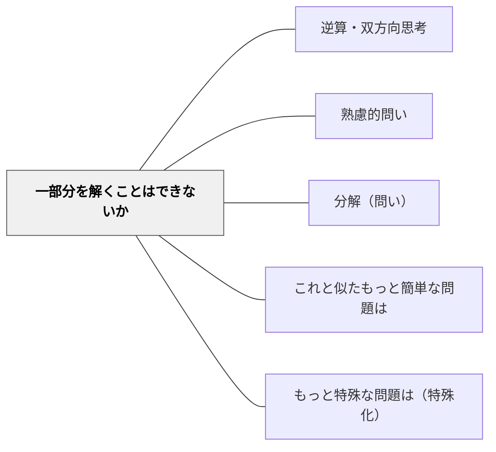

# 一部分を解くことはできないか

> 全体が解けなくても、部分から始める。サブゴールが突破口になる。

## 背景（Context）

[[パタン/熟慮的問い]] のメタ認知の問い（ポリア）グループ。複雑な問題を前にして「どこから手をつければいいかわからない」という状態は学習でよく起きる。問題を分割してサブゴールを設定することが、解決への現実的な第一歩となる。

**岩井の講話では**：本パタンを「全部解かなくても」「部分に分けて解決していく」問いとして説明し、算数の問題を解くときにも、人生のいろいろな課題を解いていくときにも使える大事な問いだと述べている（15:49〜16:07）。直前には、難しい問題を簡単な数や簡単な問題に置き換える問い（[[パタン/これと似たもっと簡単な問題は]]）を語っており（15:15〜15:42）、講話の中では「置き換える」と「部分に分ける」が別の問いとして並んでいる。

**本Wikiの関連ページでは**：[[パタン/ポリアの問題解決法]] の Schoenfeld（1992）の項は、途中で得た結果が元の問いに役立つかを見て計画へ戻ることを挙げる。部分を解くことは、元の問題に戻ってはじめて全体の解決の一歩になる。

## 問題（Problem）

問題全体の解決を目指すと、ゴールが遠すぎて思考が停止する。一度に全部解こうとして行き詰まり、「わからない」という状態のまま進めなくなってしまう。

## 力のかたち（Forces）

- 部分と全体の関係を見通す力が必要で、経験が浅いと分割点がわからない
- 部分解で満足して全体を見失うリスクがある
- 問題によっては「部分」を独立させることが難しい構造もある
- 部分解のプロセスが、全体の構造を明確にする効果がある

## 解決（Solution）

**近いパタンとの見分け**：問いの型の表では、本パタンの見分けの問いは「全体が解けないとき、解ける部分から始めているか」。全体の表は [[パタン/熟慮的問い#近いパタンとの見分け|熟慮的問い]] にある。

**「条件の一部だけを保ち、残りは無視して問題を解けないか？」「まず一部分だけを解いてみよう」と問いかけ、問題を分割してサブゴールを設定させる。**

問いかけの例：
- 「この問題全体は難しくても、一部分だけなら解けそうな部分はないか？」
- 「条件を一つだけ使って考えてみたら？」
- 「まずここまでを解けたとしたら、次は何が必要か？」

[[パタン/分解（問い）]] と組み合わせて問題構造の可視化を支援する。

---

**例：二つの場面がある文章題を前半から解く**（算数・2年）
1. 「公園に子どもが24人いました。8人帰りました。そのあと5人来ました。いま何人いますか」を読み、全体がすぐ解けない子に「一部分だけなら解けそうなところはないか」と問う。
2. 子どもは前半（24人いて8人帰った）だけを取り出し、24−8＝16 を求める。
3. 「これで元の問題のどこまでが分かったか」と問い、「8人帰ったあとの人数」が分かったことを確かめる。
4. 残りの後半（5人来た）を 16＋5＝21 で解き、二つの部分を一つの式（24−8＋5）にまとめる。

---

**例：L字の形の面積を長方形に分けて求める**（算数・4年）
1. L字の形の面積を求める問題で、「この形のままでは求められなくても、一部分なら求められないか」と問う。
2. 子どもは線を1本引いて、形を二つの長方形に分ける。分け方は人によってちがってよい。
3. それぞれの長方形の面積を求め、たして全体の面積にする。
4. ちがう分け方をした子どうしで答えを比べ、同じになることを確かめる。

## 結果（Consequences）

- 複雑な問題への取り組みやすさが増す
- 部分解の積み重ねが全体解への見通しを生む
- 「できた」という小さな成功体験が次の思考を促進する

- 注意点：部分を解いたところで止まると、全体を見失う。部分の答えが出たら「これで元の問題のどこまでが分かったか」と全体に戻る。

## 関連パタン
- [[パタン/逆算・双方向思考]]

- [[パタン/熟慮的問い]] — 親パタン
- [[パタン/分解（問い）]] — 要素に分けるパタン
- [[パタン/これと似たもっと簡単な問題は]] — 問題を単純化するパタン
- [[パタン/もっと特殊な問題は（特殊化）]] — 具体化・特殊化を問うパタン

## クラスター図

## Actionable Insight

- 行き詰まった学習者に「この問題全体は難しくても、一部分だけなら解けそうな部分はないか？」と問いかける——サブゴールの設定が思考停止を打破する
- 「まずここまでを解いてみよう」という小さなゴールを設定する——小さな成功体験が次の思考を促進する
- 問題全体を見て「どこから始められるか」を学習者に選ばせる——主体的な分割が問題への関与感を高める

## 出典

- [[文献/熟慮的問いのパターンリスト（動画記録）]]
- ジョージ・ポリア（1954）『いかにして問題をとくか』丸善出版

- 岩井輝久（年不明）『熟慮的問いのパターンリスト』［動画］ https://youtu.be/WivskVtxG34 — 2026-11-13 に文字起こしで確認（15:15〜15:42、15:49〜16:07）
- [[文献/数学の問題解決で方略を選び直す（Schoenfeld1992）]] — [[パタン/ポリアの問題解決法]] の記述による
