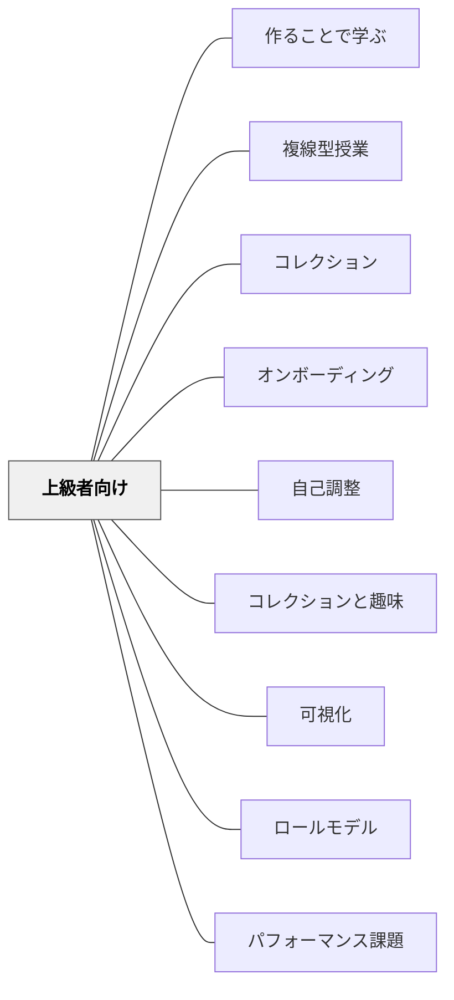

# 上級者向け

**このパタンが完成を助ける大きなパタン**：[[パタン/熟慮的動機づけ]]・[[パタン/ゲーム]]

> 上級者向けのやり込み要素もあるように教育をデザインせよ。

## 背景（Context）

ミスマッチが起きている。早く課題を終えてしまい何もすることがない、退屈している学習者がいる。

学力の格差がある。例えば、カリキュラム上・建前では小学校に入ってから初めてひらがなや片仮名、足し算や引き算を習うことになっている。しかし小学校に入学する前から幼稚園や家庭で文字や計算をすでに身につけてきている子たちもいれば、そうではない子たちもいる。入学時点で子どもたちの学力の格差はとても大きい。

## 問題（Problem）

全員が同じ課題をしなければいけない設計では、上級者は早く課題を終えて手持ち無沙汰になり、退屈・意欲低下が起きる。一方で初級者はついていけず取り残される。このミスマッチをいかに埋めるか。

## 力のかたち（Forces）

- カリキュラムは「平均的な学習者」に合わせて設計されており、上限も下限も外れた学習者には合わない
- 同じ課題でも「もっとやりたい」と感じる学習者には、追加できる要素が必要
- 上級者が退屈すると学習意欲を失い、コミュニティ全体の活力も下がる
- 逆に上級者が輝いていると、初級者・中級者の憧れとなり学習コミュニティが活性化する

## 解決（Solution）

**上級者向けのやり込み要素があるように教育をデザインする。**

**近いパタンとの見分け**：動機づけ・興味の表では、本パタンの見分けの問いは「早く進む子のための、やり込み要素を用意しているか（岩井）」。全体の表は [[パタン/熟慮的動機づけ#近いパタンとの見分け|熟慮的動機づけ]] にある。

「上級者向け」とは、深田浩嗣（2012）にあるゲーミフィケーションのデザインプロセスの一つを踏まえている。ビジネスにおいて上級者向けが特に重要な理由として深田は3点を挙げている。これらは状況によっては教育でも重要である。

1. 満足した「上級者」はロイヤリティが高く、優良な新しい顧客にクチコミする可能性が高い
2. 「上級者」が初級者・中級者にとってのあこがれの存在・ロールモデル（見本・模範）となる
3. コミュニティを積極的にリードしてくれる

---

### より高い目標を目指す小パタン

**限界突破**

小学校教員の石川翔太さんから教えてもらったアイデア。漢字ドリルを購入すると小テストがついてくることがある。この小テストの空いているところや裏に、新出漢字を使ってテストの問題とは違う熟語を書ければ加点していく。100点満点のテストでも、新出漢字を使って違った熟語を30書ければ130点を取ることができる。上限のない得点設計が「限界突破」のやり込み要素になる。

**タイムアタック**

いかに早くクリアできるかという時間を軸にした小パタン。例えば100マス計算では、それぞれの学習者が自分の最高タイムを目指す。早く計算できる学習者はより早く・正確に計算できるよう、さらなる高みを目指すことができる。

**コレクション**

学習者の感情を触発する重要なパタン。小学校1年生の国語教科書にある「自動車くらべ」（説明文）では、子どもたちがパトカーや救急車など好きな自動車を自己選択・自己決定し、同じ組み立て（同形）の説明文を書いて図鑑を作る流れになっている。1台書けた子にはさらに別の自動車を調べて書くよう促した。上級者の図鑑は2枚・3枚と書き重ねて分厚くなっていく——その「分厚さ」自体がコレクションとしての達成感を生む。

---

### 教育の個別化（大きなパタン）

そもそも全員が同じ課題をしなければならない設計からミスマッチは生まれる。問式・イエナプラン教育・リーディングワークショップ・ライティングワークショップなどのように、自己選択・自己決定で学ぶことができれば、上級者は自分のペースでレベルの高い問題解決や表現を追求することができる。自己表現できる要素・ゲーム的な要素があると、上級者は「極める」という楽しみ方ができるようになる。

### 岩井の原稿から（上級者向け）

（原稿のうち、すでに本ページの上の節にそのまま入っている段落は、ここでは繰り返さない。）

　ミスマッチが起きている。早く課題を終えてしまい、何もすることがない、退屈している学習者がいる。

　学力の格差がある。例えば、カリキュラム上、建前では小学校に入ってから、はじめて平仮名や片仮名、足し算や引き算を習うことになっている。しかし、小学校に入学する前から幼稚園や家庭で文字や計算を学習している子たちがいれば、そういういったことには無縁に生きてきて入学してくる子たちもいる。小学校に入学してきた時点で、子どもたちの学力の格差は大きい。

　「上級者向け」とは、深田浩嗣（２０１２）にあるゲーミフィケーションのデザインプロセスの一つとしているものを踏まえている。上級者向けのやり込み要素があるということは、教育の仕事に関わってからずっと意識していることの一つだ。わたしは、被教育者として、レディネスがなく先生が教えていることがわからない、ついていけないという状況、逆に学校よりも先に進みすぎて、学校の授業が退屈すぎて耐え難い状況、このようなミスマッチの状況をたくさん経験してきた。このミスマッチをいかに埋めるかというのが、反面教師としての仕事の大きなテーマであり続けている。深田浩嗣（２０１２）は、ビジネスで「上級者向け」が特に重要な３点を挙げている。

（原稿では、ここに深田浩嗣（２０１２）からの引用が入っている。長い引用は wiki には載せない。）

　これらの３点は、どれも状況によっては、教育でも重要であると考える。

　「上級者向け」のやり込み要素としてアイデアをいくつか紹介しよう。

　より高い目標を目指す小パタンとして「限界突破」「タイムアタック」「コレクション」がある。

　小学校教員の友人であるA先生から教えてもらった「限界突破」のアイデアがある。漢字ドリルを購入すると、小テストがついてくることがある。この漢字小テストの空いているところや裏に、新出漢字を使って、テストの問題とは違う熟語を書ければ、加点していくというものだ。だから、例えば１００点満点のテストでも、新出漢字を使って違った使い方の熟語を３０書ければ、１３０点とることができる。

　「タイムアタック」はいかに速くクリアできるなど時間を軸にした小パタンだ。例えば１００マス計算は、それぞれの学習者が自分の最高タイムを目指す。速く計算できる学習者は、より速く正確に計算できるようにさらなる高みを目指すことができる。

　「コレクション」は、学習者の感情を触発する重要なパタンだ。小学校1年生の光村図書の国語の教科書には「じどう車くらべ」という教材がある。この教材は、「じどう車くらべ」という説明文を読み、自動車図鑑の説明文の書き方を学んで、説明文を書く、自動車図鑑を作るという学習の流れになっている。子どもたちは、パトカーや救急車など自分で「自己選択・自己決定」して、好きな自動車について同型の作文を書き、書いたものを貼り合わせて図鑑とした。どの子も１台以上は書くようにしたが、できる子は、違う自動車の働きとつくりを調べて、２枚、３枚と同型の説明文を書くように促した。上級者の図鑑は、たくさん書いているので分厚いものとなっていく。

　教育を「個別化」するというパタンもある。そもそも全員が同じ課題をしなければいけないところからミスマッチは生まれる。公文式やイエナプラン教育、リーディング・ワークショップやライティング・ワークショップなどのように、「自己選択・自己決定」で学ぶことができれば、上級者は自分のペースでレベルの高い問題解決や表現などを追求することができる。

　自分だけの何かを表現できるようにデザインすることもできる。自己表現できるゲームの要素があると、上級者は、極めるという楽しみ方をすることができる。

　上級者がさらに力を伸ばしていけるように、「限界突破」「タイムアタック」「コレクション」などの「上級者向け」のやり込み要素がある教育デザインにすること。

#### 参考文献　

甲斐睦朗ら（２０２０）『こくご１下ともだち』光村図書

キエラン・イーガン（２０１０）『想像力を触発する教育　認知的道具を活かした授業づくり』北大路書房

キエラン・イーガン（２０１３)　『想像力と教育』北大路書房

ジョン・ハッティ、グレゴリー・イェーツ（２０２０）『教育効果を可視化する学習科学』北大路書房

深田浩嗣(２０１２)『ゲームにすればうまくいく〈ゲーミフィケーション〉９つのフレームワーク』NHK出版

（以上、岩井の原稿「教育のパタン・ランゲージ 集約」の「パタン　上級者向け」から。）

## 結果（Consequences）

- 上級者が退屈せずに力を伸ばし続けることができる
- 上級者がロールモデルとなり、学習コミュニティ全体の意欲が高まる
- 「もっとやりたい」という意欲をそのまま学習に活かせる設計になる
- コレクションや限界突破など、個人内での達成を可視化できる

## 関連パタン
- [[パタン/作ることで学ぶ]]
- [[パタン/複線型授業]]
- [[パタン/コレクション]]

- [[パタン/オンボーディング]] — 上級者と対になる下限側への対応
- [[パタン/自己調整]] — 自分のペースで学ぶ力
- [[パタン/コレクションと趣味]] — 収集・達成感のゲーム的要素
- [[パタン/可視化]] — 分厚い図鑑・最高タイムなど成長の見える化
- [[パタン/ロールモデル]] — 上級者が他の学習者の憧れとなる
- [[パタン/パフォーマンス課題]] — 上級者が自己表現を追求する場

## クラスター図

## Actionable Insight

- 漢字テストの余白に「知っている別の熟語を書いてもいい」と伝える——上限のない設計が「限界突破」のやり込み要素になる
- 課題を終えた子に「同じ問題を別の方法で解けるか試してみて」と声をかける——退屈させない最もシンプルな上級者向けの一手
- 上級者の作品（分厚い図鑑・最高タイム更新・別解）を全体に紹介する——上級者がロールモデルになることでコミュニティ全体の意欲が上がる

## 出典
- [[文献/一つの教育のパタン・ランゲージ]]

深田浩嗣（2012）「ソーシャルゲームのゲームデザイン」（ゲーミフィケーション）  
岩井輝久「岩井輝久『一つの教育のパタン・ランゲージ』」（2026-04-29 vault収録）  
岩井輝久「パタン　上級者向け（動画記録）」https://youtu.be/Yin1vbXwUDU
