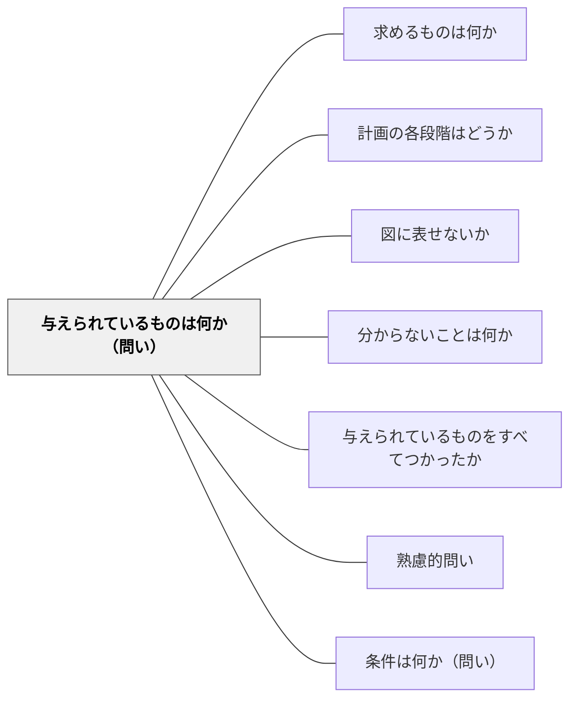

# 与えられているものは何か（問い）

> 既知の情報・前提・条件を整理することで、問題解決の出発点を確かにする。

## 背景（Context）
学習者が問題に取り組む際、何が分かっていて何が分からないかを区別できないまま考え始めることが多い。情報が混在したまま思考が進むと、方向を見失いやすい。特に複雑な問題では、手持ちの材料を整理することが最初の重要なステップになる。

**岩井の講話では**：小学2年生の算数で、夏休み前の段階から「求めるものは何か」と「与えられているものは何か」の二つを、自分に問えるようになることが大事だと教えている（9:18〜9:57）。この二つは算数に限らず国語などほかの時間でも使える問いだと伝え、くり返し問いを出して一緒に使う練習をする（10:07〜10:30）。与えられているものは「分かってること」と言い換えられ（11:32〜11:41）、求めるもの・条件と並んで「問題を理解する」ところの問いに置かれる（14:04〜14:21）。対になる「求めるものは何か」について、講話は将来の夢をもつ子の例を挙げ、何を目指すかで練習の仕方が変わると話している（10:30〜11:10）。

**本Wikiの関連ページでは**：[[パタン/ポリアの問題解決法]] は Step 1「問題を理解する」に「与えられている情報は何か」「足りない情報はないか」「余分な情報はないか」を並べ、結城浩の作品の登場人物が「《持っているもの》から《求めるもの》を作る」と言い換える場面を紹介している。与えられているものは、求めるものと対にしたとき、問題のスタート地点として働く。

## 問題（Problem）
問題に直面した学習者は、何から考えれば良いか分からず思考が止まりやすい。与えられた情報を活用せずに、ゼロから考えようとすることで不必要に難しくなってしまう。「分かっていること」を明確にしないまま「分からないこと」を探ろうとすると、混乱が生じる。

## 力のかたち（Forces）
- 学習者は問題全体を一度に把握しようとして圧倒されやすい
- 既知の情報を意識化することで、思考の足場が生まれる
- 整理する行為自体が、問題の構造を明らかにする
- 前提・条件を列挙することで、見落としを防げる

## 解決（Solution）
**近いパタンとの見分け**：問いの型の表では、本パタンの見分けの問いは「わかっていることを全部書き出しているか」。全体の表は [[パタン/熟慮的問い#近いパタンとの見分け|熟慮的問い]] にある。

「この問題で与えられているものは何か？分かっていることを全部挙げてみよう」と問いかける。例えば数学の文章題なら「三角形の底辺が5cm、高さが4cmと書いてある。他には何がある？」のように、明示的に既知情報を言語化させる。箇条書きやノートへの書き出しを促すと効果的である。

---

**例：二つの問いを自分に問う文章題**（算数・2年）
1. 教室に「もとめるものは なにか」「あたえられているものは なにか」の二つの問いを掲示しておく。
2. 「赤い花が23本、白い花が15本あります。花びんは2つあります。花は全部で何本ですか」を読み、子どもは二つの問いを声に出して自分に問う。
3. 分かっていることに線を引き、ノートに書き出す（赤23本、白15本、花びん2つ）。
4. 「書き出したもののうち、求めるものに使うのはどれか」と問い、花びんの数は使わないことを確かめてから式を立てる。

---

**例：物語の気持ちを本文の「与えられているもの」から考える**（国語・2年）
1. 「このとき、主人公はどんな気持ちだったか」という問いを出し、まず「求めるものは何か」（主人公の気持ち）を確かめる。
2. 次に「与えられているものは何か」と問い、その場面で主人公がしたこと・言ったことに線を引く。
3. 線を引いたところを根拠に、気持ちを考えてノートに書く。
4. 本文に書いていないこと（自分の想像だけのこと）と、本文から言えることを分けて話し合う。

## 結果（Consequences）
- 問題の出発点が明確になり、学習者が主体的に思考を始められる
- 情報の見落としが減り、解法の精度が上がる
- 「何が分かっていないか」を特定する準備ができる

- 注意点：二つの問いは一度教えただけでは自分への問いにならない。講話のように、算数以外の時間も含めてくり返し一緒に使う練習を重ねる（10:07〜10:30）。

## 関連パタン
- [[パタン/求めるものは何か]]
- [[パタン/計画の各段階はどうか]]
- [[パタン/図に表せないか]]
- [[パタン/分からないことは何か]]
- [[パタン/与えられているものをすべてつかったか]]
- [[パタン/熟慮的問い]] — 親パタン
- [[パタン/条件は何か（問い）]] — 制約・条件を明確にする補完的な問い

## クラスター図

## Actionable Insight

- 問題を見た後まず「分かっていることを全部ノートに書き出そう」と促す——既知情報を整理するだけで思考の足場が生まれる
- 「書いたこと以外に、問題文に書いてあることはない？」と確認させる——情報の見落としを防ぐ習慣が精度を上げる
- グループで「各自が挙げた情報を比べてみよう」と情報共有する——比較によって条件の読み落としが発見される

## 出典
- [[文献/熟慮的問いのパターンリスト（動画記録）]]
- ジョージ・ポリア（1954）『いかにして問題をとくか』丸善出版

- 岩井輝久（年不明）『熟慮的問いのパターンリスト』［動画］ https://youtu.be/WivskVtxG34 — 2026-11-13 に文字起こしで確認（9:18〜10:30、10:30〜11:10、11:32〜11:41、14:04〜14:21）
