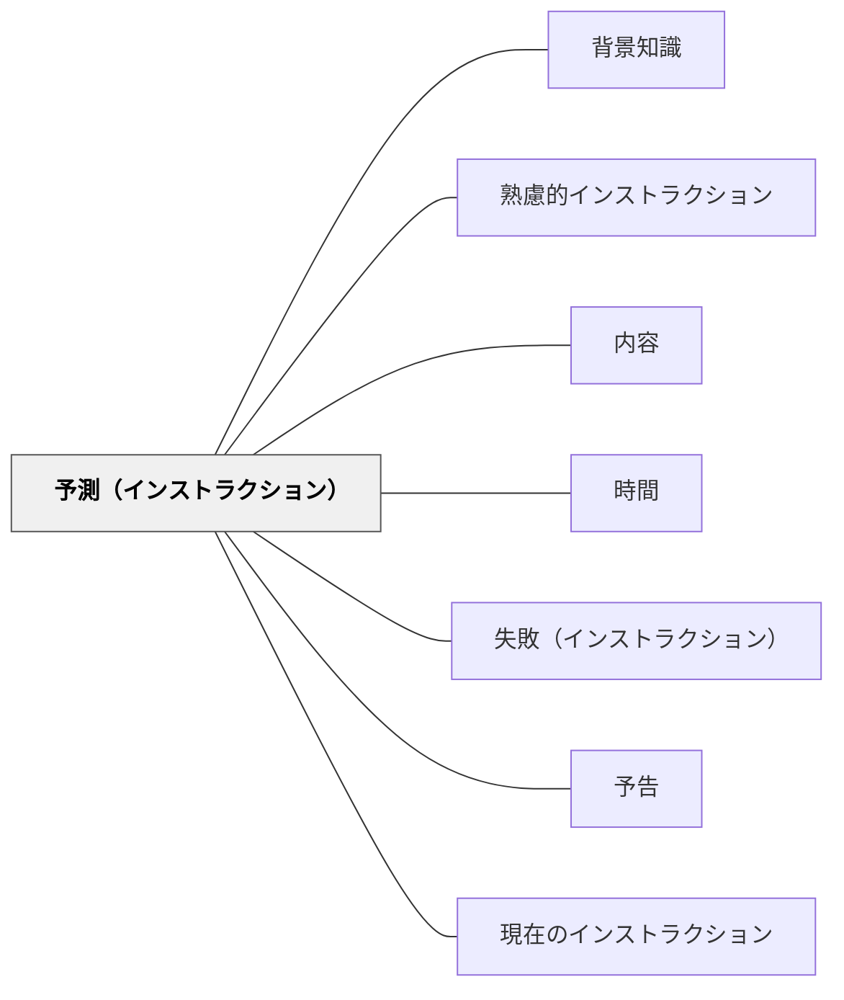

# 予測（インストラクション）

> 実行中に起こりそうなことを前もって示すことで、受け手に安心感を与える。

## 背景（Context）
ワーマンの「理解の秘密」が示すインストラクションの内容6要素の一つが「予測」である。これは実行のプロセスで受け手が遭遇しそうな状況を事前に伝える要素であり、「正しい道を進んでいる」という確信を与える安心装置として機能する。なお、熟慮的動機付けの「予測差分（期待値差分）」とは異なる概念である。

## 問題（Problem）
手順だけが示されても、実行中に想定外のことが起きると受け手は「これで合っているのか」と不安になり、作業を止めたり誤った方向に進んだりする。進行の節目にどうなるかを知らなければ、受け手は自分が正しい経路にいるかどうかを判断できない。

## 力のかたち（Forces）
- 初めての作業では特に「これは正常か異常か」の判断基準が受け手にない
- 予測があると、その通りになったときに受け手は自信をもって進める
- 予測が詳細すぎると指示が長くなり、かえって混乱を招く

## 解決（Solution）
**「この後〇〇が見えたら正しい方向です」「〇〇のタイミングで△△が起きますが、それは正常です」という形でマイルストーンを事前に示す。**

たとえば「2問目を終えたときに問題の意図がつかめてくるはずです」「グループ活動が進むと最初は静かになりますが、それで問題ありません」のように、進行の節目で起きることを予告する。受け手が自分の進捗を自己確認できるようになる。

> **研究の裏づけ（2026-10-31）**：『How People Learn』（2000）は、予想を使う二つの方法を紹介する。一つは「診断的な授業」で、いろいろな場面について予想とその理由を言ってもらい、よくある誤解を含む課題でその考えを試す（p. 134、Bell）。もう一つは大学の物理の「対話型の演示」で、学生は隣の人と話して予想を書いてから、ぶつかる2台の台車にかかる力を画面で見る。多くの学生は「重い台車のほうが大きな力を及ぼす」と予想するが、画面には等しい大きさの力が出る。条件を変えて同じことをくり返す（pp. 179–180）。結果の表示が20〜30分遅れるだけで概念の学習が妨げられた、という研究も挙げる（p. 180）。予想を書くことは、本人の考えを本人に見えるようにする。出典：[[文献/人の学び方の研究を授業の設計につなぐ（全米研究評議会2000）]]。

## 結果（Consequences）
- 受け手が迷いなく作業を継続できる
- 「止まって聞く」という中断が減り、活動の流れが保たれる
- 受け手の自律的な確認行動が育つ

## クラスター図

## Actionable Insight

- 手順を説明した後に「2問目が終わるころに意図が見えてくるはずです」と進行の節目での見通しを伝える——受け手が「正しい道にいる」と確認できる
- 「最初は静かになりますが、それは正常です」のように想定内の現象を事前に示す——異常・正常の判断基準を持たせることで無用な中断が減る
- 「うまくいったら〇〇という状態になるはずです」という完了イメージを伝える——ゴール状態を知っていることで自律的な確認行動が生まれる

## 出典

- 一つの教育のパタン・ランゲージ（岩井輝久）

## 関連パタン
- [[パタン/背景知識]]
- [[実践/カエルの算数：勝ちやすさを表で考えよう]]
- [[パタン/熟慮的インストラクション]] — 親パタン
- [[パタン/内容]] — 予測を含む6要素システム
- [[パタン/時間]] — 予測と合わせて見通しを与える
- [[パタン/失敗（インストラクション）]] — 予測の裏面として機能する警告信号
- [[パタン/予告]] — 次の活動への事前予告
- [[文献/人の学び方の研究を授業の設計につなぐ（全米研究評議会2000）]] — 予想とその理由を言う診断的な授業と、予想を書いてから確かめる演示
- [[パタン/現在のインストラクション]] — 6要素をそろえる指示の中の「予測」

