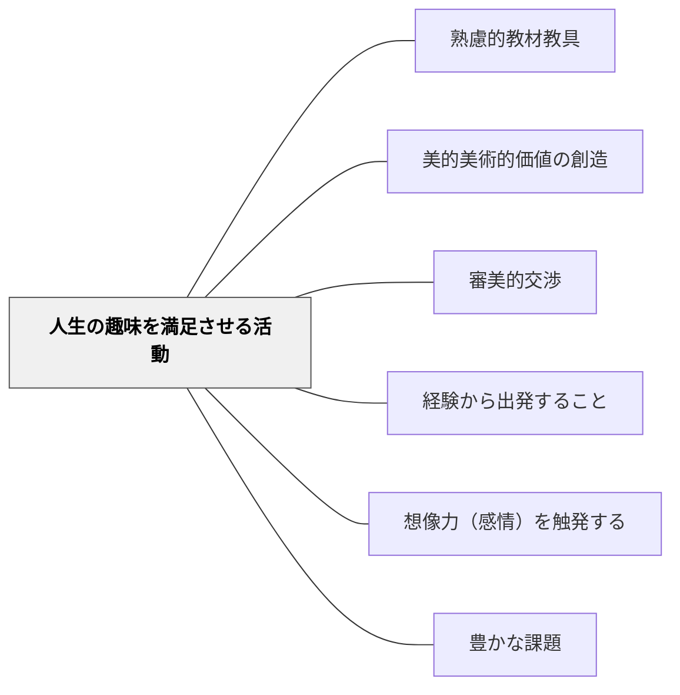

# 人生の趣味を満足させる活動

> 美術・音楽・文学——人生を豊かに彩る芸術的活動が教育材料になる。

## 背景（Context）

ハーバート・スペンサーの活動分類の第五項目。美術・絵画・音楽・文学・工芸など、人生の趣味・審美的満足に関わる活動。体育や芸術教科だけでなく、あらゆる教科での審美的な側面がここに含まれる。

**原典では**：スペンサーの論文「いかなる知識が最も価値あるか」（1859年）は、人間の生活を成り立たせる主な活動を、重要さの順に五つに分けた。本項はその第5で、原文は “those miscellaneous activities which fill up the leisure part of life, devoted to the gratification of the tastes and feelings”。スペンサーは五つのどれについても、最も価値ある知識は「科学（Science）」だと結論した。
牧口常三郎は『創価教育学体系』第4巻で、この五要素を「教材の選択論上、今でも一顧せざるを得ない貴重なる文献」と評し、第5を「有閑時の徒然を充たす種々なる活動＝人生の趣味を満足する準備＝美術、絵画、詩文等」と訳している。
ただしスペンサーは、芸術や文学は生活の余暇の部分を占めるのだから、教育でも余暇の部分を占めるべきだと書いている（“As they occupy the leisure part of life, so should they occupy the leisure part of education.”）。利・善・美を並べて価値とした牧口とは、ここで置き方が違う。

## 問題（Problem）

「役に立つ」知識を優先するあまり芸術・文化的な教育が軽視されると、人生の豊かさと審美的感受性が育たない。

## 力のかたち（Forces）

- 芸術的体験が感情・想像力を強く触発する
- 趣味・審美性は個人差が大きい
- 受験教育との緊張関係がある

## 解決（Solution）

**近いパタンとの見分け**：教材・教具の表では、本パタンの見分けの問いは「余暇と趣味を満たす知識（美術・音楽など）につながる教材か」。全体の表は [[パタン/熟慮的教材教具#近いパタンとの見分け|熟慮的教材教具]] にある。

**芸術・音楽・文学・工芸などの審美的活動を教育材料として丁寧に設計し、人生を豊かにする審美的感受性を育てる。**

**例：朝の一句**（国語）
朝の会で一句を読み、好きな言葉を一つ選んで理由を言う。選んだ言葉を使って、自分でも一句作ってみる。

---

**例：作品を外に出す**（図工）
作った作品を校内に展示し、見た人の感想カードを読む。自分の作品を見た人がどこに目を留めたかを知る。

## 結果（Consequences）

- 審美的感受性と創造性が育つ
- 生涯にわたる文化的活動の基盤が形成される

- 注意点：スペンサーの順位をそのまま当てはめると、芸術や趣味の教育は後回しになる。本ページはその順位に従わず、牧口の利・善・美の見方で芸術を位置づけている

## 関連パタン

- [[パタン/熟慮的教材教具]] — 親パタン
- [[パタン/美的美術的価値の創造]] — 美的価値との接続
- [[パタン/審美的交渉]] — 審美的な関わり

- [[パタン/経験から出発すること]] — 個人の趣味・関心を学びの出発点にする
- [[パタン/想像力（感情）を触発する]] — 趣味への熱中が感情・想像力を動かす
- [[パタン/豊かな課題]] — 趣味を核にした豊かな課題設計

## クラスター図

## Actionable Insight

- 各教科のまとめ課題に「詩・絵・音楽・工作のどれかで表現する」選択肢を加える——審美的な表現形式が概念の深い内面化を促し、学習者の多様な強みを引き出す
- 学習者が「好きな芸術作品」を1つ選び、今学んでいる内容と結びつけて紹介する課題を出す——自分の趣味と学習が結びつくことで内発的動機が生まれる
- 完成した学習成果を「小展覧会」形式で展示し、互いの審美的な良さを語り合う場を設ける——作品を大切に扱われる経験が学習への誇りと審美的感受性を同時に育てる

## 出典

- ハーバート・スペンサー（知識の分類）
- [[文献/熟慮的教育材料のパターンリスト（動画記録）]]

- Spencer, H. (1911). What knowledge is of most worth? In *Essays on education and kindred subjects* (pp. 1–44). J. M. Dent.（初出1859年。Project Gutenberg 版 #16510 で原文を確認）
- 牧口常三郎（2007）『創価教育学体系』第4巻（聖教文庫、第8刷のデジタル版）第二章「教科構造論」— 2026-11-13 に該当箇所の原文を確認。[[文献/創価教育学体系 4（牧口常三郎）]]
