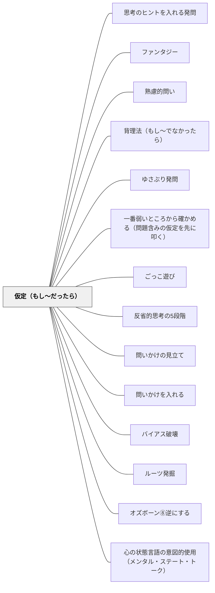

# 仮定（もし〜だったら）

**このパタンが完成を助ける大きなパタン**：[[パタン/熟慮的問い]]

> 「もし〇〇だったら？」と仮想の設定を置いて思考を広げ、反実仮想による探索を促す。

## 背景（Context）
現実の制約を外して「もし〜だったら」と問うことで、学習者は既存の枠組みを超えた思考実験ができる。歴史・科学・文学・倫理など、あらゆる分野で「仮定」の問いが深い洞察をもたらす。

※旧パタン「仮定法（視点変更）」を本ページに統合（2026-11-13）。どちらも「もし〜だったら？」と仮の設定を置き、あとで現実と比べるという同じ解決だった。旧ページにあった安斎（2021）の三つのバリエーションは、解決の小節に移した。

## 問題（Problem）
現実しか見えていないと、可能性や原因・結果の関係を探究する幅が狭まる。仮定の問いがなければ、学習者は「事実の記憶」にとどまり、「もし違っていたら」という創造的・批判的思考に踏み込めない。

## 力のかたち（Forces）
- 仮定は現実から切り離した純粋な思考実験を可能にする
- 「もし〜なら」は答えが一つではなく、多様な意見が出る
- 反実仮想を考えることで、現実の条件・要因の意味が見えてくる
- 想像力・創造力を刺激し、学習への動機を高める
- 「もしも」の問いは答えの正誤を問わないため、心理的安全性が高まりやすい
- 仮定が遠すぎると現実感が失われ、思考が空虚になるリスクがある

## 解決（Solution）
**近いパタンとの見分け**：問いの型の表では、本パタンの見分けの問いは「「もし〜だったら？」と仮の設定を置いているか」。全体の表は [[パタン/熟慮的問い#近いパタンとの見分け|熟慮的問い]] にある。

「もし重力がなかったら、地球はどうなる？」「もしペリーが日本に来なかったら、明治維新はあったか？」「もし主人公が違う選択をしていたら、物語はどう変わる？」と仮定の設定を与えて思考を広げる。仮定を考えた後に「実際はなぜそうではないのか？」と現実に引き戻すことで、事実の意味が深まる。

### 三つのバリエーション（旧「仮定法（視点変更）」・安斎 2021）

安斎（2021）は、この問いを「ユサブリモード」（とらわれを揺さぶる問い）の技法の一つとして、三つに分けている。

| 種類 | 問いの形 | 例 |
|---|---|---|
| **立場の転換** | もし〇〇の立場だったら？ | 「もしあなたが経営陣だったら？」「もし非ユーザーだったら？」 |
| **制約の撤廃** | もし〇〇がなかったら？ | 「もし失敗してもかまわないとしたら？」「もし予算が無限だったら？」 |
| **架空の物語** | もし〇〇という世界だったら？ | 「もし人類が一歩も外出できない世界になったとしたら？」 |

**立場の転換**は関係性の固定を崩す。**制約の撤廃**は「どうせ無理」という衝動の枯渇を解放する。**架空の物語**は認識の固定化を根本から揺さぶる。4つの現代病（認識の固定化・関係性の固定化・衝動の枯渇・目的の形骸化）のそれぞれに対応させることができる。

仮定の答えが出たら「なぜそうなるか」をさらに問い、背景にある原理や価値観を掘り起こす。視点が動いたあとは、[[パタン/バイアス破壊]] で固定観念を崩し続けるか、[[パタン/ルーツ発掘]] で「なぜその立場からそう見える？」とこだわりを掘り下げる。

## 結果（Consequences）
- 原因・条件・結果の関係が深く理解される
- 想像力と仮説的思考力が育ち、創造性の基盤が形成される
- 「もし〜なら」を問い続ける探究心が育つ
- 答えが複数ある状況に慣れ、複雑な問いへの耐性が高まる

## 関連パタン
- [[パタン/思考のヒントを入れる発問]]
- [[パタン/ファンタジー]]
- [[パタン/熟慮的問い]] — 親パタン
- [[パタン/背理法（もし〜でなかったら）]] — 否定的仮定による推論
- [[パタン/ゆさぶり発問]] — 思い込みを揺さぶる
- [[パタン/一番弱いところから確かめる（問題含みの仮定を先に叩く）]] — 立てた仮定に「どれがいちばんあやしいか」の順位をつける段（Kane, 1990）。仮定を仮定として置く手つきを、評価の点検の側で使う
- [[パタン/ごっこ遊び]]
- [[パタン/反省的思考の5段階]]
- [[パタン/問いかけの見立て]] — ユサブリ（とらわれ）が必要かどうかを判断する前段
- [[パタン/問いかけを入れる]] — 仮定法をユサブリモードとして体系的に位置づける
- [[パタン/バイアス破壊]] — 固定観念を崩す同系のユサブリ技法
- [[パタン/ルーツ発掘]] — 仮定の答えの奥にあるこだわりの源泉へ
- [[パタン/オズボーン⑧逆にする]] — 仮定法の一形式として逆転思考を使う
- [[パタン/心の状態言語の意図的使用（メンタル・ステート・トーク）]] — 「もし〇〇の立場だったら？」という仮定法はToM的認知（他者の信念・知識の状態を想像する）を自然に要求する（Brandt, 2026）

## クラスター図

## Actionable Insight

- 「もし重力がなかったら？」「もし主人公が違う選択をしていたら物語はどう変わる？」と仮定の設定を与えて思考を広げる——反実仮想が現実の条件・要因の意味を深く理解させる
- 仮定を考えた後に「実際はなぜそうではないのか？」と現実に引き戻す——事実の意味がより深まる
- 「もし〜なら」という問いを一単元に一度設計する——多様な意見が出て想像力と仮説的思考力が育つ

## 出典
- [[文献/熟慮的問いのパターンリスト（動画記録）]]
- [[文献/問いかけの作法（安斎勇樹）]]
