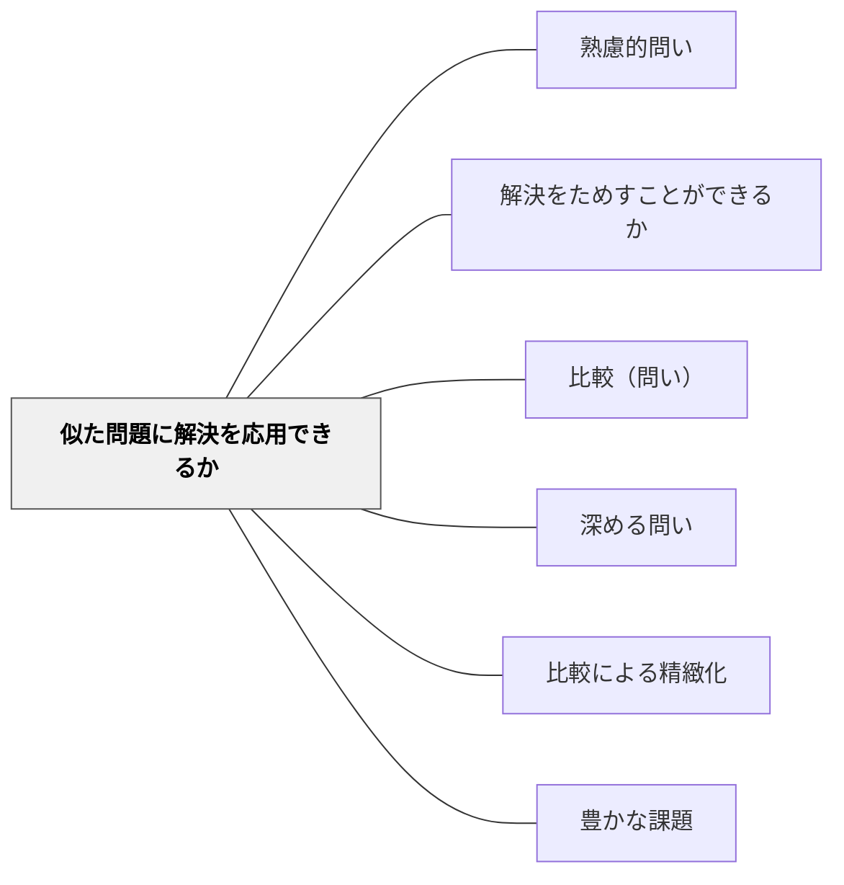

# 似た問題に解決を応用できるか

**このパタンが完成を助ける大きなパタン**：[[パタン/熟慮的問い]]

> この解き方を別の問題でも使えるか、と問うことで転移と応用を促す。

## 背景（Context）
問題を一つ解いたとき、その解法は「その問題だけの答え」になりがちである。解法を一般化し、類似の問題に適用できるかどうかを意識させなければ、学びは個別の経験にとどまり、知識の転移が起きない。

**岩井の講話では**：ポリアの問いを、問題を理解する→計画を立ててやってみる→経過を評価する→終わった後、の流れで並べ、最後の段を「解決できた結果を他に応用できるか」と問う段として説明している（13:48〜14:12）。リストの終わりでは「解答を試すことができるか」に続けて本パタンを読み上げ、「解決した後」の「応用に関する問」と位置づける（16:29〜16:40）。また講話は、前に解決したことを次の問題に役立てる働きを、算数に限らず、友達と仲直りしたい場面のような生活の問題にも広げて語っている（11:47〜12:35）。

**本Wikiの関連ページでは**：[[パタン/熟慮的問い]] の見分けの表は、本パタンを「解き方を別の問題に移す（ポリアの振り返り）」問いとし、知識を生活や実践の場面に移す [[パタン/活用（問い）]] と分けている。前に解いた問題を思い出す [[パタン/似ているものを知らないか（問い）]] が解く前に向く問いであるのに対し、本パタンは解いた後に、解き方を先の問題へ送る問いである。

## 問題（Problem）
学習者は解いた問題の解法を他の問題に応用することを自発的に試みにくい。「解けた」という達成感で満足してしまい、解法の一般性・応用可能性に気づかないまま次に進んでしまう。

## 力のかたち（Forces）
- 解法を一般化する意識がなければ転移は起きない
- 類似点を見つけることそのものが高度な思考活動である
- 応用の失敗も重要な学習機会になる
- 成功体験を土台に挑戦意欲が高まる

## 解決（Solution）
**近いパタンとの見分け**：問いの型の表では、本パタンの見分けの問いは「この解き方を、別の問題でも使えるかを問うているか」。全体の表は [[パタン/熟慮的問い#近いパタンとの見分け|熟慮的問い]] にある。

「この解き方、別の問題でも使えそうか？」「似た問題を作れるか？」と問いかけ、解法の一般化と応用を促す。たとえば、比の問題を解いたあとに「速さの問題にも同じ方法を使えるか考えてみよう」と問う。解法のどこが汎用的で、どこが特殊かを議論させることも有効。

---

**例：「同じ数ずつ」の解き方を別の場面に移す**（算数・2年）
1. 「1ふくろに4こずつ入ったあめが3ふくろ。あめは全部で何こ」を解いたあと、「この解き方は、ほかの問題でも使えそうか」と問う。
2. 子どもが「同じ数ずつのときに使える」と言えたら、「1台に5人ずつ乗った車が4台」のような問題を子どもが自分で作り、隣どうしで解き合う。
3. 「1ふくろに4こ、もう1ふくろに6こ」のように、同じ数ずつではない問題も一つ出し、さっきの解き方が使えるかどうかを話し合う。
4. ノートに「この解き方が使えるとき」「使えないとき」を一行ずつ書いて終える。

---

**例：説明文の読み方を次の教材に移す**（国語・中学年）
1. 説明文で「問いの文に線を引く→その答えが書いてある段落を探す」という読み方をした時間の終わりに、その手順を黒板に書き残す。
2. 次の説明文に入る前に、「前の読み方は、この文章でも使えるか」と問う。
3. 使えたところと、問いの文が見つからず使えなかったところを分けて発表する。
4. 使えなかったところから、手順に一つ書き足す（例：「問いの文がないときは、題名を問いの形に言いかえる」）。

## 結果（Consequences）
- 学んだ知識・解法が他の文脈に転移しやすくなる
- 解法の本質的な構造を理解する力が育つ
- 自ら問題を見つけ、応用しようとする主体的な学びが生まれる

- 注意点：解き方の形だけを移すと、新しい問題に合わない方法をそのまま使ってしまうことがある。「前の問題でなぜその方法が効いたか、どこが今の問題に使えるか」を言葉にしてから使う（[[パタン/ポリアの問題解決法]] の Woodward ほか 2012 の項）。

## 関連パタン
- [[パタン/熟慮的問い]] — 親パタン
- [[パタン/解決をためすことができるか]] — 検証から応用へ
- [[パタン/比較（問い）]] — 類似点・相違点を見る

- [[パタン/深める問い]] — 応用可能性への問いが理解を深める
- [[パタン/比較による精緻化]] — 類似問題の比較が解法の精緻化を生む
- [[パタン/豊かな課題]] — 応用問題が豊かな課題の発展形になる

## クラスター図

## Actionable Insight

- 問題を解いた後に「この解き方を使えそうな他の問題を自分で作ってみよう」と促す——解法の一般化と応用を自分で試みる経験が転移力を育てる
- 「この解法のどこが汎用的で、どこがこの問題固有か」を話し合う——解法の本質的な構造への理解が応用範囲の意識を育てる
- 単元末に「この単元で学んだ解法が使える場面・使えない場面を1つずつ挙げよう」と問う——転移の可否を意識させることで知識の射程が明確になる

## 出典
- [[文献/熟慮的問いのパターンリスト（動画記録）]]
- ジョージ・ポリア（1954）『いかにして問題をとくか』丸善出版

- 岩井輝久（年不明）『熟慮的問いのパターンリスト』［動画］ https://youtu.be/WivskVtxG34 — 2026-11-13 に文字起こしで確認（11:47〜12:35、13:48〜14:12、16:29〜16:40）
- [[文献/算数の問題解決を4〜8年生で育てる（Woodwardほか2012）]] — [[パタン/ポリアの問題解決法]] の記述による
