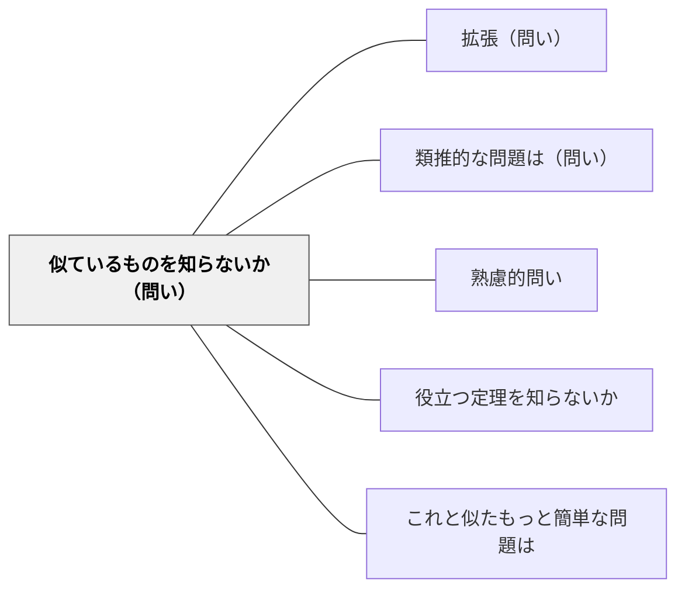

# 似ているものを知らないか（問い）

**このパタンが完成を助ける大きなパタン**：[[パタン/熟慮的問い]]・[[パタン/類推的学習①|類推的学習]]

> 既知のものから未知へ：アナロジーを活用して解法を探索する。

## 背景（Context）
全く新しい問題は存在しない。ほとんどの問題は、既に経験した何かと構造的な類似性を持っている。アナロジー（類推）は人間の思考の根本的な仕組みであり、意識的にそれを活用することで、未知の問題に対しても足がかりを見つけることができる。

**岩井の講話では**：友達と仲直りしたい、という求めるものがはっきりした場面を例に、本パタンを説明している。前に自分が悪かったときにきちんと謝って仲直りできた経験があれば、今回けんかした相手とも、自分の悪いところを素直に認めて謝ることが仲直りのきっかけになるかもしれない、と考えられる（11:47〜12:25）。そして、こうした問いは算数以外でも広く使えると述べる（12:25〜12:35）。リストを読み上げる場面では、本パタンを「まだ問題を理解するところ」かもしれないと置き、算数でも、前に解決できたアイデアが使えるかもしれないからこの問いがある、と話している（14:38〜15:00）。

**本Wikiの関連ページでは**：[[パタン/ポリアの問題解決法]] の Woodward ほか（2012）の項は、「前に解いた似た問題は？」を含む問いかけの一覧を子どもが使うことを根拠の強い勧めとして紹介する一方、似た問題を思い出しすぎて、新しい問題に合わない方法をそのまま使う失敗にも触れている。

## 問題（Problem）
学習者は新しい問題を「全く初めて見るもの」として扱い、ゼロから考えようとしがちである。過去に学んだ知識とのつながりを見出せないため、既存の知識が活用されず、学習が孤立したものになってしまう。アナロジーを使う意識がないと、「知っているはずなのに解けない」状況が生まれる。

## 力のかたち（Forces）
- 類似した問題の解法は、新しい問題への手がかりを与える
- アナロジーは知識間の橋渡しをし、転移学習を促進する
- 「似ている」という直感を言語化することで、思考が進む
- 完全に同じでなくても、部分的な類似性が有効なことが多い

## 解決（Solution）
**問題解決のどの段階の問いか**：ポリアのリストのとおり、第2段階「計画を立てる」の問いとして置く。問題を理解したあと、解き方の見通しを探しはじめるときに問う（[[パタン/ポリアの問題解決法]] の Step 2）。講話では「まだ問題を理解するところ」かもしれないとも話しているが、本Wikiでは原典の段階に合わせる（2026-11-14 岩井裁定）。

**近いパタンとの見分け**：前に解いた関連する問題を思い出すのが本パタン。似た構造の補助の問題をつくるのは [[パタン/類推的な問題は（問い）]]（ポリアのリストでは一般化・特殊化と並ぶ変形）。問いの系列の全体の表は [[パタン/熟慮的問い#近いパタンとの見分け|熟慮的問い]] にある。

「これに似た問題を見たことがないか？以前解いた問題で構造が似ているものはどれだろう？」と問いかける。例えば新しい積分の問題に対して「これは以前の置換積分と形が似ていないか？」と促す。類似点と相違点を比較させることで、アナロジーの精度も上がる。

---

**例：くり下がりのひき算で、前に習った計算を思い出す**（算数・2年）
1. 「63−27」の筆算で一の位が引けずに止まった子に、「これと似た計算を前にしたことはないか」と問う。
2. 子どもは1年生の「13−7」のような、10のまとまりをくずして引いた計算を思い出し、ノートに書く。
3. 「どこが似ていて、どこがちがうか」を問う（似ている：一の位が引けないので10をくずす。ちがう：十の位にも数がある）。
4. 似ている考えを使って一の位を計算し、ちがうところ（十の位が1へる）に気をつけて答えを出す。

---

**例：けんかの読み物で、似た経験から仲直りの手がかりを探す**（道徳または学級活動・低学年）
1. 登場人物が友達とけんかする読み物を読み、「この人が求めているものは何か」を確かめる（仲直りしたい）。
2. 「前に、これと似たことはなかったか。そのとき、どうしたら仲直りできたか」と問い、思い出したことをカードに書く（友達の名前は書かない）。
3. カードを読み合い、登場人物の場面と同じところ・ちがうところを話し合う。
4. 登場人物が使えそうな手がかりを選び、「自分ならどうするか」を一文で書く。

## 結果（Consequences）
- 既存知識と新しい問題が結びつき、スキーマが拡張される
- 解法の見通しが立ちやすくなり、思考の停滞が解消される
- 知識の転移（transfer）が促進され、応用力が育つ

- 注意点：似た問題を思い出すと、今の問題に合わない方法までそのまま使ってしまうことがある。「どこが似ていて、どこがちがうか」を確かめてから使う（[[パタン/ポリアの問題解決法]] の Woodward ほか 2012 の項）。

## 関連パタン
- [[パタン/拡張（問い）]]
- [[パタン/類推的な問題は（問い）]]
- [[パタン/熟慮的問い]] — 親パタン
- [[パタン/役立つ定理を知らないか]] — 知識の活用を問う関連パタン
- [[パタン/これと似たもっと簡単な問題は]] — 類似した単純な問題への誘導

## クラスター図

## Actionable Insight

- 新しい問題を提示したとき「これに似た問題を解いたことがあるか？」と問いかける——既知との類似の発見が未知の問題への足がかりになる
- 「この問題の構造と似ているものを知っているか？」を問題解決の出発点として教える——アナロジーを意識的に使う習慣が転移学習を促進する
- 類似点を見つけた後に「どこが似ていて、どこが違うか？」を確認させる——類似と相違の精緻な分析がアナロジーの精度を高め深い理解につながる

## 出典
- [[文献/熟慮的問いのパターンリスト（動画記録）]]
- ジョージ・ポリア（1954）『いかにして問題をとくか』丸善出版

- 岩井輝久（年不明）『熟慮的問いのパターンリスト』［動画］ https://youtu.be/WivskVtxG34 — 2026-11-13 に文字起こしで確認（11:47〜12:35、14:38〜15:00）
- [[文献/算数の問題解決を4〜8年生で育てる（Woodwardほか2012）]] — [[パタン/ポリアの問題解決法]] の記述による
