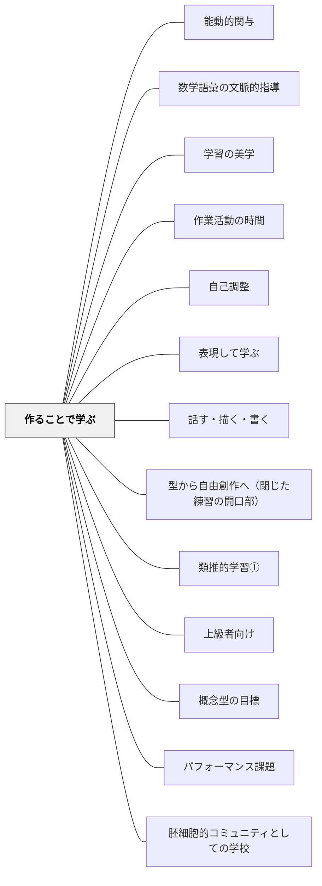

# 作ることで学ぶ

**一文でいうと**：作品や表現を作る過程で、知識を使い、考えを組み立て直す。

## 使いどころ・使いすぎ注意

| 観点         | 内容                                               |
| ------------ | -------------------------------------------------- |
| 使いどころ   | 制作過程で理解を深めたいとき。                     |
| 使いすぎ注意 | 作ることが目的化すると、概念理解が置き去りになる。 |

> 作ることで学ぶを教育設計の主軸にせよ。作ることで学ぶは学習方法の大パターンである。

## 背景（Context）

「基地から道へ」と同様に、「作ること・構成することで学ぶ」は**全ての教育を貫く大パターン**だ。

しかし多くの教室では：

- 聞いたり読んだり見たりするだけでよく考えないため、理解が表層的で応用できず、すぐ忘れてしまう
- 何の意味・価値があるのか、どう役立つのか分からないため、やる気が起きない
- 学習を早く終えて何もやることがない（上級者が退屈する）

## 問題（Problem）

「受け取るだけ」の学習では、深い理解・転移可能な力・内発的動機づけが育たない。学習者はそれぞれ違うのに、全員が同じペースで同じことをするだけの設計では、上の学習者も下の学習者も取り残される。

## 力のかたち（Forces）

- 知識とは本来「構成（作る）」ものであり、受け取るものではない
- 作るという行為は人それぞれの速さ・深さで追求し続けることができる——上限も下限もない
- 系統的に学んでほしい内容と子ども中心の学習（自己選択・自己決定）は対立しているように見えるが、「作ること」の設計によって両立できる
- 類推的学習を組み合わせることで「作ること」が自己調整の学習ループになる

## 解決（Solution）

探究・課題・プロジェクトのパタンのどれを使うかで迷ったら、下の「[[#近いパタンとの見分け|近いパタンとの見分け]]」の表を見る。

**作ることで学ぶを教育設計の主軸にせよ。**

---

### 知識は構成するもの——哲学的根拠

カントは『純粋理性批判』で「認識とは感性と悟性が合わさったもの」と指摘した。私たちは直観（直接観察）したことについて考えることで**意味や知識を構成（作り出す）**。そう考えれば、算数だろうが国語だろうが、社会科で新聞にまとめようが、理科で実験の報告文を作ろうが、**作る・構成するという点で変わらない**。

「作ることで学ぶ」を通して、教育とは**自分づくり（自分自身の構成）に取り組むこと**でもある。

---

### 各教科での「作ること」

| 教科       | 作ること                                                                 |
| ---------- | ------------------------------------------------------------------------ |
| 国語       | 物語や紹介文など文章を作る                                               |
| 算数・数学 | 問題を見出し解決方法を作り出したり、証明したりする                       |
| 社会       | 問題を見出し調査したことを新聞やレポートにまとめる                       |
| 理科       | 問題を見出し仮説を立て実験を設計してデータを考察することで知識を作り出す |
| 体育       | 自分の体づくり・チームづくりに取り組む                                   |
| 図工       | 平面作品や立体作品を作る                                                 |
| 音楽       | 曲や演奏を作る                                                           |
| 道徳       | 徳目に対して考えを作る・構成する——自律的な道徳的判断力・実践力を高める   |

---

### なぜ「作る教育」が重要か

作ることで学ぶは、**子ども中心の学習（個別化・個性化）と系統的な学習の境界**に位置する。類推的学習などのパターンを重ねて工夫することで、被教育者はそれぞれのペースで系統的に学ぶことができる。

作ることで学ぶに含まれる小パターン：

- **プロジェクト学習** — 問題を見出し解決策を作り出す
- **自己調整学習** — 自分のペースで作り続ける学習ループ
- **類推的学習** — 良い例を比較・観察して知識を構成する

---

### 具体例：ナンシー・アトウェルの「二重の作ることで学ぶ」教室

ナンシー・アトウェルのライティングワークショップの教室は**「二重の作ることで学ぶ」**になっている。

**第一の「作ること」：ジャンル学習（類推的学習）**

様々なジャンルの文章を比較・観察することで、そのジャンルの良い書き手がどのようなことをしているのかの特徴を**言語化・知識化・構成する（作り出す）**。

**第二の「作ること」：文章・作品を作る**

ジャンル学習で構成した知識を生かして文章を作ったり推敲したり自己評価したりする。

---

### エピソード：物語・小説のジャンル学習の具体的な流れ

1. **優れた短い小説をいくつか読み比べる**——作家・小説家がどんなことをしているのかを抽出する
2. **書き出してみんなで共有する**——良い書き手の特徴をリスト化・可視化する
3. **自分の下書きを書く時**にそのリストを参照して考える：
   - 「書き出しのところをもう少し工夫できる」
   - 「これからどんな問題が起きるか考えてみよう」
   - 「いい終わり方にするにはどうしたらいいか」
4. **友達の作品を鑑賞する視点**にもなる

子どもたちは基本的に自分の書きたいものを書いている——自由度がある。しかしその中に、系統的に学んでほしい学習事項が含まれるよう**制限（焦点化）することもできる**。自由度を保ちながら、系統的に身につけてほしい内容が無理なく学べるよう設計できる。

**上級者**はさらに終わりのない良いものを追求できる。**その分野が苦手な人**もその人なりに作る中で多くのことを学べる——作ることは人それぞれに追求し続けることができるからだ。

---

### 作ることで学ぶ × 他パターンの組み合わせ

作ることで学ぶを主軸にするといろんなパターンを重ねることができる：

- **上級者向け**：上限のない「作ること」の設計で上級者も退屈しない
- **概念型の目標**：大事な概念の目標に向かって、様々な学習事項を押さえながら子どもたちの自己選択・自己決定を踏まえた学習設計ができる
- **類推的学習**：良い例の比較から知識を構成し、それを作品制作に生かす自己調整の学習ループ
- **自己調整**：作り続ける中で自分の学習を調整する力が育つ

アトウェルのジャンル学習のような類推的学習を組み合わせることで、**自己調整を繰り返し作り続ける学習のループ**を促すことができる。

## 自己教育での適用例

**岩井の実践：** 数学用語辞典（概念の説明をワークシートに書く）・パタン記述を書く・このWikiを日々育てる——これらはすべて「何かを作る」行為であり、ショーペンハウアーが言う「高次の楽しみ」の実践例だ。「本でもいい、一つの作品が自分の手で日々成長し、ついに完成したのを見ると、直接的な幸せが味わえる」という体験が、数学デイリーとWiki構築の両方で起きている。

- **子どもとの共通点**：作り上げることの喜びという認知的・感情的なメカニズムは同じ
- **大人ならではの自由度**：テーマ・深さ・ペースをすべて自分で決められる。「作りたいものを作る」という自由が大人の自己教育における「作ることで学ぶ」の核心

---

**自己教育での適用例（ruisuishiki開発、2026-06）**

算数・数学教育プラットフォーム ruisuishiki の開発を通じた実例。
本パタンの問題——「受け取るだけの学習では深い理解が育たない」——を、開発者みずからがシステムレベルで解決したケース。
具体的には「数学を学ぶ→教材を作る→自分で解く→改善する→また学ぶ」という循環が成立し、
**作り手でありユーザーでもあること**が学習と開発の両方を強化している。
高校数学のコンテンツを作ることが、そのまま自分の高校数学の学習になる一石二鳥の構造——「教師が教材を作るときに最も学ぶ」という現象をシステム設計として自分に起こしている。
1ヶ月の適応期間（興奮と疲れ）を経て循環が安定し、複数の関心領域（数学学習・教育パタン研究・AI開発）がruisuishikiという結節点でつながり始めた。

---

### 研究の裏づけ

> **研究の裏づけ（2026-11-01）**：大学の理系の授業の225研究のメタ分析（Freeman ほか 2014）では、授業中に活動や話し合いを入れた授業は、教師が続けて説明するだけの授業より試験の成績が標準偏差で 0.47 高かった（pp. 8410–8411）。ただし対象は大学で、活動の種類と効果の関係は調べられていない。出典：[[文献/講義だけの授業と能動的な学びを比べる（Freemanほか2014）]]。

> **研究の裏づけ（2026-11-01）**：自分で解き方を生み出してから教わる授業について、Sinha と Kapur（2021）のメタ分析は、先に問題に取り組んでからあとで教える授業が、概念の理解と転移で先に教える授業を上回ったとする（g = 0.36）。あとで子どもの解き方をもとに教える段階があるときに効果が大きかった（pp. 778–781）。作ったものを材料に、あとで説明を置く設計である。出典：[[文献/先に問題に取り組み、あとで教える授業を比べる（SinhaとKapur2021）]]。

> **研究の裏づけ（2026-11-01）**：書くことは、読む力も支える。Graham と Hebert（2010）は、読んだ文章について書くこと、書く技能を教えること、書く量を増やすことの三つを勧める。成績の低い群では、書き方を明示的に教えたかが条件として示唆されるが、研究数は少ない（pp. 11–20）。Writing Next（2007）は、計画・推敲・編集の方略指導、協同で書くこと、モデルの検討などを有効な要素として挙げ、要素を集めても完全なカリキュラムにはならないとする（pp. 4–20）。出典：[[文献/書く活動で読む力を支える（GrahamとHebert2010）]]・[[文献/作文指導の有効な要素を組み合わせる（Writing Next2007）]]。

> **研究の裏づけ（2026-11-05）**：1年の授業をプロジェクトで組むことの効果を、学校を無作為に分けて確かめた研究がある。米国の五つの大きな学区で、高校の AP（大学の単位になる上級の授業）の米国政府と環境科学を、五つのプロジェクトの単元（模擬選挙、政策を通す行動計画、国際的な気候会議の代表を演じる、など）で組み、はじめにプロジェクトで関わってから読むことや講義で学ぶ流れにした。教師には夏と年度中の研修とコーチングがついた。1年目、生徒3,645人（43%が低所得の家庭）で、AP の試験の合格の点をとった生徒が約4ポイント（受験者に限ると約8ポイント）多くなった（pp. 20–21）。ただし、無作為化のあとに KIA の組の学校が6校抜け、はじめの違いを補正しない分析では効果はほぼゼロだった（pp. 16, 21）。研修の効果とプロジェクト型の効果は分けられない（p. 33）。出典：[[文献/高校のAPの授業をプロジェクト型に変えると、試験の成績は上がるかを、学校を無作為に分けて確かめる（Saavedraほか2021）]]。

> **研究の裏づけ（2026-11-05）**：作ることで学ぶのは、作ったものに、与えられた材料を超える新しい考えが入るときである。Chi と Wylie（2014）の ICAP の枠組みは、学習者が、教材に示されたものを超える成果を外に生み出す関わり方を「つくり出す（constructive）」と定義し、その成果には与えられた情報を超える新しい考えが含まれていなければならないとする（p. 222）。たとえば、図のない解き方の例を読んで自分で力の図を描くのは「つくり出す」だが、すでにある図を写すのは「操作する（active）」にとどまる。化学の実験で薬品を混ぜるような手を動かす活動も、それだけでは「操作する」に分類されている（p. 222）。つくり出す関わりでは、推論する・直す・組み立て直す・振り返る、といった知識の変化が起きると著者は仮説を立てる（p. 226）。ただし、既有の知識が乏しく推論の足がかりがない内容では、生み出すことを求めるだけでは学びは改善しない（p. 236）。出典：[[文献/認知的関与を捉えるICAP（ChiとWylie2014）]]。

## 近いパタンとの見分け

探究・課題・プロジェクトのパタンは、大きな学び方、課題をつくる、発見と探究、問題を解く、作品の質を見る、外へ開く、で分かれる。

| 迷いどころ | パタン | 見分けの問い |
| --- | --- | --- |
| 大きな学び方 | **作ることで学ぶ（本ページ）** | 知識を、作る・構成する活動を通して自分でつくっているか |
| 大きな学び方 | [[パタン/アドベンチャー]] | 全員を尊重する約束の上で、自分で選んだ挑戦（ストレッチゾーン）に踏み出しているか |
| 大きな学び方 | [[パタン/ゲーム]] | すぐ返る手応え・はっきりしたゴール・挑戦と達成のくり返しを、学習に組み込んでいるか |
| 課題をつくる | [[パタン/豊かな課題]] | 誰でも入れて、どこまでも伸びられる課題か（答えを一本道にしない） |
| 課題をつくる | [[パタン/算数シンキング・タスク]] | 誰でも入れて天井の高い課題を、渡す→探究→収束の三段で使っているか |
| 課題をつくる | [[パタン/パフォーマンス課題]] | 単元の終わりに、本物に近い完成品や発表の課題を先に決め、そこへ向けて学んでいるか |
| 課題をつくる | [[パタン/本物を扱う（当事者意識・自分ごと）]] | 課題・素材・成果を受け取る相手が、本物か |
| 課題をつくる | [[パタン/切実性（必要感）]] | 「今の自分に必要だ」と感じられる場面から入っているか |
| 発見と探究 | [[パタン/発見を委ねる（自分で見つけたものこそ盛り上がる）]] | 答えを先に渡さず、何が見つかっても受け止める余白があるか |
| 発見と探究 | [[パタン/知らないふりゲーム（既知を問い直す）]] | 知っている結論をいったん括弧に入れ、基礎の道具だけで見つけ直しているか |
| 発見と探究 | [[パタン/経験から出発すること]] | 感覚で受け取った経験から、概念へ進んでいるか |
| 発見と探究 | [[パタン/アンカーイベントから問いへ]] | 心を動かす体験を入口に置き、そこから問いを引き出しているか |
| 発見と探究 | [[パタン/権威と真理の探究]] | 「教科書にあるから」ではなく、「なぜ正しいと言えるか」を、説の成り立ちとともに問うているか |
| 問題を解く | [[パタン/ポリアの問題解決法]] | 理解する→計画する→実行する→振り返る、の四段で考え方を見えるようにしているか |
| 問題を解く | [[パタン/合成による問題解決]] | ゴールから逆向きに、一つずつ独立して設計できる変換をつなげているか |
| 作品の質を見る | [[パタン/質の幅ぜんぶに出会わせる（作品の束）]] | 上・中・下の質の幅をそろえた同じジャンルの作品の束を、子どもに判断してもらっているか |
| 作品の質を見る | [[パタン/四つの問いで作品を判断する]] | 課題に応えているか→全体としてどうか→なぜそう思うか→どうすればよくなるか、の順で判断しているか |
| 作品の質を見る | [[パタン/一流から学ぶ]] | その領域の最高の作品や実践に先に触れ、水準を内側にもっているか |
| 作品の質を見る | [[パタン/作品例を集める]] | 各レベル・多様なスタイルの作品例を、ライブラリとしてためているか |
| 外へ開く | [[パタン/外部からのフィードバック]] | コンクール・地域・専門家など、学校の外に作品を出す機会があるか |
| 外へ開く | [[パタン/外からの評価を自己評価とつなぐ]] | 外から返ってきた評価を、子どもが自分の評価と照らし合わせる時間があるか（子どもの学び） |
| 外へ開く | [[パタン/内部と外部それぞれの視点を取り入れる]] | 学級の内側の知と、外からの刺激を組み合わせて、共同体を育てているか（ウェンガーのコミュニティ設計・教師の設計） |
| 外へ開く | [[パタン/出版（Publishing）]] | 書き始めから「誰に届けるか」の見通しをもち、本物の読者に届けているか |
| 学びを残す | [[パタン/アンカーチャート]] | 子どもと一緒につくった考え方のチャートを、一年を通して掲示し、更新しているか |

**混同しやすい組**：
- [[パタン/内部と外部それぞれの視点を取り入れる]] と [[パタン/外からの評価を自己評価とつなぐ]]：別物（2026-11-12 まで後者は「外部と内部の視点を取り入れる」という、前者とほぼ同じ名前だった）。前者はウェンガーのコミュニティ設計の原則で、教師が学級の内側の知と外からの刺激を組み合わせて共同体を育てる。後者は、外から返ってきた評価を、子どもが自分の評価と照らし合わせる手順。
- [[パタン/豊かな課題]] と [[パタン/算数シンキング・タスク]]：どちらも「床は低く、天井は高く」。豊かな課題は課題を設計・改造する原則（Boaler）、算数シンキング・タスクは、その課題を渡す→探究→収束の三段で使う授業の型（Liljedahl）。
- [[パタン/本物を扱う（当事者意識・自分ごと）]]・[[パタン/切実性（必要感）]]・[[パタン/パフォーマンス課題]]：本物を扱うは課題・素材・受け手を本物にすること、切実性は「必要だ」と感じる入口、パフォーマンス課題は、単元の終わりの本物に近い課題を先に決める設計。
- [[パタン/質の幅ぜんぶに出会わせる（作品の束）]]・[[パタン/作品例を集める]]・[[パタン/一流から学ぶ]]：作品の束は、上・中・下の幅をそろえて子どもに判断してもらう。作品例を集めるは、ライブラリとしてためる。一流から学ぶは、最高の作品に先に触れる。
- [[パタン/外部からのフィードバック]] と [[パタン/外からの評価を自己評価とつなぐ]]：前者は外に出す機会、後者は返ってきた評価を内側とつなぐ手順。
- [[パタン/発見を委ねる（自分で見つけたものこそ盛り上がる）]] と [[パタン/知らないふりゲーム（既知を問い直す）]]：発見を委ねるは、何が見つかっても受け止める余白。知らないふりゲームは、知っている結論を括弧に入れて見つけ直す。
- [[パタン/アドベンチャー]] と [[パタン/ゲーム]]：アドベンチャーはリスクを負う挑戦（三本柱）、ゲームは、ゲームの構造で楽しさから動機を生む。

**緊張**：[[パタン/一流から学ぶ]]（最高の作品を先に見せる）と [[パタン/発見を委ねる（自分で見つけたものこそ盛り上がる）]]（答えを先に渡さない）：見分けは、**先に見せるのが「質の水準」か、「解き方や答え」か**である。水準は先に見せてよく、解き方や答えは子どもが見つける余白に残す。

## 結果（Consequences）

- 深く考えることが保障されるため、表層的な理解ではなく転移可能な知識・技能が育つ
- 上限も下限もない「作ること」の設計で、上級者も苦手な学習者もそれぞれの追求が続けられる
- 系統的な学習内容と子ども中心の学習（自己選択・自己決定）が両立する
- 作ることが自己調整の学習ループを生み、内発的動機づけが高まる

## Pattern Connection

### 岩井輝久（2023）——「なぜ大パタンか」の論拠

> 「なぜ作る教育が重要なのか。それは、今でいう個別化や個性化、それと対立する系統的な学習の境界に位置するから。作る、構成するというのは、人それぞれに追求し続けることができる。」（岩井輝久、2023）

このツイートは「作ることで学ぶ」がなぜ大パタンに位置づけられるのかの論拠を明示した記録である。

- **既存パタンとの関連**：解決セクションに「子ども中心の学習と系統的な学習の境界に位置する」と記述されているが、ここに「なぜそれが大パタンたる理由か」という問いへの答えが加わる——「人それぞれに追求し続けることができる」という無上限性が鍵である
- **補強された点**：個別化・個性化と系統的学習という教育論の「対立」の中で、「作ることで学ぶ」がその対立を解消する場所として働くという位置づけが明確になった。対立を超える視点として大パタンが機能する
- **他のパタンへの波及**：[[パタン/自己調整]]（作り続けること＝自己調整であり、個別化と系統化の両立を可能にする）・[[パタン/上級者向け]]（終わりのない「作ること」が上限のない追求を可能にする）・[[自分のパタンを作る]]（「作ることで学ぶ」はパタン・ランゲージを育てること自体にも当てはまる）

---

**ショーペンハウアー（1851/2018）「幸福について」統合（2026-05-31）：活動と幸福**

ショーペンハウアーは「生命は動きに在る」（アリストテレス）という言葉を引きながら、「最大の満足が得られるのは、何かを『作る』こと、仕上げることだ」と述べた。著作・芸術・手仕事——「高尚な種類の作品であればあるほど、高次の楽しみが味わえる」。これは本パタンの哲学的基盤として機能する。

- **既存パタンとの関連**：本パタンの「知識は構成するもの」という認識論的根拠に、ショーペンハウアーの「何かを作り上げることが幸福の直接的な源泉」という存在論的根拠が加わる。「作ることで学ぶ」は教育設計の原理であると同時に、**幸福の設計**でもある
- **補強された点**：「意義深く偉大でまとまりのある作品を生みだす能力を自覚した人物は、この点でもっとも幸福である——それによって彼の生活全体に高次の関心が行き渡る」——作品を通じた高次の関心が、教室全体に「知的なスパイス」を加えるという論拠になる
- **波及するパタン**：[[パタン/「何者であるか」の優位]] — 作り続けることは「何者であるか」を育てる最も直接的な実践；[[パタン/精神の平穏]] — 日々作品が育つのを見ることが精神の平穏の副産物として幸福をもたらす

---

**Dewey（1909）Moral Principles in Education 統合（2026-05-31）：**

Deweyは1909年に、教授の方法でも「構成（construction）と外に出すこと」を「吸収（absorption）」より重んじる、と書いた：

> "The emphasis then falls upon construction and giving out, rather than upon absorption and mere learning."（Ch.III）
>
> "Acquiring information can never develop the power of judgment."（Ch.V）

> **原文との照合（2026-11-05）**：以前ここにあった英文の引用（"The child who has a variety of materials and facts wants to do something with them, ..."）は、原典（Project Gutenberg #25172）の全文に見当たらなかったので、原典にある二つの文に差し替えた。一つめは第3章「教授の方法から受ける道徳的訓練」、二つめは第5章「道徳教育の心理的側面」の文。「作ること（make things）」という語は原典のこの箇所にはなく、原典は「construction（つくること）」と「giving out（外に出すこと）」を「absorption（吸収すること）」と対比している。

- **既存パタンとの関連**：本パタンの「知識は構成するものであり、受け取るものではない」という認識論的根拠が、1909年時点でDeweyによって教育的・道徳的観点から定式化されていたことが確認できる。「作ること」は認知的効果だけでなく、道徳的な意味での「主体的行為者としての人格形成」にも直結している。
- **補強された点**：「情報を得るだけでは判断力は育たない」——Deweyが指摘するように、作ることの対立物は「受け取るだけ・吸収するだけ」の学習である。これは単に認知的な問題でなく、道徳的問題でもある。自ら判断し行動できる人格（社会的知性・社会的力・社会的関心）を育てるために「作ること」が不可欠。
- **修正・拡張された点**：「作ることで学ぶ」は教科の内容習得の方法論であるだけでなく、「主体的行為者としての性格（character）の形成」そのものである。性格の第一要素「力・主体性（force/initiative）」——行動に必要なエネルギーと積極性——は、作る経験を通じてのみ発達する。
- **他のパタンへの波及**：[[パタン/胚細胞的コミュニティとしての学校]]（コミュニティへの貢献として「作る」行為が社会的動機を持つ）

[[文献/Moral Principles in Education（Dewey）]]

---

**Dewey（1910）How We Think 統合（2026-05-31）：**

*How We Think* Ch.12「活動と思考の訓練」は、**遊び態度（Play attitude）から仕事態度（Work attitude）への発達的連続性**を論じ、本パタンを「遊びから作ることへの連続」として補強する。

**Play attitude → Work attitude の発達的連続性（Ch.12）：**

| | 遊び態度（Play attitude） | 仕事態度（Work attitude） |
|---|---|---|
| 意味の扱い | 示唆された意味が物を支配（物に縛られない自由） | 意味が物と一致することを要求（目的へのコミット） |
| 焦点 | 活動そのものの即時的な楽しみ | 目的とプロセスへの継続的な関心 |
| 発達段階 | 幼児期の学習の主要な様式 | 学校的な学習の様式 |

**「幼稚園と小学校の断絶」への批判：**  
Deweyは Ch.12 で、幼稚園と小学校のあいだに「あいにく行きわたっている急な断絶（the sharp break）」を批判する。遊びから仕事への移行は**連続的な発達**であり、断絶として設計されるべきでない。「作ること」はこの連続性の中間に位置する——「意味への関与」（遊び的）と「目的への追求」（仕事的）を同時に持つ。

**Activity and Training of Thought（Ch.12）：**  
活動（activity）は思考を育てる最も直接的な手段であるとDeweyは述べる。活動なしに思考は育たない——「作ること」が「思考のトレーニング」として機能する哲学的根拠がここにある。

- **補強された点**：「作ることで学ぶ」がなぜ大パタンかの哲学的根拠として、Dewey（1909）の「構成>吸収」に加えて Dewey（1910）の「Play→Work連続性」が加わる。「作ること」が遊びと仕事を接続する学習様式であることが明確になる
- **修正・拡張された点**：「遊び態度を小学校で終わらせるな」——幼稚園的な「意味への自由な関与」を小学校的な「目的への追求」の中に生かし続けることが「作ることで学ぶ」の設計原則として加わる
- **他のパタンへの波及**：[[パタン/好奇心から多方興味へ]] — 遊び態度の好奇心を仕事態度の探究へとつなぐ設計；[[文献/How We Think（Dewey）]] — 本統合の出典

---

**ベルクソン（1934）思考と動き 統合（2026-06-02）：製作人（Homo Faber）と言語人批判**

ベルクソンは人間の定義として「製作人（Homo Faber）——作る人」を提唱し、旧来の教育が「言語人（Homo Loquax）——言葉を巧みに操る人」を養成してきたことを批判した。

> 「『製作人』（ホモ・ファベル）というのが私の提案する人間の定義である。……かつての教育方法は『言語人』を養成し完成することに重きを置いていた」——ベルクソン（1934/2013, 序論第二部）

> 「子どもは探究者であり、発明家である。したがっていつでも新しいものを待ちうけていて、規則には我慢できない」——同上

- **既存パタンとの関連**：Deweyの「構成>吸収」・ショーペンハウアーの「作り上げることの喜び」という根拠に、ベルクソンの人間学的根拠が加わる。「作ることで学ぶ」は教育方法論であるだけでなく、**人間存在の本質への回帰**である。「言語人」を量産する教育から、「製作人」として子どもを育てる教育への転換がパタンの射程。
- **補強された点**：子どもを「探究者・発明家」として位置づけることで、本パタンの「作ることで学ぶ」は「教師が準備した課題をこなす」設計から、「子どもが問いを立て発明する」設計へと射程が広がる。「規則には我慢できない」という子どもの本性が、自由度のある「作ること」の設計を正当化する。
- **修正・拡張された点**：「言語人批判」は現代の授業——説明を聞いて正しい言葉で答えるだけの授業——への批判として読める。本パタンは「説明・鑑賞型授業」の対極として、より積極的に位置づけられる。
- **他のパタンへの波及**：[[パタン/タウマゼイン（驚きから始まる探究）]] — 子どもが「発明家」として機能するのは、タウマゼイン（驚き）が駆動力になるとき；[[パタン/未完成教材|自分のやり方で自由にできる（考える余地がある）]] — 発明家としての子どもには選択の自由が必要

[[文献/思考と動き（ベルクソン）]]

---

**ベルクソン（1919）精神のエネルギー 統合（2026-06-02）：物質は障害・道具・刺激——作ることで学ぶの存在論的根拠**

『精神のエネルギー』第I章「意識と生命」において、ベルクソンは物質（Material）と精神の関係を三語で定式化した：**物質は障害（obstacle）であり道具（tool）であり刺激（stimulus）である**。

> 「もし精神の力というものが存在するならば、それを他のものから区別するのは、自分の持っている以上のものを自分から引き出す能力ということ以外に何があるでしょうか。」——ベルクソン（1919/2012）

同章ではさらに、**歓び（Joy）と快楽（Pleasure）の本質的な区別**を示した：

> 「歓びのあるところにはどこにも創造があることがわかるでしょう。創造が豊かであればあるほど歓びは深くなります。」——同上

「楽しい（快楽）」と「歓びがある（創造がある）」は異なる。快楽は受動的な享受だが、歓びは創造のシグナルである。

- **既存パタンとの関連**：ホモ・ファベル（思考と動き統合済み）が「作る人間としての本質」ならば、精神のエネルギーはその**実践的条件**を加える。物質（教材・課題の困難）は単なる障害でなく、精神が自分以上のものを引き出すための「障害—道具—刺激」の三重の機能を担う。「作ることで学ぶ」の設計では、この三重性を意識した材料・課題の選択が必要。
- **補強された点**：「歓びがある授業 = 創造がある授業」という等式が、「楽しい授業」との区別の基準になる。本パタンの目的は「快楽を生む」活動設計ではなく「歓び（創造の証）が生まれる」活動設計であることが明確になる。
- **他のパタンへの波及**：[[パタン/望ましい困難]] — 「障害」としての教材困難の設計；[[パタン/内発的動機づけ]] — 歓び（Joy）は内発的動機の質的指標

[[文献/精神のエネルギー（ベルクソン）]]

## 関連パタン
- [[教科/分数パズル（youcubed）]]
- [[パタン/能動的関与]]
- [[パタン/数学語彙の文脈的指導]]
- [[教科/算数・数学で使うパタン]]
- [[パタン/学習の美学]]
- [[パタン/作業活動の時間]]
- [[パタン/自己調整]]
- [[パタン/表現して学ぶ]]
- [[パタン/話す・描く・書く]]

- [[パタン/型から自由創作へ（閉じた練習の開口部）]] — 本パタンの配列的実装。型習得の末尾に創作を接続するという「いつ・どこに創作を置くか」の具体的設計
- [[パタン/類推的学習①]] — 良い例を比較観察して知識を構成する——作ることで学ぶの核心的な小パターン
- [[パタン/上級者向け]] — 終わりのない「作ること」が上級者のやり込み要素になる
- [[パタン/概念型の目標]] — 作ることで学ぶの目標設計に
- [[パタン/パフォーマンス課題]] — 「作ること」の具体的な課題設計
- [[パタン/胚細胞的コミュニティとしての学校]] — 「作る」ことがコミュニティへの貢献として社会的動機を持つ
- [[文献/Moral Principles in Education（Dewey）]] — 「構成 > 吸収」原則の1909年版定式化
- [[文献/How We Think（Dewey）]] — Play→Work attitude の発達的連続性・活動が思考を育てる（どちらも Ch.12）の出典
- [[文献/精神のエネルギー（ベルクソン）]] — 歓び（Joy）= 創造の証・物質は障害/道具/刺激（1919）
- [[文献/講義だけの授業と能動的な学びを比べる（Freemanほか2014）]] — 能動的な学びと講義だけの授業（0.47 SD、大学）
- [[文献/先に問題に取り組み、あとで教える授業を比べる（SinhaとKapur2021）]] — 自分で生み出してから教わる（g = 0.36）
- [[文献/書く活動で読む力を支える（GrahamとHebert2010）]] — 書くことが読む力を支える
- [[文献/作文指導の有効な要素を組み合わせる（Writing Next2007）]] — 作文指導の有効な要素
- [[文献/高校のAPの授業をプロジェクト型に変えると、試験の成績は上がるかを、学校を無作為に分けて確かめる（Saavedraほか2021）]] — 1年の授業をプロジェクトで組む（高校の AP の無作為化比較・研修つき）
- [[文献/認知的関与を捉えるICAP（ChiとWylie2014）]] — 作ったものに、与えられた材料を超える新しい考えが入るとき「つくり出す」学びになる

## このパタンが働く実践

| 実践パタン                             | 何を作ることで学ぶか                                                        |
| -------------------------------------- | --------------------------------------------------------------------------- |
| [[実践/10や100を単位にして計算しよう]] | 同じ考え方で解ける問題を自分で作ることで、10や100を単位とする見方を使い直す |

## クラスター図

## Actionable Insight

- 今週の授業で「説明する・作る・発表する」の機会を1つ意図的に設ける——受け取るだけの学習から作る学習への最初の一歩
- 作った作品を「見せ合う・読み合う」時間を確保する——誰かの目に触れるとき学習の質が変わる
- 「なぜこの表現を選んだの？」と作ったものの理由を問う——答えること自体が学習の深化と自己調整のループになる
- まず5分間の「ミニ制作」から始める——短い体験が全員の入口を開く
- 「完成品」より「プロセス」を見取る——途中の試行・修正・悩みを評価することで作ることへの安心感が育つ
- 他教科でも「作る」活動を1つ設ける——算数なら問題作り、理科なら観察記録。制作経験が教科を超えた学習スタイルになる

## 出典
- [[文献/一つの教育のパタン・ランゲージ]]

カント『純粋理性批判』（認識は感性と悟性の合成）  
Nancie Atwell（ライティングワークショップ・ジャンル学習）  
岩井輝久「岩井輝久『一つの教育のパタン・ランゲージ』」（2026-04-29 vault収録）  
岩井輝久「パタン　作ることで学ぶ（動画記録）」https://youtu.be/MG-SFD6EpEs  
ベルクソン，A.（原章二訳）（2013）『思考と動き』平凡社ライブラリー784 → [[文献/思考と動き（ベルクソン）]]
