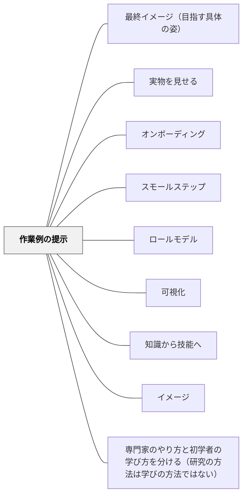

# 作業例の提示

## [Pattern Connection]

**基本文献からの補足（2026-10-14）：思考過程を見せて支える認知的徒弟制（Collinsほか1987）**

モデルを観察して過程の見通しを持ち、本人の遂行にはコーチングを行う（本文pp. 16–17）。授業案として、例を見せる際に選択の理由を述べ、次の問題では本人の選択を観察する。作業例提示だけで全枠組みを実現したとはしない。 出典：[[文献/思考過程を見せて支える認知的徒弟制（Collinsほか1987）]]。

**原典補足（2026-10-14）：授業を支える指導原則（Rosenshine2012）**

作業例は答えだけでなく手順と理由を示し、必要なら一部を子どもが補う形を使う（pp. 15–16）。授業案として例を一つ示した後、似た問題の一手順を本人に説明・実行してもらう。 出典：[[文献/授業を支える指導原則（Rosenshine2012）]]。

**原典補足（2026-10-14）：学習者に合わせる足場かけ（Woodほか1976）**

原典の実演は、目の前で完成形を見せるだけでなく、子どもの試みを理解しやすい形にして示す働きを含む（pp. 98–99）。授業案として、本人が着手した箇所を使い、次の一手だけをゆっくり示す。 出典：[[文献/学習者に合わせる足場かけ（Woodほか1976）]]。

## 背景（Context）

[[パタン/オンボーディング]] として、学習者を学習の土台に乗せたい。しかし「やり方を説明する」だけでは、学習者は何をどこまでやればいいかをイメージできないことがある。特に新しい課題や複雑な手順に取り組むとき、頭の中に「完成した姿」のイメージがなければ、最初の一手が出ない。

## 問題（Problem）

「どうやればいいかわからない」「何が正解かわからない」という状態で課題に向き合うと、認知的負荷がすべて「やり方の推測」に使われてしまい、肝心の内容の理解や習得が進まない。また、正解のイメージがないまま取り組むことへの不安が、参加そのものを妨げる。

## 力のかたち（Forces）

- 人は「見てから真似る」という模倣から多くを学ぶ
- 完成した作業例を先に見せると、依存が生まれる可能性がある
- 「どの程度まで」というクオリティの基準が見えることで安心できる学習者がいる
- 逆に、先に見せることで「自分で考える余地」が失われる場合もある

## 解決（Solution）

**課題に取り組む前または取り組みながら、「完成した・取り組んだ作業の例」を具体的に見せる。**

作業例（Worked Example）は「答え」を渡すのではなく、「どのように考え・どのように表現したか」のプロセスを示すものとして提示する。

**実践例：**
- 作文の単元で、過去の子どもの作文（類似の課題）を匿名で見せてから書き始める
- 算数の問題解決を、教師が「声に出しながら考える（Think Aloud）」でモデル提示する
- 自由研究の単元で、先輩の作品（または大人の作品）を最初に鑑賞する
- ノート指導で「こういうノートがいいノートの例」を学習者と一緒に分析する
- 体育の技を、動画や実演で「全体→部分→全体」の順に見せる

**提示のタイミング：**
- 取り組み前：方向性のイメージをつかませる（ゴールイメージ）
- 取り組み中：詰まったときの「ヒント」として提示する
- 取り組み後：自分のものと比較して改善点を見つける（事後の精緻化）

## 結果（Consequences）

- 「何をすればいいか」への認知的負荷が下がり、内容への集中が高まる
- 「この程度でいい」「こういうことでいい」という見通しが生まれ、参加のハードルが下がる
- 作業例の分析・比較を通じて、暗黙的な基準が言語化される（学習者と教師の評価基準の共有）

作業例の提示は「答えを渡すこと」ではない。「考えるための道具を渡すこと」として設計する必要がある。

> **補足（2026-10-11）**：[[文献/Why Minimal Guidance During Instruction Does Not Work（Kirschner, Sweller & Clark, 2006）]] によれば、学習者が問題を解くより、同等の解き方の例を学ぶほうが、後のテスト問題の成績がよい（**作業例の効果**。代数で最初に示され、多くの学習者と教材で再現された, p. 80）。ただし効かない条件が二つある。①作業例そのものが重い認知負荷をかける構造になっているとき、②学習者の熟達が進んだとき——作業例の効果はまず消え、やがて逆転する（**熟達化反転効果**）。作業例は、新しい内容に出会う初学者にもっとも効き、慣れた子には手を引く。

> **研究の裏づけ（2026-10-11）**：[[文献/Organizing Instruction and Study to Improve Student Learning（Pashler et al., 2007）]] は、並べ方まで具体的に勧める（根拠 moderate）。8問の宿題なら、**1問おきに解き方の例を示す**（例・問題・例・問題……）。例を全部先に見せるより、交互のほうがよく学べた。熟達に応じて例を減らし、最初の手順だけ見せて残りを解かせる形で、だんだん子どもが受け持つ手順を増やす（フェーディング）。例と問題の数値や形式を変えると、練習中の負担は増えるがよく学べる（p. 9–10）。

## クラスター図

## Actionable Insight

- 新しい課題を出す前に「過去の子のものや例」を1つ見せる——「こういうものを作るんだ」というイメージが最初のハードルを大幅に下げる
- 算数・国語の解き方を教師が「声に出しながら考える（Think Aloud）」でモデル提示する——プロセスが見えることで「どう考えればいいか」が伝わる
- 取り組み後に「先生が用意した例と自分のものを比べてみよう」と投げかける——比較が暗黙の基準を言語化させる最も自然な方法

## 出典

- 一つの教育のパタン・ランゲージ（岩井輝久）

## 関連パタン
- [[文献/思考過程を見せて支える認知的徒弟制（Collinsほか1987）]] — 完成例に、その場での判断と本人の試行を添える。
- [[文献/授業を支える指導原則（Rosenshine2012）]] — 作業例の観察から、支援付きの実行へつなぐ。
- [[文献/学習者に合わせる足場かけ（Woodほか1976）]] — 実演を学習者の試みと結びつける。
- [[パタン/最終イメージ（目指す具体の姿）]]
- [[パタン/実物を見せる]]

- [[パタン/オンボーディング]] — 学習の土台に乗せるための上位パタン
- [[パタン/スモールステップ]] — 作業例を細かいステップで提示することもある
- [[パタン/ロールモデル]] — 人そのものを模範として示すより大きなパタン
- [[パタン/可視化]] — 作業のプロセスを見える形にする
- [[パタン/知識から技能へ]] — 作業例の分析が「知識」としての理解を生む
- [[パタン/イメージ]] — ゴールイメージの共有と重なる
- [[パタン/専門家のやり方と初学者の学び方を分ける（研究の方法は学びの方法ではない）]] — 新しい内容は作業例や手本で示し、探究は使える知識がついてから広げる
- [[文献/Why Minimal Guidance During Instruction Does Not Work（Kirschner, Sweller & Clark, 2006）]] — 作業例の効果と、効かない二つの条件（重い負荷・熟達化反転）
- [[文献/Organizing Instruction and Study to Improve Student Learning（Pashler et al., 2007）]] — 1問おきに解き方の例を示す並べ方とフェーディング（勧め2）
