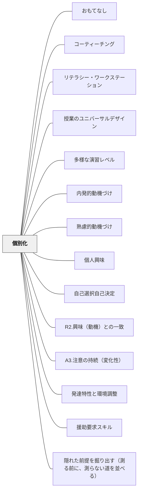

# 個別化

**このパタンが完成を助ける大きなパタン**：[[パタン/熟慮的動機づけ]]

**一文でいうと**：一人ひとりの興味・習熟度・必要に合わせて、課題・ペース・支援・環境の選び方を用意する。

## 使いどころ・使いすぎ注意

| 観点 | 内容 |
| --- | --- |
| 使いどころ | 同じ課題で、ついていけない子と退屈している子が同時にいるとき。特別な支援が要る子がいるとき。 |
| 使いすぎ注意 | 診断した「型」に方法を固定しない（学習スタイルへの適合には十分な支持がない）。全員がばらばらになり、一緒に学ぶ時間がなくなる。 |

> 学習者ひとりひとりに合わせた学習は、「これは自分のための学習だ」という感覚を生む。画一性より個別性が、動機を育てる。

## 背景（Context）
すべての学習者が同じ内容を同じペースで学ぶ画一的な授業では、個々の学習者の興味・強み・習熟度・必要との間に必然的なズレが生じる。このズレが動機の低下・疎外感・学習困難の原因になることがある。個別化は動機付けと学習の質の両方を高める。

## 問題（Problem）
クラス全体への一律の教授では、「自分はこのクラスに合わない」「このペースについていけない・遅すぎる」という感覚を持つ学習者が出てくる。そうした学習者は動機を失いやすい。

## 力のかたち（Forces）
- 完全な個別化は教師の負担が大きく、現実的な制約がある
- テクノロジー（アダプティブラーニング等）を活用することで個別化の実現が容易になっている
- 個別化はペース・内容・方法・評価の複数の次元で実現できる
- 個別化と協働学習は対立するのではなく、組み合わせることができる

## 解決（Solution）

**近いパタンとの見分け**：動機づけ・興味の表では、本パタンの見分けの問いは「一人ひとりの興味・習熟度・必要に合わせて、「これは自分のための学習だ」と感じられるようにしているか（学習スタイルへの適合とは別）」。全体の表は [[パタン/熟慮的動機づけ#近いパタンとの見分け|熟慮的動機づけ]] にある。

> **原文との照合：個人差への対応と型への適合を分ける（2026-10-14）**：本節は以前「学習スタイルに合わせた」と書いていた（2026-11-01 に外した）。Pashlerほか（2008, pp. 108–109, 116）は、提示方法の好みや既習知識の個人差と、「診断した型に指導法を合わせれば成果が上がる」という適合仮説を区別し、後者には十分な支持がないとする。興味・習熟度・アクセス上の必要に応じることを否定した論文ではない。Wiki側の適用案として、型で方法を固定せず、何につまずき、支援後に何が変わったかを見て調整する。出典：[[文献/学習スタイルの概念と証拠（Pashlerほか2008）]]。

**学習者の興味・強み・習熟度・アクセス上の必要に応じた学習の選択肢・ペース・支援を提供することで、「自分に合った学習」を実現する。**

選択課題・選択テーマの提供、習熟度別のサポート、学習者が自分のペースで進める時間の確保、多様な表現・方法から選べるようにすることなどが有効である。全体で学ぶ時間と個別に進める時間を意図的に組み合わせる設計が現実的な出発点となる。

### 教室での使い方

**例①（算数・習熟度別）**：  
練習問題をA（基礎）・B（応用）・C（発展）の3段階に分け、「どこから始めるかは自分で決めていい」と伝える。教師は個別にのぞきに行き「次のステップに行ってみようか」と声をかける。

**例②（書くこと・テーマ設定）**：  
作文のテーマを「自分で決めていい」にする。書けない子には「昨日どんなことがあった？」「好きなものは？」とカンファリングで素材を見つける。

**例③（特別支援・個別対応）**：  
1単元を「全体で学ぶ活動」「自分のペースで進める活動」に分け、特別支援を必要とする子には個別の目標ページ（A4半ページ）を用意する。全員が「同じ時間に同じことをする」ではなく「各自の次の一歩を踏む」を設計する。

### 研究の裏づけ

> **研究の裏づけ（2026-11-01）**：学習障害のある子どもの算数の41研究のメタ分析（Gersten ほか 2009）では、明示的な指導と問題解決の方略が、ほかの要素を考慮しても大きな効果量と関連した。ただし多くの介入は複数の要素の組み合わせで、少数の研究の大きな効果を一般化しないよう注意する（pp. 49–61）。出典：[[文献/算数の困難に応じて指導を組み合わせる（Gerstenほか2009）]]。

> **研究の裏づけ（2026-11-01）**：個別の支援を、だれが・いつ・どれだけ行うと効くか。就学前〜高校の個別指導（一対一または少人数）の無作為化比較96研究のメタ分析（Nickow ほか 2020、作業論文）では、全体の効果は 0.37 SD だった。教師（0.50）や教員以外の専門の指導者（0.40）による指導は、ボランティア（0.21）や保護者（0.23）より大きく、授業時間中の指導（0.40）は放課後（0.21）のほぼ2倍だった。週4〜5日は 0.41、週1〜2日は 0.24 で、週1回の指導で大きな効果が出た証拠はほとんどないとする。読みの指導は低学年ほど効果が大きく（就学前〜幼稚園 0.50、2〜5年生 0.22）、算数は2〜5年生で最も大きかった（0.44）。どれも研究どうしの比較で、指導者の種類・時間帯・学年は互いに重なっている（表3A・3B、pp. 29–38）。出典：[[文献/だれが・いつ・どれだけ個別指導すると効くかを確かめる（Nickowほか2020）]]。

> **研究の裏づけ（2026-11-01）**：学習に困難のある、またはそのおそれのある幼稚園〜6年生への支援の系統的レビュー（Dietrichson ほか 2021、205研究）では、直後の効果は 0.30 だった。効果が大きく安定していたのは、大人による5人以下の少人数指導（単独で 0.38）と、子ども同士の教え合い（単独で 0.39）で、コンピュータを使う指導（0.13）は小さかった。一対一と2〜5人の少人数のあいだに、はっきりした差はなかった（直接比べた研究は4つだけ）。困難の最も大きい子どもには、子ども同士の教え合いは効きにくい可能性があるとする（学習障害のある子の算数の別のレビューの引用）。どれも研究どうしの比較で、方法の中でも効果は大きくばらつく（表3〜7）。出典：[[文献/学習に困難のある小学生への支援の効き方を確かめる（Dietrichsonほか2021）]]。

> **研究の裏づけ（2026-11-01）**：先進国の196の無作為化実験の総説（Fryer 2017）では、6人以下で週4日以上（または36週で50時間以上）の高い量の個別指導が、1年あたり算数 0.309・読み 0.229 と大きく、低い量の個別指導は 0.015 だった。教材・研修・実施の設計図がそろった教員研修（Reading Recovery など）は読みで 0.403、一般の教員研修はほぼゼロだった。読みの効果は対象の年齢が上がるほど小さく（平均5歳未満 0.177、14歳超 0.039）、年齢の上がった子の読みに効いたのは高い量の個別指導くらいだった。どれも研究どうしの比較で、高い量の個別指導の算数は推定6つにもとづく（pp. 10, 40–44, 59–61、表2）。出典：[[文献/196の無作為化実験から、どの種類の支援が学力を伸ばしたかを確かめる（Fryer2017）]]。

> **研究の裏づけ（2026-11-01）**：幼稚園〜5年生の算数のプログラム87研究のメタ分析（Pellegrini ほか 2021、研究者の作ったテストや短い研究を除いた厳しい条件）では、個別指導が +0.20 と大きかった。支援員が構造化されたプログラムで行う2〜6人の少人数の指導（+0.30）は、一対一（+0.19）より小さくなかった（差は有意でない）。一方、一人ひとりに合わせることをうたうデジタル教材は、研修の有無にかかわらずゼロに近かった（0.00〜+0.08）。著者は、説明・手本・つまずきへの応答という合わせ方は技術では代われないとする（pp. 8, 21–23）。出典：[[文献/小学校の算数で効いたプログラムの種類を確かめる（Pellegriniほか2021）]]。

> **研究の裏づけ（2026-11-01）**：シカゴの公立高校の9・10年生を無作為に分けた二つの大規模な実験（Guryan ほか 2023、2,633人と2,710人）では、授業の1時限を使って毎日、指導者一人に生徒二人で数学を教えると、参加した生徒の数学のテストが1年で 0.16 SD と 0.37 SD 伸び、落とした数学の単位はほぼ半分になった。11年生でも 0.22 SD が残った。毎時間の流れ（準備の問題 → その子に合わせた40分 → 確かめの1〜3問）と頻繁な確かめが決まっていて、指導者は教員免許を持たない大学新卒者などだった。問題ごとに見ると、生徒はもとの水準に近い内容で伸びていた（示唆的、有意でない）（pp. 11–14, 19–25, 33–36）。出典：[[文献/中高生でも遅くないことを、毎日の二人一組の数学の個別指導で確かめる（Guryanほか2023）]]。

> **研究の裏づけ（2026-11-01）**：読みに困難のある幼稚園〜5年生へのプログラム65研究のメタ分析（Neitzel ほか 2022、算数の Pellegrini ほか 2021 と同じ方法）では、読みの一対一の個別指導（+0.41）が少人数（+0.24）より有意に大きかった。算数では少人数が一対一より小さくなかったので、人数の効き方は教科で違うのかもしれない。教師・支援員・報酬のあるボランティアのあいだには差がなく、報酬のないボランティアだけが小さかった（+0.14、調整後 +0.04）。一人ひとりに合わせるコンピュータの指導は +0.09 で有意でなかった（表7・表8、pp. 26–34）。出典：[[文献/読みに困難のある小学生への支援の効き方を確かめる（Neitzelほか2022）]]。

> **研究の裏づけ（2026-11-01）**：インドの公立小学校の無作為化比較（Banerjee ほか 2007）では、地域の若い女性が、遅れている3・4年生を1日2時間取り出して1・2年生の基礎を教える補習で、受けた子が 0.6〜1 SD 伸び、学校全体の効果は下位3分の1で上位の約2倍だった。一方、子どもが自分の段階に合った算数のゲームをするコンピューターの学習は、どの層にもほぼ同じように効いた（算数 0.35〜0.47 SD）。教室に残った子は、学級の人数がほぼ半分になっても伸びなかった。今の段階に合わせることが効き、人数を減らすだけでは効かなかった（pp. 22–31）。出典：[[文献/遅れている子を取り出して地域の若い女性が教える補習の効き方を確かめる（Banerjeeほか2007）]]。

> **研究の裏づけ（2026-11-01）**：インドの公立中学生619人の無作為化比較（Muralidharan ほか 2019）では、同じ学年の生徒が5〜6学年分の幅に散らばり、比べた群の下位3分の1は4.5か月でほとんど伸びていなかった。一人ひとりの段階を見積もり、間違いの型に合わせて問題を出すソフトを放課後に使うと、算数 0.36 SD、ヒンディー語 0.22 SD 伸び、効果は事前の点の高低で変わらなかった。同じ時期・同じ地域で、学年の内容を復習する技術なしの放課後の集団指導（時間はより長い）は効果がなかった（pp. 12–18）。出典：[[文献/一人ひとりの段階に合わせるソフトで、学年から大きく遅れた中学生が伸びるかを確かめる（Muralidharanほか2019）]]。

> **研究の裏づけ（2026-11-01）**：ケニアの公立小学校の無作為化比較（Duflo ほか 2011）では、1年生を事前の成績で二つの学級に分けると、上の子にも下の子にも効果があった（18か月後 0.14 SD）。無作為に分けた学級では、周りの子の成績が高いほど上位の子は伸びたが、真ん中の子は伸びなかった。著者は、教師が学級の上位に向けて教える水準を上げ、真ん中の子が置いていかれたと読む。分けた下の学級でも、正規の教師に教わった子は伸びず（0.048 SD）、契約の教師に教わった子は伸びた（0.255 SD）。学級の段階に合わせるだけでなく、その学級でだれがどれだけ教えるかで効き方が変わった（pp. 21–30）。出典：[[文献/1年生を事前の成績で二つの学級に分けると、だれが伸びるかを確かめる（Dufloほか2011）]]。

> **研究の裏づけ（2026-11-01）**：子どもを今の段階で組み分けて教えるやり方を、インドの四つの州の公立学校に広げた一連の無作為化比較（Banerjee ほか 2016）では、教材を配るだけ、担任を研修するだけ、学校の中にボランティアを入れるだけの形は効かなかった。研修を受けた担任は学年の教科書に戻り、ボランティアは担任の手伝いに回され、教室は段階で組み分けられなかった。効いたのは、毎日決まった1時間に担任が学年をまたいで組み分け、行政の指導主事が授業を見に来る形（読み 0.15 SD）と、ボランティアが授業時間中に40日間学校を預かる集中のキャンプ（読み・算数 0.6〜0.7 SD）だった。著者は、そのための時間をはっきり区切ることと、現場での見回りと支えが、いつものやり方に呑み込まれない条件だったと読む（pp. 21–28）。出典：[[文献/段階に合わせて教えるやり方を公立学校に広げると、どんな条件で効いたかを確かめる（Banerjeeほか2016）]]。

> **研究の裏づけ（2026-11-01）**：学年の水準に合わせた教材を足すだけでは、遅れている子は伸びなかった。ケニアの農村の公立小学校で政府の公式の教科書を配った無作為化比較（Glewwe ほか 2009）では、平均の点は上がらず（0.02 SD）、事前の点で5つに分けると上の二つの層（0.14、0.22 SD）だけが上がった。教科書は多くの子にとって3つめの言語である英語で書かれ、配った教科書を読めた中位の子は3年生で16%、4年生で28%だった。著者は、全国一律の教育課程と教科書が最も準備のできた子に合わせて作られていると読む（pp. 18–25）。出典：[[文献/教科書を配ると、だれの点が上がるかを確かめる（Glewweほか2009）]]。

> **研究の裏づけ（2026-11-01）**：苦手な生徒に授業時間と支えの授業を足した制度（Cortes ほか 2015、シカゴの9年生の代数を1日2コマに）では、代数の合格・卒業・大学への進学が増え、単位と卒業の効果は主に8年生の読みの点が中央値より下の生徒に集まった。著者は、算数の考えを言葉で説明することに重きを置いた授業がその生徒たちに合っていたか、読みの点の低さがテストに表れない算数の弱さを表していたと読む。テストの点の伸びは小さく、卒業と進学の効果はそこから予想されるよりずっと大きかった（pp. 16–26）。出典：[[文献/代数の授業を1日2コマにすると、だれの卒業と進学が伸びるかを確かめる（Cortesほか2015）]]。

> **研究の裏づけ（2026-11-02）**：個別化の根拠の一つは、熟達化の逆転である。手厚い支えは知識の少ない学習者を助けるが、知識の多い学習者には余分な作業になりうるので、学習者の今の知識を見取り、知識が変わるにつれて支えを調整する仕組みが要る（Kalyuga 2018、「教育への示唆」の節）。出典：[[文献/初学者に効く手立てが、知っている学習者には効かなくなる「熟達化の逆転」を確かめる（Kalyuga2018）]]。

## 結果（Consequences）
- 学習者が「これは自分に合っている」と感じ、学習への参加意欲が高まる
- 各学習者の強みが活かされる場が生まれ、多様性がクラスの豊かさになる
- 個別化の設計は、学習者理解を深める教師の実践力を育てる

## クラスター図

## Actionable Insight

- 各学習活動に「テーマ・形式・難易度のどれか1つ」を選択できる余地を作る——選択肢があるだけで「これは自分のための学習だ」という感覚が生まれる
- 全体指導の時間と「自分のペースで進める時間」を1コマの中に両方組み込む——全体と個別の組み合わせが現実的な個別化の出発点になる
- 学期の最初に「得意なこと・好きなこと・苦手なこと」を一問確認する——学習者理解が意図的な個別化設計の基盤となる

## 出典

- 一つの教育のパタン・ランゲージ（岩井輝久）/ いるかどり（2023）子どもの発達障害と環境調整のコツがわかる本

## [Pattern Connection]

**研究からの補足（2026-10-18）：全員の学び方を広げる包摂的な授業（FlorianとBlackHawkins2011）**

原典は、個人差に応じつつ特定の子を周辺化しない手法の使い方を論じる（pp. 820–821）。Wiki側の適用案として、個別に用意したヒントのうち他の子にも役立つものを共通の選択肢に加える。必要な個別支援を一律にやめる根拠にはしない。 出典：[[文献/全員の学び方を広げる包摂的な授業（FlorianとBlackHawkins2011）]]。

**研究からの補足（2026-10-17）：教師との関係と学習への参加を分けて捉える（Roordaほか2017）**

原典の分析対象は学級の平均的雰囲気ではなく、教師と個々の子どもとの関係である（pp. 243–244）。Wiki側の適用案として、同じ教材を渡した後でも、必要な援助を伝えられるかを一人ずつ確かめる。関係の良否から固定的な学習者類型を作らない。 出典：[[文献/教師との関係と学習への参加を分けて捉える（Roordaほか2017）]]。

**原典の接続（2026-10-14）**：学習スタイルの概念と証拠（Pashlerほか2008）を参照し、個人差への調整と学習スタイルへの適合仮説を区別するための補足を本ページに加えた。

- **いるかどり（2023）統合（2026-05-20）**：本パタンはもともと「コンテンツを個別化する」——ペース・難易度・テーマの選択——という軸で書かれていた。いるかどり（2023）はこれに「**環境を個別化する**」という別の軸を加える。同じ子どもが、環境（人的・物的・空間的）によって全く異なる状態で学習・生活できるという視点だ。環境の個別化はコンテンツの個別化より先に問われるべき次元かもしれない——どんなに内容を工夫しても、感覚過敏がある子に音が響く座席を与えたままでは学習に入れない。
- **強みリストの統合**：いるかどり（2023）は「できること・好きなこと・やりたいことの総体」を**強みリスト**として記録することを提案する。既存のActionable Insightにある「得意なこと・好きなことを確認する」は、この強みリストの実践と直接重なる。違いは、強みリストが「記録してネットワークに広める」ことを意図している点——本人・保護者・教師・支援者が共有することで個別化の設計の出発点になる。
- **既存パタンとの関連**：[[パタン/発達特性と環境調整]] が「環境の個別化」の具体的手法を提供する。本パタンは「なぜ個別化するか（動機・理念）」を、発達特性と環境調整は「どう個別化するか（手法・環境次元）」を担う。
- **他のパタンへの波及**：[[パタン/援助要求スキル]] — 個別化された環境の設計には「この子が今何に困っているか」を本人が伝えられることが必要——援助要求スキルが個別化の継続的な更新を支える。

## 関連パタン

- [[文献/学習スタイルの概念と証拠（Pashlerほか2008）]] — 個人差への調整と学習スタイルへの適合仮説を区別する。
- [[特別支援/特別支援で使えるパタン]]
- [[特別支援/太田ステージ]]
- [[学級経営/オンボーディング]]
- [[特別支援/TEACCHとシグニファイア]]
- [[特別支援/視覚支援]]
- [[教科/LowFloorHighCeilingタスク集]]
- [[教科/分数パズル（youcubed）]]
- [[教科/算数・数学で使うパタン]]
- [[特別支援/インクルーシブ教育]]
- [[特別支援/環境調整（特別支援）]]
- [[パタン/おもてなし]]
- [[パタン/コーティーチング]]
- [[パタン/リテラシー・ワークステーション]]
- [[パタン/授業のユニバーサルデザイン]]
- [[パタン/多様な演習レベル]]
- [[パタン/内発的動機づけ]]

- [[パタン/熟慮的動機づけ]] — 親パタン
- [[パタン/個人興味]] — 関連パタン
- [[パタン/自己選択自己決定]] — 関連パタン
- [[パタン/R2.興味（動機）との一致]] — 関連パタン（ARCSとの接点）
- [[パタン/A3.注意の持続（変化性）]] — 関連パタン（ARCSとの接点）
- [[パタン/発達特性と環境調整]] — 「環境の個別化」の具体的手法（いるかどり, 2023）
- [[パタン/援助要求スキル]] — 個別化の継続的な更新を支える（本人からの情報提供）
- [[パタン/隠れた前提を掘り出す（測る前に、測らない道を並べる）]] — 子どもの側を動かす道と、授業のほうを全員が入れる形に作り直す道。個別化はその両方を含むが、決める前に二本を並べて比較させるのがあちらの役割（Kane, 1990）
- [[文献/教師との関係と学習への参加を分けて捉える（Roordaほか2017）]] — 教材の調整に加え、教師との関係の個人差を見取る。
- [[文献/全員の学び方を広げる包摂的な授業（FlorianとBlackHawkins2011）]] — 個人差への対応を、学級の参加機会の拡張と結ぶ。
- [[文献/算数の困難に応じて指導を組み合わせる（Gerstenほか2009）]] — 学習障害のある子の算数：明示的指導と方略
- [[文献/だれが・いつ・どれだけ個別指導すると効くかを確かめる（Nickowほか2020）]] — 個別指導：だれが・いつ・どれだけ（教師 0.50、授業中 0.40、週1回は効きにくい）
- [[文献/学習に困難のある小学生への支援の効き方を確かめる（Dietrichsonほか2021）]] — 困難のある小学生への支援：少人数指導 0.38、教え合い 0.39
- [[文献/196の無作為化実験から、どの種類の支援が学力を伸ばしたかを確かめる（Fryer2017）]] — 高い量の個別指導（週4日以上・6人以下）と、手順の決まった研修
- [[文献/小学校の算数で効いたプログラムの種類を確かめる（Pellegriniほか2021）]] — 算数の少人数の個別指導（+0.30）と、デジタル教材の限界
- [[文献/中高生でも遅くないことを、毎日の二人一組の数学の個別指導で確かめる（Guryanほか2023）]] — 中高生への毎日の二人一組の数学の個別指導（0.16〜0.37 SD）
- [[文献/読みに困難のある小学生への支援の効き方を確かめる（Neitzelほか2022）]] — 読みの一対一（+0.41）と少人数（+0.24）、指導者の違い
- [[文献/遅れている子を取り出して地域の若い女性が教える補習の効き方を確かめる（Banerjeeほか2007）]] — 遅れている子をまだ持っていない基礎から教える補習と、段階に合わせるコンピューターの学習
- [[文献/一人ひとりの段階に合わせるソフトで、学年から大きく遅れた中学生が伸びるかを確かめる（Muralidharanほか2019）]] — 同じ学年の中の5〜6学年分の幅に、段階に合わせるソフトで応えた無作為化比較
- [[文献/1年生を事前の成績で二つの学級に分けると、だれが伸びるかを確かめる（Dufloほか2011）]] — 学級を段階で分けると、教師が教える水準を合わせられた無作為化比較
- [[文献/段階に合わせて教えるやり方を公立学校に広げると、どんな条件で効いたかを確かめる（Banerjeeほか2016）]] — 段階に合わせて教えるやり方が、学校で実際に行われた条件と行われなかった条件
- [[文献/教科書を配ると、だれの点が上がるかを確かめる（Glewweほか2009）]] — 学年の水準に合わせた教材を足しても、遅れている子は伸びなかった無作為化比較
- [[文献/代数の授業を1日2コマにすると、だれの卒業と進学が伸びるかを確かめる（Cortesほか2015）]] — 苦手な生徒に授業時間と支えの授業を足し、読みの苦手な生徒に効果が集まった制度
- [[文献/初学者に効く手立てが、知っている学習者には効かなくなる「熟達化の逆転」を確かめる（Kalyuga2018）]] — 知識に応じて支えを調整する根拠

## このパタンが働く実践
- [[実践/インクルーシブ授業の設計]]
- [[実践/個別教材の設計]]

| 実践パタン | どのように個別化しているか |
|------------|----------------------------|
| [[実践/カエルの算数：勝ちやすさを表で考えよう]] | 児童ごとに目標や支援を変え、一人用ボードなど参加の仕方も調整する |
| [[実践/個別支援級の複式算数：重さと面積をわたり・ずらしで学ぶ]] | 複数の教育課程と児童の状態に合わせ、直接指導・自力解決・支援のタイミングを調整する |
