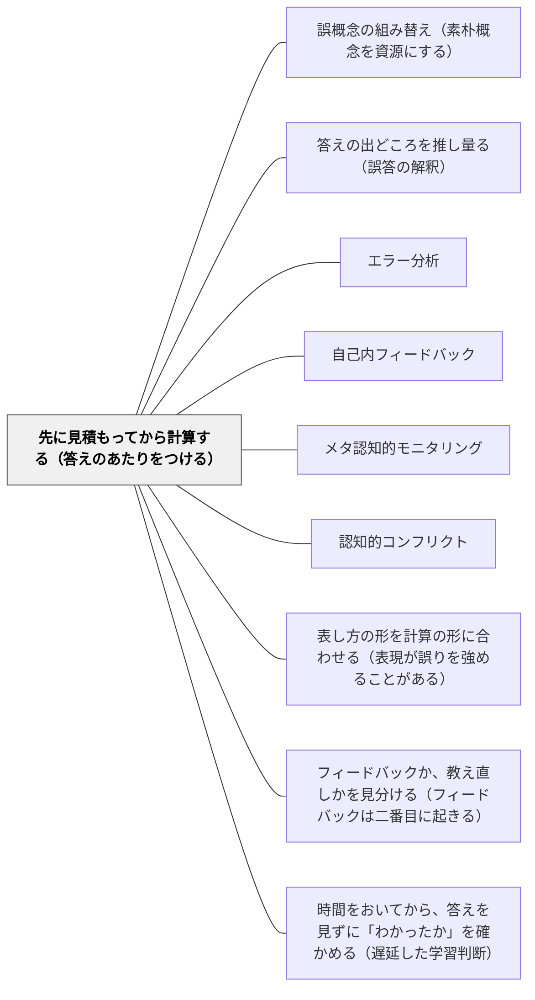

# 先に見積もってから計算する（答えのあたりをつける）

> 1/2 + 1/5 を計算して 2/7 と書いた子は、2/7 が 1/2 より小さいことに気づかない。計算の前に「1/2 より少し大きくなるはず」とあたりをつけていれば、答えを見た瞬間に「おかしい」と分かる。見積もりは近道ではなく、自分の答えを自分で疑うための前段である。

## [Pattern Connection]

[[文献/Developing Effective Fractions Instruction（Siegler et al., 2010）]] は、分数の計算手続きの意味を分かるようにするための四つの手順の一つに、見積もりを置いた（勧め3の手順2, p. 30–31）。見積もりは推論を使うので、子どもの注意を手続きの意味に向ける、という理由である。

このWikiでは、誤りが起きたあとの扱い——[[パタン/誤概念の組み替え（素朴概念を資源にする）]]・[[パタン/答えの出どころを推し量る（誤答の解釈）]]・[[パタン/エラー分析]]——は厚い。本パタンはその**前**に入る。誤りを教師が見つける前に、**子ども自身が見つけられる基準**を計算の前に持っておく。

- **補強点**：[[パタン/自己内フィードバック]] の「自分で自分の出来を判断する基準」を、計算という場面で具体化する。見積もりは、答えが合っているかを判断する**内側の物差し**になる
- **[[パタン/認知的コンフリクト]] との関係**：見積もりと計算結果のずれは、教師が反例を用意しなくても子どもの中に葛藤を生む。葛藤の材料を子どもが自分で作る形である
- **根拠の強さについて**：ガイドが勧め3全体に付けた根拠は moderate だが、**見積もりの手順そのものを確かめた厳密な研究は挙がっていない**（p. 27）。見積もりを含む複合的なカリキュラム（Rational Number Project）は見積もりの成績を上げたが、どの要素が効いたかは分けられていない（p. 62）。本パタンはパネルの判断に基づく

---

## 背景（Context）

算数の計算練習では、手続きを正しく実行して答えを出すことが目標になりやすい。答え合わせは教師か答えのページが行い、子どもは丸かバツかを受け取る。

分数の計算では、手続きの取り違えが多い。分子どうし・分母どうしを足す、大きいほうの分母をそのまま使う、帯分数の整数部分だけを引く——ガイドはこうした誤りの多くを、**整数で正しい規則を、当てはまらない場面に持ち込んだもの**と見る（p. 31）。手続きが崩れても、子どもの手元には「答えがありえない」と気づく手がかりがない。

## 問題（Problem）

**手続きだけで計算すると、ありえない答えに気づかない。** 答えの正しさを判断する基準が子どもの外（教師・答えのページ）にしかないので、誤った手続きは答え合わせのときまで、あるいは答え合わせのあとも残る。

ガイドはこう例を挙げる。1/2 + 1/5 の答えは 1/2 より大きく 3/4 より小さいと見積もっておけば、分子と分母を足して 2/7 を出したとき、2/7 は 1/2 より小さいから**この答えはありえない**と分かる（p. 31）。見積もりがなければ、2/7 はもっともらしい分数の一つに見える。

## 力のかたち（Forces）

- **見積もりは余計な手間に見える**：答えを出せばすむのに、なぜ先にあたりをつけるのか。子どもには遠回りに見え、計算に飛びつきたくなる（ガイドの障害3.2）
- **すぐ暗算できる問題では意味がない**：7/9 − 5/9 のように一瞬で答えが出る問題で見積もりを求めても、形だけの作業になる（p. 31）
- **見積もるには大きさの感覚が要る**：分数の見積もりは、0・1/2・1 のどれに近いか、分母が大きいほど単位分数は小さい、という感覚に支えられている。この感覚がない子には見積もりができない
- **見積もりは答えの代わりではない**：見積もりを「だいたいの答えを出す近道」と受け取ると、正確な計算をしなくなる

## 解決（Solution）

**計算を始める前に、答えのだいたいの大きさを書く。計算したら、答えと見積もりを並べて比べ、ずれていたら手続きを疑う。** 見積もりは手続きの前段であって、近道ではないと伝える。

手順は四つ。

1. **見積もりが効く問題を選ぶ**：暗算ですぐ出る問題ではなく、すぐには出ない問題で見積もりを求める（5/8 + 3/8 ではなく 5/9 + 3/7, p. 34）
2. **基準点を持つ**：0・1/2・1 を基準点にして、それぞれの分数がどれに近いかを言う（例3, p. 31）
3. **見積もりを先に書き、理由を言う**：「7/8 は1に近く、3/7 は 1/2 に近いから、答えは 1 1/2 くらい」
4. **計算のあとで並べる**：答えと見積もりを比べる。ずれていれば、どこで手続きが崩れたかを探す。合っていれば、なぜ合ったかを言う

---

### 具体例①：基準点 0・1/2・1 で見積もる

ガイドの例3（p. 31）から。

- **7/8 + 3/7**：7/8 は1に近い。3/7 は 1/2 に近い。だから答えは 1 1/2 に近い
- **5 ÷ 5/6**：5/6 は1に近い。5 ÷ 1 は5。5/6 は1より少し小さいから、答えは5より少し大きい

二つめの例は、割り算で答えが割られる数より大きくなることを、計算の前に見せる。「割ると小さくなる」という整数の感覚を、子どもが自分の見積もりで組み替える入口になる（[[パタン/誤概念の組み替え（素朴概念を資源にする）]]）。

---

### 具体例②：単位分数の大きさで見積もる

分母が大きくなるほど単位分数は小さくなる——この理解を見積もりに使う（例3, p. 31）。

- 始めたばかりの子：9/10 + 1/8 は、9/10 がほぼ1、1/8 が 1/10 に近いから、答えは約1
- 進んだ子：9/10 は1まであと 1/10。1/8 は 1/10 より少し大きい。だから答えは1より少し大きい

同じ問題で見積もりの細かさが変わる。見積もりは正解か不正解かではなく、どこまで細かく言えるかで深まる。

---

### 具体例③：異分母の足し算の授業で

5年の分数の足し算で、1/2 + 1/3 を計算する前に「答えは 1/2 より大きい？小さい？」と問う。1/2 に何かを足すのだから、1/2 より大きくなるはずである。

計算して 2/5 が出た子は、自分の見積もりと並べて「2/5 は 1/2 より小さい。足したのに小さくなった」と気づく。教師が「違うよ」と言う前に、子ども自身が自分の答えを疑う。ここから「なぜ分子どうし・分母どうしを足してはいけないのか」を話し合うと、通分の必要が子どもの問いとして立ち上がる（[[パタン/表し方の形を計算の形に合わせる（表現が誤りを強めることがある）]] の図と組み合わせる）。

---

### 特別支援の視点

見積もりの言葉（「より大きい」「くらい」「近い」）が負担になる子には、数直線の上に指を置くことで見積もりを表してもらう。「1/2 はここ。答えはこれより右？左？」と、位置で答えられるようにする。答えを数直線に置いたとき、見積もりの指の位置とずれているかを目で比べられるので、言葉にしなくても自分の答えを点検できる。

## 結果（Consequences）

**利点**

- 子どもが自分の答えのありえなさに、自分で気づけるようになる。答えの正しさを判断する基準が、子どもの内側にできる
- 見積もりと答えのずれが、手続きの崩れを見つける手がかりになる。誤りの出どころを探す話し合いの入口になる
- 見積もりのために大きさの感覚を使うので、分数を「大きさを持った一つの数」として見る見方が育つ

**注意点・リスク**

- **研究の裏づけはまだ弱い**：見積もりの手順そのものを確かめた厳密な研究は、ガイドには挙がっていない。教室で試し、子どもが本当に自分の答えを疑うようになるかを記録する
- **すべての問題で求めると形骸化する**：一瞬で答えが出る問題で見積もりを求めると、見積もりが「書かなければいけない欄」になる。見積もりが効く問題に絞る
- **大きさの感覚がない子には先にその支えが要る**：0・1/2・1 のどれに近いかが言えない子に見積もりを求めても、当てずっぽうになる。数直線で大きさを見る経験を先に積む
- **見積もりを評価の対象にしない**：見積もりが外れても誤りではない。外れたこと自体が、次の計算への情報になる

## 関連パタン

- [[パタン/誤概念の組み替え（素朴概念を資源にする）]] — 見積もりと答えのずれが、素朴概念の適用範囲を問い直す入口になる。組み替えの「ゆさぶる」段階を子ども自身が起こす形
- [[パタン/答えの出どころを推し量る（誤答の解釈）]] — 誤答の出どころを教師が推し量るのがあちら、見積もりによって子ども自身が答えのおかしさに気づくのが本パタン
- [[パタン/エラー分析]] — 誤りの型を分類して渡すのがあちら。本パタンは誤りを見つける手がかりを計算の前に持つ
- [[パタン/自己内フィードバック]] — 自分の出来を自分で判断する基準。見積もりはその計算版の物差し
- [[パタン/メタ認知的モニタリング]] — 計算しながら「この答えはありうるか」を監視する。見積もりはその監視の基準点を先に置く
- [[パタン/認知的コンフリクト]] — 見積もりと答えのずれは、教師が反例を出さなくても葛藤を生む
- [[パタン/表し方の形を計算の形に合わせる（表現が誤りを強めることがある）]] — 表し方は計算の意味を見せ、見積もりは計算の結果を確かめる。同じガイドの勧め3の二つの手順
- [[パタン/フィードバックか、教え直しかを見分ける（フィードバックは二番目に起きる）]] — 自信のある誤りにフィードバックはもっとも効く。見積もりはその誤りに子ども自身が気づく手がかり
- [[パタン/時間をおいてから、答えを見ずに「わかったか」を確かめる（遅延した学習判断）]] — 解く前に「解けそうか」を判断する点で通じる

## クラスター図

## Actionable Insight

- 次の分数の計算練習で、一問だけ「計算する前に、答えは 1/2 より大きいか小さいかを書こう」と求めてみる。暗算ですぐ出ない問題を選ぶ
- 答え合わせのとき、丸つけの前に「自分の見積もりと答えを並べて、おかしくないか見てみよう」と言う。教師が丸をつける前に、子どもが自分で点検する時間を1分取る
- 誤答が出たとき、「違うよ」と言う代わりに「計算の前に、答えはどのくらいになると思った？」と聞いてみる

## 出典

Siegler, R., Carpenter, T., Fennell, F., Geary, D., Lewis, J., Okamoto, Y., Thompson, L., & Wray, J. (2010). *Developing effective fractions instruction for kindergarten through 8th grade: A practice guide* (NCEE #2010-4039). National Center for Education Evaluation and Regional Assistance, Institute of Education Sciences, U.S. Department of Education.

> "Estimation requires students to use reasoning skills and thus leads them to focus on the meaning of procedures for computing with fractions." (p. 30)
>
> 見積もりは推論の力を使うことを求めるので、生徒の注意を分数の計算手続きの意味に向ける。

> "Estimation should be presented as a tool for anticipating the size and assessing the reasonableness of an answer. ... estimation is a preliminary step to solving a problem, not a shortcut to obtaining an exact answer." (p. 34)
>
> 見積もりは、答えの大きさを予想し、答えが妥当かを判断する道具として示すべきである。……見積もりは問題を解く前段の手順であって、正確な答えを得るための近道ではない。
