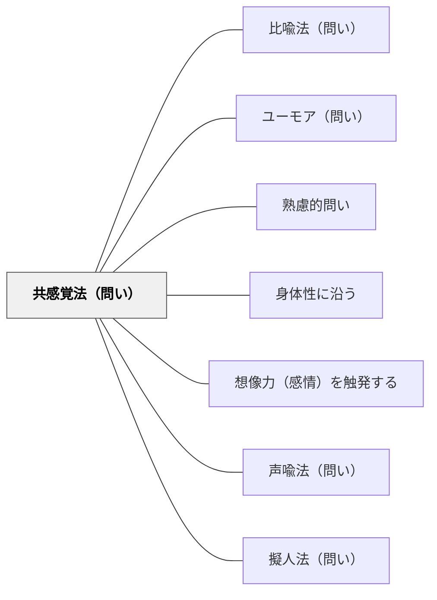

# 共感覚法（問い）

**このパタンが完成を助ける大きなパタン**：[[パタン/熟慮的問い]]

> 五感に関する表現で感覚を刺激する問い

## 背景（Context）
本パタンの出典である安斎（2021）の共感覚法は、問いの文言に五感（視覚、聴覚、触覚、味覚、嗅覚）に関する表現を使う技法である。修辞学でいう共感覚（ある感覚の言葉で別の感覚を表す表現）は、その一部にあたる。問いに五感的な表現を取り入れることで、学習者の身体的・感覚的な想像力を引き出し、言語化しにくい直感や印象を問いの場に持ち込む橋渡しになる。

**原典では**：安斎（2021）は共感覚法を「光の色を変える」タイプのレトリックの一つとし、「人間の感覚機能である五感（視覚、聴覚、触覚、味覚、嗅覚）に関する表現を使ったテクニック」と定義する（第5章 MANNERS 17、Kindle版 84%）。問いのアレンジでは特に視覚と聴覚が使い勝手がよいとされ、「3年後のあなたのキャリアの目標はなんですか？」を「3年後、あなたはどんな景色をみていたいですか？」（視覚）に、「この商品のどこを改善したいですか？」を「この商品をみたユーザーから、どんなセリフが聞こえてきそうですか？」（聴覚）に言い換える例が示される（同）。頭で思考するだけでなく、感覚的に問いに向き合えるため、発想がふくらむという（同）。原典の共感覚法は、ある感覚が別の感覚を呼び起こす現象（いわゆる共感覚）を直接扱うものではなく、問いの文言に五感の表現を入れる技法である。

**岩井の講話では**：共感覚法を「五感に関する表現で感覚を刺激する」と読み上げたうえで、講話の前半で扱った「知覚語を問う」と「同じこと」だと結びつけている（30:06〜30:14）。その「知覚語を問う」は、視覚や聴覚の言葉で、たとえば「バスの運転手は何を見ているのかな」と問う問いとして説明されている（18:31〜18:46）。→ [[パタン/知覚語で問う]]

## 問題（Problem）
知識や概念を言葉だけで問うと、学習者は覚えている定義を繰り返すだけになりがちである。感覚的・身体的な回路を使わなければ、個人の独自の理解や経験が議論に現れない。「どんな感じがするか」という問いの入口がなければ、感性的知性が学びの場で活かされない。

## 力のかたち（Forces）
- 感覚的直感 vs 論理的説明
- 個人的な感受性 vs 共有可能な知識
- イメージの豊かさ vs 概念の正確さ
- 身体的関与 vs 抽象的思考

## 解決（Solution）
「この考えはどんな色をしている？」「この理論を音に喩えると、どんな音がする？」「この問題に触れたとき、どんな感触がする？」のように、視覚・聴覚・触覚・味覚・嗅覚などの感覚次元に翻訳して問う。正解を求めず、なぜその感覚を選んだかを子どもが語ると、自分の感じ方を見直すきっかけになる。

---

**例：見学先の仕事を「見る」「聞く」で問う**（社会・3年）
1. 消防署の見学の前に、「消防士さんの仕事で大切なことは？」という問いを、「消防士さんは、出動の前にどこを見ているのだろう？」「どんな音を聞いて動き出すのだろう？」と言い換えて黒板に書く。
2. 子どもは見学メモに「見ている」「聞いている」の二つの欄をつくり、見学中に気づいたことをそれぞれの欄に書く。
3. 教室に戻ってから、二つの欄を出し合い、「見る・聞くことが、なぜ仕事に大切なのか」を話し合う。

---

**例：物語の場面を「聞こえる音」で問う**（国語・5年）
1. 物語のクライマックスの場面で、「この場面の人物の気持ちは？」と問う代わりに、「この場面に立っていたら、どんな音が聞こえるだろう？」と問う。
2. 子どもは本文から音につながる言葉に線を引き、本文にない音を想像したときは、そのもとになった本文の言葉も一緒に書く。
3. 出た音を、静かな音から大きな音へ順に並べ、「音の並びから、人物のどんな気持ちが読めるか」に問いを戻す。

**近いパタンとの見分け**：問いの型の表では、本パタンの見分けの問いは「五感の言葉を使って、感覚を刺激しているか」。全体の表は [[パタン/熟慮的問い#近いパタンとの見分け|熟慮的問い]] にある。

## 結果（Consequences）
- 言語化しにくい個人的な理解や印象が問いの場に現れる
- 感性的・身体的な知性が評価される学習環境が生まれる
- 多様な感覚的メタファーが議論を豊かにする

- 注意点：原典で使い勝手がよいとされるのは視覚と聴覚である。いきなり味覚や「考えの色」のような感覚をまたぐ問いを出すより、まず「何が見えるか」「何が聞こえるか」から入ると答えやすい（安斎 2021、第5章 MANNERS 17）。

## 関連パタン
- [[パタン/比喩法（問い）]]
- [[パタン/ユーモア（問い）]]
- [[パタン/熟慮的問い]] — 親パタン
- [[パタン/身体性に沿う]] — 感覚・身体的直感を学びに引き込む上位パタン
- [[パタン/想像力（感情）を触発する]] — 感覚的な問いが感情・想像力を動かす
- [[パタン/声喩法（問い）]] — オノマトペで内的状態を問う兄弟パタン
- [[パタン/擬人法（問い）]] — 対象に感覚・人格を与えて問う兄弟パタン

## クラスター図

## Actionable Insight

- 「この考えはどんな色をしている？」「この理論を音に喩えると？」と五感次元に翻訳して問う——言語化しにくい個人的な理解や印象が問いの場に現れる
- 「この問題に触れたとき、どんな感触がする？」と問い、なぜその感覚を選んだかを子どもが語る——感覚的メタファーの理由の語りが深い内省を生む
- 問いの前に「感覚で考えるモード」に入ることを宣言する——感性的・身体的な知性が評価される学習環境が生まれる

## 出典
- [[文献/熟慮的問いのパターンリスト（動画記録）]]

- 安斎勇樹（2021）『問いかけの作法 チームの魅力と才能を引き出す技術』ディスカヴァー・トゥエンティワン 第5章 MANNERS 17「レトリック（B-3）共感覚法」 — Kindle版 84% で確認。[[文献/問いかけの作法（安斎勇樹）]]
- 岩井輝久（年不明）『熟慮的問いのパターンリスト』［動画］ https://youtu.be/WivskVtxG34 — 2026-11-13 に文字起こしで確認（18:31〜18:46、30:06〜30:14）
