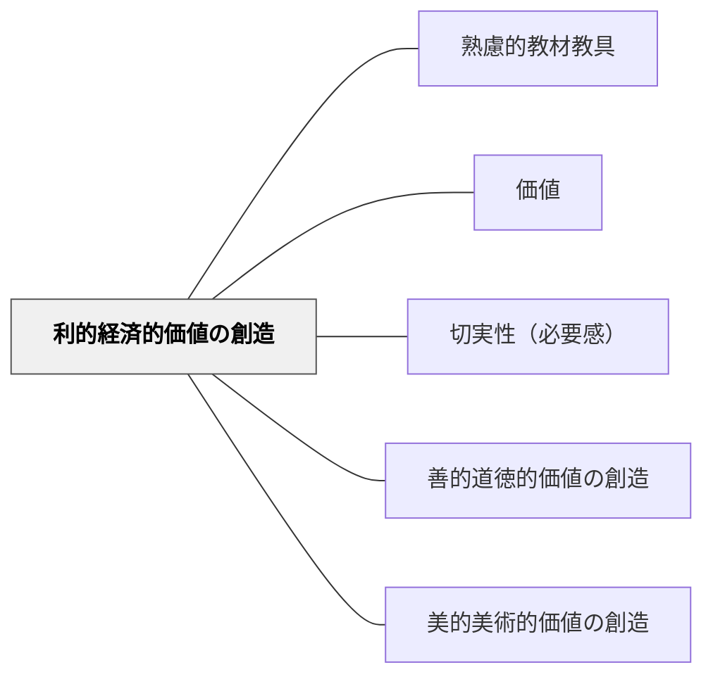

# 利的経済的価値の創造

> 役に立つこと・生活を豊かにすること——有用性の価値を育む教育材料。

## 背景（Context）

牧口常三郎の3価値分類の一つ。牧口が「利的価値の創造を指導するに主として役立つ教科」として挙げたのは手工・裁縫等で、「生活指導の教育目的からなお大に増加を要す」と述べている。国語・算術・体操は、利・善・美の諸方面の基礎となる教科として別に置かれている（『創価教育学体系』第4巻 第二章）。本Wikiでは、数学・理科・家庭科・職業教育などにも利的価値の側面を見る。「役に立つ」という実感が学習動機を支える。

**原典では**：牧口は、教科の選び方が「何等統一的の着眼点から取捨選択されたものではない」ことを批判し、利・善・美の価値の創造を指導するという目的から教科を見直した。そのうえで、利的な価値創造の指導が「極めて小部分に局限され」ている点を問題にしている。

## 問題（Problem）

「この学習が将来何の役に立つのか」が分からないと学習者は動機を失いやすい。

## 力のかたち（Forces）

- 有用性の実感が学習の意味づけを支える
- 近視眼的な「役立ち」だけでなく長期的な価値も含む
- 利的価値だけを重視すると教育が功利的になりすぎる

## 解決（Solution）

**近いパタンとの見分け**：教材・教具の表では、本パタンの見分けの問いは「役に立つ・暮らしを支えるという価値を、子どもがつくり出す教材か」。全体の表は [[パタン/熟慮的教材教具#近いパタンとの見分け|熟慮的教材教具]] にある。

**学習内容の実生活・将来の仕事・経済活動との関連を明示し、有用性を実感できる教材設計をする。**

**例：予算の中で献立を考える**（家庭科・5〜6年）
調理実習の材料費を計算し、同じ予算でよりよい献立にするにはどこを変えればよいかを考える。値段・栄養・手間の三つを比べて選ぶ。

---

**例：学級のお店**（生活科・特別活動）
自分たちで作ったしおりやカードを交換する場をつくり、どうすれば相手の役に立つか、何をどれだけ作ればよいかを考える。

## 結果（Consequences）

- 学習内容の実用的意味が学習者に伝わる
- 切実性・必要感が高まる

- 注意点：牧口は利・善・美の三つを並べている。利だけを強めると、教育が損得の話に寄りすぎる

## 関連パタン

- [[パタン/熟慮的教材教具]] — 親パタン
- [[パタン/価値]] — 上位パタン
- [[パタン/切実性（必要感）]] — 有用性から来る必要感
- [[パタン/善的道徳的価値の創造]] — 道徳・共同体への貢献という価値を生む兄弟パタン
- [[パタン/美的美術的価値の創造]] — 感動・美という価値を生む兄弟パタン
- [[メタパタン/価値を目標とする]] — 利・善・美の価値を目標とするメタパタン
- [[概念/教育の目標と力能]] — 価値の実現が力能の増大につながる
- [[概念/教養と人格形成]] — 価値の創造が人格形成の核心

## クラスター図

## Actionable Insight

- 学習内容が「どんな仕事で使われるか」「生活のどの場面で役立つか」を具体的に1つ示してから授業に入る——有用性の見通しが動機を高める
- 「この技術が分かると〇〇（具体的な活動）ができる」と学習後に何ができるかを明示する——「役立てられる」という実感が学習継続を支える
- 単元の終わりに「今日学んだことを使って何かやってみたいことはある？」と問う——有用性の認識が自分の文脈と結びついたとき動機が内発化する

## 出典

- 牧口常三郎（1972）『牧口常三郎全集第4巻 創価教育学体系 上』聖教新聞社

- 牧口常三郎（2007）『創価教育学体系』第4巻（聖教文庫、第8刷のデジタル版）第二章「教科構造論」— 2026-11-13 に該当箇所の原文を確認。[[文献/創価教育学体系 4（牧口常三郎）]]
