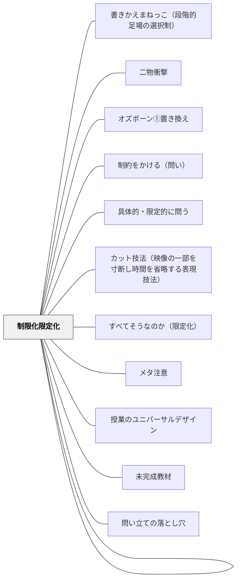

# 制限化（限定化）

**一文でいうと**：何を・どこまで・どれだけ扱うかを絞り、子どもが安心して集中し、その中で考えられるようにする。

## 使いどころ・使いすぎ注意

| 観点 | 内容 |
| --- | --- |
| 使いどころ | 課題や活動が広すぎて、子どもが何から始めればよいか分からないとき。単元のテーマを決めるとき。 |
| 使いすぎ注意 | 絞りすぎると、子どもが選び、自分のやり方で考える余地がなくなる。 |

> 無制限であることによって、安心できないし、学ぶことが妨げられている。

## 背景（Context）

「教育とは、まず制限なのです。」千葉雅也

## 問題（Problem）

無制限であることによって、安心できないし、学ぶことが妨げられている。

## 力のかたち（Forces）

- 教育において、どのように制限するのかということは、教育を支える、根本的で極めて重要なパタンである
- 「どのような知識が最も価値があるのだろうか」（スペンサー）——何を学ぶかを選ぶことは避けられない
- 制約は創造を生む（北大路翼「十七文字の器はでけーぞ。」、下の補足）
- 制限は、教師が子どもにかけるだけでなく、教師が自分自身にも、子どもが自分の学習にもかけるもの。状況に応じて適切に制限化できることが、自己調整学習の鍵になる（岩井 2023、下の補足）
- ただ無制限に自由に学ぶというのは、教育ではない

## 解決（Solution）

**効果的に教育を制限化せよ。**

### 制限化の例

- **教科書**：今ある算数や数学の教科書は、人間が長い時間をかけて構成してきた知識の中でも基本的で最も価値のある知識を、順序を考えて整理（制限化）したものです。
- **おにあそび**：逃げることができる範囲を制限することで、より安全に楽しく遊ぶことができます。
- **学校図書館**：限られた空間に、教材となるものも含めて、選りすぐりの本を集めています。子どもたちは制限化（限定化）された環境で本を選ぶことによって効果的に学ぶことができます。
- **社会科・理科の単元のはじめ**：多くの社会科や理科の単元学習のはじめは、社会事象や自然事象との出会いから始まる構成になっています。社会事象や自然事象に出会うことで、無制限に自由に思考するのではなく、子どもたちの思考には、大きな学習テーマが生まれます（制限化）。その大きなテーマの中で小テーマ（学びたいこと／質問）を出していくわけです。

### 研究の裏づけ

> **研究の裏づけ（2026-11-01）**：米国教育科学研究所の算数の問題解決の実践ガイド（Woodward ほか 2012）は、解く過程を点検する問いかけの一覧を子どもの手元に置くよう勧め（根拠 strong）、一覧は全部渡さず数個に絞るよう書く。「多すぎる問いかけは解く過程を遅くするか、無視される」からである。手がかりも、多ければよいわけではない例である。出典：[[文献/算数の問題解決を4〜8年生で育てる（Woodwardほか2012）]]。

## 結果（Consequences）

- 制限化することによって、被教育者は安心して経済的に学習に取り組むことができる
- 大きな学習テーマの中で、子どもが自分の小テーマ（学びたいこと／質問）を出せるようになる（社会科・理科の例）

## Pattern Connection

### 北大路翼（2019）生き抜くための俳句塾 統合（2026-06-02）：17文字——制約が創造を必然化する

17文字という俳句の制約は、制限化（限定化）の最も洗練された実践例の一つである。

> 「十七文字の器はでけーぞ。」——北大路翼（2019）第一講

北大路翼はこの一文で逆説を示す：制約（17文字）は小さいのではなく「でかい」。制約があることで、感情・経験・観察のすべてが17文字に向かって収斂する。「何を言わないか」が決まるとき、「何を言うか」が際立つ。

**「音数よりも音量」——制約の精神：**
「字余り・字足らずは気にしない。音数よりも音量」——これは「17という数字に制限されるのではなく、17文字という精神（何を伝えるか）に制限される」ということ。制限化の本質は「何もかもを詰め込まないこと」であり、数字そのものではない。

**制限が発想を生む：**
「なんでもいいから具体的なモノを一つ持ってきて」「二物（二つのものを取り合わせる）」——俳句の技法はすべて制限から生まれる発想法。制約がなければ「どこから始めればいいかわからない」状態になる。これは既存の解決部分「制限化することによって、被教育者は安心して経済的に学習に取り組むことができる」の詩的な実証例である。

- **既存パタンとの関連**：岩井（2023）の接続が「制限化は自己調整学習の鍵」という原理論を示すとすれば、北大路翼は「17文字の制約が感性・発想・表現をすべて収斂させる」という詩的実践での具体例を提供する
- **補強された点**：「制限が安心と学習を生む」（本パタンの解決部分）に、「制限が創造を生む」という補強が加わる——「器が小さいから詰め込まれる」のではなく「器が小さいから選ばれる」
- **他のパタンへの波及**：[[パタン/二物衝撃]] — 17文字の中で二物を選ぶという制限が取り合わせを鋭くする；[[パタン/多作多捨]] — 制限された形式（17文字・句会）が多作多捨のリズムを制度化する；[[文献/生き抜くための俳句塾（北大路翼）]] — 本統合の出典

---

### 岩井輝久（2023）——制限化は自己調整学習の鍵であり大パタン

> 「自己調整学習の鍵の一つが制限化（限定化）。力のある教育者は、自分に対しても、被教育者に対しても状況に応じて適切に教育を制限化している。これを教育者も被教育者もできるように助けていくこと。制限化は、あらゆる教育、学習を貫く原則、大パタン。」（岩井輝久、2023）

- **既存パタンとの関連**：既存の記述（千葉雅也「教育とは、まず制限なのです」・教科書や学校図書館の例）は制限化の働きを説明するが、このツイートは「なぜ大パタンか」の根拠を追加する——自己調整学習に直結するからこそ、制限化はあらゆる教育場面を貫く
- **補強された点**：制限化の適用対象が「教師自身」にも及ぶという視点が加わった。教師が自分の教え方・発問・介入を適切に制限化することと、子どもが自分の学習を制限化（フォーカス）することは同じ構造をもつ
- **他のパタンへの波及**：[[パタン/自己調整]]（制限化が自己調整のループを起動させる——目標・範囲・時間の制限があって初めて「どこに向かうか」の自己判断が生まれる）・[[パタン/目標設定]]（「何をしないか」を決めることが目標を明確にする）・[[パタン/ボトルネック]]（無制限であることはボトルネックの一形態）

## 関連パタン
- [[実践/作家の時間（2年生）]]
- [[パタン/書きかえまねっこ（段階的足場の選択制）]]
- [[パタン/二物衝撃]]
- [[パタン/オズボーン①置き換え]]
- [[パタン/制約をかける（問い）]]
- [[学級経営/オンボーディング]]
- [[パタン/具体的・限定的に問う]]
- [[パタン/カット技法（映像の一部を寸断し時間を省略する表現技法）]]
- [[パタン/すべてそうなのか（限定化）]]
- [[パタン/メタ注意]]
- [[パタン/授業のユニバーサルデザイン]]
- [[パタン/未完成教材]]

- [[概念/パタン・ランゲージ概論]]
- [[パタン/制限化限定化]] （原典パタン集に存在する場合）
- [[パタン/問い立ての落とし穴]] — 「大きすぎるテーマ」の絞り方として制限化が機能する
- [[文献/算数の問題解決を4〜8年生で育てる（Woodwardほか2012）]] — 問いかけの一覧は数個に絞る（多すぎると無視される）

## クラスター図

## Actionable Insight

- 課題を出す時に「今日はこの3つの方法だけ使ってよい」と制限する——自由すぎると思考が止まる。制限が創造を生む
- 学習テーマを決めたら「この単元では考えないこと」を明示する——何をしないかを決めることで何をするかが明確になる
- 自由探究の前に「使える素材はこれだけ」「発表時間は2分」という制限を設ける——制限が安心と集中と経済性を生む

## 出典
- [[文献/一つの教育のパタン・ランゲージ]]

岩井輝久「岩井輝久『一つの教育のパタン・ランゲージ』」（2026-04-29 vault収録）  
千葉雅也（2022）『現代思想入門』講談社
