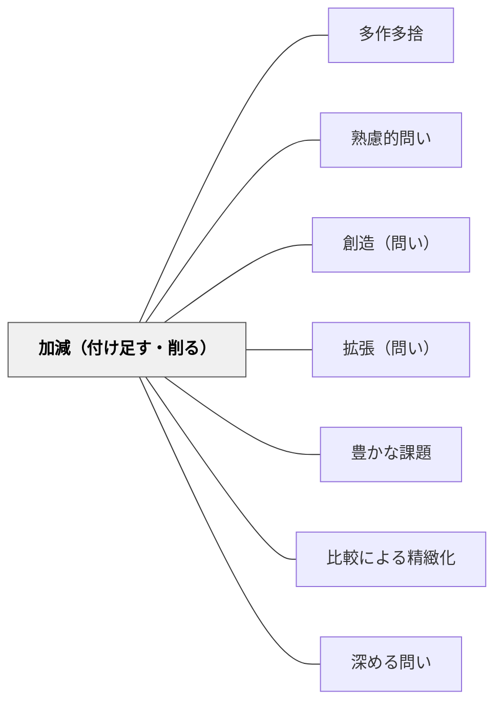

# 加減（付け足す・削る）

**このパタンが完成を助ける大きなパタン**：[[パタン/熟慮的問い]]

> 要素の追加・除去を問うことで、問題の本質と不要な要素を見極める。

## 背景（Context）
複雑に見える問題や概念も、要素を足したり引いたりすることで理解が大きく変わることがある。「何が必要不可欠で、何は取り除いても成り立つか」を問う視点は、本質の抽出や創造的な問題解決に直結する。デザイン・科学・哲学など多様な分野に応用できる思考の型である。

**岩井の講話では**：加減を「なんか付け足せないかなとか削れないかなとか」と問うことだと説明し、使う場面として「作ってる時」を挙げ、作文でも絵でもよいが「なんか足りないな」「なんか付け足せないかな」と考えるときの問いだと述べている（講話 19:14〜19:31）。講話では、加減は理解のための問いである以前に、ものを作る途中で作り手が自分に向ける問いとして語られている。

**原典では**：土居（2026）は「加減」という語を使わず、「付け足す」問いも扱っていない。ただし「削る」側にあたる問いは、くり返し出てくる。説明文の授業で、7段落だけがテレビではなく新聞の話になっていることに子どもが気づいたところで、「この段落はなくてもいいよね。」と投げかけると、はじめは「なくてもいいかも」と言う子もいたが、やがて「テレビだけでなく新聞など色々なものでアップとルーズが使われていることを筆者は伝えたいんだと思う。だからこの段落は重要。」と段落の意義に気づく子が出てきた、という実践である（第2章9「ゆさぶる」、Kindle版 75/204頁表示）。原典はこれを「加減」ではなく「ゆさぶり発問」として分類している。物語でも、中心人物が出てこない最終場面について「この場面いらないよね。何で書いたのだろう。」と問い、場面があるからこそ悲しさが際立つことをつかむ例を挙げている（第2章14、Kindle版 93/204）。

原典はあわせて、この問いが唐突だと機能しないとも書く。子どもにとってその段落が一見必要ないように見えていなければ「この段落は、いらないよね。」という発想にならないので、それまでの段落との違いに先に気づく文脈づくりが要る（第1章6、Kindle版 31/204）。さらに、教師が「どちらがいい」型の問いを重ねてきた学級では、子どもの方から「この段落はなくてもいいんじゃないかな。なくても意味が通るから。」という問いが出たという、桂聖の授業の参観記録も紹介している（第4章9、Kindle版 161/204）。削る問いは、教師が出し続けるうちに子どもの問いの視点として移っていくものとして描かれている。

## 問題（Problem）
学習者は与えられた問題や状況をそのままの形で受け取り、要素の変更を試みないことが多い。「もし〇〇がなかったら」「〇〇を加えたらどうなるか」という変更実験を行わないため、本質的な要素と付随的な要素の区別ができない。

## 力のかたち（Forces）
- 要素の除去は「最低限何が必要か」という本質を炙り出す
- 要素の追加は「何があればより良くなるか」という改善思考を生む
- 加減の実験が思考の自由度を広げ、固定観念を打ち破る
- 要素の変化に対する感受性が、構造理解の深さを示す

## 解決（Solution）
**近いパタンとの見分け**：問いの型の表では、本パタンの見分けの問いは「何を足し、何を削れば本質が見えるかを問うているか」。全体の表は [[パタン/熟慮的問い#近いパタンとの見分け|熟慮的問い]] にある。

「この問題から何か取り除いても成り立つか？何かを付け足すとどうなるか？」と問いかける。例えば「この文章から一文を削ると意味が変わるか？」「この実験に新しい変数を加えたら？」と具体的に誘導する。「最もシンプルな形はどれか？」という問いと組み合わせると、経済性の原理（オッカムの剃刀）的な思考も育つ。

---

**例：「この段落、なくてもいいよね？」で段落の役割を考える**（国語・4年「アップとルーズで伝える」など、事例の種類が途中で変わる説明文）
1. 段落ごとに「何について書いてあるか」を短く確かめ、板書に並べる（1〜6段落はテレビ、7段落は新聞、など）。
2. 子どもから「7段落だけ違う」という声が出るのを待つ。出なければ「並べてみて、何か気づくことはある？」と聞く。
3. 「今まではずっとテレビのことなのに、ここだけ新聞。じゃあ、この段落はなくてもいいよね？」と投げかける。
4. 「なくてもいい」「ないと困る」に分かれて理由を話し合い、最後に「この段落があることで、筆者の言いたいことはどう変わる？」とまとめる。
（原典 Kindle版 75、127/204 の実践をもとにした手順）

---

**例：「何か付け足せないかな」「削れないかな」で作品を見直す**（図画工作・中学年／国語・作文）
1. 作品が一通りできたところで手を止め、「なんか足りないなと思うところはある？」と自分の作品を見る時間をとる。
2. 「付け足せそうなもの」と「削れそうなもの」を一つずつ、付せんに書いて作品の横に貼る。
3. となりの人と作品を見せ合い、相手の付せんについて「それを足すと（削ると）、どう変わりそう？」と聞き合う。
4. 実際に足すか削るかは本人が決め、変えたところと変えなかったわけを一行で書く。
（講話 19:14〜19:31 の「作ってる時」の問いを授業に移した Wiki 側の手順）

## 結果（Consequences）
- 問題・概念・構造の本質的要素が明確になる
- 変更実験の習慣が、探究的・創造的思考力を育てる
- 「最小限の要素で最大の効果」という効率的思考が養われる

- 注意点：「なくてもいいよね？」は、子どもにとってその部分が一見いらないように見える文脈があって初めて働く（土居 2026）。それまでの部分との違いを確かめる前に投げかけると、子どもは「なぜ今それを考えるのか」がわからない。

## 関連パタン
- [[パタン/多作多捨]]
- [[パタン/熟慮的問い]] — 親パタン
- [[パタン/創造（問い）]] — 新しいものを付け足す創造的問い
- [[パタン/拡張（問い）]] — 加える方向への展開

- [[パタン/豊かな課題]] — 付け足す・削るの問いが豊かな探究課題を生む
- [[パタン/比較による精緻化]] — 加減による比較が概念の精緻化を促す
- [[パタン/深める問い]] — 加減の問いが思考を深める

## クラスター図

## Actionable Insight

- 「この文章から一文を削ると意味が変わるか？」と問いかける——要素の除去が「最低限何が必要か」という本質を炙り出す
- 「この実験に新しい変数を加えたら？」と問う——要素の追加が「何があればより良くなるか」という改善思考を生む
- 「この問題の最もシンプルな形はどれか？」と問う——経済性の原理的な思考が問題の本質的要素の理解を深める

## 出典
- [[文献/熟慮的問いのパターンリスト（動画記録）]]

- 土居正博（2026）『自分で考え、学べる子を育てる！ 発問の技術』学陽書房（初版・電子書籍版） — 第1章「『整理』② 発問までの自然な流れをつくる」「発問をなくしていく」、第2章「発問自体への工夫④ ゆさぶる」「『整理』への工夫② 論理的な学びの文脈をつくる」、第3章「学びの文脈をつくる」、第4章「発問をなくしていく」。頁は Kindle 版の表示（204頁中）
- 岩井輝久（年不明）『熟慮的問いのパターンリスト』［動画］ https://youtu.be/WivskVtxG34 — 2026-11-13 に文字起こしで確認（19:14〜19:31）
