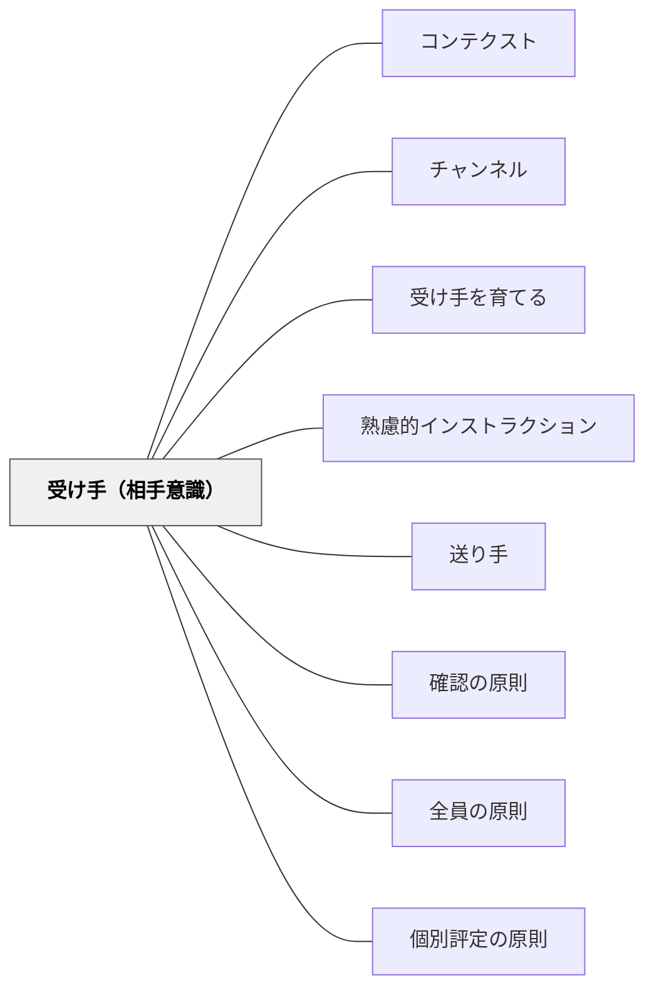

# 受け手（相手意識）

**このパタンが完成を助ける大きなパタン**：[[パタン/熟慮的インストラクション]]

> 受け手はアクティブに行動する責任ある参加者である。

## 背景（Context）
インストラクションは送り手から一方的に届けられるものと思われがちだが、受け手なしには成立しない。受け手がインストラクションを理解し、行動に移して初めてシステムは完成する。送り手が受け手を常に意識することが、インストラクション設計の核心にある。

## 問題（Problem）
受け手を「命令に従う人」「受け身で処理するだけの人」と捉えると、インストラクションは一方通行になり、伝わったかどうかの確認がなくなる。受け手が理解できなかったとき、誰も責任を取らないまま動きが止まる。

## 力のかたち（Forces）
- 受け手は理解したかどうかを送り手に伝える責任を持つ
- 送り手は受け手の知識・経験・状況に合わせて内容を設計する必要がある
- 受け手を主体的参加者として扱うことで、理解の質が上がる
- 受け手の多様性（知識量・文化的背景・処理速度）は常に存在する

## 解決（Solution）
**受け手を「インストラクションの能動的な参加者」として位置づけ、送り手は常に受け手の視点に立って内容・チャンネル・コンテクストを設計する。**

**近いパタンとの見分け**：指示・説明の表では、本パタンの見分けの問いは「受け手を、指示を待つ人ではなく、確かめ・聞き返す責任をもつ参加者として見ているか」。全体の表は [[パタン/熟慮的インストラクション#近いパタンとの見分け|熟慮的インストラクション]] にある。

受け手が理解できているかを確認する仕組みをインストラクションに組み込む。「わからなかったら聞いてよい」ではなく、「理解したかどうかを確認するステップ」として双方向のやり取りを設計する。受け手を「あなた」として具体的にイメージしながら設計する。

> **研究の裏づけ（2026-10-31）**：『How People Learn』（2000）は、2つの学校の4年生がメールで結んだ書く学習を紹介する。自分たちで描いた怪物の絵を、見たことのない相手が描き直せるほど詳しく文章で説明して送る。相手の学級がその文章から描いた絵を送り返すと、書き手は自分の説明のどこがあいまいだったかに気づく（「口が閉じていると書けばよかった」など）。同じことを、モンドリアンなどの抽象画、自画像でもくり返した（pp. 222–223、囲み9.6）。教室の中なら身ぶりで補えることも、離れた読み手には文章だけで伝えなければならない。描き直された絵が、文章の完全さと明確さについての目に見えるフィードバックになった。出典：[[文献/人の学び方の研究を授業の設計につなぐ（全米研究評議会2000）]]。

## 結果（Consequences）
- 受け手が主体的にインストラクションに関わるようになる
- 送り手は一方的な伝達で満足せず、受け手の反応を確認するようになる
- インストラクションの双方向性が高まり、失敗の早期発見につながる

## クラスター図

## Actionable Insight

- 指示の後に「最初に何をしますか？」と一問確認する——双方向のチェックが受け手の理解の状態を送り手に伝える唯一の手段になる
- 指示を設計するとき「特定の一人の学習者（例えばAさん）がこれを受け取ったら理解できるか？」と想像する——具体的な相手のイメージが指示の精度を高める
- 「分からなかったら聞いて」ではなく「ここまで分かりましたか？」という確認ステップを指示に組み込む——受け手が主体的に関与できる仕組みがインストラクションの双方向性を生む

## 出典

- 一つの教育のパタン・ランゲージ（岩井輝久）

## 関連パタン
- [[実践/文学討論グループの設計]]
- [[パタン/コンテクスト]]
- [[パタン/チャンネル]]
- [[パタン/受け手を育てる]]
- [[パタン/熟慮的インストラクション]] — 親パタン
- [[パタン/送り手]] — 受け手と対になる要素
- [[パタン/確認の原則]] — 受け手の理解を確認する実践
- [[パタン/全員の原則]] — すべての受け手に届けることを意識する
- [[パタン/個別評定の原則]] — 個別の受け手へのフィードバック
- [[文献/人の学び方の研究を授業の設計につなぐ（全米研究評議会2000）]] — 離れた学級が文章から絵を描き直し、書き手があいまいさに気づく（囲み9.6）
