# 問題の系列が足場を担う（一変数変化の連鎖）

**このパタンが完成を助ける大きなパタン**：[[パタン/熟慮的配列]]

> 前の問題が次の問題の解説になる。そう設計できれば、外から足場を加える必要はない。

## 背景（Context）

外部足場を増やすほど授業は「手厚く」見える。線分図の枠を印刷したワークシート、穴埋め式の解答欄、問題ごとに添えられた解説コメント——支援の手応えは確かで、子どもはその時間に「できた」と感じる。しかし定期テストや翌週の授業で足場を外した途端、同型の問題が解けなくなる。

戸田城外（1930）『推理式指導算術』は、この構造に正反対の答えを出した。全3冊・合計600問以上にわたって、解説ゼロ、ヒントは「基本原形と比較せよ」の指さしのみ。解説を書かない理由は「書く必要がないように問題を並べた」からだと、桝田尚之（2006）は読み解く——「配列そのもの——次の問題が前の問題の解説を兼ねている」。

外部足場の肥大化は「今すぐ解かせたい」という動機から生まれる。問題の系列設計は「問題を解く経験の中に足場を埋め込む」という設計の転換を要求する。

> **研究の裏づけ（2026-10-31）**：日独米の数学の授業をビデオで比べた研究（Stigler ほか 1999、中学2年生）では、日本の生徒は座って取り組む時間の多くを、1つの場面に複数の課題が向けられる形で過ごし、1時間の中で応用問題がだんだん複雑になる話題の割合は日本45.7％・ドイツ17.5％だった（アメリカ32.1％）。例として報告書が詳しく描く日本の授業（JP-012）は、「平行線の間の三角形は面積が等しい」を確かめたあと、曲がった土地の境界を面積を変えずにまっすぐにする問題、次に四角形を面積を変えずに三角形にする問題と進む。数学者のグループは、後の問題が前の問題より複雑で、前の解き方が後の問題に役立つ、と符号化した。出典：[[文献/日独米の数学の授業をビデオで比べる（Stiglerほか1999）]]。

> **研究の裏づけ（2026-10-31）**：ただし『How People Learn』（2000）は、練習問題がどの章のものかを手がかりに解ける場合や、きっちり並んだ練習プリントでは、子どもは「いつこの知識を使うか」を学ばないまま、学んだと思い込みやすいと注意する。全範囲から問題がばらばらに出るテストで、それが表に出る（p. 43, pp. 59–60）。また、同じ解き方で解ける問題を5問続けた群は、もっと簡単な解き方がある問題でもその解き方を使い続けた（子ども72％・大人74％。続けなかった群はほとんどが簡単な解き方を使った）（pp. 54–55、Luchins の水がめ問題）。系列で解き方を積み上げたあとに、どの考え方を使う問題かを子どもが選ぶ場面を別に置くとよい。出典：[[文献/人の学び方の研究を授業の設計につなぐ（全米研究評議会2000）]]。

## 問題（Problem）

外部足場（解説・ヒントカード・線分図の枠・穴埋めワークシート）を増やすほど、学習者は足場に依存する。足場を外した途端に解けなくなるのは怠惰ではない——足場が「あって当然」の環境で解く練習しかしていないからである。

この依存の構造は、増やすほど深まる。丁寧にしようとするほど自立を遠ざけるという、教師の善意の逆説がここにある。

## 力のかたち（Forces）

- **「今すぐ解けさせたい」vs「自分で解く力をつけたい」**：次の授業の正答率と3ヶ月後の保持は逆向きになりやすい
- **丁寧さ vs 自立**：丁寧な足場は「今この場」では子どもを助ける。しかし足場のない状況への転移を妨げる
- **設計コスト vs 指導コスト**：問題の系列を精緻に設計するには事前の教材研究がかかる。しかし一度設計すれば授業中のヒントが最小になる
- **順序の統制 vs 発見の余白**：系列を厳密にすると子どもの問いに応答しにくくなる。完全に整った系列が常に正解とは限らない

## 解決（Solution）

**問題を「一度に一箇所だけ変わる系列」として設計する。前の問題が次の問題の足場になり、外部足場なしに難度が上がれる。**

**近いパタンとの見分け**：配列・順序の表では、本パタンの見分けの問いは「問題を一度に一か所だけ変わる列にして、前の問題が次の問題の足場になっているか」。全体の表は [[パタン/熟慮的配列#近いパタンとの見分け|熟慮的配列]] にある。

設計の原則は4つ。

**原則1：基本原形を置く**

系列の冒頭に「暗算で解けるほど容易」な問題を1問置く。戸田はこれを「基本原形」と呼んだ。基本原形は全系列の足場の土台である——ここが難しいと系列全体が崩れる。子どもが「これは分かる」と感じる出発点から始める。

**原則2：一度に一箇所だけ変える**

各問題で変化させる要素を1つに絞る。変化させる候補は：
- 数値（整数 → 小数 → 分数）
- 未知数の位置（□＋3＝7 → 3＋□＝7 → □＋□＝7）
- 場面（買い物 → 速さ → 割合）
- 条件の数（1条件 → 2条件 → 3条件）

1問で2つ以上を同時に変えると、学習者は「何が変わったのか」を判断できず、比較による自得が起きない。

**原則3：段階的に配列を外す**

戸田は全3冊でこの移行を実現した。
- 『その一』：難易度順に整列（配列が明示的な足場になっている）
- 『その二』：少し変動する（配列への依存を減らす）
- 『その三』：必ずしも難易度順でない（配列という足場自体が外れている）

系列設計は「教材の配列」という足場を段階的に外す設計でもある。

**原則4：外部足場を最初から必要としない設計**

系列が機能すれば、ヒントは「前の問題と比べよ」の指さしで足りる。解説を書かなくて済む。もし第3層（解説・worked example）が必要な問題が頻発するなら、それは基本原形か一変数の原則に問題がある——問題の系列に戻って再設計するサインである。

---

**算数の具体例1：「÷分数」の系列設計（一変数変化の連鎖）**

基本原形から始め、一度に一箇所だけ変えて系列を組む。

```
① 12 ÷ 4 ＝               ← 基本原形。整数÷整数
② 12 ÷ 2 ＝
③ 12 ÷ 1 ＝
④ 12 ÷ 1/2 ＝             ← 除数が「整数→1/2」。①③と比べると関係が見える
⑤ 12 ÷ 1/3 ＝
⑥ 12 ÷ 1/4 ＝
⑦ 6 ÷ 1/2 ＝              ← 被除数が変わる
⑧ 6 ÷ 2/3 ＝              ← 分子が1でない分数へ
```

子どもは③④を並べて「÷1と÷1/2で答えが倍になった」と気づく。教師の解説は不要——前の問題が解説を兼ねている。

---

**算数の具体例2：「速さ」の場面設計（未知数の位置を変える）**

```
① 時速4kmで3時間歩くと、何km進む？       ← 距離が未知
② 時速4kmで何時間歩くと、12km進む？      ← 時間が未知
③ 何kmで3時間歩くと、12km進む？          ← 速さが未知
④ 時速4kmで3時間歩いたとき、12kmは正しい？  ← 検証型
```

同じ数値・同じ場面で未知数の位置だけを変える。「どれが分かっていて、どれが分からないのか」を判断する力が、比較によって育つ。

> **研究の裏づけ（2026-10-31）**：中学1年生126人の教室で3か月かけた実験（Rohrer ほか 2015）は、その日に習った方略の問題が並んだ練習では、子どもは問題を読む前に方略が分かってしまい、「どの方略を使うか」を選ぶ練習にならないと指摘する（早期公開版 pp. 1–2）。同じ問題を、習った日に4問、残りを後の宿題に1問ずつ散らすと、30日後のテストの点が高かった（74% 対 42%）（p. 6）。本パタンの系列は、方略を一つずつ積み上げ、前の問題を次の足場にする。その後に、系列で学んだ問題を別の単元の問題とまぜて出す段を置くと、選ぶ力も練習できる。系列とまぜる練習の組み合わせ方そのものは、この研究では比べていない。出典：[[文献/練習問題をまぜると算数の学びが残る（Rohrerほか2015）]]。

---

**算数の具体例3：BTC の1時間を「既知の段＋最後の一段」で組む（5年「分数のたし算とひき算」の実践から）**

```
① 0.2 ＋ 0.5 ＝             ← 小数どうし（既知）
② 2/10 ＋ 5/10 ＝           ← 同じ分母の分数（既知）。①と同じ大きさ
③ 2/5 ＋ 0.3 ＝             ← 分数と小数がまじる。どちらにそろえてもよい
④ 2/3 ＋ 0.5 ＝             ← 2/3 は小数に直しきれない。分数にそろえるしかない
```

①〜③は一箇所ずつ変わる系列だが、④は「どちらにそろえてもよい」という③までの関係そのものを変える。最後の一段は一変数の変化ではなく、**前の段で使った考えの限界に出会う問題**として置かれている。子どもはここで詰まり、③までの考えに戻るヒントで解決した。同じ単元の他の時間でも、最後の一段（3/4＝□/12、1/2＋1/3、40秒は何分か）で同じ形がくり返された（[[パタン/既知から未知へ]] の実践の記録）。系列の最後に「前の考えが通じない一問」を置くことは、原則2（一度に一箇所だけ変える）の外側にある、もう一つの設計の手と読める（本Wikiの読み・一つの単元の観察）。

**「既知の段→最後の一段」と「既知から未知へ」のちがい**

「既知の段→最後の一段」は、[[パタン/既知から未知へ]] を1時間の問題の並べ方に当てはめたときの、一つの具体的な形である（本Wikiの名づけで、確立した用語ではない）。

- **既知から未知へ**は、新しいことを、子どもがすでに知っていることにつなげて入る、という**方向の原則**である。単元全体の順序にも、1時間の流れにも使える。ただし、どこで新しいことに出会うかまでは決めていない。「既習を確かめる → 新しいやり方を教える → 少しずつ難しい問題で練習する」という流れも、既知から未知へに入る。
- **既知の段→最後の一段**は、その方向の中で、**未知との出会いをどこに置くか**を決める並べ方である。前半の問題（既知の段）は前に学んだことで解けるように並べ、子どもが「こうすればいい」という見通しを持てるようにする。最後の1〜2問（最後の一段）では、その見通しがそのままでは通じなくなる。新しい考えには、教わってからではなく、この最後の一段で自分で出会う。

| 問題 | 役割 | 子どもに起きること |
| --- | --- | --- |
| ① 0.2＋0.5 | 既知の段 | 小数のたし算。すぐ解ける |
| ② 2/10＋5/10 | 既知の段 | 同じ分母の分数。①と同じ大きさだと気づける |
| ③ 2/5＋0.3 | 既知の段 | 小数にそろえても分数にそろえても解ける。「どちらかにそろえればよい」という見通しができる |
| ④ 2/3＋0.5 | **最後の一段** | 2/3 は小数に直しきれない。③までの「どちらでもよい」が通じず、「分数にそろえるしかない場合がある」に出会う |

**ふつうの易→難の並びとのちがい**は、最後の問題の作り方にある。易→難の並びの最後は「同じやり方で解ける、少し難しい問題」だが、この並べ方の最後は「同じやり方では解けない問題」である。[[文献/練習問題の並びを一つのまとまりとして設計すると、変わるところと変わらないところから一般化が生まれるかを、教師たちの反応から考える（WatsonとMason2006）|Watson と Mason（2006）]] のタクシー幾何の練習問題も同じ形で、それまで一直線に並んでいた点が7つめの点 (0, 0) で一直線からはずれ、そこで多くの人が「なぜ？」と考え始めた。

**使うときのコツ**（5年「分数のたし算とひき算」の4つの時間から）：

1. 既知の段では、一度に一か所だけ変える（原則2）。子どもが見通しを持てるようにする。
2. 最後の一段は、見通しの限界に出会う問題にする。数を大きくするだけにしない。
3. 詰まったときに戻る先（どの問題の、どの考えか）を、先に決めておく。ヒントは答えを渡さず、その戻り先を指さす（[[パタン/解説を先に渡さない（自得の設計）]]）。

これらは一つの単元の観察と、理論の論文（Watson と Mason 2006、Sun 2013）からの読みで、効くと確かめられた規則ではない。

### 研究の裏づけ

> **研究の裏づけ（2026-11-04）**：一つずつ変える設計には、変化の理論からの補いがある。気づかせたい面を変わらない背景の上で変える「対比」と「一般化」は一変数の変化と重なるが、理解には、いくつかの面を同時に変えてその関係をつかむ「融合」の段階も要る。理論は「一度に一つずつ教える」という当たり前を問い直すものとして紹介されている（pp. 560–561）。スウェーデンの中学校の教師10人は、変化の理論を学んだあと、概念を一度に一つではなく、ほかの概念との関係の中で教えるようになった（p. 563）。子どもの学びは測っていない。出典：[[文献/何を変え、何を変えずに見せるかで、学べることが変わるかを確かめる（Kullbergほか2017）]]。

> **研究の裏づけ（2026-11-11）**：（教科書の分析・根拠は弱い）中国の算数の教科書は、問題を少しずつ変えて並べる「変式」を日常的に使う。中国の1年生のたし算・ひき算では、1＋2＝3 の場面からそのまま 3−1＝2 を出すように、「部分と部分と全体」という**変わらない関係を保ったまま**、場面・数の範囲・解き方を変えて並べる。著者は、方法ごとに例を並べて互いにつなげないポルトガルの教科書の設計を「一度に一つずつ」の原理とみて、知識がばらばらになりやすいと述べる（pp. 6–13）。本パタンの「一度に一箇所だけ変える」は、変わらない芯を保ったうえで変える点で変式と重なるが、何を変えずに見せるかを先に決めることが要る、という読みができる。著者は、方法の使いどころを知るには「その方法では解けない問題と並べる必要がある」とも書く（p. 12）。これは具体例3の「最後の一段」と同じ向きである。効果を測った研究ではなく、香港の実験は紹介だけ。出典：[[文献/中国の教科書は、変わらない関係を保ったまま問題を少しずつ変えて並べるかを、たし算・ひき算の単元で読む（Sun2013）]]。

> **研究の裏づけ（2026-11-11）**：（理論の論文・根拠は弱い）練習問題の並びを「一つのまとまり」として設計する考え方がある。タクシー幾何の練習問題では、基準の点を固定し、最初の点で距離3を固定して、整数の座標から分数の座標へ広げ、7つめの点 (0, 0) で、それまでの「一直線に並ぶ」という予想がくずれる。約200人（多くは教師）の反応では、この点で驚きが生まれ、多くの人が「A から距離3の点の集まり」という一般化にたどりついた。著者らは「すべてが変わると、何も見分けられないかもしれない」と書き、ほかを比較的変えずに一つの変化を前に出すことを勧める。終わり近くに型をくずす一問を置く設計は、本パタンの具体例3の「最後の一段」と同じ形である。比べる組のない理論の論文で、著者ら自身が効果の確認にはさらに実験が要るとする。出典：[[文献/練習問題の並びを一つのまとまりとして設計すると、変わるところと変わらないところから一般化が生まれるかを、教師たちの反応から考える（WatsonとMason2006）]]。

## 結果（Consequences）

**利点**

- 外部足場への依存が生まれない——「系列を進む」こと自体が学習者の力を育てる
- ヒントが最小になる——「前の問題と何が違う？」の一言で子どもが動き始める
- 第3層（解説・worked example）が必要な場面が頻発したとき、それは系列設計の改善サインとして機能する。「なぜここで詰まるか」の診断ができる
- 教材ストックが蓄積すると授業の準備コストが下がる。一度設計した良い系列は何度でも使える

**注意点・リスク**

- 基本原形の設計が難しい——易しすぎると挑戦が生まれず、難しすぎると系列全体が崩れる
- 一変数に絞るコストがある——特に単元の中盤以降、複数の変化を組み合わせた問題へ移行するタイミングを見極める必要がある
- 系列通りに進めることへの固執は禁物——子どもの問い・つまずきが系列の外に出ることがある。そのときは系列を離れて応答する柔軟さが要る
- 配列が崩れると比較が成立しない——問題の順序を子どもが自由に変える場面では系列のメカニズムが機能しなくなる

## 関連パタン

- [[実践/分数のたし算とひき算を、既知の段から最後の一段へ並べて学ぶ（5年）]] — 既知の段→最後の一段の並びを4つの時間でくり返した5年の分数単元
- [[文献/練習問題の並びを一つのまとまりとして設計すると、変わるところと変わらないところから一般化が生まれるかを、教師たちの反応から考える（WatsonとMason2006）]] — 練習問題の並びを一つのまとまりとして設計する。終わり近くに型をくずす一問
- [[文献/中国の教科書は、変わらない関係を保ったまま問題を少しずつ変えて並べるかを、たし算・ひき算の単元で読む（Sun2013）]] — 変わらない関係を保って問題を変える変式。「一度に一つずつ」との対比
- [[パタン/算数シンキング・タスク]] — BTC の1時間を、既知の段と「前の考えが通じない最後の一段」で組む
- [[パタン/既知から未知へ]] — 系列の上位の原則。5年・分数の単元で、どの時間も最後の一段で詰まり、既知に戻すヒントが効いた
- [[文献/日独米の数学の授業をビデオで比べる（Stiglerほか1999）]] — 日本の授業で、同じ原理を使う問題がだんだん複雑になる並べ方のデータと実例
- [[パタン/解説を先に渡さない（自得の設計）]] — 系列設計（本パタン）と、ヒントを渡す際の設計（自得の設計）は相補的——系列が機能すれば解説も最小で済む
- [[パタン/熟慮的配列]] — 易→難の配列原則（上位）と、一変数変化の連鎖（具体的メカニズム）。本パタンは熟慮的配列の「難易度次元」を算数問題設計に具体化した実装
- [[メタパタン/足場は消えるために組む（フェードアウト）]] — 外部足場を「外す時間設計」（フェードアウト）と「最初から最小化する問題設計」（本パタン）の分業
- [[パタン/比較で概念をつくる（事例ペアの設計）]] — 比較を「問題ペアで設計する」という共通点。比較軸の数を1に絞る点で一致。本パタンは系列全体の比較、事例ペアの設計は2事例の比較
- [[パタン/待ち時間（問いのあとの3秒）]] — 系列設計があって初めて「前の問題と比べよ」の問いが活きる。待つ姿勢は系列設計が前提になって機能する
- [[パタン/変化オペレータの系列設計（喜びのグレードアップ）]] — 一変数に絞る設計（本パタン）と、何をどの種別で変えるか設計する（変化オペレータ）の分業。両パタンを組み合わせて使う
- [[パタン/同等点と差異点の均衡設計（学習の駆動エンジン）]] — 一変数だけ変える設計は、同等点を保ちながら差異点を最小化する均衡設計の具体的実装。本パタンは「7〜8割同等点」という均衡を系列全体で実現する仕組み
- [[パタン/つまずきを構造で記録する（診断の粒度設計）]] — 一変数に絞った系列の設計（本パタン）と、どの変数で詰まったかを種別ごとに記録する設計（診断の粒度設計）は相補的——記録データが次の系列設計の修正根拠になる
- [[パタン/補充機構の常設化（匡救設計）]] — 補充系列の設計は本パタンの原則（一変数変化の連鎖・基本原形から始める）で作る。弱い種別に特化した短い系列が補充の精度を決める
- [[パタン/型から自由創作へ（閉じた練習の開口部）]] — 同じ系列設計クラスター。本パタンが型習得の「内部構造」を設計するのに対し、型から自由創作へはその末尾をどう開くかを設計する
- [[文献/Developing Effective Fractions Instruction（Siegler et al., 2010）]] — 比例の解き方を、前の方法では手間がかかる問題の系列で積み上げ→単位あたり→たすき掛けと移す（勧め4）
- [[パタン/専門家のやり方と初学者の学び方を分ける（研究の方法は学びの方法ではない）]] — 外からの指導を問題の並びで行う形。自由な探索とは違う
- [[文献/Why Minimal Guidance During Instruction Does Not Work（Kirschner, Sweller & Clark, 2006）]] — 外からの指導の必要を論じた論争の書
- [[パタン/練習の条件を変える（いつも同じ形で練習しない）]] — 練習の条件を一度に一つずつ変える並べ方
- [[文献/人の学び方の研究を授業の設計につなぐ（全米研究評議会2000）]] — 章の順に並んだ練習の弱点と、同じ解き方の続けすぎ（水がめ問題）
- [[文献/練習問題をまぜると算数の学びが残る（Rohrerほか2015）]] — 系列で積み上げたあと、後の練習にまぜて「どの方略か」を選ぶ場面をつくる
- [[文献/何を変え、何を変えずに見せるかで、学べることが変わるかを確かめる（Kullbergほか2017）]] — 対比・一般化のあとに、いくつかを同時に変える融合の段階を置く変化の理論

## クラスター図

```mermaid
flowchart LR
    ne5958fe9a18ce381aee7b3bbe58897e3818ce8b6b3e5a0b4e38292e68b85e38186efbc88e4b880e5a489e695b0e5a489e58c96e381aee980a3e98e96efbc89["問題の系列が足場を担う（一変数変化の連鎖）"]
    ne7ae97e695b0e382b7e383b3e382ade383b3e382b0e383bbe382bfe382b9e382af["算数シンキング・タスク"]
    ne697a2e79fa5e3818be38289e69caae79fa5e381b8["既知から未知へ"]
    ne8a7a3e8aaace38292e58588e381abe6b8a1e38195e381aae38184efbc88e887aae5be97e381aee8a8ade8a888efbc89["解説を先に渡さない（自得の設計）"]
    ne7869fe685aee79a84e9858de58897["熟慮的配列"]
    ne6af94e8bc83e381a7e6a682e5bfb5e38292e381a4e3818fe3828befbc88e4ba8be4be8be3839ae382a2e381aee8a8ade8a888efbc89["比較で概念をつくる（事例ペアの設計）"]
    ne5be85e381a1e69982e99693efbc88e5958fe38184e381aee38182e381a8e381ae33e7a792efbc89["待ち時間（問いのあとの3秒）"]
    ne5a489e58c96e382aae3839ae383ace383bce382bfe381aee7b3bbe58897e8a8ade8a888efbc88e5969ce381b3e381aee382b0e383ace383bce38389e382a2e38383e38397efbc89["変化オペレータの系列設計（喜びのグレードアップ）"]
    ne5908ce7ad89e782b9e381a8e5b7aee795b0e782b9e381aee59d87e8a1a1e8a8ade8a888efbc88e5ada6e7bf92e381aee9a786e58b95e382a8e383b3e382b8e383b3efbc89["同等点と差異点の均衡設計（学習の駆動エンジン）"]
    ne381a4e381bee3819ae3818de38292e6a78be980a0e381a7e8a898e98cb2e38199e3828befbc88e8a8bae696ade381aee7b292e5baa6e8a8ade8a888efbc89["つまずきを構造で記録する（診断の粒度設計）"]
    ne8a39ce58585e6a99fe6a78be381aee5b8b8e8a8ade58c96efbc88e58ca1e69591e8a8ade8a888efbc89["補充機構の常設化（匡救設計）"]
    ne59e8be3818be38289e887aae794b1e589b5e4bd9ce381b8efbc88e99689e38198e3819fe7b7b4e7bf92e381aee9968be58fa3e983a8efbc89["型から自由創作へ（閉じた練習の開口部）"]
    ne5b082e99680e5aeb6e381aee38284e3828ae696b9e381a8e5889de5ada6e88085e381aee5ada6e381b3e696b9e38292e58886e38191e3828befbc88e7a094e7a9b6e381aee696b9e6b395e381afe5ada6e381b3e381aee696b9e6b395e381a7e381afe381aae38184efbc89["専門家のやり方と初学者の学び方を分ける（研究の方法は学びの方法ではない）"]
    ne7b7b4e7bf92e381aee69da1e4bbb6e38292e5a489e38188e3828befbc88e38184e381a4e38282e5908ce38198e5bda2e381a7e7b7b4e7bf92e38197e381aae38184efbc89["練習の条件を変える（いつも同じ形で練習しない）"]

    ne5958fe9a18ce381aee7b3bbe58897e3818ce8b6b3e5a0b4e38292e68b85e38186efbc88e4b880e5a489e695b0e5a489e58c96e381aee980a3e98e96efbc89 --- ne7ae97e695b0e382b7e383b3e382ade383b3e382b0e383bbe382bfe382b9e382af
    ne5958fe9a18ce381aee7b3bbe58897e3818ce8b6b3e5a0b4e38292e68b85e38186efbc88e4b880e5a489e695b0e5a489e58c96e381aee980a3e98e96efbc89 --- ne697a2e79fa5e3818be38289e69caae79fa5e381b8
    ne5958fe9a18ce381aee7b3bbe58897e3818ce8b6b3e5a0b4e38292e68b85e38186efbc88e4b880e5a489e695b0e5a489e58c96e381aee980a3e98e96efbc89 --- ne8a7a3e8aaace38292e58588e381abe6b8a1e38195e381aae38184efbc88e887aae5be97e381aee8a8ade8a888efbc89
    ne5958fe9a18ce381aee7b3bbe58897e3818ce8b6b3e5a0b4e38292e68b85e38186efbc88e4b880e5a489e695b0e5a489e58c96e381aee980a3e98e96efbc89 --- ne7869fe685aee79a84e9858de58897
    ne5958fe9a18ce381aee7b3bbe58897e3818ce8b6b3e5a0b4e38292e68b85e38186efbc88e4b880e5a489e695b0e5a489e58c96e381aee980a3e98e96efbc89 --- ne6af94e8bc83e381a7e6a682e5bfb5e38292e381a4e3818fe3828befbc88e4ba8be4be8be3839ae382a2e381aee8a8ade8a888efbc89
    ne5958fe9a18ce381aee7b3bbe58897e3818ce8b6b3e5a0b4e38292e68b85e38186efbc88e4b880e5a489e695b0e5a489e58c96e381aee980a3e98e96efbc89 --- ne5be85e381a1e69982e99693efbc88e5958fe38184e381aee38182e381a8e381ae33e7a792efbc89
    ne5958fe9a18ce381aee7b3bbe58897e3818ce8b6b3e5a0b4e38292e68b85e38186efbc88e4b880e5a489e695b0e5a489e58c96e381aee980a3e98e96efbc89 --- ne5a489e58c96e382aae3839ae383ace383bce382bfe381aee7b3bbe58897e8a8ade8a888efbc88e5969ce381b3e381aee382b0e383ace383bce38389e382a2e38383e38397efbc89
    ne5958fe9a18ce381aee7b3bbe58897e3818ce8b6b3e5a0b4e38292e68b85e38186efbc88e4b880e5a489e695b0e5a489e58c96e381aee980a3e98e96efbc89 --- ne5908ce7ad89e782b9e381a8e5b7aee795b0e782b9e381aee59d87e8a1a1e8a8ade8a888efbc88e5ada6e7bf92e381aee9a786e58b95e382a8e383b3e382b8e383b3efbc89
    ne5958fe9a18ce381aee7b3bbe58897e3818ce8b6b3e5a0b4e38292e68b85e38186efbc88e4b880e5a489e695b0e5a489e58c96e381aee980a3e98e96efbc89 --- ne381a4e381bee3819ae3818de38292e6a78be980a0e381a7e8a898e98cb2e38199e3828befbc88e8a8bae696ade381aee7b292e5baa6e8a8ade8a888efbc89
    ne5958fe9a18ce381aee7b3bbe58897e3818ce8b6b3e5a0b4e38292e68b85e38186efbc88e4b880e5a489e695b0e5a489e58c96e381aee980a3e98e96efbc89 --- ne8a39ce58585e6a99fe6a78be381aee5b8b8e8a8ade58c96efbc88e58ca1e69591e8a8ade8a888efbc89
    ne5958fe9a18ce381aee7b3bbe58897e3818ce8b6b3e5a0b4e38292e68b85e38186efbc88e4b880e5a489e695b0e5a489e58c96e381aee980a3e98e96efbc89 --- ne59e8be3818be38289e887aae794b1e589b5e4bd9ce381b8efbc88e99689e38198e3819fe7b7b4e7bf92e381aee9968be58fa3e983a8efbc89
    ne5958fe9a18ce381aee7b3bbe58897e3818ce8b6b3e5a0b4e38292e68b85e38186efbc88e4b880e5a489e695b0e5a489e58c96e381aee980a3e98e96efbc89 --- ne5b082e99680e5aeb6e381aee38284e3828ae696b9e381a8e5889de5ada6e88085e381aee5ada6e381b3e696b9e38292e58886e38191e3828befbc88e7a094e7a9b6e381aee696b9e6b395e381afe5ada6e381b3e381aee696b9e6b395e381a7e381afe381aae38184efbc89
    ne5958fe9a18ce381aee7b3bbe58897e3818ce8b6b3e5a0b4e38292e68b85e38186efbc88e4b880e5a489e695b0e5a489e58c96e381aee980a3e98e96efbc89 --- ne7b7b4e7bf92e381aee69da1e4bbb6e38292e5a489e38188e3828befbc88e38184e381a4e38282e5908ce38198e5bda2e381a7e7b7b4e7bf92e38197e381aae38184efbc89

    classDef hub fill:#f0f0f0,stroke:#555,color:#000,font-weight:bold
    class ne5958fe9a18ce381aee7b3bbe58897e3818ce8b6b3e5a0b4e38292e68b85e38186efbc88e4b880e5a489e695b0e5a489e58c96e381aee980a3e98e96efbc89 hub
```



## Actionable Insight

- **次の単元の最初の問題を「暗算で解けるほど易しい」1問にする**——その問題が全系列の土台になる。難しすぎる基本原形は系列を崩す。まずここを見直す
- **教材プリントを作るとき、連続する2問で「何が1つ変わったか」を確認する**——変化が2つ以上あれば1問をキャンセルして系列を整理する。「1問で1変化」をチェックの基準にする
- **子どもが詰まった問題に第3層（解説）を渡す前に、問題の番号を指さして「1つ前と何が違う？」と1回だけ問う**——解説より先にこの一言。これで動ければ系列が機能している。動けなければ系列の設計に問題がある

## 出典

- 戸田城外（1930）『推理式指導算術』全3冊
- 桝田尚之（2006）「推理式指導の解明を中心に」『創価教育研究』第5号
