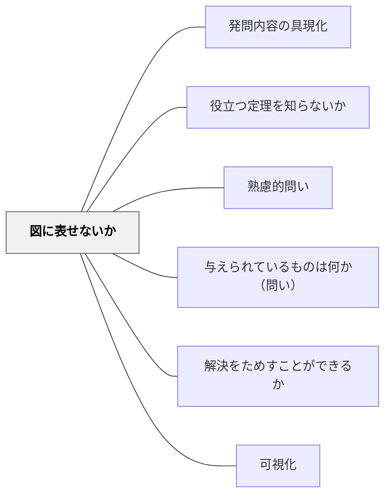

# 図に表せないか

> 問題を視覚化・図示することで、言語だけでは見えなかった構造を把握する。

## [Pattern Connection]

**研究からの補足（2026-10-18）：複数の表現を学びにつなぐ（Ainsworth2006）**

DeFTは表現の形式・操作・内容を理解する課題を分ける（公開稿pp. 4–5）。Wiki側の適用案として、図を描いた後に「この部分は問題文のどこか」「この操作は式のどこに対応するか」を一つ聞く。図を追加できたことだけで理解が進んだと判断しない。 出典：[[文献/複数の表現を学びにつなぐ（Ainsworth2006）]]。

**研究からの補足（2026-10-16）：概念理解と手続きを往復して育てる（RittleJohnsonほか2001）**

原典では小数と数直線の双方で表象を支えることが重要だった（p. 360）。Wiki側の適用案として、数直線を渡すだけで終えず、「この一区間はいくつか」「この数はどこに当たるか」を指して説明してもらう。あらゆる図示の効果を直接検証した研究ではない。 出典：[[文献/概念理解と手続きを往復して育てる（RittleJohnsonほか2001）]]。

## 背景（Context）
抽象的な問題や複雑な関係性は、言語だけで扱おうとすると思考に限界が生じやすい。人間の認知は視覚的な情報処理を得意としており、図や図式に落とし込むことで関係性や全体像が一気に明確になることがある。数学・科学だけでなく、社会問題や論理構造の把握にも有効である。

## 問題（Problem）
言語的・記号的な表現だけで考えていると、要素間の関係を見誤ったり、全体構造が把握できなかったりする。特に空間的・動態的な問題では、言語表現だけでは十分な理解が得られないことが多い。視覚化の習慣がない学習者は、頭の中だけで複雑な情報を扱おうとして処理が限界を超えてしまう。

## 力のかたち（Forces）
- 視覚化は作業記憶の負荷を下げ、思考の余裕を生む
- 図を描く行為自体が理解の確認になる
- 関係性・順序・空間的配置は図で初めて明確になることがある
- 誤った図は誤解を可視化するので、訂正の機会になる

## 解決（Solution）
「この問題を図に表してみよう。矢印や丸を使って描けないか？」と問いかける。例えば速度・距離・時間の問題なら数直線を、確率の問題なら樹形図を、論理関係ならベン図を使うよう誘導する。まず「どんな種類の図が使えるか？」を考えさせることが、図示の習慣化に繋がる。

## 結果（Consequences）
- 問題の構造が視覚的に整理され、解法への見通しが立ちやすくなる
- 視覚化を通じて誤解や見落としを早期に発見できる
- 図示を通じて他者への説明も容易になる

## 関連パタン
- [[パタン/発問内容の具現化]]
- [[パタン/役立つ定理を知らないか]]
- [[教科/算数・数学で使うパタン]]
- [[パタン/熟慮的問い]] — 親パタン
- [[パタン/与えられているものは何か（問い）]] — 整理した情報を図に落とし込む
- [[パタン/解決をためすことができるか]] — 図示が解の検証を助ける
- [[パタン/可視化]] — 情報を見える形にする全般
- [[文献/概念理解と手続きを往復して育てる（RittleJohnsonほか2001）]] — 図と数の意味の対応まで支える。
- [[文献/複数の表現を学びにつなぐ（Ainsworth2006）]] — 図を描くことに加え、図の要素が何を表すかを確かめる。

## クラスター図

## Actionable Insight

- 問題を解く前に「まずどんな簡単な図でも描いてみよう」と声かけし、2分間で紙に手描きさせる——図を描く行為が問題構造の把握と見落とし発見を同時に促す
- 数直線・ベン図・樹形図・矢印図などのサンプルを常に教室の壁に掲示しておく——「こんな図が使える」という選択肢の可視化が視覚化の習慣化を支える
- 学習者が描いた図を黒板に写して「この図から何が見える？」と問いかける——図の共有が「図は考えを整理するツール」という認識をクラスに育てる

## 出典
- [[文献/熟慮的問いのパターンリスト（動画記録）]]
- ジョージ・ポリア（1954）『いかにして問題をとくか』丸善出版
